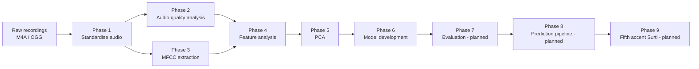

# Gujarati Accent Classifier

An audio-based machine-learning research project that investigates whether regional Gujarati speech accents can be recognised from voice recordings.

> **Status:** research prototype. Phases 1 to 4 (data preparation, audio analysis, MFCC feature extraction, feature analysis) are **completed** and have been **re-run on all five accents** after genuine Surti recordings were added. Model development has **not** started. The dataset has **five accent classes and one speaker per accent**, so all findings so far are **preliminary and exploratory**.

---

## Table of Contents

1. [Project overview](#1-project-overview)
2. [Problem statement](#2-problem-statement)
3. [Objectives](#3-objectives)
4. [Dataset overview](#4-dataset-overview)
5. [Technology stack](#5-technology-stack)
6. [Project workflow and phases](#6-project-workflow-and-phases)
7. [Repository structure](#7-repository-structure)
8. [Research findings so far](#8-research-findings-so-far)
9. [Scientific limitations](#9-scientific-limitations)
10. [Installation and setup](#10-installation-and-setup)
11. [How to run the project](#11-how-to-run-the-project)
12. [Reports and documentation](#12-reports-and-documentation)
13. [Future work](#13-future-work)

---

## 1. Project overview

The goal is to build an audio-based machine-learning system that identifies the **regional accent category** of a Gujarati speaker from a short voice recording.

The research prototype works with **five accent categories** (Ahmedabad, Kutchi, Mehsani, Kathiyawadi and Surti). It started with four accents (28 recordings); **Surti** (7 recordings) was added later, and Phases 1 to 4 were re-run for all five. The code discovers accents from the data, so adding recordings or a new accent does not require rewriting the pipeline (see [Future work](#13-future-work)).

## 2. Problem statement

Gujarati is spoken across several regions of Gujarat. Regional speech may differ in pronunciation, phonetic characteristics, rhythm and other acoustic properties.

This project investigates whether **acoustic features extracted from audio** can be used to distinguish regional Gujarati speech categories through machine learning. It does not assume that such differences exist or describe specific linguistic characteristics of any region: that is what the experiments are meant to examine, and with the present data (one speaker per accent) they cannot yet answer it.

## 3. Objectives

- Collect and organise regional Gujarati speech recordings.
- Standardise audio formats.
- Analyse audio characteristics and recording quality.
- Extract MFCC, delta and delta-delta features.
- Investigate potentially useful acoustic features.
- Apply dimensionality reduction.
- Develop and evaluate machine-learning classifiers.
- Build a reusable audio prediction pipeline.
- Integrate additional accent categories as genuine recordings become available.

## 4. Dataset overview

| Accent | Region | Recordings | Speakers | Original format |
|---|---|---:|---:|---|
| Ahmedabad | Central Gujarat | 7 | 1 | M4A |
| Kutchi | Kutch | 7 | 1 | M4A |
| Mehsani | North Gujarat | 7 | 1 | OGG |
| Kathiyawadi | Saurashtra | 7 | 1 | OGG |
| Surti | South Gujarat | 7 | 1 | M4A |
| **Total** | | **35** | **5** | |

- The 35 recordings last 8.3 to 18.3 seconds each (about 7.4 minutes in total).
- All speakers were given common Gujarati sentence prompts but were allowed to adapt them to their own regional vocabulary and speaking style, so the recordings do not contain identical words. Nothing was translated, standardised or transcribed.
- **Each accent has only one speaker. This is a significant limitation.** The dataset must not be taken as representative of the entire regional population.
- **Surti:** the seven files (`surti-01-GAC.m4a` to `surti-07-GAC.m4a`) are 44.1 kHz M4A created on 2026-11-15, whereas the other two M4A accents are 48 kHz and were created on 2026-11-09, so Surti was recorded in a **different session, probably on a different device or app**. **All seven Surti recordings belong to one speaker (`SUR_S01`), as confirmed by the dataset collector.** No synthetic or substitute data was used.

## 5. Technology stack

Everything listed here is used in the repository (see `requirements.txt` for the exact versions).

| Technology | Role in this project |
|---|---|
| **Python 3.12** | Language for all code. |
| **FFmpeg** | Converts the original M4A and OGG recordings to WAV (Phase 1). Uses `ffmpeg` from the system `PATH`, or falls back to the binary bundled in `imageio-ffmpeg`. |
| **SoundFile** | Reads WAV headers and checks that every converted file is 16 kHz, mono and PCM 16-bit. |
| **Librosa** | Loads audio unchanged and computes frame energy, spectrograms and MFCC, delta and delta-delta features. |
| **NumPy** | Numerical work on audio signals and feature matrices; compressed NPZ files for frame-level features. |
| **Numba** | A Librosa dependency (version 0.68 or later is needed to work with NumPy 2.5). |
| **Pandas** | Metadata, feature and result tables, saved as CSV. |
| **Matplotlib** | All figures (waveforms, spectrograms, heatmaps, distributions, correlation plots). |
| **TensorFlow / Keras** (`tensorflow`, `keras`) | Phase 6: builds and trains the neural networks (CNN, MLP and the dual-branch fusion network) from scratch on the CPU. |
| **scikit-learn** | Phase 6: the SVM baseline and the evaluation metrics (precision, recall, F1, confusion matrices). |
| **Jupyter** (`ipykernel`, `nbformat`, `nbclient`) | The four phase notebooks, and `scripts/run_notebooks.py`, which runs them headlessly. |
| **Git** | Version control. |

Phase 5 (PCA) is implemented with NumPy only. Phase 6 adds TensorFlow/Keras and scikit-learn (pinned in `requirements.txt`); no pretrained models or weights are used anywhere.

## 6. Project workflow and phases



| Phase | Purpose | Status | Important outputs |
|---|---|---|---|
| **1. Dataset preparation and audio standardisation** | Convert every raw recording to WAV, 16,000 Hz, mono, PCM 16-bit with FFmpeg (no filtering, trimming or denoising), assign recording and speaker IDs, validate every file. | Completed | `dataset/processed/wav/<Accent>/*.wav`, `dataset/recordings_metadata.csv`, `dataset/processed/reports/validation_report.txt` |
| **2. Audio analysis and quality assessment** | Describe durations, waveforms, spectrograms, silence and pauses, clipping, loudness and background noise, without changing any audio. | Completed | `results/audio_analysis/` (figures and CSV tables, `audio_quality_metrics.csv`) |
| **3. MFCC feature extraction** | Extract 13 MFCC, delta and delta-delta coefficients per 10 ms frame (the full frame-level matrices are kept) and summarise each recording by the mean and standard deviation of every coefficient (78 features). | Completed | `results/mfcc/frame_features/*.npz`, `results/mfcc/mfcc_recording_features.csv`, `results/mfcc/mfcc_feature_columns.json` |
| **4. Feature analysis and comparison** | Examine which features overlap between accents and whether differences are influenced by silence, noise, original format or recording quality. Build speech-only versions of the features. | Completed | `results/feature_analysis/` (summary CSVs, speech-only features, 26 figures) |
| **5. Dimensionality reduction (PCA)** | Explore the structure of the 78 features with PCA (exploratory only, not a classifier): variance, loadings, accent- and recording-condition patterns, Surti investigation, sensitivity analyses. | Completed | `results/pca/` (scores, variance, loadings, scaler+PCA model, figures), [`reports/pca_report.md`](reports/pca_report.md), `scripts/run_phase5.py` |
| **6. Model development** | A custom dual-branch CNN–MLP feature-fusion network with hierarchical region/accent heads, trained from scratch, compared with an SVM, an MLP and a CNN under one 7-fold protocol; a final model and an inference pipeline. **Within-speaker, exploratory evaluation only.** | Completed | `results/model_development/`, [`reports/model_development_report.md`](reports/model_development_report.md), `reports/figures/phase6_hierarchical_model_architecture.png`, `scripts/run_phase6.py`, `scripts/predict_accent.py` |
| **7. Model evaluation** | Evaluate models honestly given the data limitations. | **Planned** | – |
| **8. Prediction pipeline** | A reusable pipeline that takes a new recording and returns a predicted accent. | **Planned** | – |
| **9. Fifth accent integration** | Add genuine Surti recordings and update the dataset, features, analysis and the model to five classes. | **Partly completed:** Surti data integrated and Phases 1 to 4 re-run. The five-class model update is planned. | Surti rows in all Phase 1-4 outputs; updated reports |

## 7. Repository structure

```text
.
├── README.md                    This file
├── requirements.txt             Pinned Python dependencies
├── .gitignore
├── NLP_researchPaper_project.pdf / .pptx    Original project presentation
│
├── dataset/
│   ├── central-Gujarat/ahmedabad/    Raw Ahmedabad recordings (M4A)
│   ├── kutch/                        Raw Kutchi recordings (M4A)
│   ├── north-Gujarat/mehsani/        Raw Mehsani recordings (OGG)
│   ├── saurashtra/kathiyawadi/       Raw Kathiyawadi recordings (OGG)
│   ├── south-Gujarat/surti/          Raw Surti recordings (M4A)
│   ├── recordings_metadata.csv       One row per recording (IDs, accent, region, paths, audio properties)
│   └── processed/
│       ├── wav/<Accent>/             Standardised WAV files (16 kHz, mono, PCM 16-bit)
│       └── reports/                  Phase 1 validation report
│
├── src/                         Reusable code
│   ├── config.py                 Paths, target audio format, accent / speaker / folder mapping
│   ├── common.py                 Shared helpers: metadata loaders, validation container, file hashing
│   ├── audio_utils.py            Phase 1: discovery, FFmpeg conversion, validation, metadata
│   ├── audio_analysis.py         Phase 2: speech activity and audio quality metrics
│   ├── mfcc_features.py          Phase 3: MFCC / delta / delta-delta extraction and validation
│   ├── feature_analysis.py       Phase 4: overlap, speech-only, format and quality analysis
│   ├── pca_analysis.py           Phase 5: PCA (NumPy), loadings, condition and sensitivity analyses
│   ├── model_data.py             Phase 6: Log-Mel spectrograms, extra features, folds, normalisation, augmentation
│   ├── model_dev.py              Phase 6: Keras models, training, SVM baseline, evaluation, hierarchical inference
│   ├── model_checks.py           Phase 6: validation checks and inference examples
│   ├── model_plots.py            Phase 6 figures incl. the architecture diagram
│   ├── pca_plots.py              Phase 5 figure functions
│   ├── plot_utils.py             Shared plotting helpers (palette, style, saving)
│   └── feature_plots.py          Phase 4 figure functions
│
├── scripts/
│   ├── run_phase1.py             Run Phase 1 from the command line
│   ├── run_phase5.py             Run Phase 5 (PCA) and write results/pca/
│   ├── run_phase6.py             Run Phase 6 (prepare / train / finalize / evaluate)
│   ├── predict_accent.py         Predict region and accent of a new recording (final model)
│   ├── diagnose_cnn_batchnorm.py Phase 6 diagnostic (inference only)
│   ├── run_notebooks.py          Run the phase notebooks headlessly
│   └── validate_project.py       Run every project validation in one place
│
├── notebooks/                   One notebook per phase
│   ├── 01_audio_standardization.ipynb
│   ├── 02_audio_analysis.ipynb
│   ├── 03_mfcc_extraction.ipynb
│   └── 04_feature_analysis.ipynb
│
├── results/                     Generated numbers and figures
│   ├── audio_analysis/           Phase 2 figures and CSV tables
│   ├── mfcc/                     Phase 3: frame_features/ (NPZ), CSV tables, figures/
│   ├── feature_analysis/         Phase 4: CSV tables, figures/
│   ├── pca/                      Phase 5: scores, variance, loadings, model, tables, figures/
│   └── model_development/        Phase 6: spectrograms, per-experiment folders, final_model/, hierarchical_inference/, evaluation/
│
└── reports/                     Human-readable research reports
    ├── README.md                 Index of the reports
    ├── audio_analysis_report.md
    ├── mfcc_extraction_report.md
    ├── feature_analysis_report.md
    ├── pca_report.md
    ├── model_development_report.md
    ├── figures/                  Phase 6 architecture diagram
    └── project_cleanup_audit.md  Code audit and cleanup record
```

Notes:
- Each `src/` module is imported by the notebooks under the name shown (the notebooks add `src/` to the import path). The phase modules hold phase-specific logic; `config.py`, `common.py` and `plot_utils.py` hold what is shared.
- `results/audio_analysis/audio_analysis_report.md` and `results/mfcc/README.md` are earlier copies of the Phase 2 and Phase 3 reports that were created next to the results. The reports in `reports/` are the canonical versions.

## 8. Research findings so far

> All findings are **preliminary and exploratory**. They describe these 35 recordings from five speakers, not Gujarati regional accents in general. Findings that **changed when Surti was added** are marked **[CHANGED]**; new Surti observations are marked **[NEW]**.

**Phase 1 – audio standardisation**
- All 35 recordings (21 M4A, 14 OGG) were converted and validated: 0 conversion failures and 0 validation failures. Every output is WAV, 16,000 Hz, mono, PCM 16-bit. The 28 earlier recordings were not reconverted or changed.
- The original recordings have different sample rates (all mono): Ahmedabad, Kutchi and Mehsani 48 kHz, Kathiyawadi 16 kHz, **Surti 44.1 kHz**. Phase 1 resampled all of them to 16 kHz. *(An earlier version of this README wrongly said the originals were already 16 kHz; this has been corrected.)*

**Phase 2 – recording quality**
- Recordings last 8.3 to 18.3 seconds; average durations are 13.7 s (Ahmedabad), 15.1 s (Kutchi), 14.2 s (Mehsani), 11.4 s (Kathiyawadi) and **[NEW] 9.3 s (Surti, the shortest)**.
- 10 recordings (4 Mehsani, 6 Kathiyawadi) contain minor clipping (a very small share of samples at full scale); 1 Kutchi recording is about 6 dB quieter than the rest. None is empty, near-silent or an unusual length. **The Surti recordings add no quality flags** and the earlier 28 recordings' measurements are unchanged.
- **Every accent has its own recording setup.** Ahmedabad and Kutchi (M4A) have a noise floor of about −45 to −51 dBFS and the OGG recordings (Mehsani, Kathiyawadi) about −67 to −94 dBFS, with digitally silent gaps in many of them. **[CHANGED]** Surti, also M4A, is the noisiest of all (about −35 to −36 dBFS), so the noise level is **not** determined by the file format alone.
- **[NEW] A limit of the speech detector was found:** because of Surti's high noise, the energy-based speech rule reports about 99% speech and no pauses for Surti. The waveform and spectrogram show pauses, and a stricter threshold gives a normal-looking 69%. The Surti speech/pause numbers are not comparable with the other accents'.

**Phase 3 – MFCC extraction**
- 35 of 35 recordings produced valid 13-coefficient MFCC, delta and delta-delta matrices (44,664 frames of 10 ms in total), with no NaN or infinite values and identical extraction parameters (`n_fft` 512, window 400, hop 160, Hann, DCT type 2, `ortho`). The features of the 28 earlier recordings are **identical** to the four-accent run, and the feature schema is unchanged.
- The first coefficient (MFCC 1) mainly reflects overall energy. **[CHANGED]** It is now highest for Surti (all seven recordings above every other recording), consistent with Surti's constant background noise.

**Phase 4 – feature analysis**
- **Silence and noise influence MFCC 1 and MFCC 2.** Inside a speaker, whole-recording means of both rise with the share of speech frames (r = 0.46 and 0.41; unchanged by Surti). With speech frames only (75.5% of all frames), the MFCC 2 link disappears and the MFCC 1 link changes sign.
- **Recording format is a confound, with details changed by Surti.** MFCC 2 mean still reverses direction once silence is excluded. **[CHANGED]** The earlier MFCC 1 reversal disappeared (M4A −390.3, OGG −390.3 on speech frames). Delta variability is low for all three M4A accents and high for both OGG accents, so that link got stronger. Some features also differ between accents recorded in the *same* format, so format does not explain everything.
- **[NEW] Surti stands apart in 10 of 78 features** (all seven recordings outside the range of the 28 others), mainly overall-level and variability features such as MFCC 1 mean and standard deviation. This is what a noisier recording setup would produce; it does **not** show that Surti is acoustically distinct as an accent.
- **The overall picture is mostly stable:** the accent η² values of the four-accent and five-accent runs correlate 0.96. **[CHANGED]** Details: MFCC 8 is now low for both Mehsani and Surti (it was unique to Mehsani); heavy overlap remains for 7 of the 78 features (8 before).
- 51 of 78 features separate the five speakers strongly (η² ≥ 0.60 on speech frames; 49 before). With one speaker per accent this is expected and **is not evidence that the accents can be told apart.**
- 35 features passed every screening rule and are listed as candidates for follow-up with more speakers (30 before; 7 were added, mostly Surti-driven energy features, and 2 dropped out). No feature was removed or selected.

**Phase 5 – PCA (exploratory; see [`reports/pca_report.md`](reports/pca_report.md))**
- PC1 to PC4 explain 33.5%, 12.0%, 10.2% and 8.7% of the variance (64.4% together); 9, 15 and 19 components are needed for 80%, 90% and 95%. PC1 to PC4 are above chance level (shuffled-data baseline), PC5 onwards is not.
- Each of PC1 to PC4 is almost entirely one speaker/accent group (η² with the accent label 0.85 to 0.94), so the five groups form largely separate clouds. With one speaker per accent this is expected from voice and recording-session differences and **is not evidence of accent recognition**.
- PC1 is dominated by variability (standard-deviation) features; removing MFCC 1 and 2 changes the structure very little. Surti forms its own cloud but does not drive PC1; its noisier session is a likely contributor, not an accent finding.

**Phase 6 – model development (within-speaker, exploratory; see [`reports/model_development_report.md`](reports/model_development_report.md))**
- A custom dual-branch CNN–MLP fusion network (Log-Mel CNN 128-d + feature MLP 32-d → concatenation 160-d → shared Dense(64) → region and accent softmax heads; 127,626 trainable parameters) was implemented and trained from scratch. Diagram: `reports/figures/phase6_hierarchical_model_architecture.png`.
- Same 7-fold protocol (each fold holds out one recording per accent): SVM 1.000, MLP-only 1.000, fusion network (as specified) 0.857, CNN-only 0.429 pooled accuracy. Post-hoc variants with longer early-stopping patience: fusion 1.000, CNN-only 0.486; fusion without augmentation 0.771.
- The CNN's weak results are largely a training artefact: checkpoints saved at epochs 3 to 9 carry unconverged BatchNorm statistics (stored variance 4–19 times the true value), while long-trained folds are all correct. The architecture is not shown to be unsuitable.
- **Final model selected: the MLP on the 78 features with the hierarchical heads** (10,026 trainable parameters), because accuracy cannot separate the working models and nothing shows that the CNN branch helps. The fusion design remains documented for re-testing with more data. These scores are within-speaker and **do not show accent generalisation**; with one accent per region the two heads are equivalent, so multi-accent hierarchical discrimination is not demonstrated.

## 9. Scientific limitations

- **One speaker per accent** (confirmed for all five accents, including Surti). Accent, speaker identity, vocabulary, microphone and room are mixed together and cannot be separated with these data.
- **Possible speaker-identity confounding.** Any difference between classes may reflect a person rather than a regional accent.
- **Different original formats and recording conditions.** M4A covers three accents and OGG two, but every accent still has its own recording setup (noise floor, loudness, silence handling, source sample rate). Surti was recorded in a different session, probably on a different device.
- **Limited sample size.** 35 recordings, 7 per speaker, which are not independent of each other. No significance tests were run, and none would be valid.
- **No speaker-independent generalisation has been demonstrated.** Any classifier trained on these data must be evaluated with this in mind.
- **The speech/non-speech split fails for the noisy Surti recordings** (see Phase 2 and 4 findings), so the Surti "speech-only" features are not comparable with the others under the standard 30 dB rule; a stricter-threshold sensitivity check is provided.
- Silence and pauses were deliberately kept in the whole-recording features; speech-only versions exist for comparison.

## 10. Installation and setup

Requirements: **Python 3.12** (the version used for development), and optionally **FFmpeg**.

```bash
# 1. Create and activate a virtual environment
python -m venv .venv
source .venv/bin/activate          # macOS / Linux
.venv\Scripts\activate             # Windows (Command Prompt / PowerShell)

# 2. Install the dependencies
pip install -r requirements.txt
```

**FFmpeg** is needed only to re-run Phase 1 (convert raw recordings). Either:
- install it on your system so that `ffmpeg` is on the `PATH` (for example `winget install Gyan.FFmpeg` on Windows, `brew install ffmpeg` on macOS, `sudo apt install ffmpeg` on Ubuntu), **or**
- do nothing: `requirements.txt` installs `imageio-ffmpeg`, whose bundled binary is used automatically when `ffmpeg` is not on the `PATH`.

The notebooks can be opened in VS Code or JupyterLab. If you use JupyterLab, install it separately; it is not in `requirements.txt` because the project does not need it to run.

## 11. How to run the project

All commands are run from the repository root. The raw recordings and all results are already in the repository, so you can explore the results without re-running anything.

**Check that everything is consistent** (read-only; takes about a minute):

```bash
python scripts/validate_project.py          # add --quick to skip decoding every WAV file
```

**Phase 1 from the command line** (skips files that are already converted and valid):

```bash
python scripts/run_phase1.py                # add --force to reconvert everything
```

**Run Phase 5 (PCA)** (needs Phases 1–4; Phase 5 is a script, not a notebook):

```bash
python scripts/run_phase5.py                # writes results/pca/ and runs its 40 validation checks
```

**Run Phase 6 (model development)** (needs Phases 1–4; resumable; the full training takes many CPU-hours because the CNN-based runs are slow):

```bash
python scripts/run_phase6.py --stage evaluate            # consolidate existing results, figures and validation (no training)
python scripts/run_phase6.py                              # prepare + train all experiments + final model + evaluate
python scripts/predict_accent.py recording.m4a            # region/accent prediction for a new recording (final model)
```

**Run the notebooks** (each phase uses the outputs of the earlier ones):

```bash
python scripts/run_notebooks.py                 # phases 1 to 4 in order, saving outputs into the notebooks
python scripts/run_notebooks.py --only 3 4      # only some phases
python scripts/run_notebooks.py --no-save       # run without overwriting the .ipynb files
```

Or open `notebooks/01_audio_standardization.ipynb` to `notebooks/04_feature_analysis.ipynb` and use *Run All*. The notebooks find the project root automatically, so they can be opened from any folder inside the repository.

**Where to find the results**

| What | Where |
|---|---|
| Standardised audio and metadata | `dataset/processed/wav/`, `dataset/recordings_metadata.csv` |
| Phase 2 figures and quality tables | `results/audio_analysis/` |
| Frame-level MFCC arrays (one `.npz` per recording) | `results/mfcc/frame_features/` |
| Recording-level feature table and feature-column list | `results/mfcc/mfcc_recording_features.csv`, `results/mfcc/mfcc_feature_columns.json` |
| Feature-analysis tables and figures | `results/feature_analysis/` |
| PCA scores, loadings, saved scaler+PCA model, figures | `results/pca/` |
| Phase 6 experiments, checkpoints, final model, comparison tables | `results/model_development/` |
| Research reports | `reports/` |

Loading the features for your own experiments: read `results/mfcc/mfcc_feature_columns.json`. Use only the columns listed under `acoustic_feature_columns` as model inputs; never use recording IDs, speaker IDs, accent labels or quality flags as inputs.

## 12. Reports and documentation

| Report | Content |
|---|---|
| [`reports/README.md`](reports/README.md) | Index of all reports |
| [`reports/audio_analysis_report.md`](reports/audio_analysis_report.md) | Phase 2: audio quality analysis and visualisation |
| [`reports/mfcc_extraction_report.md`](reports/mfcc_extraction_report.md) | Phase 3: MFCC feature extraction |
| [`reports/feature_analysis_report.md`](reports/feature_analysis_report.md) | Phase 4: feature analysis and comparison |
| [`reports/pca_report.md`](reports/pca_report.md) | Phase 5: PCA and dimensionality reduction |
| [`reports/model_development_report.md`](reports/model_development_report.md) | Phase 6: dual-branch CNN–MLP hierarchical model, experiments and model decision |
| [`reports/project_cleanup_audit.md`](reports/project_cleanup_audit.md) | Code audit and cleanup record after Phase 4 |

The reports are written in simple language, with embedded figures and tables, and can be read without opening the notebooks.

## 13. Future work

- ~~Phase 5 – Dimensionality reduction (PCA)~~ **completed** (see the findings below and [`reports/pca_report.md`](reports/pca_report.md)).
- ~~Phase 6 – Model development~~ **completed** (within-speaker, exploratory; see [`reports/model_development_report.md`](reports/model_development_report.md)). Open points: speaker-independent evaluation, multi-accent regions, repeated seeds, a BatchNorm fix for the CNN-based runs.
- **Phase 7 – Model evaluation.** Evaluate honestly. With one speaker per accent, scores on held-out recordings of the *same* speakers do not show accent recognition.
- **Phase 8 – Prediction pipeline.** A reusable pipeline: new recording → standardised WAV → features → predicted accent.
- **Phase 9 – Fifth accent (Surti).** **Partly completed.** The seven Surti recordings were added, and Phases 1 to 4 were re-run with the same extraction parameters and feature schema, so the metadata, quality metrics, features and analyses are consistent across all five accents. What remains is the five-class model update, once models exist. The same procedure works for further recordings or accents:
  1. put new recordings in the folder of their accent (a new accent needs one entry in `src/config.py`);
  2. re-run Phase 1, then Phases 2, 3 and 4 (`python scripts/run_phase1.py`, then `python scripts/run_notebooks.py --only 2 3 4`);
  3. re-run `python scripts/validate_project.py` (it fails if a raw recording has not been processed);
  4. refresh the written reports, which contain numbers from the current dataset.

  Never use another accent's recordings or synthetic audio as a substitute.

Ideally, future data collection should also add **more speakers per accent**, recorded on the **same device and format**, because that is what the current limitations call for.
