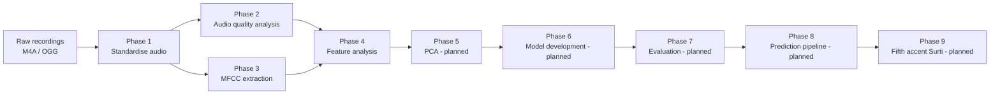

# Gujarati Accent Classifier

An audio-based machine-learning research project that investigates whether regional Gujarati speech accents can be recognised from voice recordings.

> **Status:** research prototype. Phases 1 to 4 (data preparation, audio analysis, MFCC feature extraction, feature analysis) are **completed**. Model development has **not** started. The current dataset has **four accent classes and one speaker per accent**, so all findings so far are **preliminary and exploratory**.

---

## Table of Contents

1. [Project overview](#1-project-overview)
2. [Problem statement](#2-problem-statement)
3. [Objectives](#3-objectives)
4. [Dataset overview](#4-dataset-overview)
5. [Technology stack](#5-technology-stack)
6. [Project workflow and phases](#6-project-workflow-and-phases)
7. [Repository structure](#7-repository-structure)
8. [Research findings so far](#8-research-findings-so-far)
9. [Scientific limitations](#9-scientific-limitations)
10. [Installation and setup](#10-installation-and-setup)
11. [How to run the project](#11-how-to-run-the-project)
12. [Reports and documentation](#12-reports-and-documentation)
13. [Future work](#13-future-work)

---

## 1. Project overview

The goal is to build an audio-based machine-learning system that identifies the **regional accent category** of a Gujarati speaker from a short voice recording.

The current research prototype works with **four available accent categories** (Ahmedabad, Kutchi, Mehsani, Kathiyawadi). A fifth category, **Surti**, is planned and will be integrated when suitable genuine recordings become available. The code is written so that adding it does not require rewriting the pipeline (see [Future work](#13-future-work)).

## 2. Problem statement

Gujarati is spoken across several regions of Gujarat. Regional speech may differ in pronunciation, phonetic characteristics, rhythm and other acoustic properties.

This project investigates whether **acoustic features extracted from audio** can be used to distinguish regional Gujarati speech categories through machine learning. It does not assume that such differences exist or describe specific linguistic characteristics of any region: that is what the experiments are meant to examine, and with the present data (one speaker per accent) they cannot yet answer it.

## 3. Objectives

- Collect and organise regional Gujarati speech recordings.
- Standardise audio formats.
- Analyse audio characteristics and recording quality.
- Extract MFCC, delta and delta-delta features.
- Investigate potentially useful acoustic features.
- Apply dimensionality reduction.
- Develop and evaluate machine-learning classifiers.
- Build a reusable audio prediction pipeline.
- Integrate additional accent categories as genuine recordings become available.

## 4. Dataset overview

| Accent | Region | Recordings | Speakers | Original format |
|---|---|---:|---:|---|
| Ahmedabad | Central Gujarat | 7 | 1 | M4A |
| Kutchi | Kutch | 7 | 1 | M4A |
| Mehsani | North Gujarat | 7 | 1 | OGG |
| Kathiyawadi | Saurashtra | 7 | 1 | OGG |
| Surti | South Gujarat | 0 currently available | Pending | Pending |
| **Total** | | **28** | **4** | |

- The 28 recordings last 9.6 to 18.3 seconds each (about 6.4 minutes in total).
- All speakers were given common Gujarati sentence prompts but were allowed to adapt them to their own regional vocabulary and speaking style, so the recordings do not contain identical words. Nothing was translated, standardised or transcribed.
- **Each current accent has only one speaker. This is a significant limitation.** The dataset must not be taken as representative of the entire regional population.
- Surti recordings are not yet available. No synthetic, empty or substitute Surti data exists in the repository.

## 5. Technology stack

Everything listed here is used in the repository (see `requirements.txt` for the exact versions).

| Technology | Role in this project |
|---|---|
| **Python 3.12** | Language for all code. |
| **FFmpeg** | Converts the original M4A and OGG recordings to WAV (Phase 1). Uses `ffmpeg` from the system `PATH`, or falls back to the binary bundled in `imageio-ffmpeg`. |
| **SoundFile** | Reads WAV headers and checks that every converted file is 16 kHz, mono and PCM 16-bit. |
| **Librosa** | Loads audio unchanged and computes frame energy, spectrograms and MFCC, delta and delta-delta features. |
| **NumPy** | Numerical work on audio signals and feature matrices; compressed NPZ files for frame-level features. |
| **Numba** | A Librosa dependency (version 0.68 or later is needed to work with NumPy 2.5). |
| **Pandas** | Metadata, feature and result tables, saved as CSV. |
| **Matplotlib** | All figures (waveforms, spectrograms, heatmaps, distributions, correlation plots). |
| **Jupyter** (`ipykernel`, `nbformat`, `nbclient`) | The four phase notebooks, and `scripts/run_notebooks.py`, which runs them headlessly. |
| **Git** | Version control. |

Machine-learning libraries (for example scikit-learn) will be added when Phase 5 and Phase 6 begin; they are not used yet.

## 6. Project workflow and phases



| Phase | Purpose | Status | Important outputs |
|---|---|---|---|
| **1. Dataset preparation and audio standardisation** | Convert every raw recording to WAV, 16,000 Hz, mono, PCM 16-bit with FFmpeg (no filtering, trimming or denoising), assign recording and speaker IDs, validate every file. | Completed | `dataset/processed/wav/<Accent>/*.wav`, `dataset/recordings_metadata.csv`, `dataset/processed/reports/validation_report.txt` |
| **2. Audio analysis and quality assessment** | Describe durations, waveforms, spectrograms, silence and pauses, clipping, loudness and background noise, without changing any audio. | Completed | `results/audio_analysis/` (figures and CSV tables, `audio_quality_metrics.csv`) |
| **3. MFCC feature extraction** | Extract 13 MFCC, delta and delta-delta coefficients per 10 ms frame (the full frame-level matrices are kept) and summarise each recording by the mean and standard deviation of every coefficient (78 features). | Completed | `results/mfcc/frame_features/*.npz`, `results/mfcc/mfcc_recording_features.csv`, `results/mfcc/mfcc_feature_columns.json` |
| **4. Feature analysis and comparison** | Examine which features overlap between accents and whether differences are influenced by silence, noise, original format or recording quality. Build speech-only versions of the features. | Completed | `results/feature_analysis/` (summary CSVs, speech-only features, 26 figures) |
| **5. Dimensionality reduction (PCA)** | Explore structure in the feature space with PCA and related methods. | **Planned** | – |
| **6. Model development** | Train and compare classifiers with speaker-aware validation in mind. | **Planned** | – |
| **7. Model evaluation** | Evaluate models honestly given the data limitations. | **Planned** | – |
| **8. Prediction pipeline** | A reusable pipeline that takes a new recording and returns a predicted accent. | **Planned** | – |
| **9. Fifth accent integration** | Add genuine Surti recordings and update the dataset, features, analysis and the model to five classes. | **Planned** | – |

## 7. Repository structure

```text
.
├── README.md                    This file
├── requirements.txt             Pinned Python dependencies
├── .gitignore
├── NLP_researchPaper_project.pdf / .pptx    Original project presentation
│
├── dataset/
│   ├── central-Gujarat/ahmedabad/    Raw Ahmedabad recordings (M4A)
│   ├── kutch/                        Raw Kutchi recordings (M4A)
│   ├── north-Gujarat/mehsani/        Raw Mehsani recordings (OGG)
│   ├── saurashtra/kathiyawadi/       Raw Kathiyawadi recordings (OGG)
│   ├── south-Gujarat/surti/          Empty: reserved for future Surti recordings
│   ├── recordings_metadata.csv       One row per recording (IDs, accent, region, paths, audio properties)
│   └── processed/
│       ├── wav/<Accent>/             Standardised WAV files (16 kHz, mono, PCM 16-bit)
│       └── reports/                  Phase 1 validation report
│
├── src/                         Reusable code
│   ├── config.py                 Paths, target audio format, accent / speaker / folder mapping
│   ├── common.py                 Shared helpers: metadata loaders, validation container, file hashing
│   ├── audio_utils.py            Phase 1: discovery, FFmpeg conversion, validation, metadata
│   ├── audio_analysis.py         Phase 2: speech activity and audio quality metrics
│   ├── mfcc_features.py          Phase 3: MFCC / delta / delta-delta extraction and validation
│   ├── feature_analysis.py       Phase 4: overlap, speech-only, format and quality analysis
│   ├── plot_utils.py             Shared plotting helpers (palette, style, saving)
│   └── feature_plots.py          Phase 4 figure functions
│
├── scripts/
│   ├── run_phase1.py             Run Phase 1 from the command line
│   ├── run_notebooks.py          Run the phase notebooks headlessly
│   └── validate_project.py       Run every project validation in one place
│
├── notebooks/                   One notebook per phase
│   ├── 01_audio_standardization.ipynb
│   ├── 02_audio_analysis.ipynb
│   ├── 03_mfcc_extraction.ipynb
│   └── 04_feature_analysis.ipynb
│
├── results/                     Generated numbers and figures
│   ├── audio_analysis/           Phase 2 figures and CSV tables
│   ├── mfcc/                     Phase 3: frame_features/ (NPZ), CSV tables, figures/
│   └── feature_analysis/         Phase 4: CSV tables, figures/
│
└── reports/                     Human-readable research reports
    ├── README.md                 Index of the reports
    ├── audio_analysis_report.md
    ├── mfcc_extraction_report.md
    ├── feature_analysis_report.md
    └── project_cleanup_audit.md  Code audit and cleanup record
```

Notes:
- Each `src/` module is imported by the notebooks under the name shown (the notebooks add `src/` to the import path). The phase modules hold phase-specific logic; `config.py`, `common.py` and `plot_utils.py` hold what is shared.
- `results/audio_analysis/audio_analysis_report.md` and `results/mfcc/README.md` are earlier copies of the Phase 2 and Phase 3 reports that were created next to the results. The reports in `reports/` are the canonical versions.
- Git does not store empty folders, so after a fresh clone `dataset/south-Gujarat/surti/` will not exist until you create it.

## 8. Research findings so far

> All findings are **preliminary and exploratory**. They describe these 28 recordings from four speakers, not Gujarati regional accents in general.

**Phase 1 – audio standardisation**
- All 28 recordings (14 M4A, 14 OGG) were converted and validated: 0 conversion failures and 0 validation failures. Every output is WAV, 16,000 Hz, mono, PCM 16-bit.
- Surti: 0 recordings (pending). Originals were already 16 kHz mono, so conversion changed format and encoding only.

**Phase 2 – recording quality**
- Recordings last 9.6 to 18.3 seconds; average durations are 13.7 s (Ahmedabad), 15.1 s (Kutchi), 14.2 s (Mehsani) and 11.4 s (Kathiyawadi).
- 10 recordings (4 Mehsani, 6 Kathiyawadi) contain minor clipping (a very small share of samples at full scale); 1 Kutchi recording is about 6 dB quieter than the rest. None is empty, near-silent or an unusual length.
- **The recording setup differs between the format groups:** the M4A recordings (Ahmedabad, Kutchi) have a median noise floor of about −47 dBFS, the OGG recordings (Mehsani, Kathiyawadi) about −78 dBFS, with digitally silent gaps in many of them.

**Phase 3 – MFCC extraction**
- 28 of 28 recordings produced valid 13-coefficient MFCC, delta and delta-delta matrices (38,127 frames of 10 ms in total), with no NaN or infinite values and identical extraction parameters (`n_fft` 512, window 400, hop 160, Hann, DCT type 2, `ortho`).
- The first coefficient (MFCC 1) mainly reflects overall energy.

**Phase 4 – feature analysis**
- **Silence and noise influence MFCC 1 and MFCC 2.** Whole-recording means of both rise with the share of speech frames (r = 0.69 and 0.70). With speech frames only (71.4% of all frames), the MFCC 2 link inside a speaker disappears and the MFCC 1 link changes sign.
- **Recording format is a confound.** M4A and OGG recordings differ in several features, and two of them (MFCC 1 and MFCC 2 means) **reverse direction** once silence is excluded. Some features also differ between accents recorded in the *same* format, so format does not explain everything.
- **Heavy overlap** remains for 8 of the 78 features (mostly delta and delta-delta means).
- 49 of 78 features separate the four speakers strongly (η² ≥ 0.60 on speech frames). With one speaker per accent this is expected and **is not evidence that the accents can be told apart.**
- 30 features passed every screening rule and are listed as candidates for follow-up with more speakers. No feature was removed or selected.

## 9. Scientific limitations

- **One speaker per current accent.** Accent, speaker identity, vocabulary, microphone and room are mixed together and cannot be separated with these data.
- **Possible speaker-identity confounding.** Any difference between classes may reflect a person rather than a regional accent.
- **Different original formats and recording conditions.** Format (M4A or OGG) is tied to accent group, and the two groups differ in noise floor, loudness and silence handling.
- **Limited sample size.** 28 recordings, 7 per speaker, which are not independent of each other. No significance tests were run, and none would be valid.
- **No speaker-independent generalisation has been demonstrated.** Any classifier trained on these data must be evaluated with this in mind.
- **Surti is not yet included**, so the current dataset is a four-class dataset.
- Silence and pauses were deliberately kept in the whole-recording features; speech-only versions exist for comparison.

## 10. Installation and setup

Requirements: **Python 3.12** (the version used for development), and optionally **FFmpeg**.

```bash
# 1. Create and activate a virtual environment
python -m venv .venv
source .venv/bin/activate          # macOS / Linux
.venv\Scripts\activate             # Windows (Command Prompt / PowerShell)

# 2. Install the dependencies
pip install -r requirements.txt
```

**FFmpeg** is needed only to re-run Phase 1 (convert raw recordings). Either:
- install it on your system so that `ffmpeg` is on the `PATH` (for example `winget install Gyan.FFmpeg` on Windows, `brew install ffmpeg` on macOS, `sudo apt install ffmpeg` on Ubuntu), **or**
- do nothing: `requirements.txt` installs `imageio-ffmpeg`, whose bundled binary is used automatically when `ffmpeg` is not on the `PATH`.

The notebooks can be opened in VS Code or JupyterLab. If you use JupyterLab, install it separately; it is not in `requirements.txt` because the project does not need it to run.

## 11. How to run the project

All commands are run from the repository root. The raw recordings and all results are already in the repository, so you can explore the results without re-running anything.

**Check that everything is consistent** (read-only; takes about a minute):

```bash
python scripts/validate_project.py          # add --quick to skip decoding every WAV file
```

**Phase 1 from the command line** (skips files that are already converted and valid):

```bash
python scripts/run_phase1.py                # add --force to reconvert everything
```

**Run the notebooks** (each phase uses the outputs of the earlier ones):

```bash
python scripts/run_notebooks.py                 # phases 1 to 4 in order, saving outputs into the notebooks
python scripts/run_notebooks.py --only 3 4      # only some phases
python scripts/run_notebooks.py --no-save       # run without overwriting the .ipynb files
```

Or open `notebooks/01_audio_standardization.ipynb` to `notebooks/04_feature_analysis.ipynb` and use *Run All*. The notebooks find the project root automatically, so they can be opened from any folder inside the repository.

**Where to find the results**

| What | Where |
|---|---|
| Standardised audio and metadata | `dataset/processed/wav/`, `dataset/recordings_metadata.csv` |
| Phase 2 figures and quality tables | `results/audio_analysis/` |
| Frame-level MFCC arrays (one `.npz` per recording) | `results/mfcc/frame_features/` |
| Recording-level feature table and feature-column list | `results/mfcc/mfcc_recording_features.csv`, `results/mfcc/mfcc_feature_columns.json` |
| Feature-analysis tables and figures | `results/feature_analysis/` |
| Research reports | `reports/` |

Loading the features for your own experiments: read `results/mfcc/mfcc_feature_columns.json`. Use only the columns listed under `acoustic_feature_columns` as model inputs; never use recording IDs, speaker IDs, accent labels or quality flags as inputs.

## 12. Reports and documentation

| Report | Content |
|---|---|
| [`reports/README.md`](reports/README.md) | Index of all reports |
| [`reports/audio_analysis_report.md`](reports/audio_analysis_report.md) | Phase 2: audio quality analysis and visualisation |
| [`reports/mfcc_extraction_report.md`](reports/mfcc_extraction_report.md) | Phase 3: MFCC feature extraction |
| [`reports/feature_analysis_report.md`](reports/feature_analysis_report.md) | Phase 4: feature analysis and comparison |
| [`reports/project_cleanup_audit.md`](reports/project_cleanup_audit.md) | Code audit and cleanup record after Phase 4 |

The reports are written in simple language, with embedded figures and tables, and can be read without opening the notebooks.

## 13. Future work

- **Phase 5 – Dimensionality reduction (PCA).** Explore the feature space on both the whole-recording and the speech-only features, and colour the projections by accent *and* by original format to see which one the main components follow.
- **Phase 6 – Model development.** Train and compare classifiers using only the acoustic columns listed in `mfcc_feature_columns.json`. Keep the candidate features from Phase 4 as a starting point, not a final feature set.
- **Phase 7 – Model evaluation.** Evaluate honestly. With one speaker per accent, scores on held-out recordings of the *same* speakers do not show accent recognition.
- **Phase 8 – Prediction pipeline.** A reusable pipeline: new recording → standardised WAV → features → predicted accent.
- **Phase 9 – Fifth accent (Surti).** The accent mapping already contains Surti (`src/config.py`), and the analysis code discovers accents from the data instead of assuming four classes. When genuine Surti recordings are available:
  1. put them in `dataset/south-Gujarat/surti/` (create the folder after a fresh clone);
  2. re-run Phase 1, then Phases 2, 3 and 4 (`python scripts/run_phase1.py`, then `python scripts/run_notebooks.py --only 2 3 4`), so that metadata, quality metrics, features and analyses are all updated **consistently** with the same extraction parameters and feature schema;
  3. re-run `python scripts/validate_project.py`;
  4. retrain and re-evaluate the model for five classes.

  The written reports contain numbers from the four-class dataset, so they must be refreshed after Surti is added. Never use another accent's recordings or synthetic audio as a substitute.

Ideally, future data collection should also add **more speakers per accent**, recorded on the **same device and format**, because that is what the current limitations call for.
