# Phase 2 Report: Audio Quality Analysis of the Gujarati Accent Dataset

*Gujarati Accent Classifier – a beginner-friendly research report*

This report explains what we did in Phase 2, what every graph shows, what we found, and what it means. You do **not** need to open the Jupyter notebook to follow it. (The notebook is `notebooks/02_audio_analysis.ipynb` if you want the code.)

> **One sentence to remember:** we have only **one speaker per accent**, so every difference in this report could come from the *accent*, the *person*, the *microphone/app*, or the *room*. We cannot tell which. All findings are **descriptive and exploratory**, not proof about Gujarati regional accents in general.

---

## Table of Contents

- [Tech Stack](#tech-stack)
- [A. Project Overview](#a-project-overview)
- [B. Dataset Overview](#b-dataset-overview)
- [C. What We Analysed](#c-what-we-analysed)
- [D. Visual Analysis and Observations](#d-visual-analysis-and-observations)
  - [D1. Duration analysis](#d1-duration-analysis)
  - [D2. Waveform analysis](#d2-waveform-analysis)
  - [D3. Spectrogram analysis](#d3-spectrogram-analysis)
  - [D4. Silence and pause analysis](#d4-silence-and-pause-analysis)
  - [D5. Audio quality analysis](#d5-audio-quality-analysis)
- [E. Comparative Findings](#e-comparative-findings)
- [F. Important Problems Identified](#f-important-problems-identified)
- [G. What Do These Results Tell Us](#g-what-do-these-results-tell-us)
- [H. Impact on the Next Phase (MFCC Extraction)](#h-impact-on-the-next-phase-mfcc-extraction)
- [I. Final Conclusion](#i-final-conclusion)
- [J. Next Steps](#j-next-steps)
- [Appendix: Files in this folder](#appendix-output-files)

---

## Tech Stack

These are the tools used in this project, each explained in one line. Phase 2 only *reads* the audio; it never changes it.

| Tool | Version | What it does (in simple words) |
|---|---|---|
| **Python** | 3.12.2 | The programming language all our code is written in. |
| **FFmpeg** | 9.0.2 (via `imageio-ffmpeg` 0.8.1) | Converts the original M4A and OGG recordings into WAV files (Phase 1). |
| **SoundFile** | 0.14.0 | Opens WAV files and checks they have the right format (Phase 1). |
| **Librosa** | 1.0.0 | Loads the audio and works out loudness over time and the spectrograms. |
| **NumPy** | 2.5.4 | Does the maths on the long lists of numbers that make up the sound. |
| **Numba** | 0.68.1 | Runs in the background to make Librosa faster. |
| **Pandas** | 2.2.2 | Holds our data in tables and saves the results as CSV files. |
| **Matplotlib** | 3.9.2 | Draws all the graphs and saves them as PNG images. |
| **Jupyter Notebook** | ipykernel 7.2.0, nbconvert 7.17.2, nbformat 5.11.1 | Lets us run the analysis step by step and keep code, graphs and notes together. |

**Our own project files used in this phase**

| File | What it does (in simple words) |
|---|---|
| `src/config.py` | Stores the folder paths, the target audio format and the accent and speaker list. |
| `src/audio_utils.py` | Phase 1 helper code for converting and checking audio. |
| `src/audio_analysis.py` | Phase 2 helper code that finds speech, silence, clipping and other quality problems. |
| `notebooks/02_audio_analysis.ipynb` | Runs the whole analysis and creates every graph and CSV in this folder. |

---

## A. Project Overview

**The project.** The Gujarati Accent Classifier aims to build a computer model that listens to a short Gujarati speech recording and guesses which regional accent it has (for example Ahmedabad, Kutchi, Mehsani, Kathiyawadi, and later Surti).

**The plan has phases.**

1. Phase 1 – put every recording into one common audio format (done).
2. **Phase 2 – check the audio quality and look at the sound visually (this report).**
3. Phase 3 onwards – extract features (MFCCs), compare accents, and train a model.

**What Phase 2 was meant to do.** Before a model learns from audio, we need to know what the audio *looks like* and whether it has problems. Phase 2 measured length, loudness, silence, background noise and clipping, and drew waveforms and spectrograms.

**Why look at the audio before extracting MFCCs?** MFCCs are numbers that summarise the *shape of the sound*. They pick up everything in the recording: the voice, but also the microphone, the room and the background noise. If we do not check the audio first, we might later think "this is an accent difference" when it is really "this was recorded on a different device". Phase 2 is our safety check.

Phase 2 changed **no audio**. Nothing was denoised, trimmed, normalised or deleted.

---

## B. Dataset Overview

| Accent | Region | Recordings | Speakers | Original Format |
|---|---|---:|---:|---|
| Ahmedabad | Central Gujarat | 7 | 1 | M4A |
| Kutchi | Kutch | 7 | 1 | M4A |
| Mehsani | North Gujarat | 7 | 1 | OGG |
| Kathiyawadi | Saurashtra | 7 | 1 | OGG |
| Surti | South Gujarat | Pending | Pending | Pending |

- **28 recordings** in total, all converted in Phase 1 to WAV, 16,000 Hz, mono, 16-bit.
- Speaker IDs: `AHM_S01`, `KUT_S01`, `MEH_S01`, `KAT_S01`. Seven recordings from one person are **not** seven independent speakers.
- **Surti recordings will be added later**, before the final five-class training. Nothing in this report was invented or substituted for Surti.
- Speakers were allowed to change the prompt sentences to their regional wording, so the recordings do not contain exactly the same words.

---

## C. What We Analysed

| Concept | Simple explanation | Everyday analogy |
|---|---|---|
| **Duration** | How many seconds a recording lasts. | The length of a video clip. |
| **Waveform** | A picture of loudness over time. Tall = loud, flat = quiet. | A heartbeat monitor for sound. |
| **Spectrogram** | A picture of *which pitches (frequencies)* are present at each moment. Time goes left to right, frequency bottom to top, and brightness shows strength. | Sheet music that also shows how strong each note is. |
| **Silence and pauses** | Time with no speech: before the speaker starts (leading), after they stop (trailing), and gaps between phrases (internal pauses). | The quiet before and after someone speaks, and the breaths between sentences. |
| **Amplitude / volume** | How large the signal is. We measure it in **dBFS** ("decibels relative to full scale"). 0 dBFS is the loudest the file can store; more negative means quieter. | A volume knob: 0 is maxed out, −20 is much lower. |
| **Clipping** | When the sound is so loud it hits the maximum and gets flattened. | Shouting into a phone so loudly that it distorts. |
| **Background noise (noise floor)** | How loud the recording is when nobody is speaking. Closer to 0 dBFS = noisier. | The hum of a fan or room when the talking stops. |
| **Speech activity** | Which moments contain speech, found by checking how loud each 25 ms slice is. | Highlighting the "talking" parts of the recording. |

**How we detected speech.** We cut each recording into 25 ms slices and measured the energy of each. We then compared every slice with that file's own loudest speech level. A slice is *speech-level* if it is within 30 dB of that level, *silence* if it is more than 45 dB below it, and *quiet* in between (this could be soft speech, breathing, or room noise). A gap of at least 200 ms between speech slices counts as an *internal pause*.

**A limit of this method:** energy alone cannot perfectly separate quiet speech from low noise. That is why "quiet" is kept as its own group instead of being called silence.

**Representative recordings.** For the single-recording graphs we picked, for each accent, the recording whose length is closest to that accent's median. This is a fixed rule, so we did not hand-pick the "best-looking" file. They are `AHM_S01_R04`, `KUT_S01_R01`, `MEH_S01_R05` and `KAT_S01_R06`.

---

## D. Visual Analysis and Observations

All graphs use the same colour for each accent throughout: **blue = Ahmedabad, orange = Kutchi, green = Mehsani, pink = Kathiyawadi**.

### D1. Duration analysis

#### Figure 1 – Average duration per accent

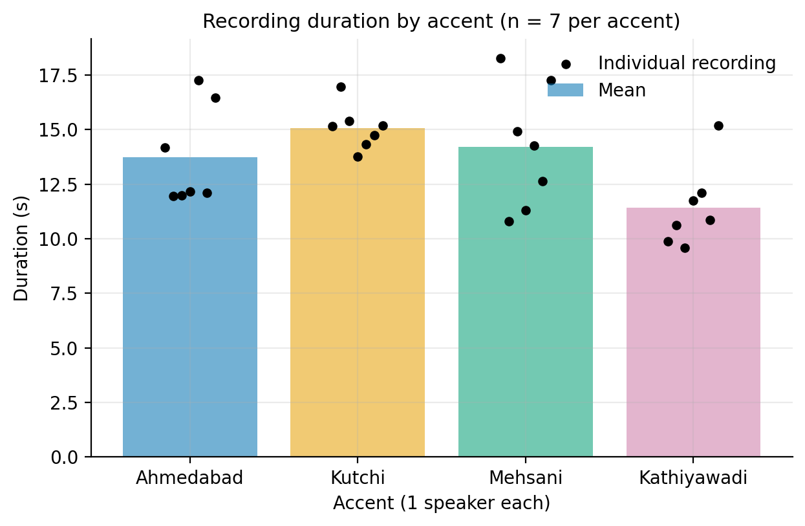

**What it shows.** The height of each bar is the *average* length of the 7 recordings of that accent. Each black dot is one recording.

**How to read it.** Higher bar = longer recordings on average. Dots close together mean the recordings are similar in length; dots spread out mean they vary.

**What we observe.**
- Kutchi is the longest on average (**15.1 s**) and its dots are tightly bunched.
- Kathiyawadi is the shortest (**11.4 s**); one dot (15.2 s) sits well above the other six.
- Ahmedabad (**13.7 s**) and Mehsani (**14.2 s**) are in the middle but spread out. Mehsani goes from 10.8 s to 18.3 s.

**Why it matters.** Every file lasts roughly 10–18 s, so no recording is suspiciously short or long. But the differences between accents are about as large as the differences *within* an accent. Duration therefore depends a lot on the exact words and speaking pace of each speaker. It is **not** evidence about accent.

#### Figure 2 – Duration spread (boxplot)

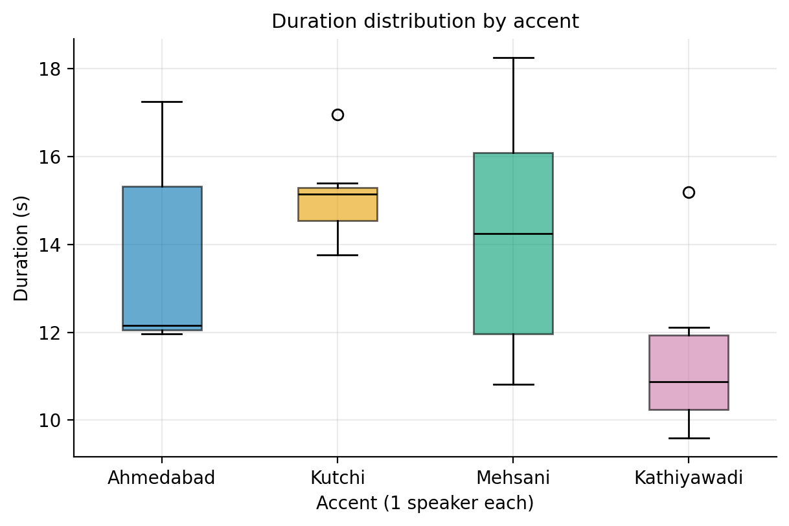

**What it shows.** The same duration data, but showing the spread. Each box covers the middle half of that accent's recordings, the line inside is the median (middle value), and the "whiskers" and circles show the extremes.

**How to read it.** A tall box means very different lengths; a short box means consistent lengths. A circle is a recording that sits away from the rest.

**What we observe.**
- Kutchi has the narrowest box (most consistent lengths, standard deviation 1.0 s).
- Mehsani has the widest spread (standard deviation 2.9 s).
- Circles appear for one Kutchi recording and one Kathiyawadi recording.

**Why it matters.** With only 7 recordings per accent, a box is a rough guide, not a precise estimate. It confirms there are no extreme lengths that need special treatment before feature extraction.

---

### D2. Waveform analysis

#### Figure 3 – Waveform comparison (one recording per accent)

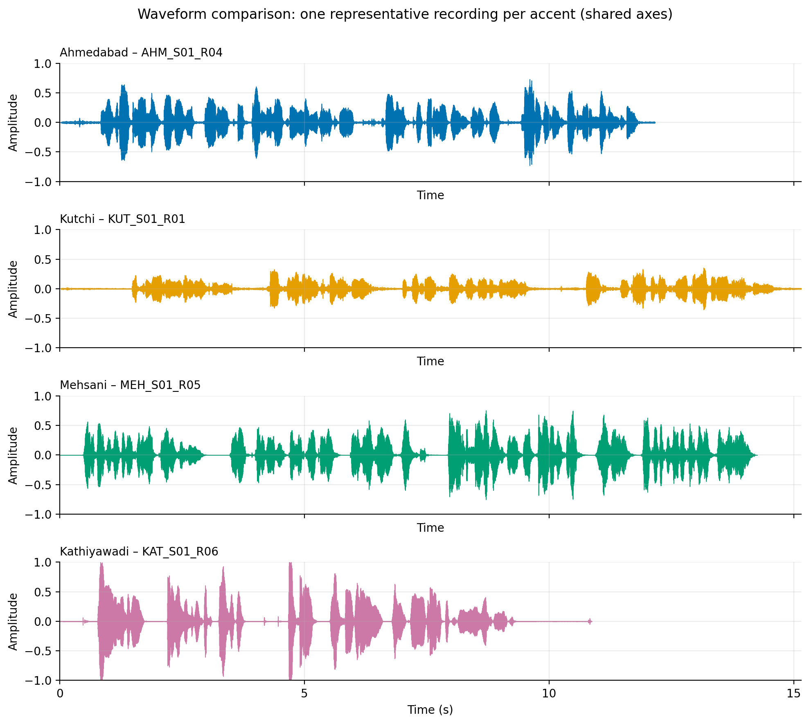

**What it shows.** Loudness over time for one representative recording from each accent. All four panels share the same vertical scale (−1 to +1, where ±1 is the maximum the file can hold) and the same time axis, so they can be compared fairly. The audio was not normalised.

**How to read it.** Each cluster of "bursts" is a word or phrase. Flat lines between bursts are pauses. The taller the burst, the louder the sound.

**What we observe.**
- All four show clear bursts of speech separated by pauses, so the speech is intact and easy to see.
- **Kutchi (`KUT_S01_R01`)** is visibly smaller: its peaks reach only about ±0.3, compared with about ±0.6–0.7 for Ahmedabad and Mehsani. This is the file later flagged as quieter than the rest. It also has a long flat start of about 1.5 s.
- **Kathiyawadi (`KAT_S01_R06`)** reaches the top and bottom of the plot (±1.0) at the start of some bursts. This is the clipping discussed in [D5](#d5-audio-quality-analysis).
- **Mehsani (`MEH_S01_R05`)** is very flat and clean between phrases, and it ends right after the last word.

**Why it matters.** Waveforms show that the recordings have different loudness levels and different amounts of start/end silence. Later, MFCC extraction will see these differences, so we need to remember them.

#### Individual waveforms

One larger waveform per accent is also saved (same scale, labelled with the recording ID). They show the same signals as Figure 3, so only the Kathiyawadi one is embedded here, to show the full-scale peaks in detail.

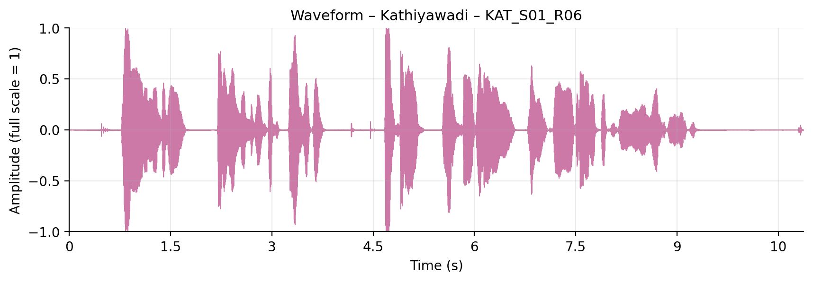

Peaks at the very start (about 0.8 s) and near 4.7 s touch ±1.0, which is the maximum the file can store.

The other three are available here: [Ahmedabad](../results/audio_analysis/03_waveform_Ahmedabad_AHM_S01_R04.png), [Kutchi](../results/audio_analysis/03_waveform_Kutchi_KUT_S01_R01.png), [Mehsani](../results/audio_analysis/03_waveform_Mehsani_MEH_S01_R05.png).

---

### D3. Spectrogram analysis

**How to read a spectrogram.** Time runs left to right. Frequency (pitch, in Hz) runs bottom to top, up to 8,000 Hz. The colour shows how strong each frequency is: bright yellow/orange is strong, dark purple/black is weak. All spectrograms below use **the same −80 to 0 dB colour scale**, so brightness can be compared between them.

Useful patterns in speech:
- **Horizontal stripes at the bottom** are the vibration of the voice (pitch and its harmonics) during vowels.
- **Wide bright patches** are formants, the vowel "shape" of the mouth.
- **Tall thin streaks** are short sounds like "t" or "k".
- **Fuzzy energy at high frequencies** is sounds like "s" or "sh".
- **Dark gaps** are pauses.

#### Figure 4 – Spectrogram comparison

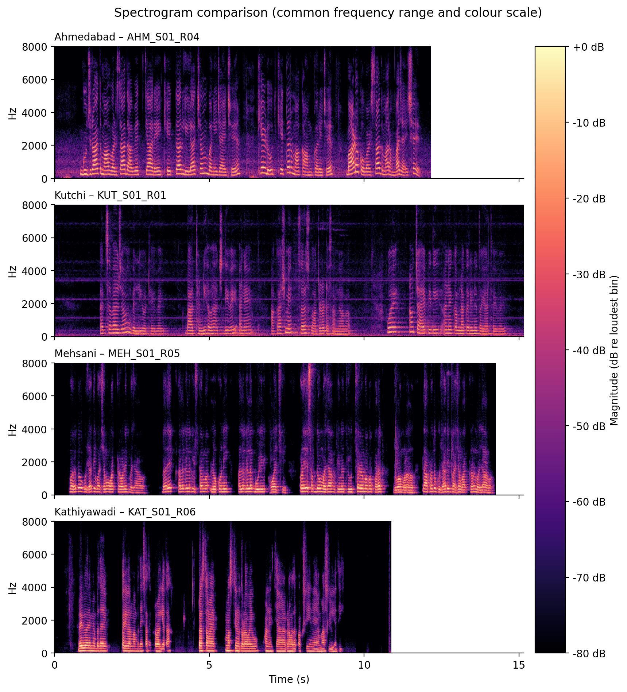

**What it shows.** The four representative recordings stacked on the same time axis, frequency range and colour scale.

**What we observe.**
- All four show the expected speech structure: harmonic stripes, vowel patches, bursts and high-frequency noise. The speech is clearly captured.
- The **dark gaps** between phrases look different. In Mehsani and Kathiyawadi they are almost completely black. In Ahmedabad and Kutchi they are not fully black; there is a faint purple haze.
- **Kutchi** shows thin horizontal lines at roughly 1.1, 2.3, 3.4 and 4.5 kHz running through the whole recording, even when nobody is speaking.

**Why it matters.** The "hazy gap" versus "black gap" difference lines up with the noise-floor result in [D5](#d5-audio-quality-analysis). Differences in background are a property of the recording, not of the way someone pronounces words.

#### Figure 5 – Ahmedabad (`AHM_S01_R04`)

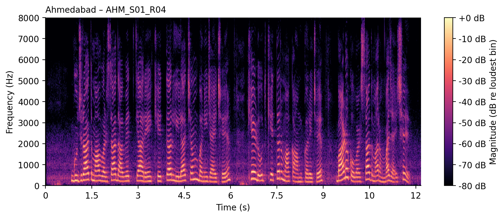

**Observation.** Very clear curved harmonic stripes up to about 4–5 kHz, plus a purple haze of low-frequency noise (below about 3 kHz) between words. The gaps never go fully dark.

#### Figure 6 – Kutchi (`KUT_S01_R01`)

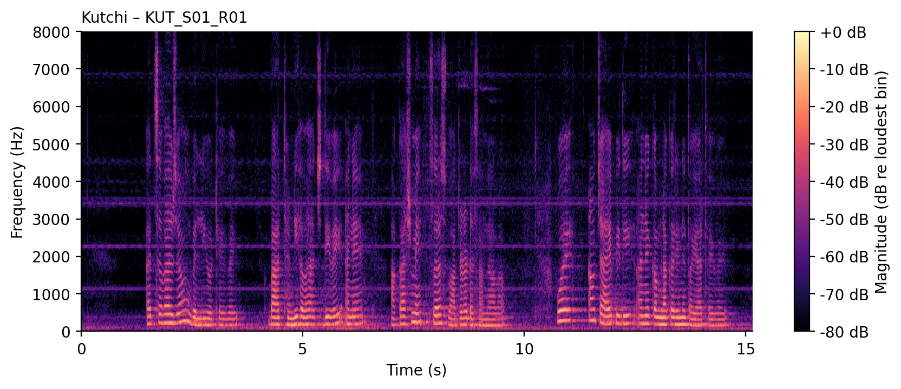

**Observation.** Speech starts after about 1.5 s. The recording has **steady horizontal lines** (around 1.1, 2.3, 3.4 and 4.5 kHz) that continue through the silent parts. These are not speech. **Possible explanation (not confirmed):** a constant hum or electronic tone from the recording device or its surroundings.

#### Figure 7 – Mehsani (`MEH_S01_R05`)

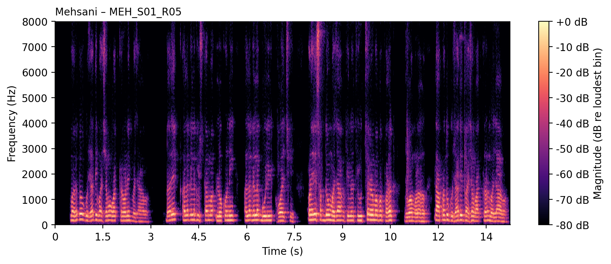

**Observation.** Strong voice energy in the lower frequencies and very black, clean gaps between phrases. The recording ends almost immediately after the last word.

#### Figure 8 – Kathiyawadi (`KAT_S01_R06`)

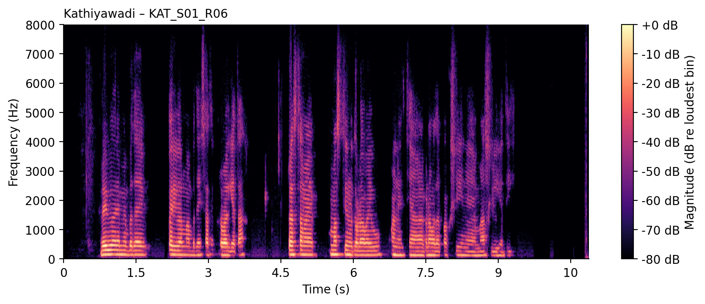

**Observation.** Very clear, dense harmonic stripes and bright energy up to about 5 kHz. The gaps are fully black, and the last second or more of the recording is empty.

**Why the spectrograms matter for the project.** They show that the voice is captured well in every file. They also warn us that the *background* of each file differs. We cannot judge fine accent cues (vowel quality, rhythm, intonation) by eye from one recording per accent. That is the job of later phases, with the same one-speaker caveat.

---

### D4. Silence and pause analysis

#### Figure 9 – Speech activity timelines

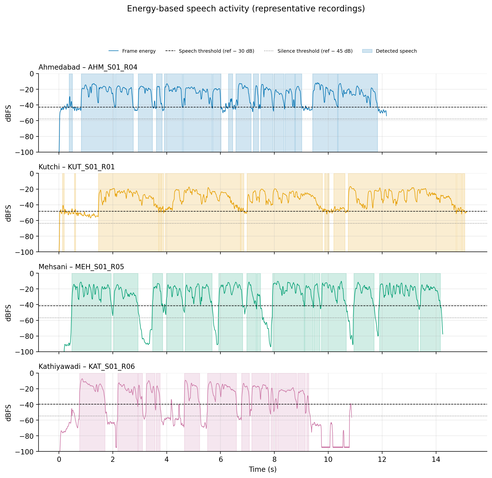

**What it shows.** The loudness of each 25 ms slice over time (the coloured line). The shaded blocks are the moments detected as speech. The dashed line is the speech threshold and the dotted line is the silence threshold, both set relative to each file's own loud-speech level.

**How to read it.** The line should be high inside shaded blocks (speech) and drop in the gaps. If the line in a gap stays *between* the dotted and dashed lines, that gap is "quiet" (low-level noise or soft sounds) rather than true silence.

**What we observe.**
- In **Mehsani** and **Kathiyawadi** the line falls to −80 or −100 dBFS in the gaps, far below the dotted line. These gaps are essentially digital silence. At the end of the Kathiyawadi file the line sits flat at about −94 dBFS.
- In **Ahmedabad** and **Kutchi** the line in the gaps stays at around −45 to −50 dBFS. It never reaches the silence line, so those gaps are "quiet" rather than silent. This is background noise. The Kutchi recording also shows this noise for its first 1.5 s.
- All four recordings show speech clearly separated from the gaps.

**Why it matters.** The same speech-detection rule behaves differently in noisy and clean files. In the noisy files, the speech threshold sits only a few dB above the noise, so small wobbles in the gaps can be mistaken for speech or pauses. **Pause counts for Ahmedabad and Kutchi should therefore be treated as approximate.**

#### Figure 10 – Silence and pause statistics

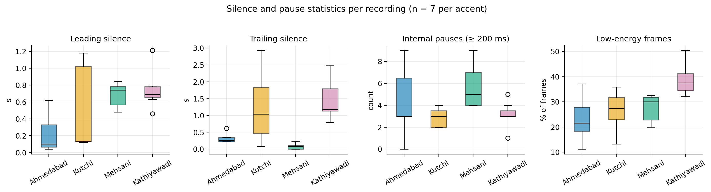

**What it shows.** For all 28 recordings, four measurements: silence before speech starts, silence after speech ends, number of internal pauses of 200 ms or more, and the percentage of low-energy frames.

**How to read it.** Each coloured box is one accent (7 recordings). Higher = more of that measurement.

**What we observe** (averages per accent are in the table in [Section E](#e-comparative-findings)):
- **Leading silence:** shortest for Ahmedabad (about 0.2 s), longest for Kathiyawadi (about 0.75 s) and Mehsani (about 0.7 s). Kutchi varies a lot, from about 0.1 s to 1.2 s.
- **Trailing silence:** Mehsani files stop almost at once (average 0.08 s). Kutchi and Kathiyawadi often have 1–3 s of silence at the end (the longest are 2.9 s for a Kutchi file and 2.5 s for a Kathiyawadi file).
- **Internal pauses:** Mehsani has the most (about 5.7 per file) and Kutchi the fewest (about 2.9). Ahmedabad varies from 0 to 9.
- **Low-energy frames:** Kathiyawadi has the highest share (about 39%), the others about 23–27%.

**Why it matters.** These are mostly habits of *when the speaker pressed record and stop* and how they phrased the sentence. Pauses also depend on the words used. We should not read them as accent traits. We also have not removed any of this silence, so any later model will see it.

---

### D5. Audio quality analysis

#### Figure 11 – Audio quality summary

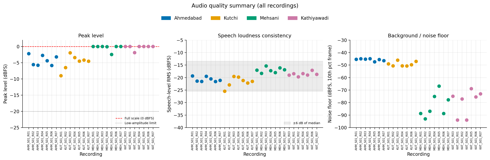

**What it shows.** One dot per recording (28 dots) in three panels, coloured by accent.

- **Left – Peak level:** the loudest point of each recording. The red dashed line at 0 dBFS is the maximum.
- **Middle – Speech loudness:** the average level while speech is happening (dBFS). The grey band is ±6 dB around the median of all recordings.
- **Right – Noise floor:** how loud the recording is in its quietest moments. Lower (more negative) means cleaner.

**How to read it.** In the left panel, dots touching the red line are at full scale. In the middle panel, dots outside the grey band are unusually quiet or loud. In the right panel, a high dot means more background noise.

**What we observe.**
- **Peak level:** nearly all Mehsani and Kathiyawadi dots sit at, or almost at, 0 dBFS. The Ahmedabad and Kutchi dots stay between about −2 and −9 dBFS.
- **Speech loudness:** most dots lie inside the grey band. One Kutchi dot (`KUT_S01_R01`, about −25.5 dBFS) sits right at the lower edge, about 6 dB below the median. The Mehsani dots are the loudest on average (about −17 dBFS).
- **Noise floor:** a **clear split into two groups**. Ahmedabad and Kutchi (M4A) are all between about −45 and −51 dBFS. Mehsani and Kathiyawadi (OGG) are all far lower, between about −67 and −94 dBFS.

**Why it matters.** The noise-floor split exactly matches the file format and also matches the accent groups. This is the most important finding of Phase 2 (see [Section F](#f-important-problems-identified)).

#### Quality flags (checked on all 28 recordings)

| Check | Rule | Recordings flagged |
|---|---|---:|
| Clipping | any sample at full scale (≥ 0.999) | **10** |
| Inconsistent level | speech level more than 6 dB from the median of all files | **1** |
| Low amplitude | peak below −20 dBFS, or speech level below −35 dBFS | 0 |
| Nearly silent or empty | under 10% speech frames, or overall level below −60 dBFS | 0 |
| Unusual duration | under 0.5× or over 2× the median duration | 0 |

**11 of 28** recordings have at least one flag. Per-accent counts are in [Section E](#e-comparative-findings).

---

## E. Comparative Findings

### Verified duration summary

| Accent | Average Duration | Shortest | Longest |
|---|---:|---:|---:|
| Ahmedabad | 13.7 seconds | 12.0 s | 17.3 s |
| Kutchi | 15.1 seconds | 13.8 s | 17.0 s |
| Mehsani | 14.2 seconds | 10.8 s | 18.3 s |
| Kathiyawadi | 11.4 seconds | 9.6 s | 15.2 s |
| Surti | – | – | – |

### Silence and speech activity (average per recording)

| Accent | Leading silence (s) | Trailing silence (s) | Internal pauses (count) | Low-energy frames (%) | Speech frames (%) |
|---|---:|---:|---:|---:|---:|
| Ahmedabad | 0.22 | 0.32 | 4.4 | 23.2 | 77 |
| Kutchi | 0.53 | 1.24 | 2.9 | 26.5 | 73 |
| Mehsani | 0.68 | 0.08 | 5.7 | 27.4 | 73 |
| Kathiyawadi | 0.75 | 1.47 | 3.1 | 38.8 | 61 |

### Loudness and noise (by accent)

| Accent | Original format | Average peak (dBFS) | Average speech level (dBFS) | Noise floor range (dBFS) | Clipping flags |
|---|---|---:|---:|---|---:|
| Ahmedabad | M4A | −4.3 | −20.7 | −47.4 to −45.0 | 0 of 7 |
| Kutchi | M4A | −4.9 | −21.8 | −50.8 to −46.1 | 0 of 7 |
| Mehsani | OGG | −0.4 | −17.0 | −93.1 to −66.9 | 4 of 7 |
| Kathiyawadi | OGG | −0.3 | −18.6 | −94.0 to −68.9 | 6 of 7 |

### Grouped by original format

| Format | Recordings | Lowest noise floor | Median noise floor | Highest noise floor |
|---|---:|---:|---:|---:|
| M4A (Ahmedabad, Kutchi) | 14 | −50.8 dBFS | −46.8 dBFS | −45.0 dBFS |
| OGG (Mehsani, Kathiyawadi) | 14 | −94.0 dBFS | −77.5 dBFS | −66.9 dBFS |

### Quality flags in detail

| Flag | Count | Which recordings |
|---|---:|---|
| Clipping | **10** | `MEH_S01_R01`, `R03`, `R06`, `R07` and `KAT_S01_R01`, `R03`, `R04`, `R05`, `R06`, `R07` |
| Inconsistent amplitude | **1** | `KUT_S01_R01` (about 6 dB below the median) |
| Low amplitude / near-silent / unusual duration | 0 | – |

### Observations versus possible explanations

| Observation (measured) | Possible explanation (not proven) |
|---|---|
| M4A files have a noise floor of about −45 to −51 dBFS; OGG files about −67 to −94 dBFS. | Different recording apps or devices, different codec behaviour, or noise gating (an automatic muting of quiet sound) applied before or during encoding. We do not know which. |
| Mehsani and Kathiyawadi gaps are almost digitally silent. | Same as above. |
| Mehsani and Kathiyawadi peaks are at or near full scale. | Higher recording gain or a closer microphone. |
| Kutchi shows steady horizontal lines in its spectrogram. | A hum or electronic tone from the device or the room. |
| `KUT_S01_R01` is quieter than the others. | The speaker was farther from the microphone or spoke softly for that take. |
| Trailing silence of 1–3 s in some Kutchi and Kathiyawadi files; almost none in Mehsani. | Different habits about when to stop recording. |
| Different numbers of pauses. | Different sentence wording, speaking speed and breathing habits of each speaker. |

---

## F. Important Problems Identified

**1. Recording format and recording conditions are tied to the accent groups.**
Both M4A recordings are Ahmedabad and Kutchi, and both OGG recordings are Mehsani and Kathiyawadi. The two format groups also differ in noise, loudness and silence. Because of this, "accent" and "recording setup" are mixed together. *Possible effect:* a classifier might learn to recognise the recording setup (for example "clean, gated, loud = Mehsani or Kathiyawadi") instead of the accent, and then appear to work well for the wrong reason.

**2. M4A recordings have a much higher background noise floor than OGG recordings.**
About −46.8 dBFS (median) versus −77.5 dBFS (median). *Possible effect:* MFCCs describe the overall shape of the sound spectrum. During pauses and soft speech, noisy files will have different MFCC values from clean files, even if the speaker said the same thing. The "approximate SNR" values in `level_summary_by_accent.csv` should **not** be compared between the two groups, because digital silence makes OGG look unrealistically clean.

**3. Ten recordings have minor clipping.**
Four Mehsani and six Kathiyawadi recordings touch full scale. The clipped samples are a tiny share of each file (at most about 0.3%, and in several files only a few samples), so the damage is small. *Possible effect:* clipped peaks add a little distortion to the spectrum. This is probably minor for MFCCs, but it should be tracked and not ignored.

**3b. Clipping affects only the OGG group.**
This is another way the recording setup is tied to accent (see problem 1).

**4. One Kutchi recording is quieter than the others.**
`KUT_S01_R01` has a speech level of about −25.5 dBFS, roughly 6 dB below the median of all recordings. *Possible effect:* absolute loudness can shift some features. Careful handling in Phase 3 (for example, deciding on level normalisation) is needed, and it must be a conscious decision, not an accident.

**5. Silence and pauses differ across recordings.**
Leading silence ranges from about 0.04 s to 1.2 s, and trailing silence from 0 s to 2.9 s. *Possible effect:* if silence is left in, silent frames become part of each file's features and can add differences that have nothing to do with the accent. Whether and how to treat silence is a Phase 3 decision, and it should be applied the same way to every recording.

**Also noted:** the Kutchi recording has steady tonal lines in its background, and the speech detector's pause counts are less reliable on the noisier M4A files (see Figure 9).

---

## G. What Do These Results Tell Us

**Useful findings**
- All 28 recordings are intact, in the correct format, and contain clear speech. No recording is empty, extremely quiet or an odd length.
- The problems found are small and known: minor clipping in 10 files, one quieter file, and different amounts of silence.
- We learned about a real risk (recording setup tied to accent) **before** building any model. This is the main benefit of Phase 2.

**Differences that may come from the individual speaker**
- Voice pitch and voice quality.
- Speaking speed, number of pauses and how long they pause.
- How softly or loudly they speak (the quieter Kutchi file).
- The exact words they chose when changing the prompt sentence.

**Differences that may come from recording equipment or environment**
- Noise floor and background hum (M4A versus OGG groups, Kutchi tonal lines).
- Digital-silence gaps in the OGG files.
- Peaks at full scale (recording gain).
- How long each person waited before starting and after stopping.

**Why we cannot call these universal regional accent characteristics**
- **There is only one speaker per accent.** Speaker, region, vocabulary, device and recording conditions are all mixed together, and we cannot separate them with this data.
- Seven recordings from one person are not seven independent samples of an accent.
- We ran **no statistical tests**, because with this sample size they would be misleading.
- Nothing here says that "Kathiyawadi speakers speak shorter sentences" or "Mehsani speakers pause more". It only says that *these four recordings* differ this way.

---

## H. Impact on the Next Phase (MFCC Extraction)

**Why MFCC extraction is next.** MFCCs (Mel-frequency cepstral coefficients) turn each short slice of audio into a small set of numbers describing its sound shape. They are a standard, compact way to represent speech for classification, and later phases (comparison, PCA, models) all start from them.

**Why we should keep the quality flags.** The flags (`quality_flags` in `audio_quality_metrics.csv`) let us later check whether an odd result belongs to a clipped file, a quiet file, or a noisy file. If we discard them, we lose the ability to explain surprising results.

**Why we should not automatically delete clipped recordings.** The clipping is minor, and with only 7 recordings per accent, removing 4 of 7 Mehsani and 6 of 7 Kathiyawadi recordings would almost wipe out two classes. A better plan is to keep all recordings, keep the flags, and later check whether results change when flagged files are excluded.

**Why the original audio should stay untouched.** The raw files and the Phase 1 WAV files are our reference. Any cleaning or trimming should be done as a separate, clearly named step that can be repeated or undone, so that we can always compare "before" and "after".

**Why MFCC differences must be interpreted carefully.** If MFCCs differ between two accents, the cause could be the accent, the speaker, the noise, or the codec, and we cannot tell which. Differences between the M4A group and the OGG group are especially suspect. Early classification scores should be treated as exploratory.

---

## I. Final Conclusion

Phase 2 achieved what it set out to do. We measured and visualised all 28 standardised recordings without changing them. We confirmed that:

- every recording is usable, clear, and 9.6–18.3 s long;
- 10 recordings have minor clipping and 1 Kutchi recording is quieter than the rest;
- speakers differ in how much silence and how many pauses they have;
- **most importantly, the recordings differ in noise and loudness in a way that lines up with the accent groups**, because the two M4A accents and the two OGG accents form separate groups.

Because there is one speaker per accent, none of this tells us about Gujarati regional accents in general. We are ready to move on to MFCC extraction, with all quality flags kept, with the original audio untouched, and with an honest warning that early results may partly reflect the recording setup.

---

## J. Next Steps

1. **MFCC extraction** (Phase 3) – turn each recording into feature numbers.
2. **MFCC visualisation** – look at the features, as we did for waveforms and spectrograms.
3. **Accent-wise feature comparison** (Phase 4) – compare features across the four accents, keeping the one-speaker caveat in mind.
4. **PCA and exploratory analysis** (Phase 5) – see whether recordings group by accent, or by recording setup.
5. **Preliminary classification** (Phase 6) – a first model, interpreted cautiously.
6. **Add Surti recordings** (Phase 7) – collected later, ideally with the same device and format as the others; then repeat the pipeline and train the final five-class model.

---

## Appendix: Output files

All files below are in `results/audio_analysis/`.

| File | Contents |
|---|---|
| `audio_quality_metrics.csv` | Every measurement for each of the 28 recordings, plus quality flags |
| `duration_summary_by_accent.csv` | Count, min, max, mean, median and standard deviation of duration |
| `speech_activity_summary_by_accent.csv` | Average silence, pause and low-energy measurements |
| `level_summary_by_accent.csv` | Peak, speech level, noise floor and approximate SNR (min / mean / max) |
| `quality_flag_counts_by_accent.csv` | Number of flagged recordings per accent per flag |
| `quality_summary.txt` | Plain-text list of flagged recordings |
| `01_…` to `09_….png` | The figures shown above |

Detection thresholds (for example the −30 dB / −45 dB speech rules and the ≥ 200 ms pause rule) are defined at the top of `src/audio_analysis.py`.
