# Feature Analysis and Comparison Report: Gujarati Accent Dataset (Phase 4, updated with Surti)

*Gujarati Accent Classifier – a beginner-friendly research report*

This report explains what we did in Phase 4, what every graph shows, what we found, and what it means. You do **not** need to open the notebook to follow it (the code is in `notebooks/04_feature_analysis.ipynb`).

> **Update – Surti recordings added.** This report was first written for four accents (28 recordings). Genuine **Surti** recordings (7, all M4A) have since been added, and Phases 1 to 3 and this analysis were re-run. **Every number, table and figure below now covers all five accents (35 recordings).** The earlier four-accent findings are kept and compared with the new ones: wherever something is new or has changed it is marked **[NEW – Surti]** or **[CHANGED]**, and the section [What Changed After Adding Surti](#what-changed-after-adding-surti) summarises it. The last four-accent version is in the git history (commit `644befb`). The analysis methods and screening rules were **not** changed; one clearly labelled **sensitivity analysis** was added (Section 9.5) because the Surti recordings exposed a limit of the speech detector.

> **One sentence to remember:** we have only **one speaker per accent**, so every difference between the accent groups could come from the *accent*, the *person*, the *microphone/app*, the *room*, the *file format*, or the *words used*. We cannot tell which. This is **exploratory analysis, not proof that the accents can be told apart.**

---

## Table of Contents

- [What Changed After Adding Surti](#what-changed-after-adding-surti)
1. [Introduction](#1-introduction)
2. [Objectives](#2-objectives)
3. [Dataset Description](#3-dataset-description)
4. [Tech Stack and Project Files Used](#4-tech-stack-and-project-files-used)
5. [The Analysis Methods in Simple Language](#5-the-analysis-methods-in-simple-language)
6. [Key Numerical Findings](#6-key-numerical-findings)
7. [Tables of Important Results](#7-tables-of-important-results)
8. [Feature Distributions and Overlap](#8-feature-distributions-and-overlap)
9. [Silence and Speech Analysis](#9-silence-and-speech-analysis)
10. [Recording Format Analysis](#10-recording-format-analysis)
11. [Quality-Related Findings](#11-quality-related-findings)
12. [Candidate Feature Observations](#12-candidate-feature-observations)
13. [Limitations and Potential Biases](#13-limitations-and-potential-biases)
14. [What We Learned](#14-what-we-learned)
15. [How This Phase Connects to PCA and Model Development](#15-how-this-phase-connects-to-pca-and-model-development)
16. [Conclusion](#16-conclusion)
17. [Output Files](#17-output-files)

---

## What Changed After Adding Surti

| Topic | Four-accent baseline (28 recordings) | Five-accent update (35 recordings) |
|---|---|---|
| Dataset | 4 accents, 38,127 frames | **5 accents, 44,664 frames.** The 28 earlier recordings' features are identical. |
| Frames counted as speech (30 dB rule) | 71.4% | 75.5% overall, **but Surti is 99.3% because the rule fails on its noisy audio** (the other accents: 61 to 77%). **[NEW]** |
| Speech/non-speech alignment check | 28 of 28 verified (26 exactly aligned, 2 one frame off) | **35 of 35 verified** (33 exactly aligned; the same 2 Kutchi recordings are one frame, 10 ms, off). |
| Overall picture (accent eta^2 of the 78 features, speech-only) | – | **Mostly stable:** the four-accent and five-accent sets correlate 0.96; only 3 of 78 features change by more than 0.15. |
| Features with high accent separation (eta^2 >= 0.60, speech-only) | 49 of 78 | **51 of 78** |
| Heavy overlap (eta^2 < 0.30) | 8 features | **7 features** (Delta-Delta MFCC 9 mean is no longer in the group). |
| Features with at least one accent pair with non-overlapping ranges (speech-only) | 56 | **62** (with 10 accent pairs instead of 6; no feature separates all pairs). |
| Format-dominated features | 3 (MFCC 2 mean, Delta MFCC 3 and 4 means) | **2 (Delta MFCC 3 and 4 means).** **[CHANGED]** MFCC 2 mean's format eta^2 fell from 0.54 to 0.48, just below the 0.50 rule. |
| MFCC 1 mean by format, speech frames only | M4A −409.6, OGG −390.3 (a reversed difference) | **[CHANGED]** M4A −390.3, OGG −390.3: **no difference**. Surti (M4A) has very high values. |
| MFCC 2 mean by format | Reverses between whole recordings and speech frames | **Still reverses** (M4A 134.8 > OGG 114.7 on whole recordings; M4A 139.2 < OGG 161.3 on speech frames). |
| Delta MFCC 1 and 2 standard deviations | High for the OGG accents, low for the M4A accents | **Same, and stronger:** all three M4A accents (including Surti) are low, both OGG accents high (format eta^2 0.65 and 0.67). |
| Quality-sensitive within one speaker | 4 features | 2 features |
| Candidates for follow-up | 30 of 78 | **35 of 78:** 28 kept, 2 dropped (Delta MFCC 9 mean, MFCC 5 mean), **7 added**, most of them features where Surti stands out (see Section 12). |
| Surti's position | – | **[NEW]** In 10 of 78 speech-only features all seven Surti recordings lie outside the range of the 28 others, mostly energy and variability features (MFCC 1 mean and std, delta 1 mean and std, ...). |
| MFCC 1 and MFCC 2 versus speech share, within an accent | r = 0.47 and 0.43 (whole recording); −0.25 and 0.04 (speech only) | **r = 0.46 and 0.41; −0.24 and 0.04.** Essentially unchanged. |
| Non-speech MFCC 1 versus noise floor | r = 0.76 | r = 0.38 pooled, 0.04 within accent. **[NEW caution]** Surti has only 3 to 16 non-speech frames per recording, so its points are unreliable; the 28 earlier recordings still give 0.76. |
| Files fingerprinted to prove Phase 1-3 outputs were not changed | 128 | 152 |

---

## 1. Introduction

The Gujarati Accent Classifier is meant to listen to a short Gujarati recording and guess its regional accent. So far:

| Phase | What | Status |
|---|---|---|
| 1 | Convert all audio to one format | Done (re-run for Surti) |
| 2 | Audio quality analysis | Done (re-run for Surti) |
| 3 | MFCC feature extraction (13 MFCC + delta + delta-delta features per 10 ms frame) | Done (re-run for Surti) |
| **4** | **Feature analysis and comparison (this report)** | **Done (re-run for Surti)** |
| 5–7 | PCA, preliminary classification, final five-class model | Later |

In Phase 3 we saw hints that the first MFCC coefficients depend on **how much silence and background noise** a recording has, and that **original format (M4A vs OGG)** is tied to the accent groups. Phase 4 follows up on those hints and asks which features really look different between accents, and which differences are probably caused by something else. With Surti added, it also asks **how much the earlier picture changes**.

Nothing from Phases 1–3 was changed by this analysis. We proved this by comparing a fingerprint (SHA-256) of 152 earlier files before and after it ran.

---

## 2. Objectives

We wanted to find out:

1. Which features vary across the available accent groups?
2. Which features overlap heavily?
3. Are the differences influenced by silence or background noise?
4. Are they influenced by the original format (M4A or OGG)?
5. Do the patterns remain when only **speech frames** are used?
6. Which features might be worth investigating in later experiments?
7. **[NEW]** Do the four-accent observations change when Surti is included, and is Surti different for acoustic reasons or recording reasons?

**What we did not do:** no PCA, no feature selection (no feature was thrown away), no classification, and no tests of statistical significance (they would be misleading with one speaker per accent). We also did not assume Surti is acoustically distinct just because it carries a separate label.

---

## 3. Dataset Description

| Accent | Region | Recordings | Speakers | Original Format | Frames (10 ms each) |
|---|---|---:|---:|---|---:|
| Ahmedabad | Central Gujarat | 7 | 1 (`AHM_S01`) | M4A | 9,615 |
| Kutchi | Kutch | 7 | 1 (`KUT_S01`) | M4A | 10,558 |
| Mehsani | North Gujarat | 7 | 1 (`MEH_S01`) | OGG | 9,948 |
| Kathiyawadi | Saurashtra | 7 | 1 (`KAT_S01`) | OGG | 8,006 |
| Surti **[NEW]** | South Gujarat | 7 | 1 (`SUR_S01`) | M4A | 6,537 |

- **35 recordings**, **44,664 frames**, **78 recording-level features** each (13 coefficients × MFCC/delta/delta-delta × mean/standard deviation).
- All 35 recordings are used, **including the 11 flagged in Phase 2** (10 with minor clipping, 1 quieter Kutchi file). None of the Surti recordings is flagged. Nothing was removed, repaired or normalised.
- **Surti:** seven files (`surti-01-GAC.m4a` to `surti-07-GAC.m4a`), 8.3 to 10.8 s each, 44.1 kHz M4A created on 2026-11-15. The other two M4A accents are 48 kHz and were created on 2026-11-09, so Surti was **recorded in a different session, probably with a different device or app**. **All seven Surti recordings belong to one speaker (`SUR_S01`), confirmed by the dataset collector.**
- The analysis finds accent names and formats **from the data**, so Surti appeared in every table and figure automatically once Phases 1 to 3 were re-run.
- Speakers were allowed to change the prompt sentences to match their regional wording, so recordings do not contain exactly the same words.

---

## 4. Tech Stack and Project Files Used

| Tool | Version | What it does (in simple words) |
|---|---|---|
| **Python** | 3.12.2 | The programming language all our code is written in. |
| **NumPy** | 2.5.4 | Does the maths: correlations, variance, frame masks. |
| **Pandas** | 2.2.2 | Holds the feature, quality and metadata tables and saves results as CSV. |
| **Matplotlib** | 3.9.2 | Draws all the graphs and saves them as PNG images. |
| **Librosa** | 1.0.0 | Loads the audio unchanged so the speech detector from Phase 2 can be re-run. |
| **Numba** | 0.68.1 | Runs in the background to make Librosa faster. |
| **Jupyter Notebook** | ipykernel 7.2.0, nbclient 0.11.0 | Runs the whole analysis step by step with notes and graphs together. |

| Project file | What it does (in simple words) |
|---|---|
| `src/config.py` | Folder paths and the accent list (reused). |
| `src/common.py` | Shared helpers: loading the metadata and quality tables, validation checks. |
| `src/audio_analysis.py` | Phase 2 speech/silence detector (reused, read-only; it now accepts an optional threshold for the sensitivity check, with the same default as before). |
| `src/mfcc_features.py` | Phase 3 feature definitions and frame-level files (reused). |
| `src/feature_analysis.py` | Phase 4 statistics: overlap measures, speech-only features, correlations, validation. |
| `src/plot_utils.py`, `src/feature_plots.py` | Shared colours and plotting helpers (they draw whatever accents are in the data). |
| `notebooks/04_feature_analysis.ipynb` | Runs everything and creates all tables and figures in `results/feature_analysis/`. |
| `results/mfcc/mfcc_feature_columns.json` | The official list of which columns are features. We read this instead of guessing. |

Metadata (recording ID, speaker ID, accent, quality flags) is kept **separate** from the 78 acoustic features. They are never used as inputs.

---

## 5. The Analysis Methods in Simple Language

**Recording-level features.** Each recording is summarised by 78 numbers (for example "the average of MFCC 3 over the whole recording"). Because we have 7 recordings per accent, we can compare accents by comparing these numbers.

**Eta-squared (η²) – "how much does the accent group explain?"** For one feature, η² is the share of the differences between recordings that is explained by which accent group they belong to. 0 means none, 1 means all. If the five groups were random, η² would average about **0.12** here (4 divided by 34). It is a plain descriptive size with **no p-value**. Important: because each group is *one person*, a high η² mostly tells us that these five people (and their equipment) differ. It does not tell us the cause.

**Disjoint accent pairs.** Out of the 10 pairs of accents, how many have completely separate value ranges for a feature (all seven recordings of one accent lie outside the range of the other accent)?

**Speech frames vs non-speech frames.** Phase 2 detected speech using a simple energy rule: a 10 ms frame counts as speech if it is within **30 dB** of that recording's loud-speech level. We re-ran that same rule (reading the audio only) to label every frame, then recomputed the features using **only speech frames**. The whole-recording features are untouched.

**Was the alignment reliable? (checked, not assumed).** For all 35 recordings we verified that:
1. the speech labels and the MFCC matrix have the **same number of frames**;
2. both use the same 10 ms hop and the same window, with frames centred on the same sample, and the stored frame times match;
3. the Phase 2 numbers we recomputed (speech share, leading/trailing silence, pause count) equal the saved Phase 2 values;
4. frame loudness and MFCC 1 follow each other best at (or within one frame of) zero time shift.

*An honest note:* I first required the best match at exactly zero shift. For 33 recordings it is exactly zero. For two noisy Kutchi recordings (`KUT_S01_R03` and `R04`) it is one frame (10 ms) away, so I widened the rule to ± 1 frame **after seeing this** (in the four-accent run). 10 ms is much smaller than the 25 ms analysis window, and a test that shifts the labels by one frame changes any MFCC mean by at most 12% of the typical difference between accents (under 7% for 11 of the 13 coefficients).

**[NEW] Threshold sensitivity.** The Surti recordings showed that the 30 dB rule can **fail on noisy audio**: if even the quietest frames are less than 30 dB below the loud speech, every frame counts as speech. So we also recomputed the speech masks with stricter rules (25, 20 and 15 dB) as a **sensitivity check only**. The 30 dB rule stays the primary, previously established rule. See Section 9.5.

**Within-accent correlation.** To ask "does this feature move with background noise?" fairly, we compute correlations two ways: *pooled* (all recordings together, so speaker/format differences are included) and *within accent* (each accent's own average is subtracted first, so we only look at how a speaker's own recordings vary).

**Format check.** For every feature we compute (a) how much M4A-versus-OGG explains (η² format), and (b) how much accent still explains **after** format is taken out (η² accent after format). Now that M4A holds three accents (Ahmedabad, Kutchi, Surti) and OGG two, this compares accents inside both formats.

**Screening rules (fixed in advance, unchanged).** Each feature gets a status from these rules, applied to its speech-only version:

| Rule | Threshold |
|---|---|
| Heavy overlap | η² of accent below 0.30 |
| Separation mostly follows format | η² format ≥ 0.50 **and** η² accent after format < 0.30 |
| Quality-sensitive | within-accent correlation with speech share or noise floor ≥ 0.50 |
| Stable after speech-only | η² changed by at most 0.15 |
| **Candidate for follow-up** | status "investigate further", stable, and η² accent after format ≥ 0.50 |

*Method note (transparency):* in the four-accent run I first judged quality-sensitivity with the pooled correlation, then changed it to the within-accent correlation (the noise floor itself differs by format) **before** building the final tables. Being a "candidate" is not feature selection: all 78 features stay in every table.

---

## 6. Key Numerical Findings

1. **All checks passed.** 35 of 35 recordings accounted for; feature columns match the Phase 3 schema exactly; no missing or infinite values anywhere; all speech/non-speech alignments verified; 26 validation checks passed.
2. **75.5% of frames are speech** under the 30 dB rule (33,706 of 44,664). Per recording this ranges from 49.6% (`KAT_S01_R01`) to 99.7% (a Surti recording).
3. **[NEW] The 30 dB speech detector fails on the Surti recordings.** It counts 99.3% of Surti frames as speech (the other accents 61 to 77%) because Surti's background noise is so high. With a stricter 20 dB rule Surti is 68.8% speech (the others 54.5 to 61.8%). Only 12 of 78 features change their accent η² by more than 0.15 between the two rules, so the overall picture is fairly robust.
4. **Silence and noise still drove the first coefficients.** Inside an accent, whole-recording MFCC 1 and 2 means rise with the speech share (r = 0.46 and 0.41). With speech frames only, the MFCC 2 link vanishes (r = 0.04) and the MFCC 1 link reverses (r = −0.24).
5. **Format differences changed in part.** MFCC 2 mean still reverses between whole recordings and speech frames; the MFCC 1 reversal disappeared; delta variability is clearly low for all three M4A accents and high for both OGG accents.
6. **[NEW] Surti stands apart in 10 of 78 features** (all seven recordings outside the range of the 28 others), mostly energy- and variability-related features. This is what a noisier recording setup would produce; it does not show that Surti is acoustically distinct as an accent.
7. **Earlier conclusions mostly hold.** The four- and five-accent η² sets correlate 0.96. 51 of 78 features have η² ≥ 0.60 (49 before) and 7 show heavy overlap (8 before). With each group being one different person, large η² is expected and **is not evidence of accent separability.**
8. **35 of 78 features pass every screening rule** (30 before). They deserve a second look with more speakers; several of the new ones are Surti-driven. Nothing more.

---

## 7. Tables of Important Results

### How many features fall in each status?

| Status (speech-only features, rule-based) | Features |
|---|---:|
| separation present, investigate further | 68 |
| separation present, quality-sensitive | 1 |
| separation mostly follows format | 2 |
| heavy overlap | 7 |

### How much do accents overlap? (number of features per class)

| Overlap class (eta^2 of accent) | Whole recordings | Speech frames only (30 dB rule) |
|---|---:|---:|
| High (>= 0.60) | 44 | 51 |
| Moderate (0.30 to 0.59) | 22 | 20 |
| Low = heavy overlap (< 0.30) | 12 | 7 |

### Seven selected features: accent averages (whole recording / speech only, 30 dB rule)

| Feature | Ahmedabad | Kutchi | Mehsani | Kathiyawadi | Surti | eta^2 all / speech |
|---|---:|---:|---:|---:|---:|---:|
| MFCC 1 mean | −429.3 / −399.5 | −464.0 / −419.7 | −460.9 / −396.4 | −494.1 / −384.2 | −353.3 / −351.9 | 0.87 / 0.74 |
| MFCC 2 mean | 132.5 / 135.1 | 126.9 / 137.0 | 126.1 / 165.9 | 103.3 / 156.8 | 145.0 / 145.6 | 0.65 / 0.57 |
| MFCC 3 mean | −19.8 / −19.6 | 7.1 / 1.2 | 13.7 / 15.9 | 6.9 / 3.0 | −2.4 / −2.4 | 0.82 / 0.75 |
| MFCC 4 mean | 2.4 / 3.7 | 23.7 / 27.5 | −5.3 / −8.7 | 21.5 / 26.3 | 14.5 / 14.6 | 0.75 / 0.75 |
| MFCC 8 mean | −3.8 / −4.6 | −2.5 / −4.5 | −19.2 / −24.3 | −2.5 / −4.8 | −13.4 / −13.5 | 0.81 / 0.83 |
| MFCC 10 mean | −14.0 / −13.4 | −7.4 / −9.6 | −16.3 / −21.3 | −1.9 / −3.3 | −3.7 / −3.7 | 0.89 / 0.86 |
| Delta MFCC 1 std | 10.2 / 11.1 | 9.0 / 10.0 | 12.4 / 13.1 | 16.6 / 19.4 | 8.2 / 7.6 | 0.95 / 0.96 |

*(The values are the average of each accent's 7 recording-level means. Computed from `accent_feature_statistics.csv` and `accent_feature_statistics_speech_only.csv`.)*

### Speech frames kept (30 dB rule)

| Accent | Recordings | All frames | Speech frames kept (30 dB rule) | Kept % (min / mean / max per recording) |
|---|---:|---:|---:|---:|
| Ahmedabad | 7 | 9615 | 7309 | 62.9 / 76.8 / 88.8 |
| Kutchi | 7 | 10558 | 7765 | 64.1 / 73.5 / 86.7 |
| Mehsani | 7 | 9948 | 7219 | 67.5 / 72.6 / 80.1 |
| Kathiyawadi | 7 | 8006 | 4918 | 49.6 / 61.2 / 67.7 |
| Surti | 7 | 6537 | 6495 | 98.2 / 99.3 / 99.7 |

---

## 8. Feature Distributions and Overlap

### 8.1 Recording-level values: do accents differ, and by how much?

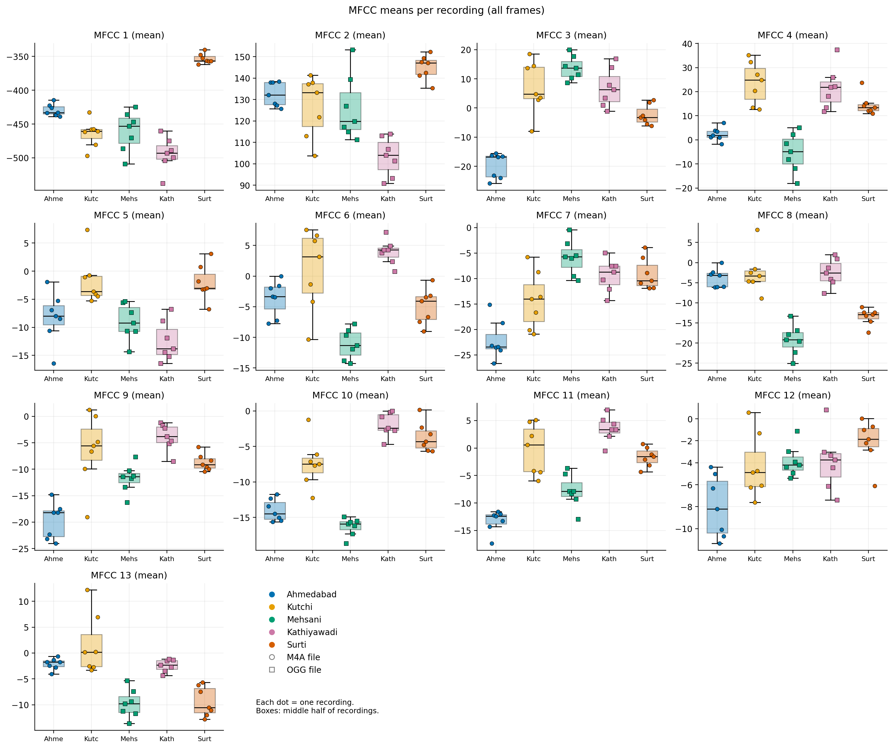

**What it shows.** One small chart per coefficient (MFCC 1 to 13). Every dot is **one recording** (circle = M4A file, square = OGG file); the box shows the middle half of that accent's seven recordings. Showing the dots means the group average never hides individual recordings.

**How to read it.** If the boxes of two accents do not overlap, those accents have separate ranges for that coefficient. If they overlap a lot, the feature does not distinguish them.

**What we observe.**
- Some coefficients show clear gaps: for **MFCC 3**, all seven Ahmedabad recordings (−25.9 to −15.6) still lie below all recordings of all four other accents (Kutchi's lowest is −8.0, Surti's range is −6.1 to 2.7).
- **[CHANGED] MFCC 8:** with four accents the seven Mehsani recordings (−25.1 to −13.3) lay below all the others. Surti (−17.4 to −11.1) is also low and **overlaps Mehsani's range**; both are below Ahmedabad, Kutchi and Kathiyawadi.
- **MFCC 4:** Kutchi and Kathiyawadi sit above Ahmedabad and Mehsani, as before. **[NEW]** Surti (10.9 to 23.7) overlaps the Kutchi and Kathiyawadi range.
- **[NEW] MFCC 1:** all seven Surti recordings (−362 to −340) lie above every one of the other 28 recordings (−538 to −415).
- Other coefficients overlap a lot (for example MFCC 12). Recordings of the same speaker usually cluster; Kutchi is the most spread out.

**Why it matters.** The gaps are between five *people*. A gap on MFCC 3 for Ahmedabad could be accent, but it could equally be that speaker's voice, microphone or sentence choice. Surti's MFCC 1 gap is exactly what a constantly noisy recording would produce (MFCC 1 is mostly overall energy).

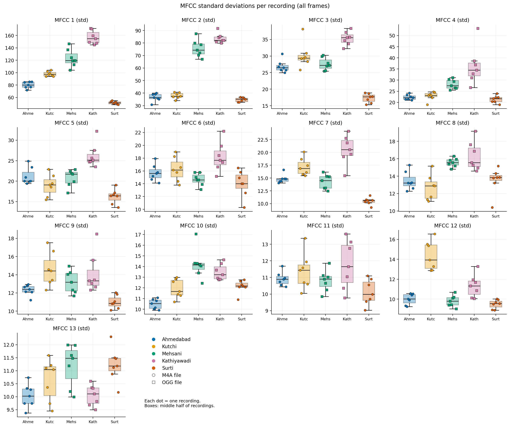

**What it shows.** The same layout for the *standard deviation* of each coefficient (how much it fluctuates inside a recording). **What we observe.** Larger differences between accents than for the means (for example MFCC 2 and MFCC 1 std have η² of 0.97 and 0.95). **[NEW]** Surti has the *smallest* MFCC 1 fluctuation (average standard deviation 51, against 80 to 157): its energy never drops to silence. **Why it matters.** The fluctuation of MFCC 1 and 2 is closely tied to how much silence and noise a recording contains, so these high numbers need the checks in Sections 9 to 11.

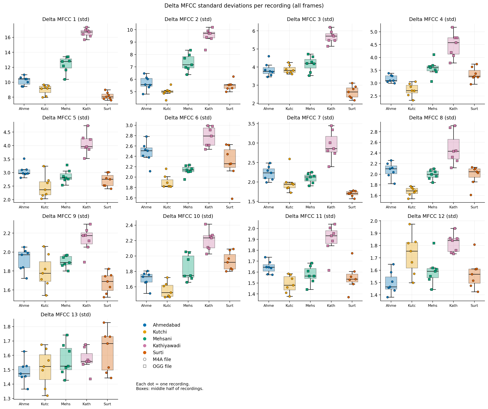

**What it shows.** How much the *speed of change* (delta) of each coefficient fluctuates. **What we observe.** Kathiyawadi is highest for the first coefficients (Delta MFCC 1: 16.6 on whole recordings), then Mehsani (12.4), Ahmedabad (10.2), Kutchi (9.0); **[NEW] Surti is lowest (8.2)**. All three M4A accents are low and both OGG accents high. **Why it matters.** This follows the format split, so it may reflect sharp jumps between speech and digital silence in the OGG files (an idea, not a finding; see Section 10).

The other three recording-level charts are saved in the same style: [MFCC delta means](../results/feature_analysis/figures/03_delta_means_by_accent.png), [delta-delta means](../results/feature_analysis/figures/05_delta2_means_by_accent.png) and [delta-delta standard deviations](../results/feature_analysis/figures/06_delta2_stds_by_accent.png). The delta and delta-delta **means** are very small numbers close to zero and overlap heavily between accents.

### 8.2 Frame-level distributions (MFCC 1–4)

We use MFCC 1–4 for the frame-level and pairwise plots because they are the first four coefficients (they describe the overall energy and broad spectral shape). They were chosen by this fixed rule, not because they look different.

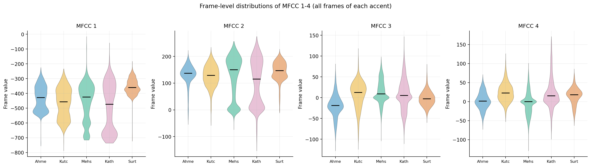

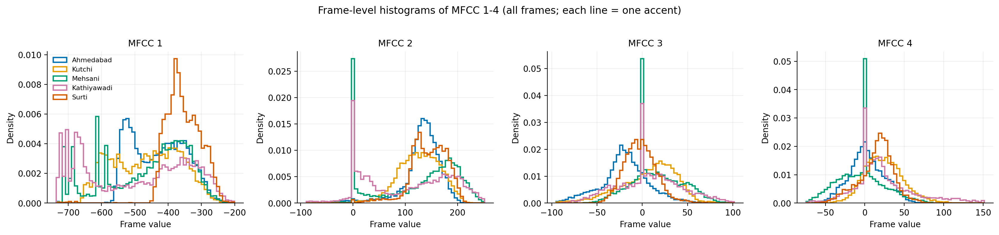

**What they show.** Every 10 ms frame of each accent pooled together, drawn as violins (width = how common a value is; black line = median) and as outline histograms (one line per accent).

**What we observe.**
- The accents **overlap heavily** frame by frame. A single frame cannot tell the accents apart.
- MFCC 1 has two humps for the accents with silent gaps: low values (silence) and higher values (speech). Mehsani and Kathiyawadi show very narrow spikes at about −620 and −700 for MFCC 1. Counting frames: **12.5% of Mehsani and 9.1% of Kathiyawadi frames have MFCC 2 to 4 equal to exactly 0** (digital silence), against 0.2% for Ahmedabad and Kutchi and **0.3% for Surti**.
- **[NEW] Surti has no low-energy hump at all:** only 0.3% of its frames (the first frame or two of each file) have MFCC 1 below −600, against 36% for Kathiyawadi and 19% for Mehsani. Its recordings never go quiet.

**Why it matters.** The spikes are not speech at all, yet they are part of the whole-recording averages. Surti's lack of any quiet frames is why its whole-recording and speech-only features are almost the same (Section 9).

### 8.3 Pairwise plots

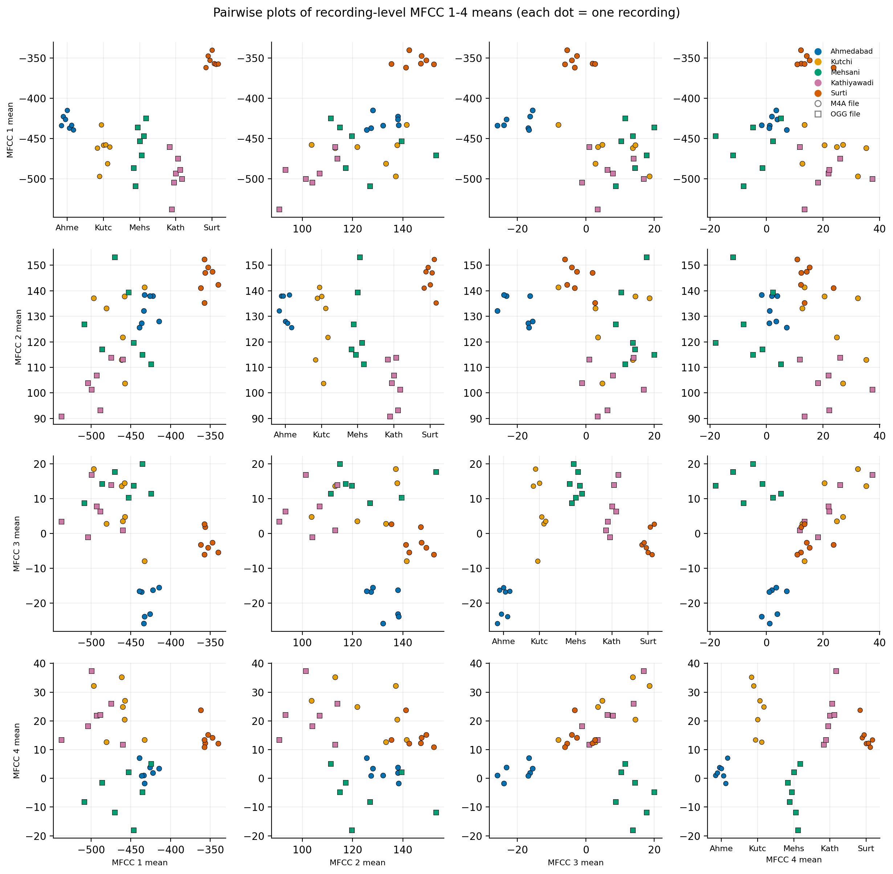

**What it shows.** Every pair among the recording-level means of MFCC 1–4; each dot is a recording. The diagonal shows the values by accent.

**What we observe.** In several panels the accents form fairly separate clouds: MFCC 3 against MFCC 1 puts Ahmedabad lowest in MFCC 3 and **[NEW] Surti far from all the others in MFCC 1 (about −350)**; MFCC 4 against MFCC 3 separates Ahmedabad and Mehsani from Kutchi and Kathiyawadi, with Surti in between. Other panels (for example MFCC 1 against MFCC 2 among the four earlier accents) overlap.

**Why it matters.** It shows how a later method (such as PCA) might find structure. The most visible structure is Surti's MFCC 1, which is an energy/noise feature, so it does not show that the structure is accent.

### 8.4 How big is the overlap, for all 78 features?

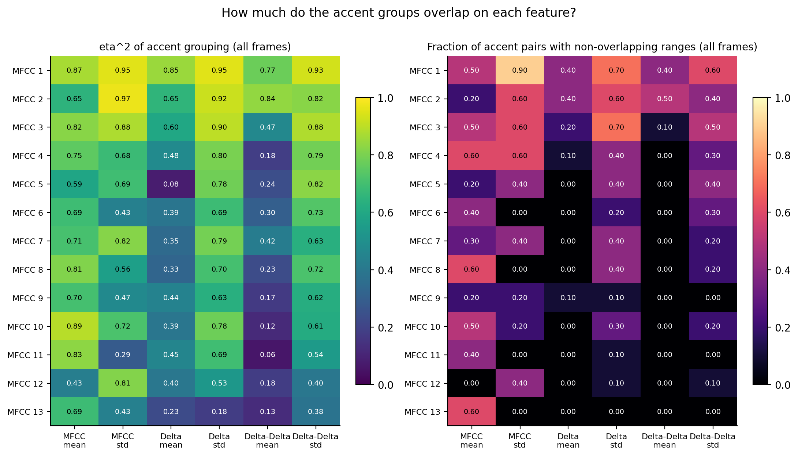

**What it shows.** Left: η² of the accent grouping for every coefficient (rows) and feature type (columns). Right: the fraction of the 10 accent pairs with non-overlapping ranges. Whole-recording features.

**How to read it.** Bright = large (accents explain a lot / many pairs have separate ranges). Dark = small (heavy overlap).

**What we observe.**
- Highest η² (whole recordings): MFCC 2 std (0.97), Delta MFCC 1 std (0.95), MFCC 1 std (0.95), Delta-Delta MFCC 1 std (0.93), Delta MFCC 2 std (0.92).
- Lowest: Delta-Delta MFCC 11 mean (0.06), Delta MFCC 5 mean (0.08), Delta-Delta MFCC 10 mean (0.12).
- 51 of 78 features have at least one pair of accents with separate ranges (46 of 78 with four accents, which had only 6 pairs). **No** feature separates all 10 pairs; the most separates 9.
- Whole-recording classes: 44 features high, 22 moderate, 12 heavy overlap (four accents: 38, 25, 15).

**Why it matters.** Many features have large η², but with one person per group this is expected. The more useful information is which features overlap heavily and can be given lower priority later (without deleting them).

### 8.5 Correlation between features

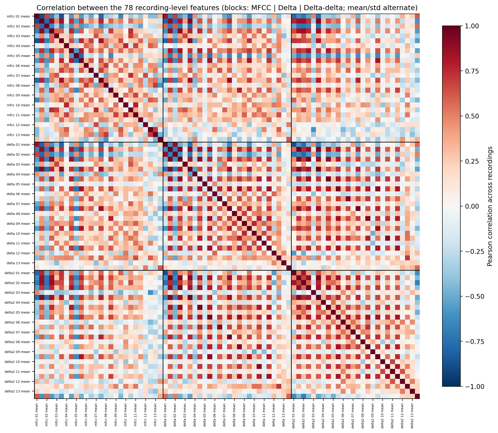

**What it shows.** How similarly each pair of features moves across the 35 recordings (Pearson correlation, −1 to +1; red = move together, blue = opposite).

**What we observe.** Many features are strongly related: 18 of 3,003 pairs have |r| ≥ 0.9 and 232 have |r| ≥ 0.7. The strongest are the **standard deviation of a delta and of the delta-delta of the same coefficient** (for example Delta MFCC 1 std with Delta-Delta MFCC 1 std, r = 0.98).

**Why it matters.** Many features carry almost the same information. Later methods that are sensitive to that (including PCA) will find shared directions, and we should not count each as an independent clue.

---

## 9. Silence and Speech Analysis

### 9.1 Is the alignment right?

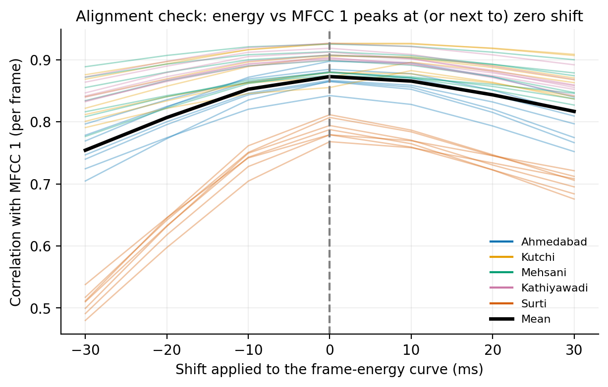

**What it shows.** For each recording, how well frame loudness matches MFCC 1 when we slide one curve against the other (−30 ms to +30 ms). The bold line is the mean.

**What we observe.** The curves peak at zero shift (33 recordings) or one frame next to it (2). Correlation at zero shift is at least 0.77 (the lowest is a Surti recording, where the constant noise blurs the match) and its median is 0.88.

**Why it matters.** This is evidence that the speech/non-speech labels line up with the MFCC frames; we did not assume it.

### 9.2 How many frames did we keep?

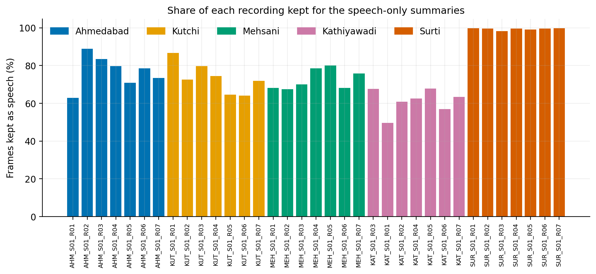

**What it shows.** The percentage of frames kept as speech in each recording (30 dB rule).

**What we observe.** Overall 75.5% of frames are speech (33,706 of 44,664). The lowest is `KAT_S01_R01` (49.6%). **[NEW] All seven Surti recordings keep 98.2 to 99.7%**, far above the others (the highest of the other accents is 88.8%, `AHM_S01_R02`). Kathiyawadi keeps the smallest share among the original four accents on average (61.2%). Every recording keeps at least 527 speech frames.

**Why it matters.** The Surti bars are not a sign of continuous speech: they show the detector limit explained in Section 9.5. For Surti, "speech-only" features are practically the whole-recording features.

### 9.3 Whole recording versus speech only

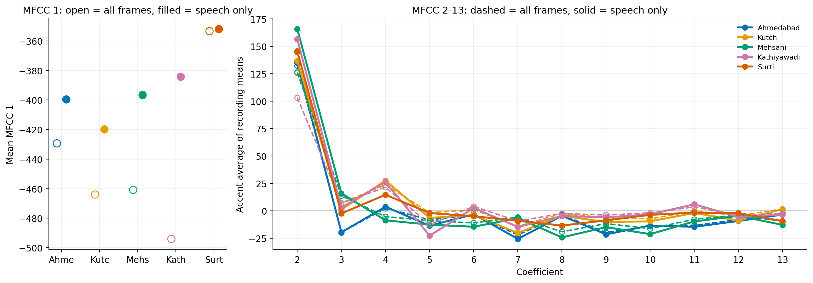

**What it shows.** Accent averages of the recording means for MFCC 1 (left) and MFCC 2–13 (right). Dashed or open = whole recordings; solid or filled = speech frames only.

**What we observe.**
- **MFCC 1** moves a lot for the accents with silent gaps (for example Kathiyawadi −494 → −384, Mehsani −461 → −396) and **hardly at all for Surti (−353 → −352)**, because Surti has almost no non-speech frames to remove. The order of the accents changes: whole recordings Surti > Ahmedabad > Mehsani > Kutchi > Kathiyawadi; speech only Surti > Kathiyawadi > Mehsani > Ahmedabad > Kutchi.
- **MFCC 2** also changes a lot: Kathiyawadi goes from lowest (103.3) to 156.8, and Mehsani becomes highest among the original four (165.9). Surti goes from 145.0 to 145.6.
- MFCC 3 to 13 change much less.

**Why it matters.** The first two coefficients were dominated by silence and loudness. The speech-only comparison is the better starting point, but for Surti it cannot do what it does for the others.

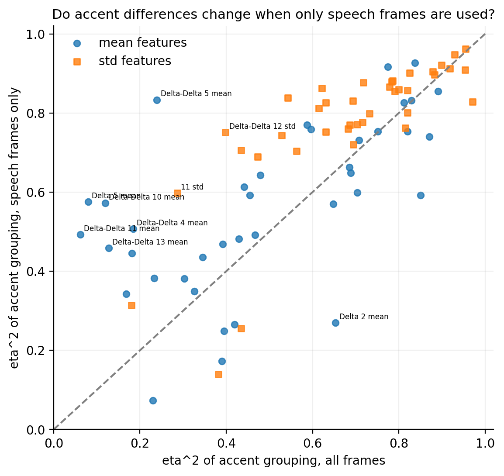

**What it shows.** For each of the 78 features, the accent η² on whole recordings (x-axis) against the same feature on speech frames (y-axis). On the dashed line nothing changed.

**What we observe.** Most dots are near or above the line. 30 of 78 features change by more than 0.15 (25 before), mostly delta and delta-delta means, which are tiny numbers and get larger differences once silence is removed. The largest drops are Delta MFCC 2 mean (0.65 → 0.27) and Delta MFCC 1 mean (0.85 → 0.59). The average η² of the mean features rises from 0.49 to 0.56.

**Why it matters.** The conclusions about which features overlap are mostly stable, but a large share of the features are sensitive to the silence frames, so their whole-recording values should be treated with care.

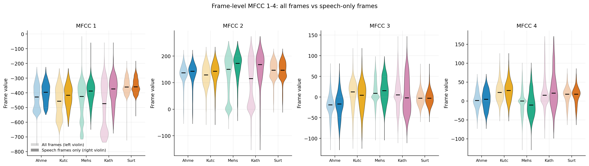

**What it shows.** For MFCC 1–4, the light violin (left) is all frames and the dark violin (right) is speech frames only.

**What we observe.** For Mehsani, Kathiyawadi and Kutchi the long lower tails and spikes (silence) disappear in the dark violins. For Surti the two violins are almost identical. The distributions of the five accents still overlap strongly.

**Why it matters.** Restricting to speech frames removes artefacts for the accents that have silence, but individual frames still do not separate the accents.

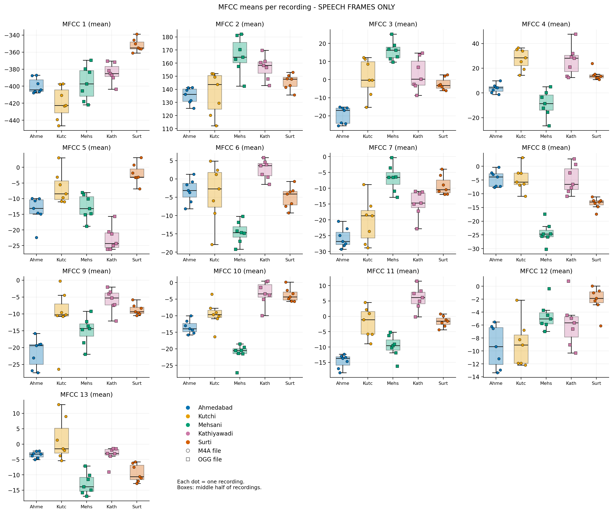

**What it shows.** The same layout as Figure 01 but using speech frames only. (Compare it with Section 8.1.)

**What we observe.** The gaps seen earlier for MFCC 3, MFCC 4, MFCC 8 and MFCC 10 remain, while MFCC 1 and MFCC 2 change as described above.

### 9.4 Does the link with the amount of speech go away?

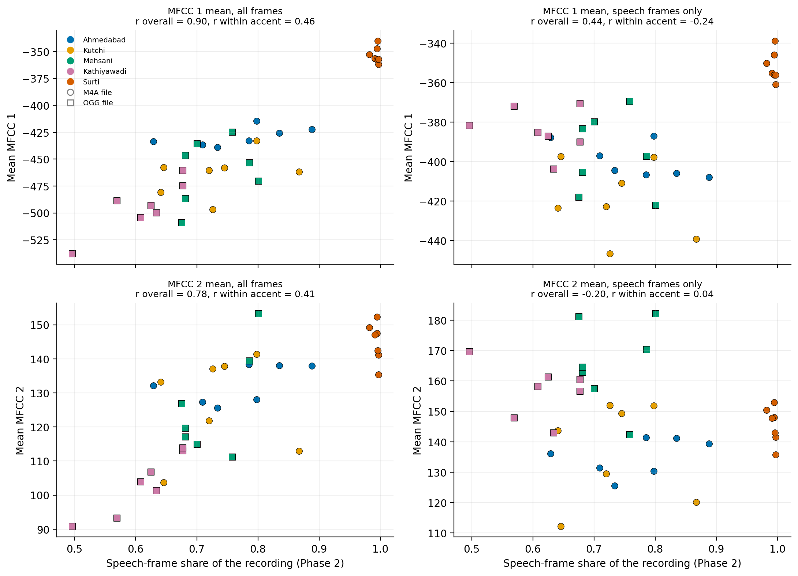

**What it shows.** Each dot is a recording. Left: whole-recording MFCC 1 and 2 means against the share of speech frames (from Phase 2). Right: speech-only means. *r overall* is the correlation across all 35; *r within accent* removes each speaker's own average first.

| Feature | Version | r with speech share (pooled) | r with speech share (within accent) | r with noise floor (pooled) | r with noise floor (within accent) |
|---|---:|---:|---:|---:|---:|
| MFCC 1 mean | whole recording | 0.90 | 0.46 | 0.74 | 0.45 |
| MFCC 1 mean | speech only (30 dB) | 0.44 | −0.24 | 0.19 | −0.05 |
| MFCC 2 mean | whole recording | 0.78 | 0.41 | 0.68 | 0.43 |
| MFCC 2 mean | speech only (30 dB) | −0.20 | 0.04 | −0.63 | −0.12 |

**What we observe.** For whole recordings the means rise with the speech share (0.90 and 0.78 pooled; 0.46 and 0.41 within accent). With speech frames only, the MFCC 2 relationship disappears within an accent (0.04) and the MFCC 1 relationship changes sign (−0.24). **[CHANGED]** The pooled values are larger than with four accents (0.69 and 0.70) because the Surti cluster (speech share about 99%, MFCC 1 highest) sits at the extreme end. As that share is a detector artefact, **the within-accent values are the safer numbers, and they are unchanged.**

**Why it matters.** This confirms the Phase 3 suspicion: the first two coefficients mostly reflect how much of a recording is silence. Speech-only versions are the better starting point for comparing speakers.

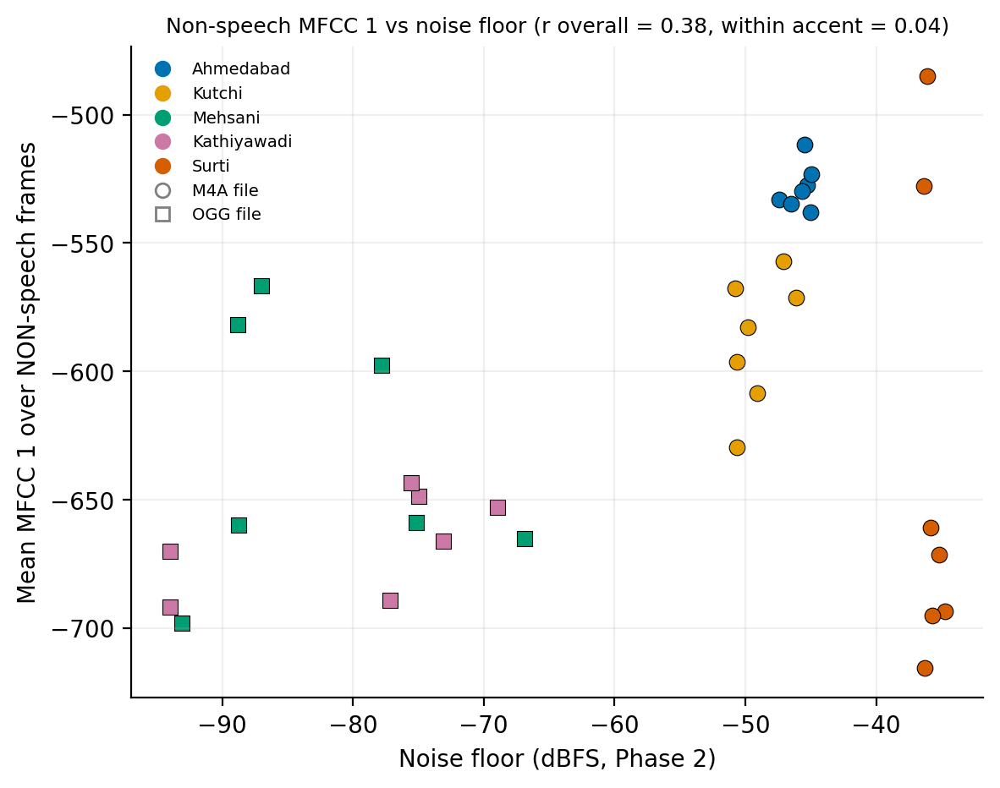

**What it shows.** MFCC 1 averaged over only the **non-speech** frames against the noise floor measured in Phase 2.

**What we observe.** Among the original four accents the two go together across speakers (r = 0.76): Ahmedabad and Kutchi (M4A, noise floor −45 to −51 dBFS) at the top, Mehsani and Kathiyawadi (OGG, much lower noise floor) lower. With all five accents the pooled r is 0.38 (0.04 within accent). **[NEW – caution]** The fall is caused by Surti: its recordings have only **3 to 16 non-speech frames** (30 to 160 ms, mostly the very first frame), against hundreds in the other accents, so Surti's points rest on almost no data. The figure should be read for the four original accents only.

**Why it matters.** In pauses, MFCC 1 measures the background, and the background differs between recording setups. For Surti we cannot test this with the 30 dB rule.

### 9.5 [NEW] Sensitivity to the speech-detector threshold

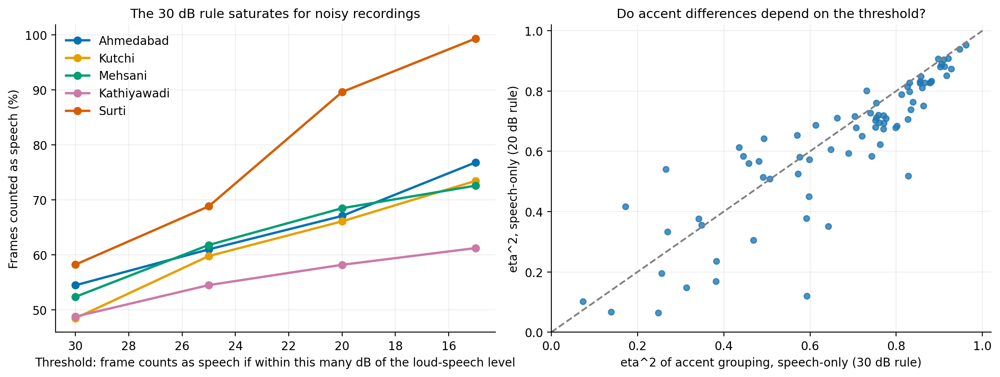

**What it shows.** Left: the share of frames counted as speech when the rule is made stricter (30, 25, 20 and 15 dB below the loud-speech level), for each accent. Right: for each of the 78 features, the accent η² under the 30 dB rule (x-axis) against the 20 dB rule (y-axis).

**Share of frames counted as speech (%), by rule:**

| Accent | 30 dB rule | 25 dB rule | 20 dB rule | 15 dB rule |
|---|---:|---:|---:|---:|
| Ahmedabad | 76.8 | 67.1 | 61.0 | 54.5 |
| Kutchi | 73.5 | 66.1 | 59.8 | 48.5 |
| Mehsani | 72.6 | 68.5 | 61.8 | 52.4 |
| Kathiyawadi | 61.2 | 58.2 | 54.5 | 48.8 |
| Surti | 99.3 | 89.6 | 68.8 | 58.2 |

**What we observe.**
- Under the 30 dB rule Surti jumps to 99.3% while the other accents sit at 61 to 77%. Under a 20 dB rule Surti falls to 68.8%, in line with the others (54.5 to 61.8%). **The Surti jump is a threshold effect.** The reason is that Surti's quietest frames are only about 28 dB below its loud speech (35 to 100 dB for the others), because its background noise is high.
- Only 12 of 78 features change their accent η² by more than 0.15 between the 30 dB and 20 dB rules, and the two sets correlate 0.88 (right panel: most dots lie close to the diagonal).
- Accent averages (30 dB rule / 20 dB rule) for key features:

| Feature | Ahmedabad | Kutchi | Mehsani | Kathiyawadi | Surti |
|---|---:|---:|---:|---:|---:|
| MFCC 1 mean | −399.5 / −380.2 | −419.7 / −398.0 | −396.4 / −380.1 | −384.2 / −367.4 | −351.9 / −332.9 |
| MFCC 2 mean | 135.1 / 141.6 | 137.0 / 141.1 | 165.9 / 175.6 | 156.8 / 168.0 | 145.6 / 159.2 |
| MFCC 4 mean | 3.7 / 4.0 | 27.5 / 28.9 | −8.7 / −11.2 | 26.3 / 26.4 | 14.6 / 13.1 |
| MFCC 8 mean | −4.6 / −5.8 | −4.5 / −6.0 | −24.3 / −25.1 | −4.8 / −5.4 | −13.5 / −17.4 |
| Delta MFCC 1 std | 11.1 / 11.2 | 10.0 / 10.1 | 13.1 / 12.5 | 19.4 / 18.7 | 7.6 / 8.0 |

- Under the 20 dB rule the MFCC 1 means of M4A and OGG are −370.3 and −373.7 (no clear difference, as under 30 dB), and MFCC 2 still reverses (M4A 147.3, OGG 171.8; whole recordings M4A 134.8 > OGG 114.7).

**Why it matters.** The main conclusions of Phase 4 do not depend strongly on the exact threshold, but **Surti's "speech-only" features under the 30 dB rule are not comparable with the other accents'**: they contain the background-noise frames. A stricter rule gives Surti a normal-looking speech share, so later analyses should keep both versions (the 20 dB speech-only table is saved as `speech_only_recording_features_ref20.csv`).

---

## 10. Recording Format Analysis

Ahmedabad, Kutchi and (new) Surti were M4A; Mehsani and Kathiyawadi were OGG. We compared features by format and asked how much format alone explains.

### Selected features by format

| Feature | M4A mean (all / speech) | OGG mean (all / speech) | eta^2 format (all / speech) | eta^2 accent after format (all / speech) |
|---|---:|---:|---:|---:|
| MFCC 1 mean | −415.6 / −390.3 | −477.5 / −390.3 | 0.35 / 0.00 | 0.80 / 0.74 |
| MFCC 2 mean | 134.8 / 139.2 | 114.7 / 161.3 | 0.34 / 0.48 | 0.47 / 0.17 |
| MFCC 3 mean | −5.0 / −6.9 | 10.3 / 9.4 | 0.34 / 0.37 | 0.73 / 0.61 |
| MFCC 4 mean | 13.5 / 15.3 | 8.1 / 8.8 | 0.04 / 0.04 | 0.74 / 0.74 |
| Delta MFCC 1 std | 9.1 / 9.6 | 14.5 / 16.2 | 0.72 / 0.65 | 0.84 / 0.89 |
| Delta MFCC 2 std | 5.4 / 5.6 | 8.4 / 9.1 | 0.74 / 0.67 | 0.68 / 0.73 |
| Delta-Delta MFCC 1 std | 3.8 / 4.0 | 6.0 / 6.4 | 0.61 / 0.54 | 0.82 / 0.88 |

### Features where format explains at least half of the variation (speech-only)

| Feature | eta^2 format (all) | eta^2 format (speech) | eta^2 accent after format (speech) |
|---|---:|---:|---:|
| MFCC 4 std | 0.53 | 0.55 | 0.47 |
| MFCC 10 std | 0.56 | 0.54 | 0.73 |
| Delta MFCC 1 std | 0.72 | 0.65 | 0.89 |
| Delta MFCC 2 std | 0.74 | 0.67 | 0.73 |
| Delta MFCC 3 mean | 0.12 | 0.73 | 0.11 |
| Delta MFCC 4 mean | 0.01 | 0.6 | 0.12 |
| Delta MFCC 4 std | 0.51 | 0.58 | 0.66 |
| Delta-Delta MFCC 1 mean | 0.41 | 0.65 | 0.76 |
| Delta-Delta MFCC 1 std | 0.61 | 0.54 | 0.88 |
| Delta-Delta MFCC 2 mean | 0.76 | 0.86 | 0.49 |
| Delta-Delta MFCC 3 std | 0.63 | 0.58 | 0.75 |
| Delta-Delta MFCC 4 std | 0.55 | 0.66 | 0.65 |
| Delta-Delta MFCC 11 std | 0.2 | 0.51 | 0.67 |

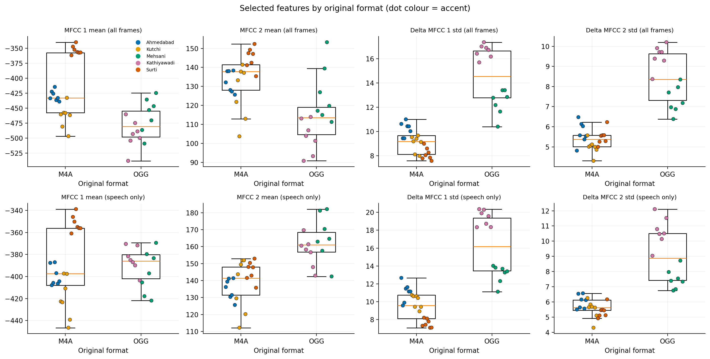

**What it shows.** Four features (columns) split by M4A and OGG. Top row: whole recordings. Bottom row: speech frames only. Dot colour = accent.

**What we observe.**
- **MFCC 2 mean:** OGG is lower on whole recordings but **higher** on speech frames. The direction still reverses.
- **[CHANGED] MFCC 1 mean:** with four accents OGG was lower on whole recordings and higher on speech frames. Now OGG is lower on whole recordings (−477.5 against −415.6 for M4A) but **there is no difference on speech frames** (both −390.3), because the three M4A accents are very spread out (Surti at about −352, Kutchi at about −420).
- **Delta MFCC 1 and 2 standard deviations:** OGG is clearly higher in both versions and **all three M4A accents (including Surti) sit low**. Inside OGG, Kathiyawadi is higher than Mehsani; inside M4A, Surti and Kutchi are lower than Ahmedabad.

**Why it matters.** The delta format difference is now seen in three M4A accents against two OGG accents, which makes a pure "accent" explanation less likely and a recording-chain explanation more likely. It is still not proven: we cannot say that format *causes* any difference, and the delta variability may be tied to how the recordings handle silence.

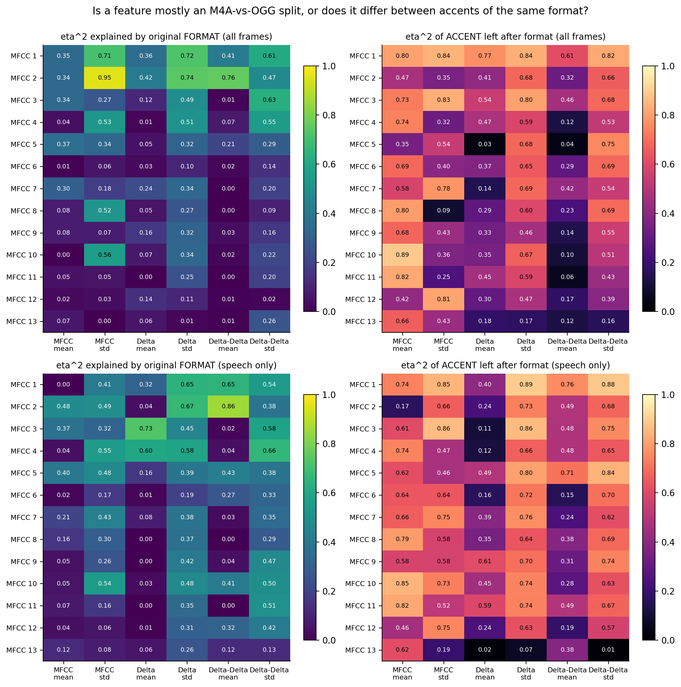

**What it shows.** Left column: how much of each feature's variation M4A-versus-OGG explains. Right column: how much accent explains **after** format is removed (this now compares three accents inside M4A and two inside OGG). Top: whole recordings; bottom: speech only.

**How to read it.** A feature that is bright on the left and dark on the right is mostly a format split. A feature that is dark on the left and bright on the right differs between accents of the **same** format.

**What we observe.**
- Format-dominated (speech-only): Delta MFCC 3 mean, Delta MFCC 4 mean.
- Many features are not format-associated but still differ between accents, for example MFCC 4, 8, 10 and 11 means (format η² of 0.28 or less).
- 13 features have format η² of at least 0.50; 11 of them still keep accent η² after format at 0.30 or more.

**Why it matters.** Format clearly shapes several features (especially MFCC 2 and the delta variability), so those need caution. But format cannot explain everything: some differences exist between accents recorded in the same format. **We cannot say that format *causes* any difference.** We can only say how strongly they go together.

---

## 11. Quality-Related Findings

We related each feature to five Phase 2 quality measures (speech share, noise floor, duration, clipped samples, level deviation) and two flags (clipping, level-inconsistent). Each pair has two numbers: pooled r / within-accent r.

| Feature (whole recording) | Speech share | Noise floor | Duration | Clipping flag | Level flag |
|---|---:|---:|---:|---:|---:|
| MFCC 1 mean | 0.90 / 0.46 | 0.74 / 0.45 | −0.43 / −0.04 | −0.42 / 0.34 | −0.07 / 0.02 |
| MFCC 2 mean | 0.78 / 0.41 | 0.68 / 0.43 | −0.22 / −0.28 | −0.70 / −0.44 | −0.14 / −0.25 |
| MFCC 3 mean | −0.24 / 0.19 | −0.55 / 0.08 | 0.20 / 0.40 | 0.48 / 0.24 | 0.17 / 0.22 |
| MFCC 4 mean | −0.01 / 0.25 | 0.23 / 0.20 | −0.01 / 0.47 | −0.00 / 0.09 | 0.32 / 0.33 |
| Delta MFCC 1 std | −0.70 / 0.07 | −0.79 / 0.18 | −0.03 / 0.00 | 0.74 / −0.08 | −0.12 / 0.04 |
| Delta MFCC 2 std | −0.56 / 0.10 | −0.76 / 0.05 | −0.13 / 0.14 | 0.74 / −0.04 | −0.17 / −0.05 |

*(Whole-recording features. The full tables for all 78 features, both versions, are in `quality_correlations.csv`.)*

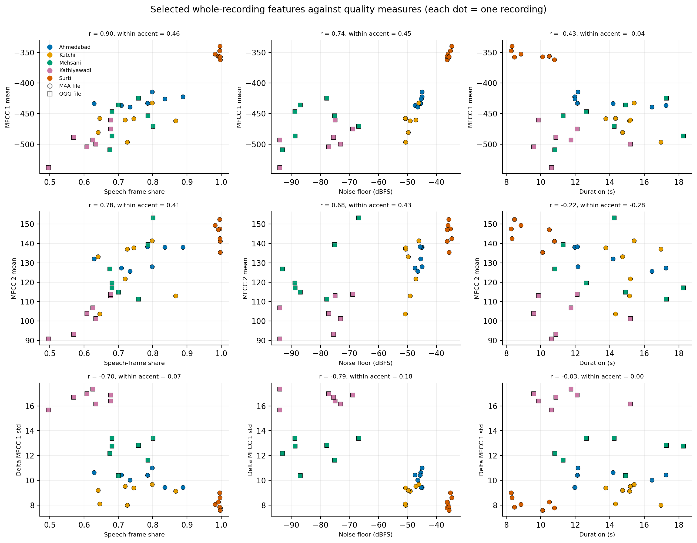

**What it shows.** MFCC 1 mean, MFCC 2 mean and Delta MFCC 1 std (rows) against speech share, noise floor and duration (columns); each dot is a recording.

**What we observe.**
- MFCC 1 and 2 means rise with speech share and noise floor (pooled r 0.68 to 0.90; within accent 0.41 to 0.46). **[CHANGED]** The pooled values are higher than with four accents (0.54 to 0.70) because of the Surti cluster, which has the highest noise floor, the highest MFCC 1 and a (detector-limited) 99% speech share; the within-accent values barely changed.
- **Delta MFCC 1 std** correlates strongly across speakers with noise floor (−0.79), speech share (−0.70) and clipping flag (+0.74), but **within a speaker** these links are close to zero (0.18, 0.07 and −0.08). The cloud simply separates the OGG accents (high) from the M4A accents (low).
- Duration is only weakly related to these features overall.

**Why it matters.** Many strong-looking relationships are really "which speaker/format is this". Within one speaker's own recordings they mostly disappear. **[NEW]** For Surti this test is weak: the noise floor of its seven recordings varies by less than 2 dB (−34.8 to −36.4), so its own recordings contain almost no variation that could show a within-speaker link.

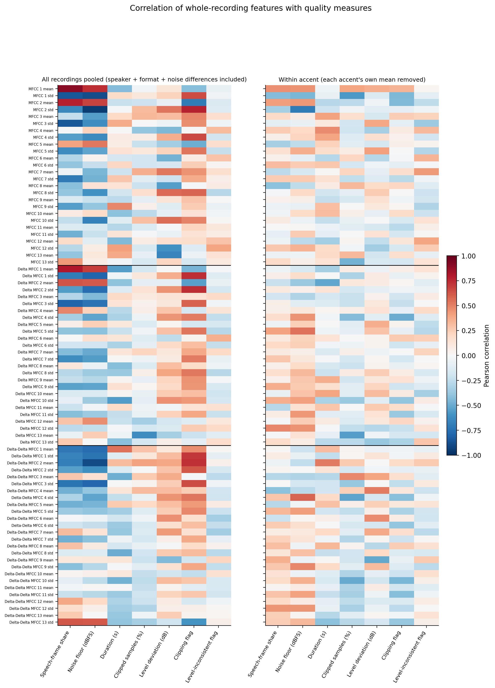

**What it shows.** Every feature (rows) against every quality measure (columns). Left: pooled; right: within accent.

**What we observe.** The left half has many strong colours; the right half is much paler. The speech-only version of the same figure is [here](../results/feature_analysis/figures/23_quality_correlations_speech_only.png).

**Quality-sensitive within a single speaker (speech-only):** MFCC 3 std, Delta MFCC 6 mean (2 features; 4 with four accents).

**Duration.** Duration depends on how long a speaker's sentence was, so it partly reflects the words used. For example, MFCC 4 mean has a within-accent correlation of 0.47 (whole recording) and 0.51 (speech only) with duration. The screening rules did not look at duration, so this is one more reason to stay cautious with that feature.

**Recordings kept.** All 11 flagged recordings are included everywhere. No noise reduction, clipping repair or normalisation was used.

---

## 12. Candidate Feature Observations

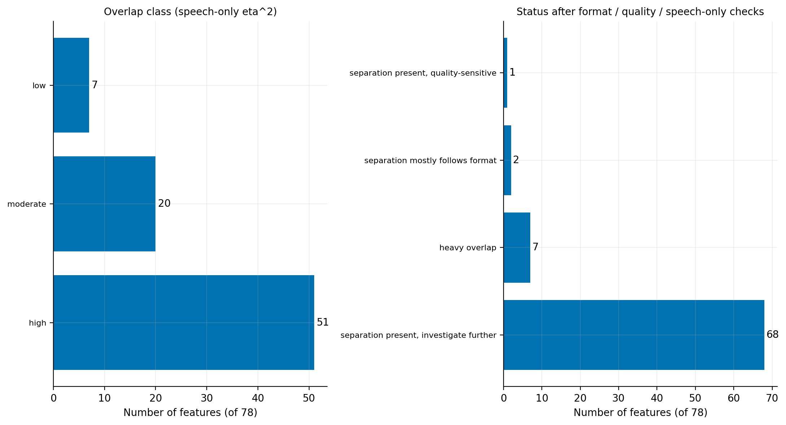

**What it shows.** How many features fall into each overlap class and each final status. (Counts are in Section 7.)

**What we observe.**
- **Heavy overlap (MFCC 13 std, Delta MFCC 2 mean, Delta MFCC 6 mean, Delta MFCC 12 mean, Delta MFCC 13 mean, Delta-Delta MFCC 7 mean, Delta-Delta MFCC 13 std):** mostly delta and delta-delta *means* and MFCC 13 std; the accents are not distinguishable on these.
- **Mostly format-driven:** Delta MFCC 3 mean, Delta MFCC 4 mean.
- 35 features pass every screening rule (listed below): 28 of the 30 from the four-accent run, plus 7 new ones.

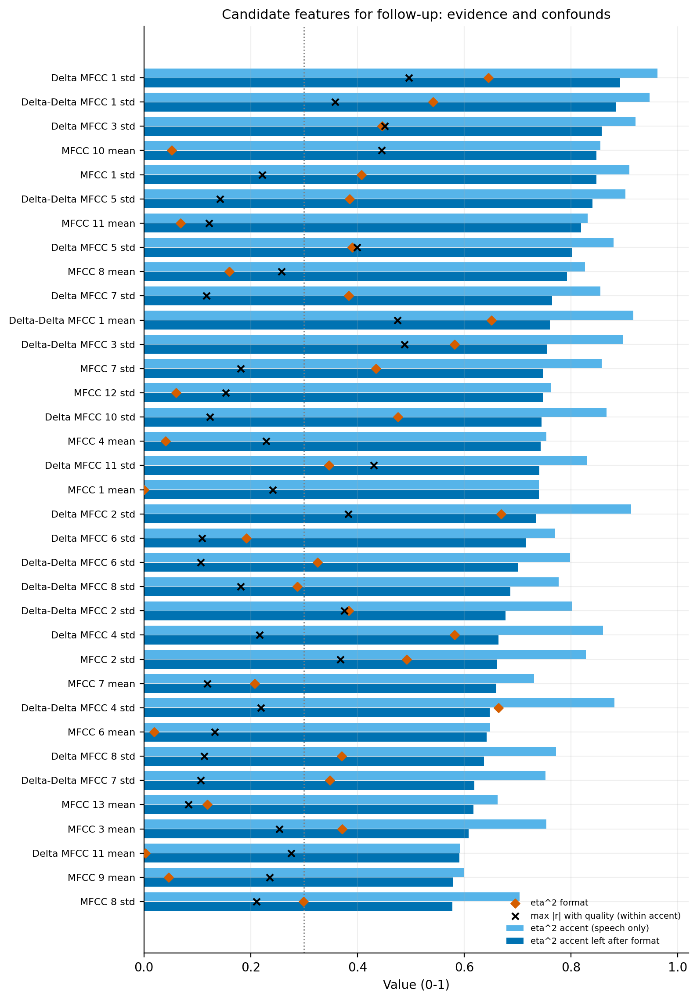

**What it shows.** For each candidate: light bar = accent η² (speech-only); dark bar = accent η² left after format; orange diamond = η² of format; black cross = strongest within-accent correlation with speech share or noise floor.

**How to read it.** The best candidates have long bars and short diamonds/crosses (differences between accents of the same format that do not follow quality).

### The candidate table

| Feature | eta^2 accent (speech) | Disjoint accent pairs (of 10) | eta^2 format | eta^2 accent after format | Max abs r with speech share / noise (within accent) | Format note |
|---|---:|---:|---:|---:|---:|---:|
| Delta MFCC 1 std | 0.96 | 8 | 0.65 | 0.89 | 0.5 | partly format-associated |
| Delta-Delta MFCC 1 std | 0.95 | 7 | 0.54 | 0.88 | 0.36 | partly format-associated |
| Delta MFCC 3 std | 0.92 | 7 | 0.45 | 0.86 | 0.45 | partly format-associated |
| MFCC 10 mean | 0.86 | 6 | 0.05 | 0.85 | 0.44 | not format-associated |
| MFCC 1 std | 0.91 | 7 | 0.41 | 0.85 | 0.22 | partly format-associated |
| Delta-Delta MFCC 5 std | 0.9 | 4 | 0.38 | 0.84 | 0.14 | partly format-associated |
| MFCC 11 mean | 0.83 | 5 | 0.07 | 0.82 | 0.12 | not format-associated |
| Delta MFCC 5 std | 0.88 | 5 | 0.39 | 0.8 | 0.4 | partly format-associated |
| MFCC 8 mean | 0.83 | 6 | 0.16 | 0.79 | 0.26 | not format-associated |
| Delta MFCC 7 std | 0.85 | 7 | 0.38 | 0.76 | 0.12 | partly format-associated |
| Delta-Delta MFCC 1 mean | 0.92 | 6 | 0.65 | 0.76 | 0.48 | partly format-associated |
| Delta-Delta MFCC 3 std | 0.9 | 6 | 0.58 | 0.75 | 0.49 | partly format-associated |
| MFCC 7 std | 0.86 | 6 | 0.43 | 0.75 | 0.18 | partly format-associated |
| MFCC 12 std | 0.76 | 4 | 0.06 | 0.75 | 0.15 | not format-associated |
| Delta MFCC 10 std | 0.87 | 4 | 0.48 | 0.74 | 0.12 | partly format-associated |
| MFCC 4 mean | 0.75 | 6 | 0.04 | 0.74 | 0.23 | not format-associated |
| Delta MFCC 11 std | 0.83 | 4 | 0.35 | 0.74 | 0.43 | partly format-associated |
| MFCC 1 mean | 0.74 | 4 | 0.0 | 0.74 | 0.24 | not format-associated |
| Delta MFCC 2 std | 0.91 | 7 | 0.67 | 0.73 | 0.38 | partly format-associated |
| Delta MFCC 6 std | 0.77 | 4 | 0.19 | 0.72 | 0.11 | not format-associated |
| Delta-Delta MFCC 6 std | 0.8 | 4 | 0.33 | 0.7 | 0.11 | partly format-associated |
| Delta-Delta MFCC 8 std | 0.78 | 3 | 0.29 | 0.69 | 0.18 | not format-associated |
| Delta-Delta MFCC 2 std | 0.8 | 4 | 0.38 | 0.68 | 0.38 | partly format-associated |
| Delta MFCC 4 std | 0.86 | 5 | 0.58 | 0.66 | 0.22 | partly format-associated |
| MFCC 2 std | 0.83 | 5 | 0.49 | 0.66 | 0.37 | partly format-associated |
| MFCC 7 mean | 0.73 | 2 | 0.21 | 0.66 | 0.12 | not format-associated |
| Delta-Delta MFCC 4 std | 0.88 | 4 | 0.66 | 0.65 | 0.22 | partly format-associated |
| MFCC 6 mean | 0.65 | 3 | 0.02 | 0.64 | 0.13 | not format-associated |
| Delta MFCC 8 std | 0.77 | 5 | 0.37 | 0.64 | 0.11 | partly format-associated |
| Delta-Delta MFCC 7 std | 0.75 | 5 | 0.35 | 0.62 | 0.11 | partly format-associated |
| MFCC 13 mean | 0.66 | 4 | 0.12 | 0.62 | 0.08 | not format-associated |
| MFCC 3 mean | 0.75 | 4 | 0.37 | 0.61 | 0.25 | partly format-associated |
| Delta MFCC 11 mean | 0.59 | 0 | 0.0 | 0.59 | 0.28 | not format-associated |
| MFCC 9 mean | 0.6 | 2 | 0.05 | 0.58 | 0.24 | not format-associated |
| MFCC 8 std | 0.7 | 4 | 0.3 | 0.58 | 0.21 | not format-associated |

**What we observe.**
- Candidates still include MFCC 4, 6, 8, 10 and 11 means (not format-associated and weakly linked to quality) and many delta/delta-delta standard deviations.
- For example **MFCC 8 mean** (speech-only, 30 dB rule): Ahmedabad −4.6, Kutchi −4.5, Kathiyawadi −4.8, **Surti −13.5 and Mehsani −24.3**. With four accents it separated one speaker (Mehsani) from the rest; now two speakers are low and their ranges overlap.
- **MFCC 4 mean** (Ahmedabad 3.7, Kutchi 27.5, Mehsani −8.7, Kathiyawadi 26.3, **Surti 14.6**) still splits the speakers into two pairs (one M4A and one OGG in each pair), with Surti in between. Format cannot explain that split.
- **[NEW] Seven features joined the list: MFCC 1 mean, MFCC 2 std, MFCC 7 mean, MFCC 13 mean, Delta MFCC 1 std, Delta-Delta MFCC 1 mean and Delta-Delta MFCC 3 std.** All seven are overall-level or variability features, and three of them (MFCC 1 mean, Delta MFCC 1 std, Delta-Delta MFCC 3 std) are among the features where Surti lies outside the range of every other recording (table below). Because the noise floor barely varies between Surti's own recordings, the within-accent quality test cannot exclude a noise explanation for them. **Treat them with extra suspicion.**
- Two features left the list (Delta MFCC 9 mean and MFCC 5 mean). They are not less separated (their speech-only accent η² did not fall: 0.61 compared with 0.61 before, and 0.77 compared with 0.67 before), but with Surti their η² changed by slightly more than 0.15 between whole recordings and speech frames (0.44 → 0.61 and 0.59 → 0.77), so they no longer count as "stable after speech-only".

### Features where Surti stands apart (speech-only, 30 dB rule)

In these 10 features all seven Surti recordings lie outside the range of all 28 other recordings:

| Feature | Surti (min to max) | All 28 other recordings (min to max) | Surti is |
|---|---|---|---|
| MFCC 1 mean | −360.9 to −338.8 | −446.5 to −369.4 | above all |
| MFCC 1 std | 44.3 to 49.8 | 59.2 to 96.6 | below all |
| MFCC 3 std | 15.3 to 18.9 | 26.7 to 45.6 | below all |
| MFCC 7 std | 9.2 to 11.6 | 13.7 to 27.3 | below all |
| Delta MFCC 1 mean | 0.1 to 0.2 | −0.8 to 0.0 | above all |
| Delta MFCC 1 std | 7.1 to 8.2 | 8.9 to 20.4 | below all |
| Delta MFCC 3 std | 2.2 to 3.1 | 3.7 to 7.4 | below all |
| Delta MFCC 7 std | 1.6 to 1.8 | 1.9 to 4.0 | below all |
| Delta-Delta MFCC 1 std | 3.1 to 3.7 | 3.8 to 8.6 | below all |
| Delta-Delta MFCC 3 std | 1.3 to 1.6 | 1.7 to 3.4 | below all |

These are mainly overall-level (MFCC 1), and variability (standard deviation) features. That is what a recording with constant, loud background noise and no digital silence would give. **They do not show that Surti is acoustically distinct as an accent.**

**Confounds that apply to every candidate:** speaker voice, wording, microphone/room, and (for Surti) a different recording session and device. **Further investigation:** needs recordings from more speakers per accent, ideally on the same device and format, before any of these can be called accent-related.

---

## 13. Limitations and Potential Biases

1. **One speaker per accent.** Accent, speaker, device, room and vocabulary cannot be separated. Large η² values are expected for any feature that differs between five different people. The dataset collector has confirmed that the seven Surti recordings are from one speaker, so this holds for all five accents.
2. **Format and setup tied to accent.** M4A = Ahmedabad, Kutchi and Surti; OGG = Mehsani and Kathiyawadi. The within-format comparison is now three accents in M4A and two in OGG, but every accent still has its own noise and loudness profile, and Surti comes from a different session and probably a different device (44.1 kHz source against 48 kHz).
3. **Seven recordings per speaker.** The recordings of one speaker are not independent of each other, so no significance testing was done and none would be valid.
4. **Speech detection is a simple energy rule.** Very quiet speech may be treated as non-speech, noise may be treated as speech, and **[NEW] the rule fails completely for the noisy Surti recordings** (99% speech, almost no non-speech frames). About 30 features changed their η² by more than 0.15 when switching to speech frames, so the speech/non-speech boundary matters. The 20 dB sensitivity check is the only protection against this.
5. **The alignment tolerance was set after seeing the data** (±1 frame; Section 5). A sensitivity test shows it is harmless.
6. **Screening thresholds are conventions** (0.30, 0.50, 0.60), fixed before looking at results but not statistically derived. One rule (quality link) was changed after seeing a first version, for the reason in Section 5.
7. **Delta and delta-delta values use neighbouring frames.** Even on a speech-only frame, they include information from up to 40 ms of neighbouring frames, which can include pauses.
8. **Different words.** Speakers adapted the sentences, so features can reflect word choice. Surti's recordings are shorter (8.3 to 10.8 s), which may reflect different sentences or pace.
9. **Correlation is not cause.** Nothing here shows that format, noise or silence *cause* any feature difference.
10. **Unequal importance of recordings.** Averages over a recording count all frames equally, so long recordings with many frames influence their speaker's pooled numbers more.

We therefore **do not claim** that these differences represent the whole regional population, that the accents are separable, or that any listed feature is an accent characteristic.

---

## 14. What We Learned

- **Silence matters.** In whole recordings, the first two MFCC coefficients mostly report how much of a recording is silence and how noisy the background is. Speech-only versions are much cleaner, except for Surti where the detector cannot separate speech from noise.
- **Format matters, but is not everything.** OGG files differ from M4A files in several features, yet some differences also exist between accents of the same format. The delta-variability split now holds across three M4A accents and two OGG accents.
- **Adding a fifth, different recording does not overturn the overall picture** (η² sets correlate 0.96), but it **changes details**: MFCC 8 is no longer special to Mehsani, the MFCC 1 format reversal disappears, and a new group of Surti-driven energy features appears.
- **A new recording setup shows up as "an accent".** Surti is separated from the others most strongly in the features that report level and noise. This is a good example of why the recording setup must be controlled before accent claims.
- **Many features overlap heavily** (7 features) and **many are redundant** (for example delta std and delta-delta std of the same coefficient).
- **The honest answer is still "too early to say".** We found things worth checking, but no evidence about accents themselves.

---

## 15. How This Phase Connects to PCA and Model Development

**Phase 5 (PCA and exploratory projections)** will use the 78-feature table. What we learned here shapes it:
- Run PCA on the whole-recording features, the speech-only features (`speech_only_recording_features.csv`) **and the 20 dB speech-only variant** (`speech_only_recording_features_ref20.csv`), and compare.
- Colour the PCA plots by **accent, original format and noise floor**, and inspect whether the first components line up with format, noise or speech share. **Expect Surti to separate on the first component through MFCC 1 and the variability features**, and do not read that as accent.
- Consider repeating PCA without the energy-like features (MFCC 1 and the delta/delta-delta 1 features) to see what remains.
- Remember that many features are highly correlated, so the first components may describe a few shared directions.
- Treat any grouping by accent as a hypothesis, because of the one-speaker-per-accent confound.

**Later model development:**
- Use only the acoustic columns listed in `mfcc_feature_columns.json`, never IDs, accent labels or quality flags.
- Keep the candidate list as a *starting point for experiments* (for example, compare a model with and without the format-sensitive and Surti-driven features), not as a final feature set.
- Do not evaluate a model on recordings from the same speaker as its training recordings and call it accent accuracy. A classifier could reach high accuracy on these data simply by recognising each recording setup. Speaker-independent evaluation needs more speakers.

**Adding recordings.** Re-running `notebooks/04_feature_analysis.ipynb` after Phases 1 to 3 includes new accents and recordings automatically; nothing in the analysis code names the accents. The statistics were also re-run on subsets of 3 accents and 1 accent of the real data without errors.

---

## 16. Conclusion

Phase 4 examined all 78 features of all 35 recordings, with silence and noise, format and quality checked one by one, and compared the result with the earlier four-accent analysis. Adding Surti left the overall picture largely intact (the accent η² of the features correlates 0.96 with the four-accent version) but changed some details: MFCC 8 is no longer unique to Mehsani, the MFCC 1 format reversal is gone, and Surti stands apart in the energy- and variability-related features. It also exposed a limit of our speech detector: for the noisy Surti recordings it counts almost everything as speech, so the Surti "speech-only" features are not comparable with the others (a stricter threshold check shows the main conclusions survive). Many features differ between the five speakers, others overlap heavily, and 35 features pass every screening rule. Because each accent is **one speaker**, and Surti was recorded in a different session on a probably different device, these results are a map of what to investigate, **not evidence that the accents can be distinguished**. We are ready to move to PCA, with whole-recording and speech-only features, both thresholds, and the confounds firmly in mind.

---

## 17. Output Files

All files are in `results/feature_analysis/`.

| File | Contents |
|---|---|
| `feature_analysis_summary.csv` | One row per feature (78): overlap measures, format and quality links, speech-only stability, status and candidate flag |
| `accent_feature_statistics.csv` | Per accent and feature: n, mean, standard deviation, min, median, max (whole recordings) |
| `accent_feature_statistics_speech_only.csv` | The same for speech frames only (30 dB rule) |
| `feature_correlations.csv` | 78 × 78 correlation matrix of the recording-level features |
| `format_comparison.csv` | Per feature: M4A and OGG means and standard deviations, η² of format, η² of accent after format (whole and speech-only) |
| `quality_correlations.csv` | Every feature against every quality measure: pooled, rank, and within-accent correlations |
| `speech_only_recording_features.csv` | One row per recording: frames kept, and the 78 speech-only features (same column names as Phase 3) |
| `speech_only_recording_features_ref20.csv` | **[NEW]** The same with the stricter 20 dB rule (sensitivity check) |
| `speech_threshold_sensitivity.csv` | **[NEW]** Speech share and frames kept per recording at 30, 25, 20 and 15 dB |
| `candidate_features.csv` | The candidate table with observations and confounds |
| `validation_summary.txt` | All validation checks (26 passed) |
| `figures/` | The 27 figures used in this report |
