# Feature Analysis and Comparison Report: Gujarati Accent Dataset (Phase 4)

*Gujarati Accent Classifier – a beginner-friendly research report*

This report explains what we did in Phase 4, what every graph shows, what we found, and what it means. You do **not** need to open the notebook to follow it (the code is in `notebooks/04_feature_analysis.ipynb`).

> **One sentence to remember:** we have only **one speaker per accent**, so every difference between the four accent groups could come from the *accent*, the *person*, the *microphone/app*, the *room*, the *file format*, or the *words used*. We cannot tell which. This is **exploratory analysis, not proof that the accents can be told apart.**

---

## Table of Contents

1. [Introduction](#1-introduction)
2. [Objectives](#2-objectives)
3. [Dataset Description](#3-dataset-description)
4. [Tech Stack and Project Files Used](#4-tech-stack-and-project-files-used)
5. [The Analysis Methods in Simple Language](#5-the-analysis-methods-in-simple-language)
6. [Key Numerical Findings](#6-key-numerical-findings)
7. [Tables of Important Results](#7-tables-of-important-results)
8. [Feature Distributions and Overlap](#8-feature-distributions-and-overlap)
9. [Silence and Speech Analysis](#9-silence-and-speech-analysis)
10. [Recording Format Analysis](#10-recording-format-analysis)
11. [Quality-Related Findings](#11-quality-related-findings)
12. [Candidate Feature Observations](#12-candidate-feature-observations)
13. [Limitations and Potential Biases](#13-limitations-and-potential-biases)
14. [What We Learned](#14-what-we-learned)
15. [How This Phase Connects to PCA and Model Development](#15-how-this-phase-connects-to-pca-and-model-development)
16. [Conclusion](#16-conclusion)
17. [Output Files](#17-output-files)

---

## 1. Introduction

The Gujarati Accent Classifier is meant to listen to a short Gujarati recording and guess its regional accent. So far:

| Phase | What | Status |
|---|---|---|
| 1 | Convert all audio to one format | Done |
| 2 | Audio quality analysis | Done |
| 3 | MFCC feature extraction (13 MFCC + delta + delta-delta features per 10 ms frame) | Done |
| **4** | **Feature analysis and comparison (this report)** | **Done** |
| 5–7 | PCA, preliminary classification, adding Surti | Later |

In Phase 3 we saw hints that the first MFCC coefficients depend on **how much silence and background noise** a recording has, and that **original format (M4A vs OGG)** is tied to the accent groups. Phase 4 follows up on those hints and asks which features really look different between accents, and which differences are probably caused by something else.

Nothing from Phases 1–3 was changed. We proved this by comparing a fingerprint (SHA-256) of 128 earlier files before and after the analysis.

---

## 2. Objectives

We wanted to find out:

1. Which features vary across the four accent groups?
2. Which features overlap heavily?
3. Are the differences influenced by silence or background noise?
4. Are they influenced by the original format (M4A or OGG)?
5. Do the patterns remain when only **speech frames** are used?
6. Which features might be worth investigating in later experiments?

**What we did not do:** no PCA, no feature selection (no feature was thrown away), no classification, and no tests of statistical significance (they would be misleading with one speaker per accent).

---

## 3. Dataset Description

| Accent | Region | Recordings | Speakers | Original Format | Frames (10 ms each) |
|---|---|---:|---:|---|---:|
| Ahmedabad | Central Gujarat | 7 | 1 (`AHM_S01`) | M4A | 9,615 |
| Kutchi | Kutch | 7 | 1 (`KUT_S01`) | M4A | 10,558 |
| Mehsani | North Gujarat | 7 | 1 (`MEH_S01`) | OGG | 9,948 |
| Kathiyawadi | Saurashtra | 7 | 1 (`KAT_S01`) | OGG | 8,006 |
| Surti | South Gujarat | Pending | Pending | Pending | – |

- **28 recordings**, **38,127 frames**, **78 recording-level features** each (13 coefficients × MFCC/delta/delta-delta × mean/standard deviation).
- All 28 recordings are used, **including the 11 flagged in Phase 2** (10 with minor clipping, 1 quieter Kutchi file). Nothing was removed, repaired or normalised.
- **Surti is not included** because no real Surti recordings exist yet. Nothing was made up. The analysis finds accent names and formats **from the data**, so when real Surti recordings are added (and Phases 1–3 are re-run), they will appear automatically in every table and figure.
- Speakers were allowed to change the prompt sentences to match their regional wording, so recordings do not contain exactly the same words.

---

## 4. Tech Stack and Project Files Used

| Tool | Version | What it does (in simple words) |
|---|---|---|
| **Python** | 3.12.2 | The programming language all our code is written in. |
| **NumPy** | 2.5.4 | Does the maths: correlations, variance, frame masks. |
| **Pandas** | 2.2.2 | Holds the feature, quality and metadata tables and saves results as CSV. |
| **Matplotlib** | 3.9.2 | Draws all the graphs and saves them as PNG images. |
| **Librosa** | 1.0.0 | Loads the audio unchanged so the speech detector from Phase 2 can be re-run. |
| **Numba** | 0.68.1 | Runs in the background to make Librosa faster. |
| **Jupyter Notebook** | ipykernel 7.2.0, nbconvert 7.17.2 | Runs the whole analysis step by step with notes and graphs together. |

| Project file | What it does (in simple words) |
|---|---|
| `src/config.py` | Folder paths and the accent list (reused). |
| `src/audio_analysis.py` | Phase 2 speech/silence detector (reused, read-only). |
| `src/mfcc_features.py` | Phase 3 feature definitions and frame-level files (reused). |
| `src/feature_analysis.py` | Phase 4 statistics: overlap measures, speech-only features, correlations, validation. |
| `src/feature_plots.py` | Phase 4 plotting helpers (they draw whatever accents are in the data). |
| `notebooks/04_feature_analysis.ipynb` | Runs everything and creates all tables and figures in `results/feature_analysis/`. |
| `results/mfcc/mfcc_feature_columns.json` | The official list of which columns are features. We read this instead of guessing. |

Metadata (recording ID, speaker ID, accent, quality flags) is kept **separate** from the 78 acoustic features. They are never used as inputs.

---

## 5. The Analysis Methods in Simple Language

**Recording-level features.** Each recording is summarised by 78 numbers (for example "the average of MFCC 3 over the whole recording"). Because we have 7 recordings per accent, we can compare accents by comparing these numbers.

**Eta-squared (η²) – "how much does the accent group explain?"** For one feature, η² is the share of the differences between recordings that is explained by which accent group they belong to. 0 means none, 1 means all. If the four groups were random, η² would average about **0.11** here. It is a plain descriptive size with **no p-value**. Important: because each group is *one person*, a high η² mostly tells us that these four people (and their equipment) differ. It does not tell us the cause.

**Disjoint accent pairs.** Out of the 6 pairs of accents, how many have completely separate value ranges for a feature (all seven recordings of one accent lie outside the range of the other accent)?

**Speech frames vs non-speech frames.** Phase 2 detected speech using a simple energy rule. We re-ran that same rule (reading the audio only) to label every 10 ms frame as speech or non-speech, then recomputed the features using **only speech frames**. The whole-recording features are untouched.

**Was the alignment reliable? (checked, not assumed).** For all 28 recordings we verified that:
1. the speech labels and the MFCC matrix have the **same number of frames**;
2. both use the same 10 ms hop and the same window, with frames centred on the same sample, and the stored frame times match;
3. the Phase 2 numbers we recomputed (speech share, leading/trailing silence, pause count) equal the saved Phase 2 values;
4. frame loudness and MFCC 1 follow each other best at (or within one frame of) zero time shift.

*An honest note:* I first required the best match at exactly zero shift. For 26 recordings it is exactly zero. For two noisy Kutchi recordings it is one frame (10 ms) away, so I widened the rule to ± 1 frame **after seeing this**. 10 ms is much smaller than the 25 ms analysis window, and a test that shifts the labels by one frame changes any MFCC mean by at most 13% of the typical difference between accents (and under 8% for most coefficients). So this choice does not affect the results.

**Within-accent correlation.** To ask "does this feature move with background noise?" fairly, we compute correlations two ways: *pooled* (all 28 recordings together, so speaker/format differences are included) and *within accent* (each accent's own average is subtracted first, so we only look at how a speaker's own recordings vary).

**Format check.** For every feature we compute (a) how much M4A-versus-OGG explains (η² format), and (b) how much accent still explains **after** format is taken out (η² accent after format, i.e. Ahmedabad vs Kutchi inside M4A, and Mehsani vs Kathiyawadi inside OGG).

**Screening rules (fixed in advance).** Each feature gets a status from these rules, applied to its speech-only version:

| Rule | Threshold |
|---|---|
| Heavy overlap | η² of accent below 0.30 |
| Separation mostly follows format | η² format ≥ 0.50 **and** η² accent after format < 0.30 |
| Quality-sensitive | within-accent correlation with speech share or noise floor ≥ 0.50 |
| Stable after speech-only | η² changed by at most 0.15 |
| **Candidate for follow-up** | status "investigate further", stable, and η² accent after format ≥ 0.50 |

*Method note (transparency):* my first version judged quality-sensitivity with the pooled correlation. I then noticed that the noise floor itself differs by format, so a pooled correlation mostly repeats the M4A/OGG split. I changed the rule to the within-accent correlation, **before** building the final tables. Being a "candidate" is not feature selection: all 78 features stay in every table.

---

## 6. Key Numerical Findings

1. **All checks passed.** 28 of 28 recordings accounted for; feature columns match the Phase 3 schema exactly; no missing or infinite values anywhere; all speech/non-speech alignments verified; 26 validation checks passed.
2. **71.4% of frames are speech.** 27,211 of 38,127 frames were kept as speech. Per recording this ranges from 49.6% to 88.8%.
3. **Silence and noise were driving the first coefficients.** For whole recordings, the mean of MFCC 1 and MFCC 2 rose with the share of speech frames (r = 0.69 and 0.70). With speech frames only, the MFCC 2 link vanishes inside a speaker (r = 0.04) and the MFCC 1 link reverses sign (r = −0.25).
4. **Format differences flip direction.** On whole recordings, OGG files have *lower* MFCC 1 and MFCC 2 means than M4A files. On speech frames only they are *higher* (MFCC 2: 161.3 vs 136.0). The earlier difference was partly caused by the many digital-silence frames in the OGG files.
5. **Four voices are easy to tell apart, but this is expected.** 49 of 78 features have η² ≥ 0.60 on speech frames. When each group is one different person, large differences are normal. This is **not** evidence of accent separability.
6. **Heavy overlap** remains for 8 features.
7. **Standard-deviation features separate the four speakers most**: average η² goes from 0.67 to 0.75 (whole recording → speech only), against 0.45 to 0.53 for the mean features. They are also the features most linked to format and, across speakers, to noise.
8. **30 of 78 features pass every screening rule.** They deserve a second look with more speakers. Nothing more.

---

## 7. Tables of Important Results

### How many features fall in each status?

| Status (speech-only features, rule-based) | Features |
|---|---:|
| separation present, investigate further | 64 |
| separation present, quality-sensitive | 3 |
| separation mostly follows format | 3 |
| heavy overlap | 8 |

### How much do accents overlap? (number of features per class)

| Overlap class (eta^2 of accent) | Whole recordings | Speech frames only |
|---|---:|---:|
| High (>= 0.60) | 38 | 49 |
| Moderate (0.30 to 0.59) | 25 | 21 |
| Low = heavy overlap (< 0.30) | 15 | 8 |

### Seven selected features: accent averages (whole recording / speech only)

| Feature | Ahmedabad | Kutchi | Mehsani | Kathiyawadi | eta^2 all / speech |
|---|---:|---:|---:|---:|---:|
| MFCC 1 mean | -429.3 / -399.5 | -464.0 / -419.7 | -460.9 / -396.4 | -494.1 / -384.2 | 0.56 / 0.44 |
| MFCC 2 mean | 132.5 / 135.1 | 126.9 / 137.0 | 126.1 / 165.9 | 103.3 / 156.8 | 0.52 / 0.58 |
| MFCC 3 mean | -19.8 / -19.6 | 7.1 / 1.2 | 13.7 / 15.9 | 6.9 / 3.0 | 0.83 / 0.76 |
| MFCC 4 mean | 2.4 / 3.7 | 23.7 / 27.5 | -5.3 / -8.7 | 21.5 / 26.3 | 0.76 / 0.76 |
| MFCC 8 mean | -3.8 / -4.6 | -2.5 / -4.5 | -19.2 / -24.3 | -2.5 / -4.8 | 0.80 / 0.83 |
| MFCC 10 mean | -14.0 / -13.4 | -7.4 / -9.6 | -16.3 / -21.3 | -1.9 / -3.3 | 0.89 / 0.83 |
| Delta MFCC 1 std | 10.2 / 11.1 | 9.0 / 10.0 | 12.4 / 13.1 | 16.6 / 19.4 | 0.94 / 0.95 |

*(The values are the average of each accent's 7 recording-level means. Computed from `accent_feature_statistics.csv` and `accent_feature_statistics_speech_only.csv`.)*

### Speech frames kept

| Accent | Recordings | All frames | Speech frames kept | Kept % (min / mean / max per recording) |
|---|---:|---:|---:|---:|
| Ahmedabad | 7 | 9615 | 7309 | 62.9 / 76.8 / 88.8 |
| Kutchi | 7 | 10558 | 7765 | 64.1 / 73.5 / 86.7 |
| Mehsani | 7 | 9948 | 7219 | 67.5 / 72.6 / 80.1 |
| Kathiyawadi | 7 | 8006 | 4918 | 49.6 / 61.2 / 67.7 |

---

## 8. Feature Distributions and Overlap

### 8.1 Recording-level values: do accents differ, and by how much?

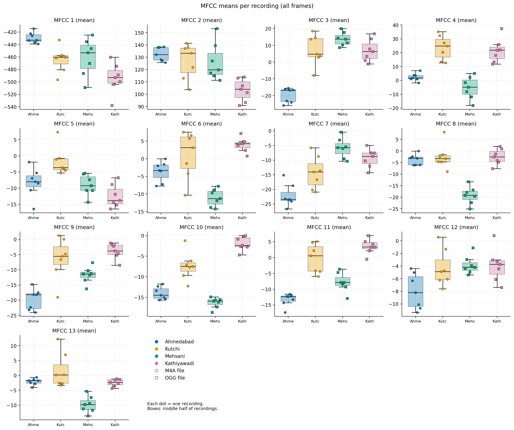

**What it shows.** One small chart per coefficient (MFCC 1 to 13). Every dot is **one recording** (circle = M4A file, square = OGG file); the box shows the middle half of that accent's seven recordings. Showing the dots means the group average never hides individual recordings.

**How to read it.** If the boxes of two accents do not overlap, those accents have separate ranges for that coefficient. If they overlap a lot, the feature does not distinguish them.

**What we observe.**
- Some coefficients show clear gaps: for **MFCC 3**, all seven Ahmedabad recordings (−25.9 to −15.6) lie below all recordings of the other three accents. For **MFCC 8**, all seven Mehsani recordings (−25.1 to −13.3) lie below all the others. For **MFCC 4**, Kutchi and Kathiyawadi sit above Ahmedabad and Mehsani.
- Other coefficients overlap a lot (for example MFCC 12).
- Recordings of the same speaker usually cluster; Kutchi is the most spread out.

**Why it matters.** The gaps are between four *people*. A gap on MFCC 3 for Ahmedabad could be accent, but it could equally be that speaker's voice, microphone or sentence choice.

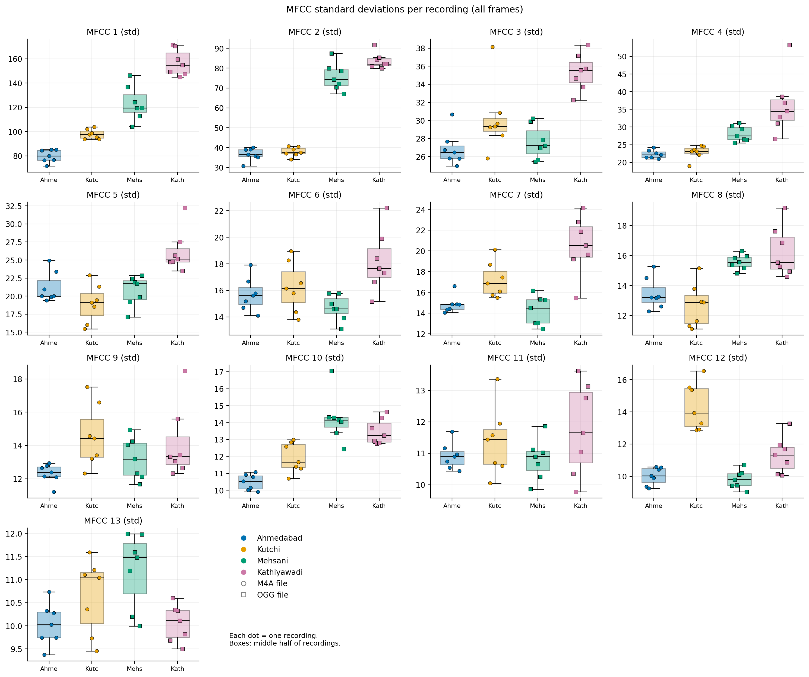

**What it shows.** The same layout for the *standard deviation* of each coefficient (how much it fluctuates inside a recording). **What we observe.** Larger differences between accents than for the means (for example MFCC 1 and MFCC 2 std have η² of 0.91 and 0.96). **Why it matters.** The fluctuation of MFCC 1 and 2 is closely tied to how much silence and noise a recording contains, so these high numbers need the checks in Sections 9 to 11.

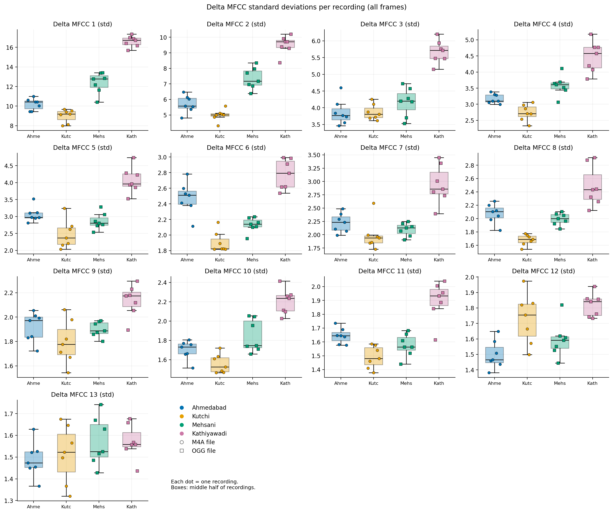

**What it shows.** How much the *speed of change* (delta) of each coefficient fluctuates. **What we observe.** Kathiyawadi recordings are clearly higher than the others for the first coefficients (for example Delta MFCC 1: 16.6 against 9.0 to 12.4 on whole recordings), Mehsani is second, and the two M4A accents are lowest. **Why it matters.** This pattern follows the format split, so it may reflect sharp jumps between speech and digital silence in the OGG files (an idea, not a finding; see Section 10).

The other three recording-level charts are saved in the same style: [MFCC delta means](../results/feature_analysis/figures/03_delta_means_by_accent.png), [delta-delta means](../results/feature_analysis/figures/05_delta2_means_by_accent.png) and [delta-delta standard deviations](../results/feature_analysis/figures/06_delta2_stds_by_accent.png). The delta and delta-delta **means** are very small numbers close to zero and overlap heavily between accents.

### 8.2 Frame-level distributions (MFCC 1–4)

We use MFCC 1–4 for the frame-level and pairwise plots because they are the first four coefficients (they describe the overall energy and broad spectral shape). They were chosen by this fixed rule, not because they look different.

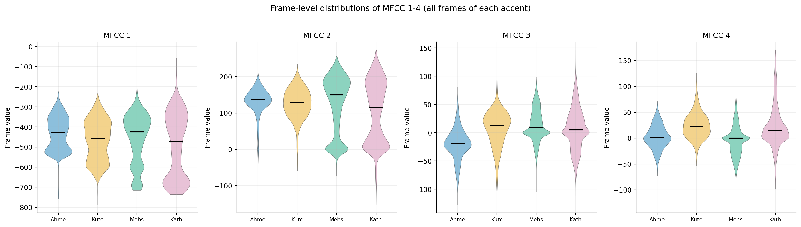

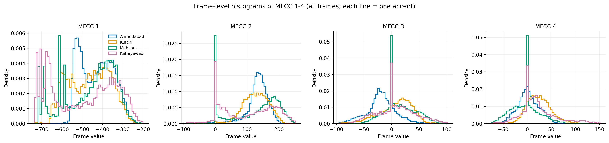

**What they show.** Every 10 ms frame of each accent pooled together, drawn as violins (width = how common a value is; black line = median) and as outline histograms (one line per accent).

**What we observe.**
- The accents **overlap heavily** frame by frame. A single frame cannot tell the accents apart.
- MFCC 1 has two humps: low values (silence) and higher values (speech). Mehsani and Kathiyawadi show very narrow spikes at about −620 and −700 for MFCC 1.
- For MFCC 2, 3 and 4, Mehsani and Kathiyawadi each have a **sharp spike at exactly 0**. This is what *digital silence* looks like: completely silent frames give constant feature values.

**Why it matters.** These spikes are not speech at all, yet they are part of the whole-recording averages. This is why we need the speech-only comparison in Section 9.

### 8.3 Pairwise plots

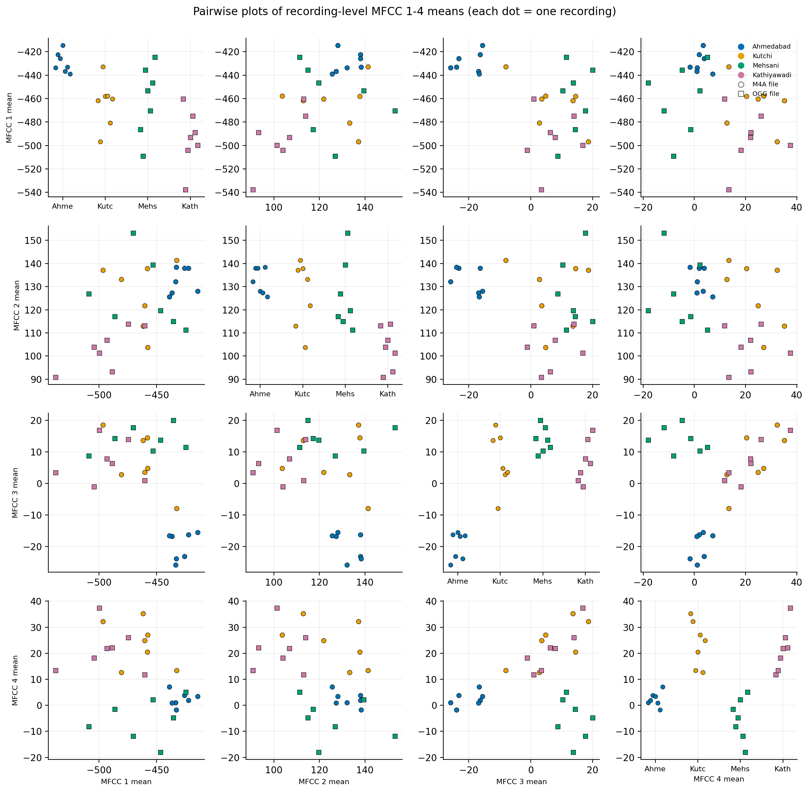

**What it shows.** Every pair among the recording-level means of MFCC 1–4; each dot is a recording. The diagonal shows the values by accent.

**What we observe.** In several panels the four accents form fairly separate clouds, especially MFCC 3 against MFCC 1 (Ahmedabad lowest), and MFCC 4 against MFCC 3. Other panels (for example MFCC 1 against MFCC 2) show clouds that overlap.

**Why it matters.** It shows how a later method (such as PCA) might find structure. It does not show that the structure is accent.

### 8.4 How big is the overlap, for all 78 features?

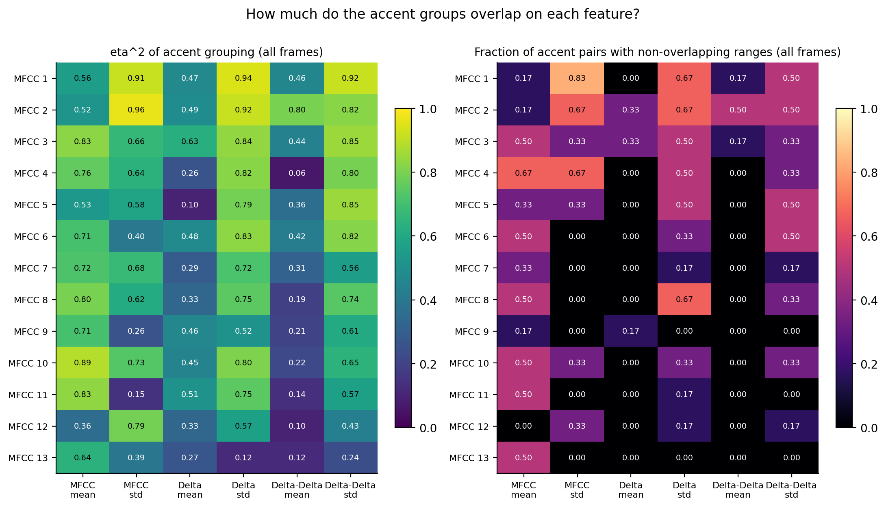

**What it shows.** Left: η² of the accent grouping for every coefficient (rows) and feature type (columns). Right: the fraction of accent pairs with non-overlapping ranges. Whole-recording features.

**How to read it.** Bright = large (accents explain a lot / many pairs have separate ranges). Dark = small (heavy overlap).

**What we observe.**
- Highest η²: MFCC 2 std (0.96), Delta MFCC 1 std (0.94), Delta-Delta MFCC 1 std (0.92), MFCC 1 std (0.91), MFCC 10 mean (0.89).
- Lowest: Delta-Delta MFCC 4 mean (0.06), Delta MFCC 5 mean (0.10), Delta-Delta MFCC 12 mean (0.10).
- 46 of 78 features have at least one pair of accents with separate ranges. **No** feature separates all 6 pairs.
- Whole-recording classes: 38 features high, 25 moderate, 15 heavy overlap.

**Why it matters.** Many features have large η², but with one person per group this is expected. The more useful information is which features overlap heavily and can be given lower priority later (without deleting them).

### 8.5 Correlation between features

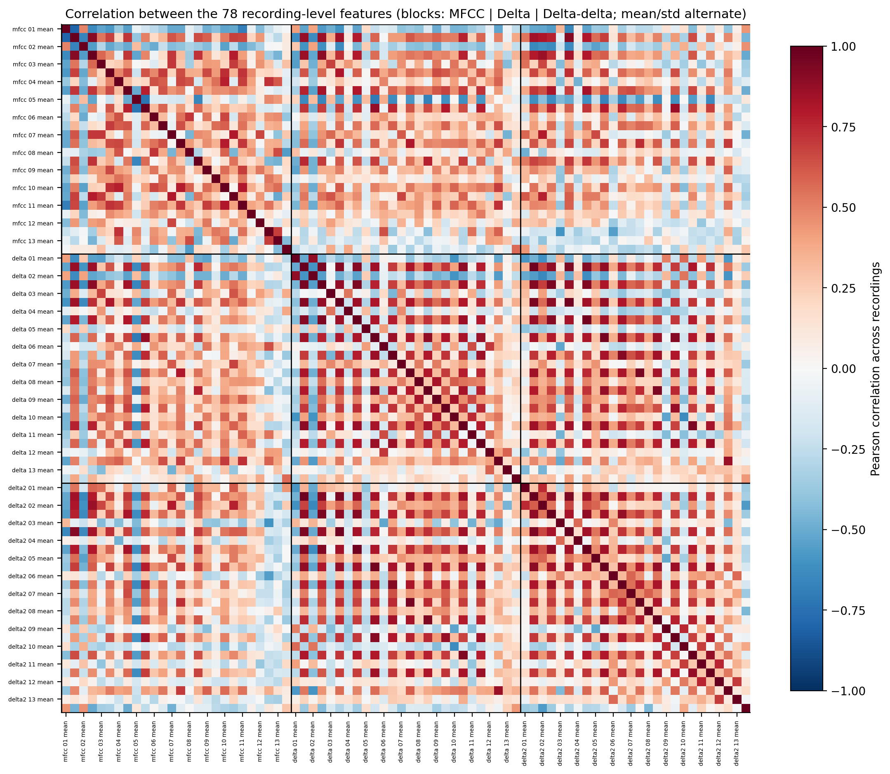

**What it shows.** How similarly each pair of features moves across the 28 recordings (Pearson correlation, −1 to +1; red = move together, blue = opposite).

**What we observe.** Many features are strongly related: 23 of 3,003 pairs have |r| ≥ 0.9 and 278 have |r| ≥ 0.7. The strongest are the **standard deviation of a delta and of the delta-delta of the same coefficient** (for example Delta MFCC 1 std with Delta-Delta MFCC 1 std, r = 0.98).

**Why it matters.** Many features carry almost the same information. Later methods that are sensitive to that (including PCA) will find shared directions, and we should not count each as an independent clue.

---

## 9. Silence and Speech Analysis

### 9.1 Is the alignment right?

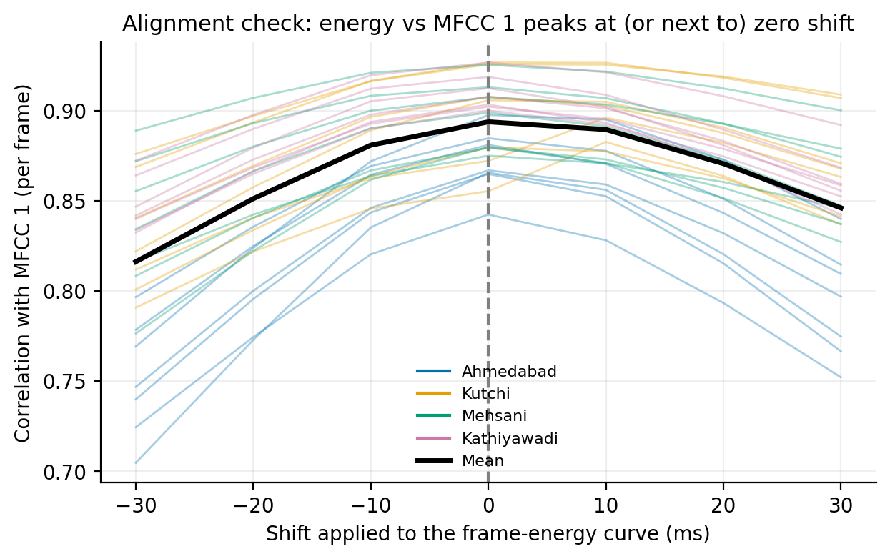

**What it shows.** For each recording, how well frame loudness matches MFCC 1 when we slide one curve against the other (−30 ms to +30 ms). The bold line is the mean.

**What we observe.** The curves peak at zero shift (or one frame next to it). Correlation at zero shift is at least 0.84 and its median is 0.90.

**Why it matters.** This is evidence that the speech/non-speech labels line up with the MFCC frames; we did not assume it.

### 9.2 How many frames did we keep?

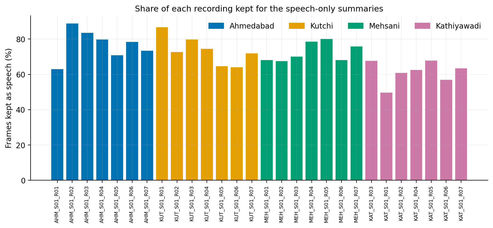

**What it shows.** The percentage of frames kept as speech in each recording.

**What we observe.** Overall 71.4% of frames are speech (27,211 of 38,127). The lowest is `KAT_S01_R01` (49.6%), the highest `AHM_S01_R02` (88.8%). Kathiyawadi keeps the smallest share on average (61.2%), Ahmedabad the most (76.8%). Every recording keeps at least 527 speech frames.

**Why it matters.** Recordings with a lot of silence have more influence on whole-recording averages. The table in Section 7 has the exact numbers.

### 9.3 Whole recording versus speech only

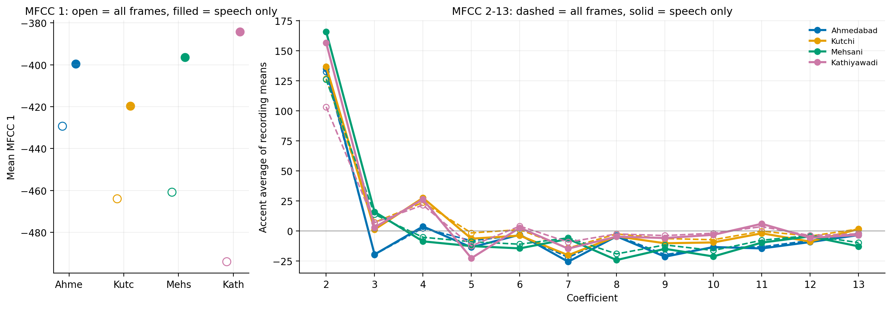

**What it shows.** Accent averages of the recording means for MFCC 1 (left) and MFCC 2–13 (right). Dashed or open = whole recordings; solid or filled = speech frames only.

**What we observe.**
- **MFCC 1** moves a lot: whole-recording values (−429 to −494) change to speech-only values (−384 to −420), and the **order of the accents changes** (Kathiyawadi goes from lowest to highest).
- **MFCC 2** also changes a lot: Kathiyawadi goes from lowest (103.3) to near the top (156.8), and Mehsani becomes highest (165.9).
- MFCC 3 to 13 change much less: the dashed and solid lines sit close together for most of them (the largest shift is MFCC 8 for Mehsani, −19.2 to −24.3).

**Why it matters.** The first two coefficients were dominated by silence and loudness. The higher coefficients are less affected.

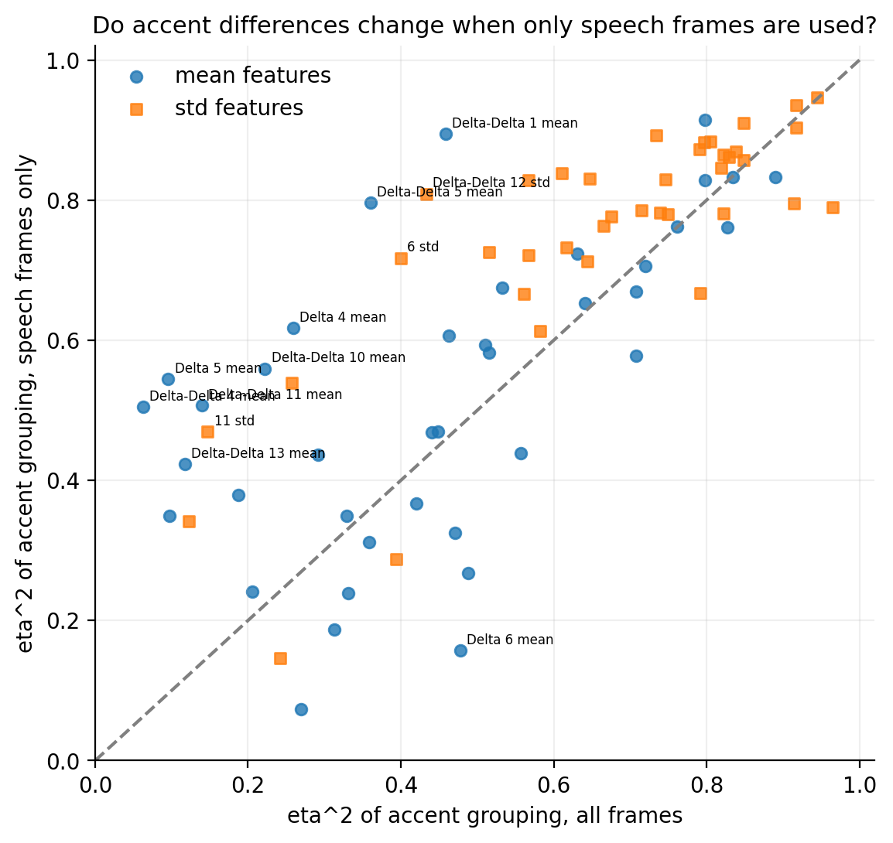

**What it shows.** For each of the 78 features, the accent η² on whole recordings (x-axis) against the same feature on speech frames (y-axis). On the dashed line nothing changed.

**What we observe.** Most dots are near or above the line. 25 of 78 features change by more than 0.15 (mostly delta and delta-delta means, which are tiny numbers and get larger differences once silence is removed). Delta MFCC 6 mean drops (0.48 → 0.16). The average η² of the mean features rises from 0.45 to 0.53.

**Why it matters.** The conclusions about which features overlap are mostly stable, but about a third of the features are sensitive to the silence frames, so their whole-recording values should be treated with care.

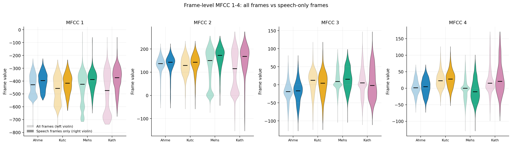

**What it shows.** For MFCC 1–4, the light violin (left) is all frames and the dark violin (right) is speech frames only.

**What we observe.** The long lower tails and the spikes in the light violins (silence) disappear in the dark ones. The distributions of the four accents still overlap strongly, even on speech frames.

**Why it matters.** Restricting to speech frames removes artefacts, but individual frames still do not separate the accents.

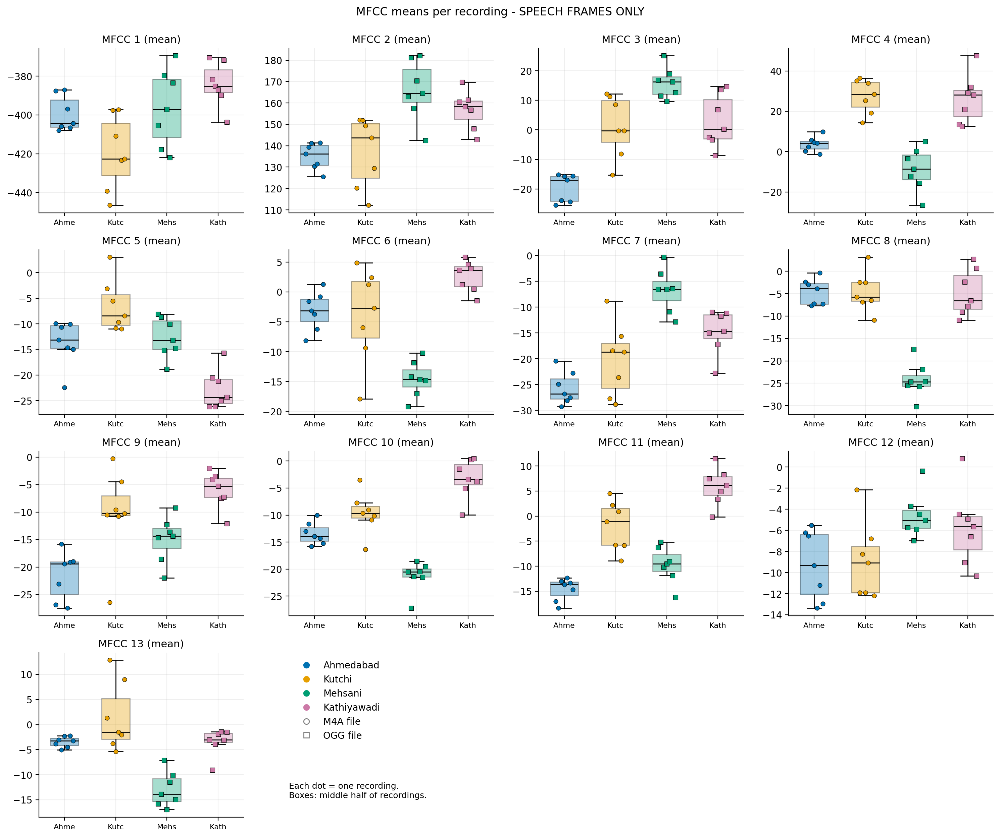

**What it shows.** The same layout as Figure 01 but using speech frames only. (Compare it with Section 8.1.)

**What we observe.** The gaps seen earlier for MFCC 3, MFCC 4, MFCC 8 and MFCC 10 remain, while MFCC 1 and MFCC 2 change as described above.

### 9.4 Does the link with the amount of speech go away?

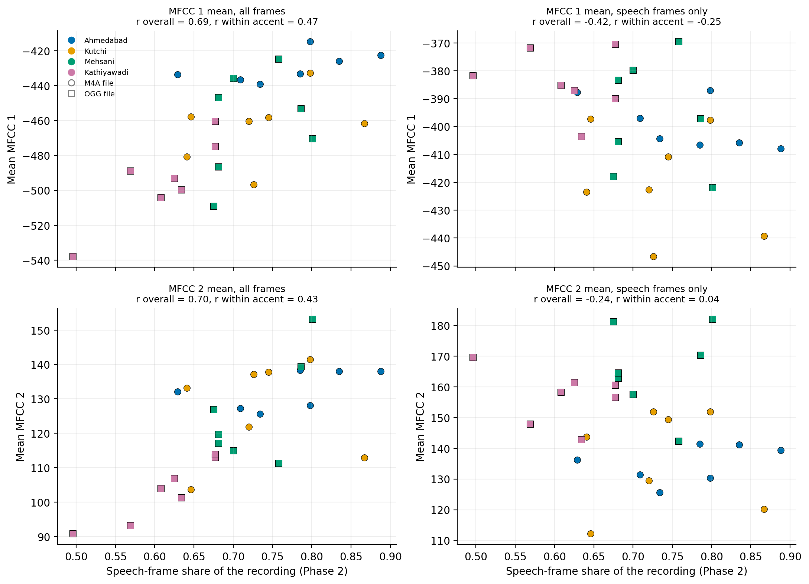

**What it shows.** Each dot is a recording. Left: whole-recording MFCC 1 and 2 means against the share of speech frames (from Phase 2). Right: speech-only means. *r overall* is the correlation across all 28; *r within accent* removes each speaker's own average first.

| Feature | Version | r with speech share (pooled) | r with speech share (within accent) | r with noise floor (pooled) | r with noise floor (within accent) |
|---|---:|---:|---:|---:|---:|
| MFCC 1 mean | whole recording | 0.69 | 0.47 | 0.58 | 0.45 |
| MFCC 1 mean | speech only | -0.42 | -0.25 | -0.45 | -0.06 |
| MFCC 2 mean | whole recording | 0.70 | 0.43 | 0.54 | 0.45 |
| MFCC 2 mean | speech only | -0.24 | 0.04 | -0.73 | -0.12 |

**What we observe.** For whole recordings the means rise with the speech share (0.69 and 0.70 pooled; 0.47 and 0.43 within accent). With speech frames only, the MFCC 2 relationship disappears within an accent (0.04) and the MFCC 1 relationship changes sign (−0.25).

**Why it matters.** This confirms the Phase 3 suspicion: the first two coefficients mostly reflect how much of a recording is silence. Speech-only versions are the better starting point for comparing speakers.

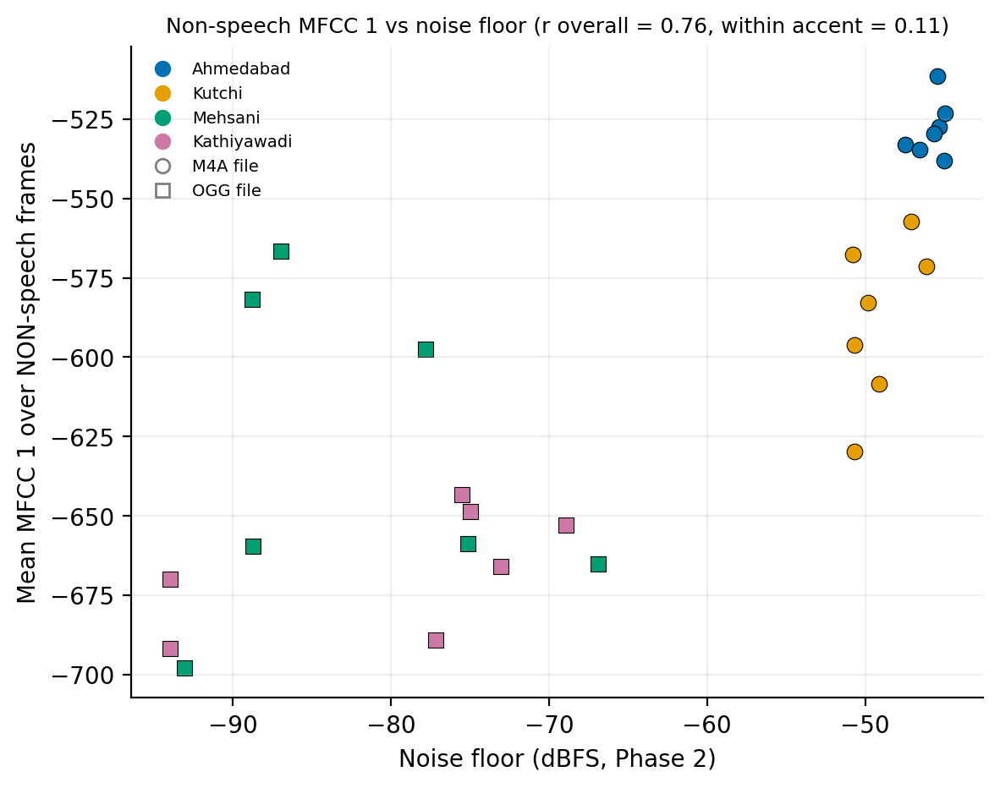

**What it shows.** MFCC 1 averaged over only the **non-speech** frames against the noise floor measured in Phase 2.

**What we observe.** The two go together across speakers (r = 0.76). Ahmedabad and Kutchi (M4A, noise floor around −45 to −51 dBFS) are at the top; Mehsani and Kathiyawadi (OGG, much lower noise floor) are lower. Within one speaker's recordings the link is weak (r = 0.11).

**Why it matters.** In pauses, MFCC 1 measures the background, and the background differs between recording setups.

---

## 10. Recording Format Analysis

Ahmedabad and Kutchi were M4A; Mehsani and Kathiyawadi were OGG. We compared features by format and asked how much format alone explains.

### Selected features by format

| Feature | M4A mean (all / speech) | OGG mean (all / speech) | eta^2 format (all / speech) | eta^2 accent after format (all / speech) |
|---|---:|---:|---:|---:|
| MFCC 1 mean | -446.7 / -409.6 | -477.5 / -390.3 | 0.25 / 0.25 | 0.41 / 0.25 |
| MFCC 2 mean | 129.7 / 136.0 | 114.7 / 161.3 | 0.23 / 0.54 | 0.37 / 0.08 |
| MFCC 3 mean | -6.3 / -9.2 | 10.3 / 9.4 | 0.35 / 0.41 | 0.74 / 0.60 |
| MFCC 4 mean | 13.0 / 15.6 | 8.1 / 8.8 | 0.03 / 0.04 | 0.75 / 0.75 |
| Delta MFCC 1 std | 9.6 / 10.5 | 14.5 / 16.2 | 0.67 / 0.58 | 0.83 / 0.87 |
| Delta MFCC 2 std | 5.3 / 5.8 | 8.4 / 9.1 | 0.72 / 0.62 | 0.71 / 0.75 |
| Delta-Delta MFCC 1 std | 4.0 / 4.3 | 6.0 / 6.4 | 0.54 / 0.46 | 0.82 / 0.88 |

### Features where format explains at least half of the variation (speech-only)

| Feature | eta^2 format (all) | eta^2 format (speech) | eta^2 accent after format (speech) |
|---|---:|---:|---:|
| MFCC 2 mean | 0.23 | 0.54 | 0.08 |
| MFCC 7 mean | 0.54 | 0.54 | 0.37 |
| MFCC 10 std | 0.62 | 0.57 | 0.75 |
| Delta MFCC 1 std | 0.67 | 0.58 | 0.87 |
| Delta MFCC 2 std | 0.72 | 0.62 | 0.75 |
| Delta MFCC 3 mean | 0.08 | 0.69 | 0.11 |
| Delta MFCC 4 mean | 0.04 | 0.57 | 0.11 |
| Delta MFCC 4 std | 0.58 | 0.56 | 0.69 |
| Delta MFCC 10 std | 0.55 | 0.52 | 0.76 |
| Delta-Delta MFCC 1 mean | 0.35 | 0.58 | 0.75 |
| Delta-Delta MFCC 2 mean | 0.76 | 0.83 | 0.49 |
| Delta-Delta MFCC 3 std | 0.57 | 0.5 | 0.71 |
| Delta-Delta MFCC 4 std | 0.61 | 0.65 | 0.66 |
| Delta-Delta MFCC 10 std | 0.35 | 0.52 | 0.65 |

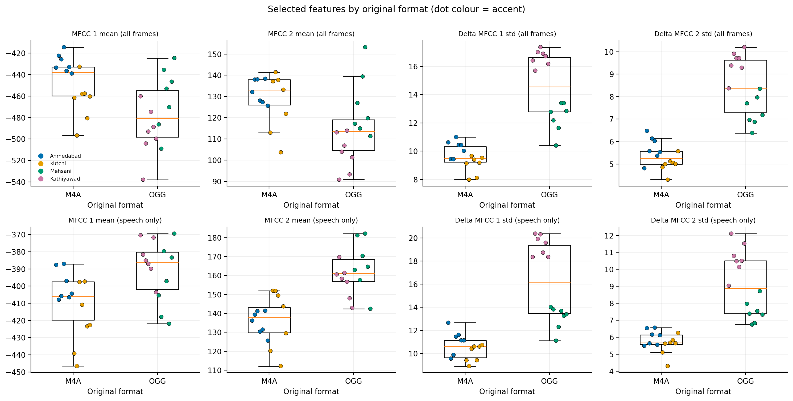

**What it shows.** Four features (columns) split by M4A and OGG. Top row: whole recordings. Bottom row: speech frames only. Dot colour = accent.

**What we observe.**
- **MFCC 1 and MFCC 2 means:** OGG is lower on whole recordings but **higher** on speech frames. The direction reverses.
- **Delta MFCC 1 and 2 standard deviations:** OGG is clearly higher in both versions, and the difference does not go away on speech frames. Inside OGG, Kathiyawadi is higher than Mehsani; inside M4A, Kutchi is lower than Ahmedabad.

**Why it matters.** For the delta features, the format difference is real in these data, but the accents also differ *within* each format. So neither format nor accent alone explains the pattern.

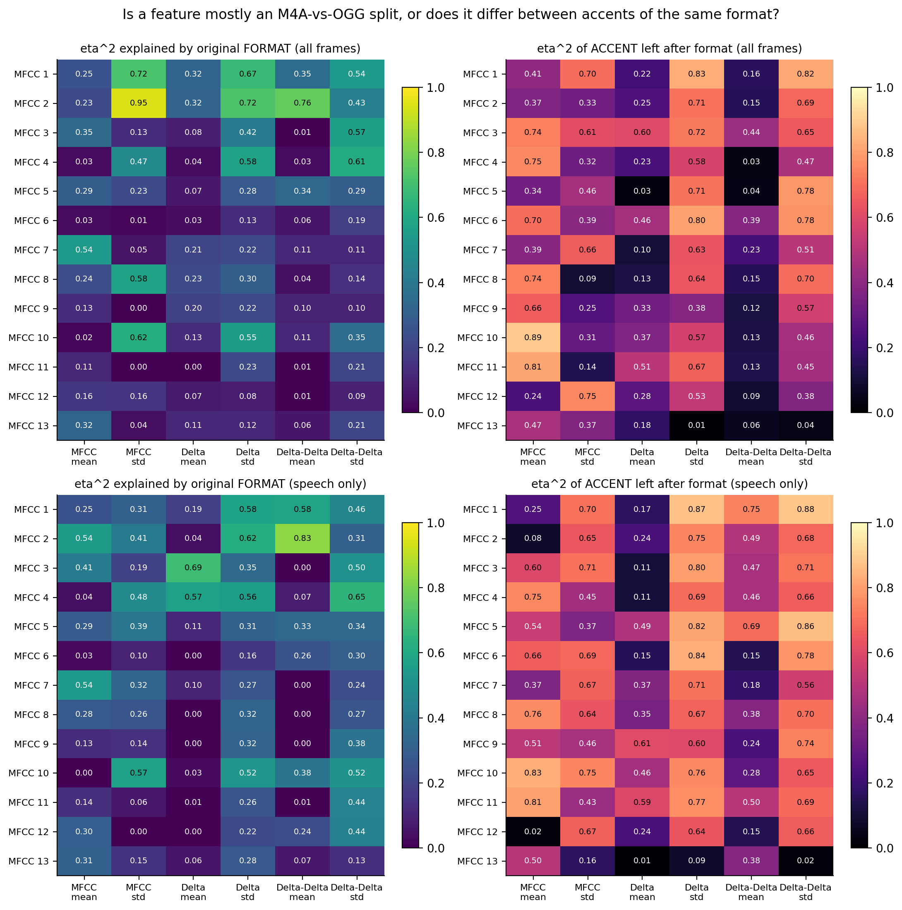

**What it shows.** Left column: how much of each feature's variation M4A-versus-OGG explains. Right column: how much accent explains **after** format is removed. Top: whole recordings; bottom: speech only.

**How to read it.** A feature that is bright on the left and dark on the right is mostly a format split. A feature that is dark on the left and bright on the right differs between accents of the **same** format.

**What we observe.**
- Format-dominated (speech-only): MFCC 2 mean, Delta MFCC 3 mean, Delta MFCC 4 mean.
- Many features are not format-associated but still differ between accents, for example MFCC 4, 8, 10 and 11 means (format η² of 0.28 or less, but accent η² after format of 0.75 to 0.83).
- 14 features have format η² of at least 0.50; 11 of them still keep accent η² after format at 0.30 or more.

**Why it matters.** Format clearly shapes several features (especially MFCC 2 and the delta variability), so those need caution. But format cannot explain everything: some differences exist between accents recorded in the same format. **We cannot say that format *causes* any difference.** We can only say how strongly they go together.

---

## 11. Quality-Related Findings

We related each feature to five Phase 2 quality measures (speech share, noise floor, duration, clipped samples, level deviation) and two flags (clipping, level-inconsistent). Each pair has two numbers: pooled r / within-accent r.

| Feature (whole recording) | Speech share | Noise floor | Duration | Clipping flag | Level flag |
|---|---:|---:|---:|---:|---:|
| MFCC 1 mean | 0.69 / 0.47 | 0.58 / 0.45 | 0.24 / -0.01 | -0.31 / 0.35 | 0.00 / 0.02 |
| MFCC 2 mean | 0.70 / 0.43 | 0.54 / 0.45 | 0.20 / -0.26 | -0.67 / -0.46 | -0.11 / -0.26 |
| MFCC 3 mean | -0.22 / 0.20 | -0.59 / 0.09 | 0.14 / 0.38 | 0.47 / 0.25 | 0.16 / 0.23 |
| MFCC 4 mean | -0.20 / 0.26 | 0.20 / 0.21 | 0.07 / 0.46 | 0.04 / 0.09 | 0.33 / 0.34 |
| Delta MFCC 1 std | -0.58 / 0.07 | -0.71 / 0.18 | -0.50 / 0.05 | 0.71 / -0.08 | -0.19 / 0.04 |
| Delta MFCC 2 std | -0.54 / 0.10 | -0.75 / 0.05 | -0.45 / 0.14 | 0.71 / -0.04 | -0.22 / -0.05 |

*(Whole-recording features. The full tables for all 78 features, both versions, are in `quality_correlations.csv`.)*

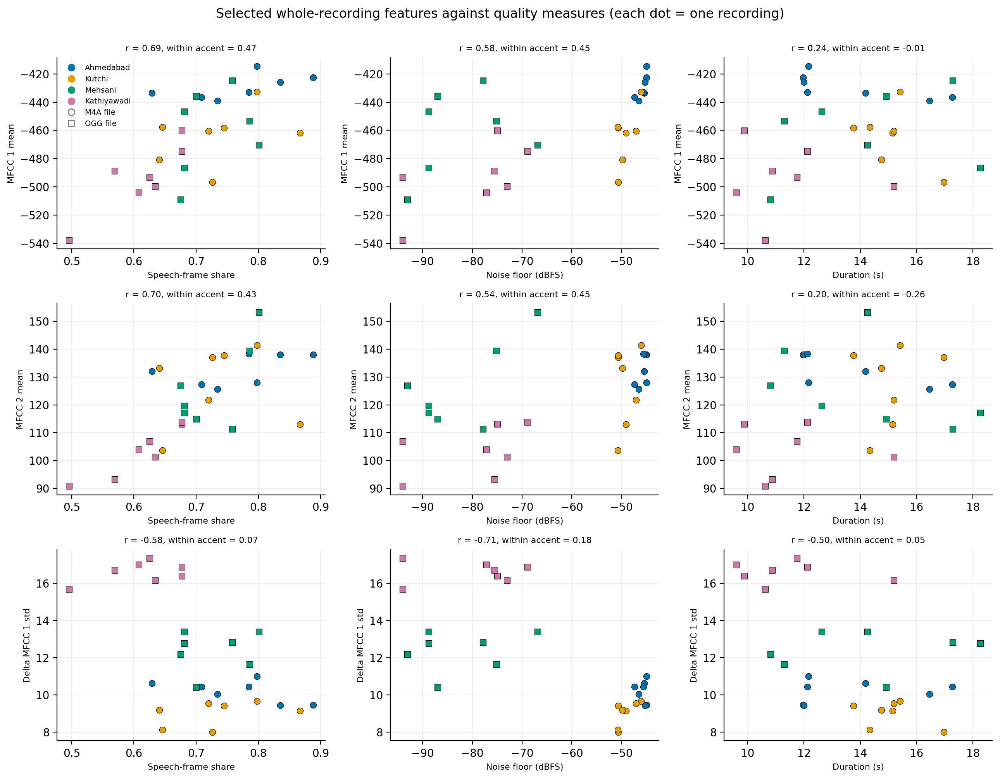

**What it shows.** MFCC 1 mean, MFCC 2 mean and Delta MFCC 1 std (rows) against speech share, noise floor and duration (columns); each dot is a recording.

**What we observe.**
- MFCC 1 and 2 means rise with speech share and noise floor (pooled r 0.54 to 0.70; within accent 0.43 to 0.47).
- **Delta MFCC 1 std** correlates strongly across speakers with noise floor (−0.71), speech share (−0.58) and duration (−0.50), but **within a speaker** these links are close to zero (0.18, 0.07 and 0.05). The cloud simply separates Kathiyawadi (high) from Kutchi (low).
- The clipping flag is linked to Delta MFCC 1 std across speakers (+0.71) but not within accent (−0.08).

**Why it matters.** Many strong-looking relationships are really "which speaker/format is this". Within one speaker's own recordings they mostly disappear. So the quality measures are not simple causes of the feature differences.

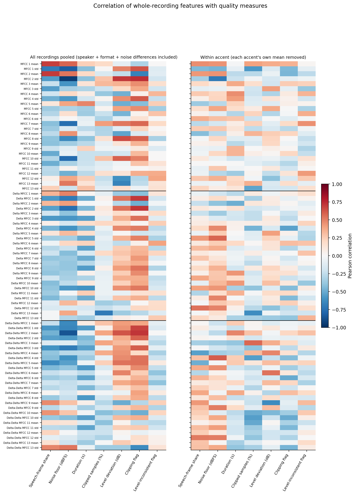

**What it shows.** Every feature (rows) against every quality measure (columns). Left: pooled; right: within accent.

**What we observe.** The left half has many strong colours; the right half is much paler. The speech-only version of the same figure is [here](../results/feature_analysis/figures/23_quality_correlations_speech_only.png).

**Quality-sensitive within a single speaker (speech-only):** MFCC 3 std, Delta MFCC 1 std, Delta MFCC 6 mean, Delta-Delta MFCC 3 std.

**Duration.** Duration depends on how long a speaker's sentence was, so it partly reflects the words used. For example, MFCC 4 mean (a candidate feature below) has a within-accent correlation of 0.46 (whole recording) and 0.51 (speech only) with duration. The screening rules did not look at duration, so this is one more reason to stay cautious with that feature.

**Recordings kept.** All 11 flagged recordings are included everywhere. No noise reduction, clipping repair or normalisation was used.

---

## 12. Candidate Feature Observations

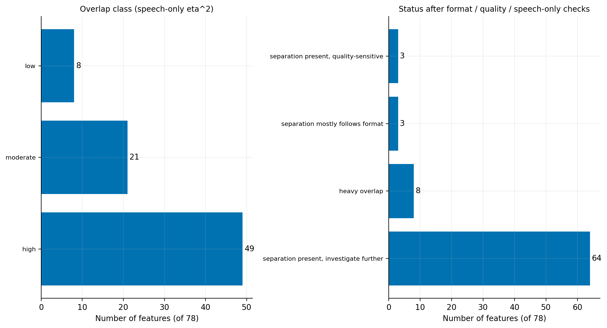

**What it shows.** How many features fall into each overlap class and each final status. (Counts are in Section 7.)

**What we observe.**
- **Heavy overlap (MFCC 13 std, Delta MFCC 2 mean, Delta MFCC 6 mean, Delta MFCC 12 mean, Delta MFCC 13 mean, Delta-Delta MFCC 7 mean, Delta-Delta MFCC 9 mean, Delta-Delta MFCC 13 std):** mostly delta and delta-delta *means* and MFCC 13 std; the accents are not distinguishable on these.
- **Mostly format-driven:** MFCC 2 mean, Delta MFCC 3 mean, Delta MFCC 4 mean.
- 30 features pass every screening rule (listed below).

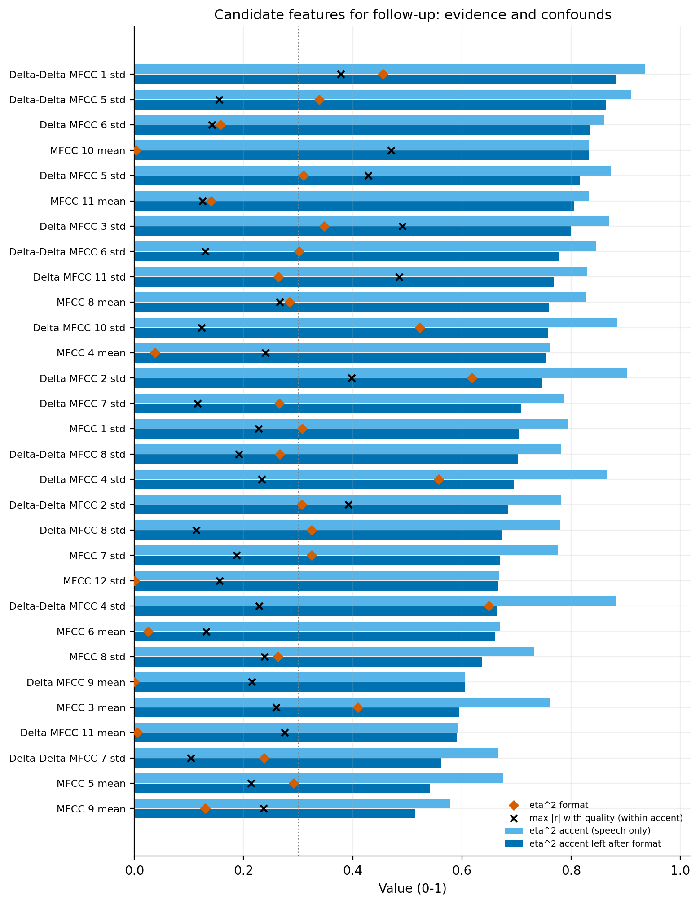

**What it shows.** For each candidate: light bar = accent η² (speech-only); dark bar = accent η² left after format; orange diamond = η² of format; black cross = strongest within-accent correlation with speech share or noise floor.

**How to read it.** The best candidates have long bars and short diamonds/crosses (differences between accents of the same format that do not follow quality).

### The candidate table

| Feature | eta^2 accent (speech) | Disjoint accent pairs | eta^2 format | eta^2 accent after format | Max abs r with speech share / noise (within accent) | Format note |
|---|---:|---:|---:|---:|---:|---:|
| Delta-Delta MFCC 1 std | 0.94 | 3/6 | 0.46 | 0.88 | 0.38 | partly format-associated |
| Delta-Delta MFCC 5 std | 0.91 | 3/6 | 0.34 | 0.86 | 0.16 | partly format-associated |
| Delta MFCC 6 std | 0.86 | 3/6 | 0.16 | 0.84 | 0.14 | not format-associated |
| MFCC 10 mean | 0.83 | 4/6 | 0.0 | 0.83 | 0.47 | not format-associated |
| Delta MFCC 5 std | 0.87 | 3/6 | 0.31 | 0.82 | 0.43 | partly format-associated |
| MFCC 11 mean | 0.83 | 3/6 | 0.14 | 0.81 | 0.12 | not format-associated |
| Delta MFCC 3 std | 0.87 | 3/6 | 0.35 | 0.8 | 0.49 | partly format-associated |
| Delta-Delta MFCC 6 std | 0.85 | 3/6 | 0.3 | 0.78 | 0.13 | partly format-associated |
| Delta MFCC 11 std | 0.83 | 3/6 | 0.26 | 0.77 | 0.49 | not format-associated |
| MFCC 8 mean | 0.83 | 3/6 | 0.28 | 0.76 | 0.27 | not format-associated |
| Delta MFCC 10 std | 0.88 | 3/6 | 0.52 | 0.76 | 0.12 | partly format-associated |
| MFCC 4 mean | 0.76 | 4/6 | 0.04 | 0.75 | 0.24 | not format-associated |
| Delta MFCC 2 std | 0.9 | 5/6 | 0.62 | 0.75 | 0.4 | partly format-associated |
| Delta MFCC 7 std | 0.79 | 3/6 | 0.27 | 0.71 | 0.12 | not format-associated |
| MFCC 1 std | 0.79 | 3/6 | 0.31 | 0.7 | 0.23 | partly format-associated |
| Delta-Delta MFCC 8 std | 0.78 | 2/6 | 0.27 | 0.7 | 0.19 | not format-associated |
| Delta MFCC 4 std | 0.86 | 4/6 | 0.56 | 0.69 | 0.23 | partly format-associated |
| Delta-Delta MFCC 2 std | 0.78 | 3/6 | 0.31 | 0.68 | 0.39 | partly format-associated |
| Delta MFCC 8 std | 0.78 | 4/6 | 0.32 | 0.67 | 0.11 | partly format-associated |
| MFCC 7 std | 0.78 | 2/6 | 0.32 | 0.67 | 0.19 | partly format-associated |
| MFCC 12 std | 0.67 | 2/6 | 0.0 | 0.67 | 0.16 | not format-associated |
| Delta-Delta MFCC 4 std | 0.88 | 3/6 | 0.65 | 0.66 | 0.23 | partly format-associated |
| MFCC 6 mean | 0.67 | 2/6 | 0.03 | 0.66 | 0.13 | not format-associated |
| MFCC 8 std | 0.73 | 3/6 | 0.26 | 0.64 | 0.24 | not format-associated |
| Delta MFCC 9 mean | 0.61 | 0/6 | 0.0 | 0.61 | 0.22 | not format-associated |
| MFCC 3 mean | 0.76 | 2/6 | 0.41 | 0.6 | 0.26 | partly format-associated |
| Delta MFCC 11 mean | 0.59 | 0/6 | 0.01 | 0.59 | 0.28 | not format-associated |
| Delta-Delta MFCC 7 std | 0.67 | 2/6 | 0.24 | 0.56 | 0.1 | not format-associated |
| MFCC 5 mean | 0.67 | 1/6 | 0.29 | 0.54 | 0.21 | not format-associated |
| MFCC 9 mean | 0.58 | 1/6 | 0.13 | 0.51 | 0.24 | not format-associated |

**What we observe.**
- Candidates include MFCC 4, 6, 8, 10 and 11 means (not format-associated and weakly linked to quality) and many delta/delta-delta standard deviations (high η², but partly format-associated and quality-linked *across* speakers).
- For example **MFCC 8 mean**: speech-only Ahmedabad −4.6, Kutchi −4.5, Kathiyawadi −4.8 and **Mehsani −24.3**. The overlap is extreme between three accents and Mehsani sits far from them, so it separates one speaker from the rest, not four accents from each other.
- **MFCC 4 mean** (Ahmedabad 3.7, Kutchi 27.5, Mehsani −8.7, Kathiyawadi 26.3) splits the speakers into two pairs, one M4A and one OGG in each pair. Format cannot explain that split.

**Confounds that apply to every candidate:** speaker voice, wording, microphone/room. **Further investigation:** needs recordings from more speakers per accent, ideally on the same device and format, before any of these can be called accent-related.

---

## 13. Limitations and Potential Biases

1. **One speaker per accent.** Accent, speaker, device, room and vocabulary cannot be separated. Large η² values are expected for any feature that differs between four different people.
2. **Format tied to accent.** M4A = Ahmedabad and Kutchi; OGG = Mehsani and Kathiyawadi. The within-format comparison is only one accent pair per format.
3. **Seven recordings per speaker.** The recordings of one speaker are not independent of each other, so no significance testing was done and none would be valid.
4. **Speech detection is a simple energy rule.** Very quiet speech may be treated as non-speech, and noise may occasionally be treated as speech. About 25 features changed their η² by more than 0.15 when switching to speech frames, so the speech/non-speech boundary matters.
5. **The alignment tolerance was set after seeing the data** (±1 frame; Section 5). A sensitivity test shows it is harmless.
6. **Screening thresholds are conventions** (0.30, 0.50, 0.60), fixed before looking at results but not statistically derived. One rule (quality link) was changed after seeing a first version, for the reason in Section 5.
7. **Delta and delta-delta values use neighbouring frames.** Even on a speech-only frame, they include information from up to 40 ms of neighbouring frames, which can include pauses.
8. **Different words.** Speakers adapted the sentences, so features can reflect word choice.
9. **Correlation is not cause.** Nothing here shows that format, noise or silence *cause* any feature difference.
10. **Unequal importance of recordings.** Averages over a recording count all frames equally, so long recordings with many frames influence their speaker's pooled numbers more.

We therefore **do not claim** that these differences represent the whole regional population, that the accents are separable, or that any listed feature is an accent characteristic.

---

## 14. What We Learned

- **Silence matters.** In whole recordings, the first two MFCC coefficients mostly report how much of a recording is silence and how noisy the background is. Speech-only versions are much cleaner.
- **Format matters, but is not everything.** OGG files differ from M4A files in several features (and the direction of two of them reverses once silence is removed), yet some differences also exist between accents of the same format.
- **Delta variability is the most separating but also the most confounded.** It is high for the OGG speakers, especially Kathiyawadi, and tied to noise across speakers.
- **Many features overlap heavily,** such as most delta and delta-delta means.
- **Many features are redundant** (for example delta std and delta-delta std of the same coefficient).
- **The honest answer is "too early to say".** We found things worth checking, but no evidence about accents themselves.

---

## 15. How This Phase Connects to PCA and Model Development

**Phase 5 (PCA and exploratory projections)** will use the 78-feature table. What we learned here shapes it:
- Run PCA on **both** the whole-recording features and the **speech-only** features (`speech_only_recording_features.csv`), and compare.
- Colour the PCA plots by **accent and by original format**, and inspect whether the first components line up with format or with the noise floor and speech share.
- Remember that many features are highly correlated, so the first components may mostly describe a few shared directions (for example delta variability).
- Treat any grouping by accent as a hypothesis, because of the one-speaker-per-accent confound.

**Later model development:**
- Use only the acoustic columns listed in `mfcc_feature_columns.json`, never IDs, accent labels or quality flags.
- Keep the candidate list as a *starting point for experiments* (for example, compare a model with and without the format-sensitive features), not as a final feature set.
- Do not evaluate a model on recordings from the same speaker as its training recordings and call it accent accuracy. Speaker-independent evaluation needs more speakers.

**Adding Surti.** When real Surti recordings are added (Phase 1, 2 and 3 re-run), re-running `notebooks/04_feature_analysis.ipynb` includes Surti in every table and figure automatically. Nothing in the analysis code names the accents. We tested this robustness by re-running the statistics on subsets of 3 accents and 1 accent of the real data without any error.

---

## 16. Conclusion

Phase 4 examined all 78 features of all 28 recordings, with silence and noise, format and quality checked one by one. We showed that the speech/non-speech labels line up with the MFCC frames, built speech-only versions of every feature, and found that silence and noise were distorting the first two coefficients and that format is tied to several of the others. Many features differ between the four speakers, others overlap heavily, and 30 features survived every check we set up. Because each accent is **one speaker**, these results are a map of what to investigate, not evidence that the accents can be distinguished. We are ready to move to PCA, with both whole-recording and speech-only features and with the confounds firmly in mind.

---

## 17. Output Files

All files are in `results/feature_analysis/`.

| File | Contents |
|---|---|
| `feature_analysis_summary.csv` | One row per feature (78): overlap measures, format and quality links, speech-only stability, status and candidate flag |
| `accent_feature_statistics.csv` | Per accent and feature: n, mean, standard deviation, min, median, max (whole recordings) |
| `accent_feature_statistics_speech_only.csv` | The same for speech frames only |
| `feature_correlations.csv` | 78 × 78 correlation matrix of the recording-level features |
| `format_comparison.csv` | Per feature: M4A and OGG means and standard deviations, η² of format, η² of accent after format (whole and speech-only) |
| `quality_correlations.csv` | Every feature against every quality measure: pooled, rank, and within-accent correlations |
| `speech_only_recording_features.csv` | One row per recording: frames kept, and the 78 speech-only features (same column names as Phase 3) |
| `candidate_features.csv` | The candidate table with observations and confounds |
| `validation_summary.txt` | All validation checks (26 passed) |
| `figures/` | The 26 figures used in this report |
