# MFCC Extraction Analysis Report: Gujarati Accent Dataset (Phase 3)

*Gujarati Accent Classifier – a beginner-friendly visual analysis report*

This report explains what we did in Phase 3, what every graph shows, what we found, and what it means. You do **not** need to open the notebook to follow it (the code is in `notebooks/03_mfcc_extraction.ipynb`).

> **One sentence to remember:** we have only **one speaker per accent**, so every difference in these features could come from the *accent*, the *person*, the *microphone/app*, the *room*, the *file format*, or the *words used*. We cannot tell which. Everything below is **descriptive and exploratory**, not proof that MFCCs can tell Gujarati accents apart.

---

## Table of Contents

- [Tech Stack](#tech-stack)
1. [Introduction and Objectives](#1-introduction-and-objectives)
2. [What Are MFCCs?](#2-what-are-mfccs)
3. [Delta and Delta-Delta Features](#3-delta-and-delta-delta-features)
4. [Extraction Methodology and Parameters](#4-extraction-methodology-and-parameters)
5. [Dataset Description](#5-dataset-description)
6. [Numerical Results](#6-numerical-results)
7. [Visual Analysis](#7-visual-analysis)
   - [7.1 MFCC heatmaps of single recordings](#71-mfcc-heatmaps-of-single-recordings)
   - [7.2 Average MFCC per accent](#72-average-mfcc-per-accent)
   - [7.3 Comparing the four accents](#73-comparing-the-four-accents)
   - [7.4 Distribution of each coefficient](#74-distribution-of-each-coefficient)
   - [7.5 Delta and delta-delta MFCC](#75-delta-and-delta-delta-mfcc)
   - [7.6 Recording-level means across accents](#76-recording-level-means-across-accents)
   - [7.7 Extra views for interpretation](#77-extra-views-for-interpretation)
8. [Summary of Observations](#8-summary-of-observations)
9. [Limitations and Possible Sources of Bias](#9-limitations-and-possible-sources-of-bias)
10. [What We Learned](#10-what-we-learned)
11. [How These Features Will Be Used in Phase 4](#11-how-these-features-will-be-used-in-phase-4)
12. [Conclusion](#12-conclusion)
13. [Files in This Folder](#13-output-files)

---

## Tech Stack

These are the tools used in this phase, each explained in one line. Phase 3 only *reads* the audio; it never changes it.

| Tool | Version | What it does (in simple words) |
|---|---|---|
| **Python** | 3.12.2 | The programming language all our code is written in. |
| **Librosa** | 1.0.0 | Loads the audio and calculates the MFCC, delta and delta-delta features. |
| **NumPy** | 2.5.4 | Does the maths on the feature matrices and saves them as compressed NPZ files. |
| **Numba** | 0.68.1 | Runs in the background to make Librosa faster. |
| **Pandas** | 2.2.2 | Holds the metadata and feature tables and saves them as CSV files. |
| **Matplotlib** | 3.9.2 | Draws all the heatmaps and graphs and saves them as PNG images. |
| **Jupyter Notebook** | ipykernel 7.2.0, nbconvert 7.17.2, nbformat 5.11.1 | Runs the whole extraction step by step, keeping code, graphs and notes together. |

**Our own project files used in this phase**

| File | What it does (in simple words) |
|---|---|
| `src/config.py` | Stores folder paths, the audio format and the accent and speaker list. |
| `src/audio_analysis.py` | Phase 2 helper that loads audio unchanged and picks the representative recordings. |
| `src/mfcc_features.py` | Phase 3 code: extracts the features, builds the tables, saves the NPZ files and runs all validation checks. |
| `notebooks/03_mfcc_extraction.ipynb` | Runs everything and creates every table, graph and file in `results/mfcc/`. |

---

## 1. Introduction and Objectives

**The project.** The Gujarati Accent Classifier is meant to listen to a short Gujarati recording and guess its regional accent (Ahmedabad, Kutchi, Mehsani, Kathiyawadi, and later Surti).

**Where we are.**

| Phase | What | Status |
|---|---|---|
| 1 | Convert all audio to one format (WAV, 16 kHz, mono, 16-bit) | Done |
| 2 | Audio quality analysis and visualisation | Done |
| **3** | **MFCC feature extraction (this report)** | **Done** |
| 4 | Compare features across accents | Next |
| 5–7 | PCA, preliminary classification, add Surti | Later |

**Objectives of Phase 3**
- Turn every recording into numbers (MFCC, delta and delta-delta features) that a computer can compare.
- Keep the **complete frame-by-frame** features, not only averages.
- Build a table with **one row per recording**.
- Check that nothing was skipped or broken.
- Look at the features with graphs, while being careful not to over-interpret them.

**What we did not do:** no PCA, no feature selection, no classification, no model training. No audio was changed.

---

## 2. What Are MFCCs?

**In simple words:** an MFCC is a short list of numbers that describes **the shape of a sound** at one tiny moment. Think of it as a "fingerprint of the sound's colour".

Why this is useful:
- A sound (like a vowel) has energy at many pitches (frequencies). The *pattern* of this energy tells us which sound it is, and also something about the voice and the recording.
- MFCCs squeeze this pattern into just **13 numbers** per moment, in a way that is similar to how human hearing works (we hear low pitches in more detail than high ones).

How we get them, in four steps:
1. Cut the audio into very short slices (25 ms each, a new slice every 10 ms).
2. For each slice, measure how much energy is at each pitch.
3. Group the pitches the way the human ear does (the "mel" scale) and take the logarithm (like measuring loudness in decibels).
4. Compress the result into 13 numbers.

**How to read the 13 coefficients (a rough guide, not a rule):**
- **MFCC 1** is mostly the **overall loudness/energy** of the slice. It is very low (about −700) in silent slices and much higher in speech. (In librosa this is "coefficient 0" or c0. We call it MFCC 1 so the labels run from 1 to 13.)
- **MFCC 2–4** describe the broad shape of the sound (for example how much energy is low versus high in pitch).
- **Higher numbers (5–13)** describe finer details.

> **Important:** MFCCs capture *everything* in the recording: the voice, the microphone, the room and the background noise. We should not say "this coefficient is the Mehsani accent". We have no evidence for that.

---

## 3. Delta and Delta-Delta Features

| Feature | Plain meaning | Everyday analogy |
|---|---|---|
| **MFCC** | The sound shape *right now* | Your car's position |
| **Delta (Δ)** | How **fast** the sound shape is changing | Your car's speed |
| **Delta-delta (ΔΔ)** | How fast the *change* is changing | Your car's acceleration |

Why add them? Speech is about movement: the mouth keeps changing shape. Delta features capture how quickly sounds change from one moment to the next, which a single snapshot cannot.

We compute each one from the MFCC values of the surrounding frames (a window of 9 frames, about 90 ms). This gives us three matrices per recording, each with 13 rows (coefficients).

---

## 4. Extraction Methodology and Parameters

For each recording we loaded the Phase 1 WAV file as it is (no resampling, no normalising, no trimming, no denoising) and used the Python library **Librosa**. Every recording used exactly the same settings, and these are saved inside every NPZ file for checking.

| Parameter | Value | Plain meaning |
|---|---|---|
| Sample rate | 16,000 Hz | Audio used as stored |
| `n_mfcc` | 13 | 13 numbers per frame |
| `n_fft` | 512 | 32 ms analysis block |
| `win_length` | 400 | 25 ms window inside the block |
| `hop_length` | 160 | A new frame every 10 ms |
| Window | Hann | Smooth window shape |
| DCT type / norm | 2 / ortho | The standard MFCC transform |
| Mel filters (`n_mels`) | 128 | Librosa default, written down for reproducibility |
| Frame centring | on | Librosa default |
| Delta window | 9 frames | Librosa default |

**What we saved for each recording**
- The full **frame-level matrices** (MFCC, delta, delta-delta), each 13 rows × (number of frames) columns, in one NPZ file named after the recording ID.
- One table row with the **mean** and **standard deviation** (over all frames) of each of the 13 coefficients, for MFCC, delta and delta-delta. That is 13 × 3 × 2 = **78 feature columns**.

**What we did not do:** we did not remove silence or pauses, did not normalise the features, and did not remove any recording (including those flagged in Phase 2 for clipping or lower loudness).

**Keeping labels away from the features.** The table clearly separates *metadata* (recording ID, speaker ID, accent, region, format, quality flags) from the *78 acoustic columns*. The file `mfcc_feature_columns.json` lists which is which. **Accent, speaker ID and recording ID must never be used as inputs to a model.**

---

## 5. Dataset Description

| Accent | Region | Recordings | Speakers | Original Format | Total frames |
|---|---|---:|---:|---|---:|
| Ahmedabad | Central Gujarat | 7 | 1 (`AHM_S01`) | M4A | 9,615 |
| Kutchi | Kutch | 7 | 1 (`KUT_S01`) | M4A | 10,558 |
| Mehsani | North Gujarat | 7 | 1 (`MEH_S01`) | OGG | 9,948 |
| Kathiyawadi | Saurashtra | 7 | 1 (`KAT_S01`) | OGG | 8,006 |
| Surti | South Gujarat | Pending | Pending | Pending | – |

- **28 recordings** in total, **38,127 frames** (one frame = 10 ms). The shortest recording has 960 frames (9.6 s); the longest has 1,826 frames (18.3 s).
- **Surti is not included** because no real recordings exist yet. Nothing was invented. When genuine Surti recordings are added and Phase 1 is re-run, this notebook reads the updated metadata and extracts their features automatically.
- Speakers were allowed to adapt the prompt sentences to their own regional wording, so the recordings do not contain exactly the same words.
- The 11 recordings flagged in Phase 2 (10 for minor clipping, 1 quieter Kutchi file) are **kept**.

---

## 6. Numerical Results

### Validation results

All 11 checks passed (full list in `extraction_validation_summary.txt`):

| Check | Result |
|---|---|
| All 28 recordings processed, none skipped | Pass |
| Extraction errors | 0 |
| Every recording has 13 coefficients | Pass |
| MFCC, delta and delta-delta shapes match and agree with the number of frames | Pass |
| No NaN or infinite values (frame-level and recording-level) | Pass |
| Recording IDs in the feature table match the metadata | Pass |
| 78 acoustic columns present | Pass |
| One NPZ per recording, each storing its recording ID | Pass |
| Extraction parameters identical for all recordings | Pass |
| Phase 2 quality flags available for every recording | Pass |
| Flagged recordings kept | Pass (11 kept) |

### Mean MFCC values per accent

Each number is the average of that accent's 7 recording-level means. (Compare with the next table: values that differ by less than the spread within an accent are not very informative.)

| Coefficient | Ahmedabad | Kutchi | Mehsani | Kathiyawadi |
|---|---:|---:|---:|---:|
| MFCC 1 | −429.3 | −464.0 | −460.9 | −494.1 |
| MFCC 2 | 132.5 | 126.9 | 126.1 | 103.3 |
| MFCC 3 | −19.8 | 7.1 | 13.7 | 6.9 |
| MFCC 4 | 2.4 | 23.7 | −5.3 | 21.5 |
| MFCC 5 | −8.2 | −1.7 | −9.0 | −12.5 |
| MFCC 6 | −3.6 | 1.0 | −11.1 | 4.0 |
| MFCC 7 | −22.1 | −14.3 | −5.8 | −9.3 |
| MFCC 8 | −3.8 | −2.5 | −19.2 | −2.5 |
| MFCC 9 | −19.8 | −6.4 | −11.7 | −3.9 |
| MFCC 10 | −14.0 | −7.4 | −16.3 | −1.9 |
| MFCC 11 | −13.3 | −0.3 | −7.8 | 3.6 |
| MFCC 12 | −8.0 | −4.3 | −3.8 | −3.9 |
| MFCC 13 | −2.1 | 1.6 | −9.8 | −2.4 |

### Spread between recordings of the same accent (standard deviation of the 7 recording means)

| Coefficient | Ahmedabad | Kutchi | Mehsani | Kathiyawadi |
|---|---:|---:|---:|---:|
| MFCC 1 | 8.7 | 20.1 | 29.6 | 24.5 |
| MFCC 2 | 5.6 | 14.3 | 15.2 | 9.0 |
| MFCC 3 | 4.4 | 9.1 | 4.0 | 6.6 |
| MFCC 4 | 2.8 | 8.7 | 8.1 | 8.6 |
| MFCC 8 | 2.3 | 5.3 | 3.8 | 3.4 |
| MFCC 13 | 1.1 | 5.8 | 2.8 | 1.2 |

(The full 13-row tables for all three feature groups are in `mfcc_accent_summary.csv`.)

### How much delta and delta-delta values fluctuate inside a recording (average within-recording standard deviation)

| Coefficient | Δ Ahmedabad | Δ Kutchi | Δ Mehsani | Δ Kathiyawadi | ΔΔ Ahmedabad | ΔΔ Kutchi | ΔΔ Mehsani | ΔΔ Kathiyawadi |
|---|---:|---:|---:|---:|---:|---:|---:|---:|
| 1 | 10.20 | 9.00 | 12.38 | 16.60 | 4.21 | 3.81 | 4.85 | 7.17 |
| 2 | 5.70 | 4.99 | 7.35 | 9.51 | 2.67 | 2.40 | 2.80 | 3.80 |
| 3 | 3.87 | 3.87 | 4.17 | 5.67 | 1.69 | 1.75 | 2.04 | 2.67 |
| 5 | 3.06 | 2.48 | 2.86 | 4.08 | 1.49 | 1.29 | 1.42 | 2.12 |
| 13 | 1.49 | 1.51 | 1.57 | 1.57 | 0.96 | 0.96 | 0.93 | 0.91 |

---

## 7. Visual Analysis

**Colour guide for all heatmaps:** red = positive value, blue = negative value, white = near zero. Red/blue do **not** mean good/bad. In every comparison, all recordings share the same colour scale, so colours can be compared fairly. Accent colours in line charts: **blue = Ahmedabad, orange = Kutchi, green = Mehsani, pink = Kathiyawadi**.

**Why MFCC 1 is drawn separately:** MFCC 1 has a much bigger range (about −730 to −230) than MFCC 2–13 (mostly −55 to +190). If drawn together, it would hide everything else. So in many figures MFCC 1 gets its own strip with its own scale.

### 7.1 MFCC heatmaps of single recordings

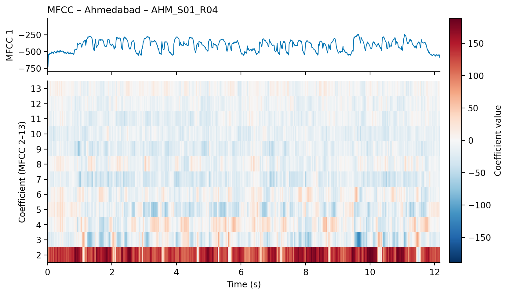

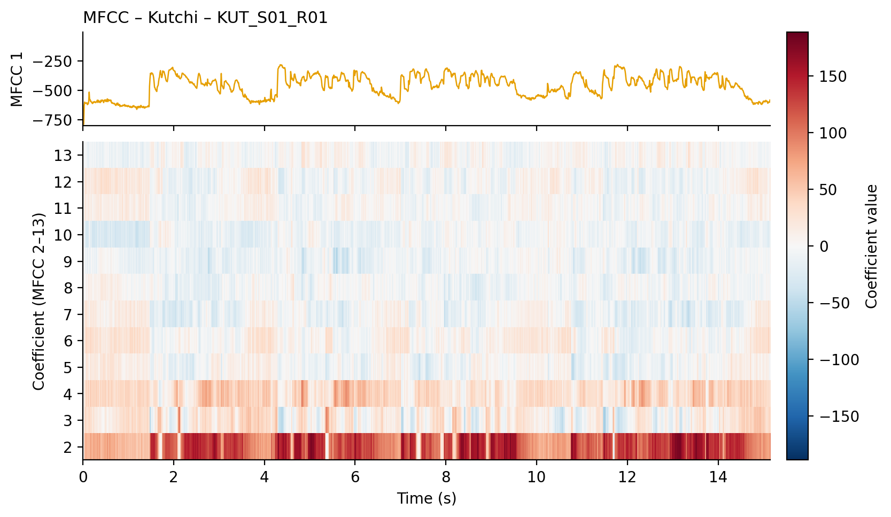

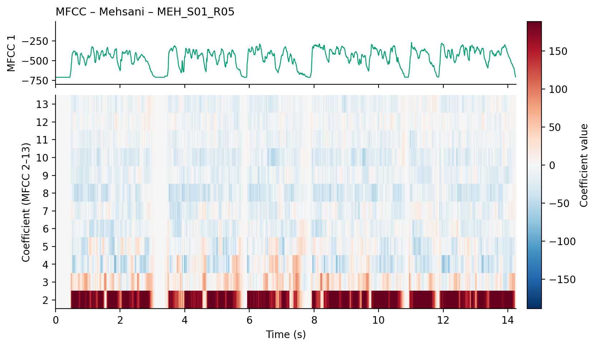

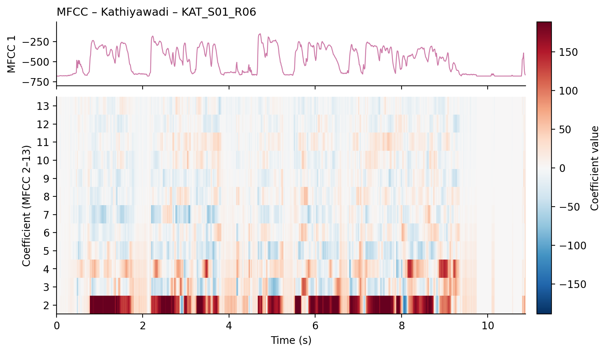

**What these show.** The MFCC features of one recording over time. The thin line on top is MFCC 1. The big heatmap is MFCC 2–13: each column is one 10 ms frame and each row is one coefficient. (These four are the same representative recordings used in Phase 2, picked by a fixed rule: duration closest to the accent's median.) A heatmap is drawn for **all 28 recordings**; the other 24 are in the `figures/per_recording/` folder.

**How to read them.** Read left to right as time. Where the pattern is busy with strong colours, someone is speaking. Where it turns flat and pale, there is a pause or silence.

**What we observe.**
- In all four, the top MFCC 1 line jumps up during speech and drops during pauses. In the Kathiyawadi example it falls to about −680 during pauses and stays flat there at the end of the recording (digital silence).
- MFCC 2 (the bottom row) is strongly red during speech in all four recordings.
- Pauses look different: in the Mehsani and Kathiyawadi recordings they are almost perfectly flat and pale, while in the Ahmedabad and Kutchi recordings the pauses still show faint patterns (background noise).

**Why it matters.** These features respond strongly to whether someone is speaking at all. Since we left silence in, a big part of what the numbers describe is *how much of the recording is speech versus silence or noise*, not only *how the words sound*.

### 7.2 Average MFCC per accent

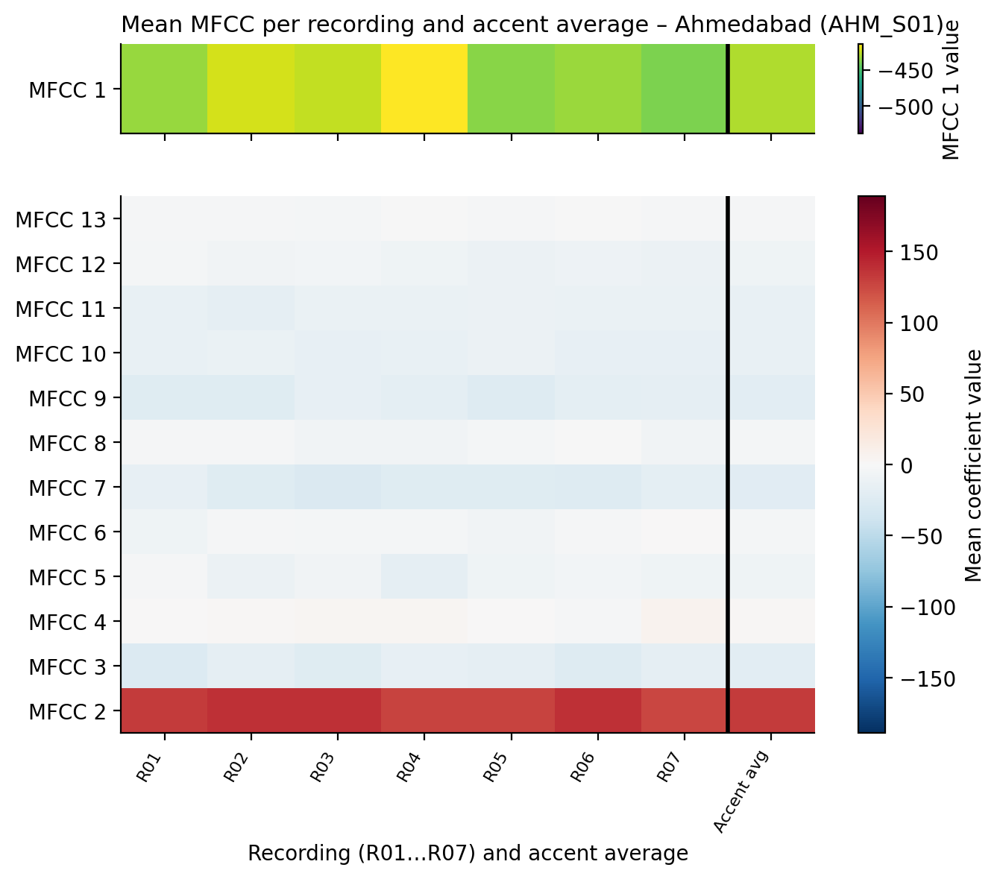

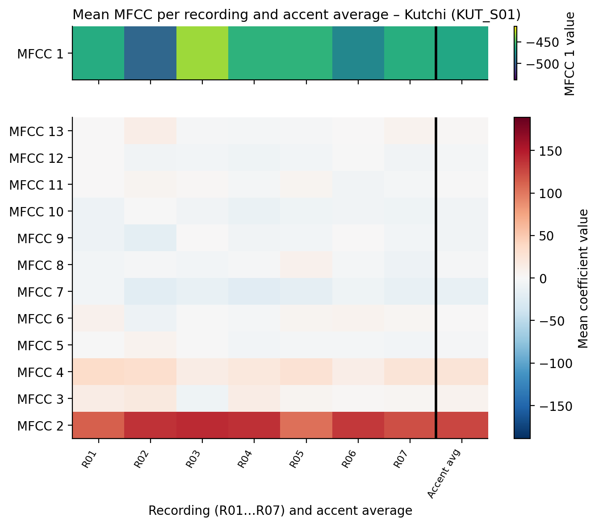

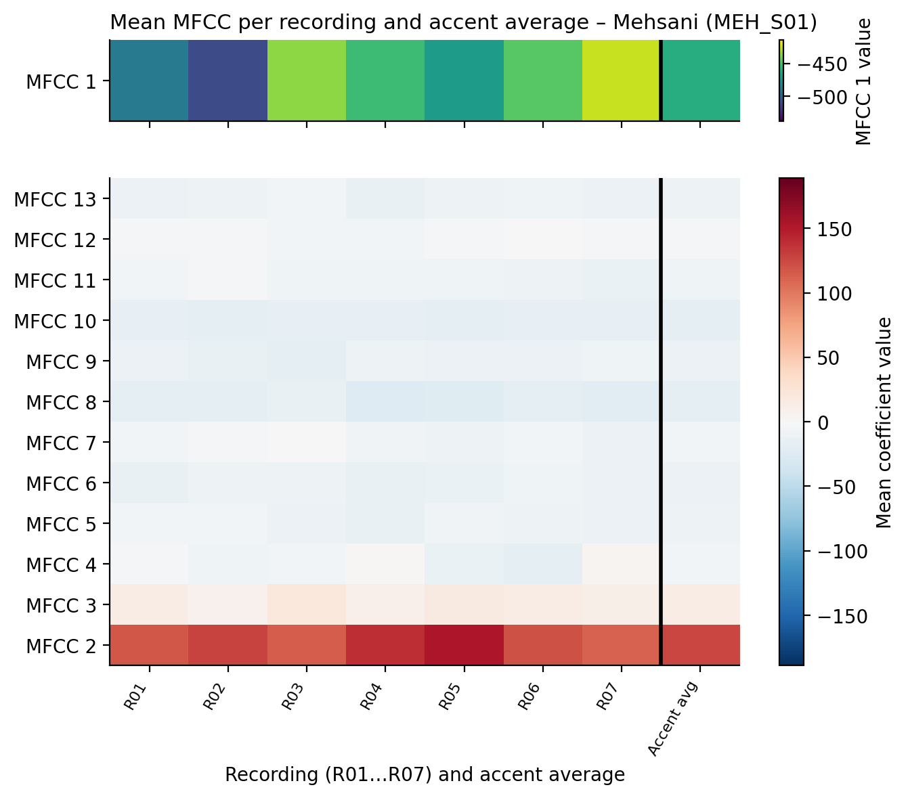

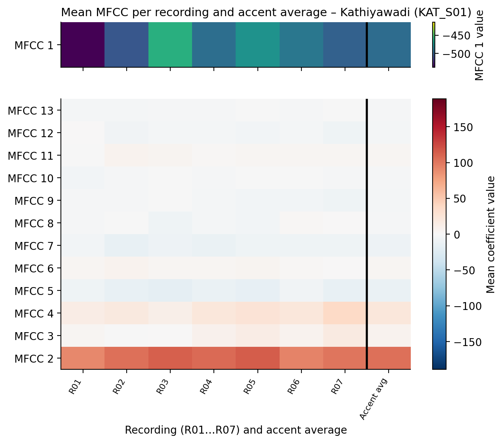

**What these show.** Averaging the heatmap over time would blur together different words and timings, so instead each column here is **one recording's average over all its frames** (R01 to R07), and the last column (after the black line) is the average for the whole accent. The small top strip is MFCC 1 (same colour scale in all four accent figures).

**How to read them.** If the seven columns look alike, the speaker's recordings are consistent with each other.

**What we observe.**
- Within each accent the columns look quite similar, especially for Ahmedabad.
- Some columns stand out: for example, in Kutchi, R02 and R03 differ from the others in MFCC 1, and R01 and R05 have a paler MFCC 2.

**Why it matters.** Recordings of one speaker are fairly consistent in their coefficient pattern. But because it is the *same person* each time, this consistency does not show anything about the accent group as a whole.

### 7.3 Comparing the four accents

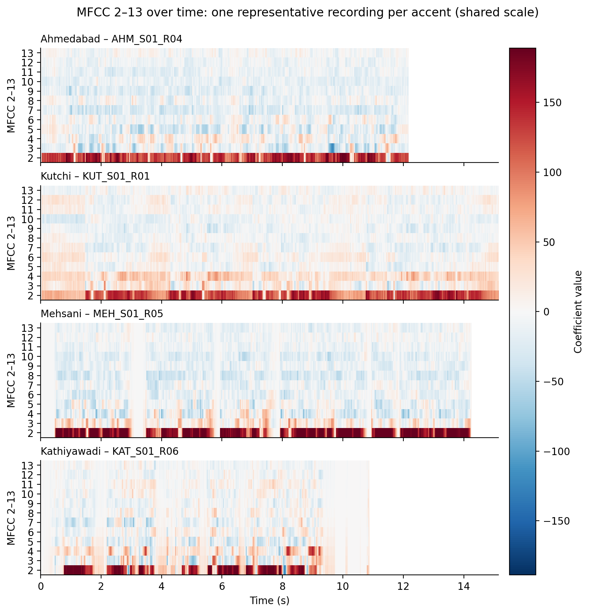

**What it shows.** One representative recording per accent, stacked, with the same time axis and colour scale.

**What we observe.**
- All four have the same broad structure: a very strong MFCC 2 band, with weaker coefficients above it.
- Each recording has a different texture. For instance, MFCC 4 is mostly orange in the Kutchi and Kathiyawadi examples, whereas in the Mehsani example it is mostly pale blue and in the Ahmedabad example it is near zero.
- Timing differs because speakers said different sentences and paused differently.

**Why it matters.** The visual differences are small and subtle compared with the shared structure. The recordings are not obviously separable by eye from a single example each.

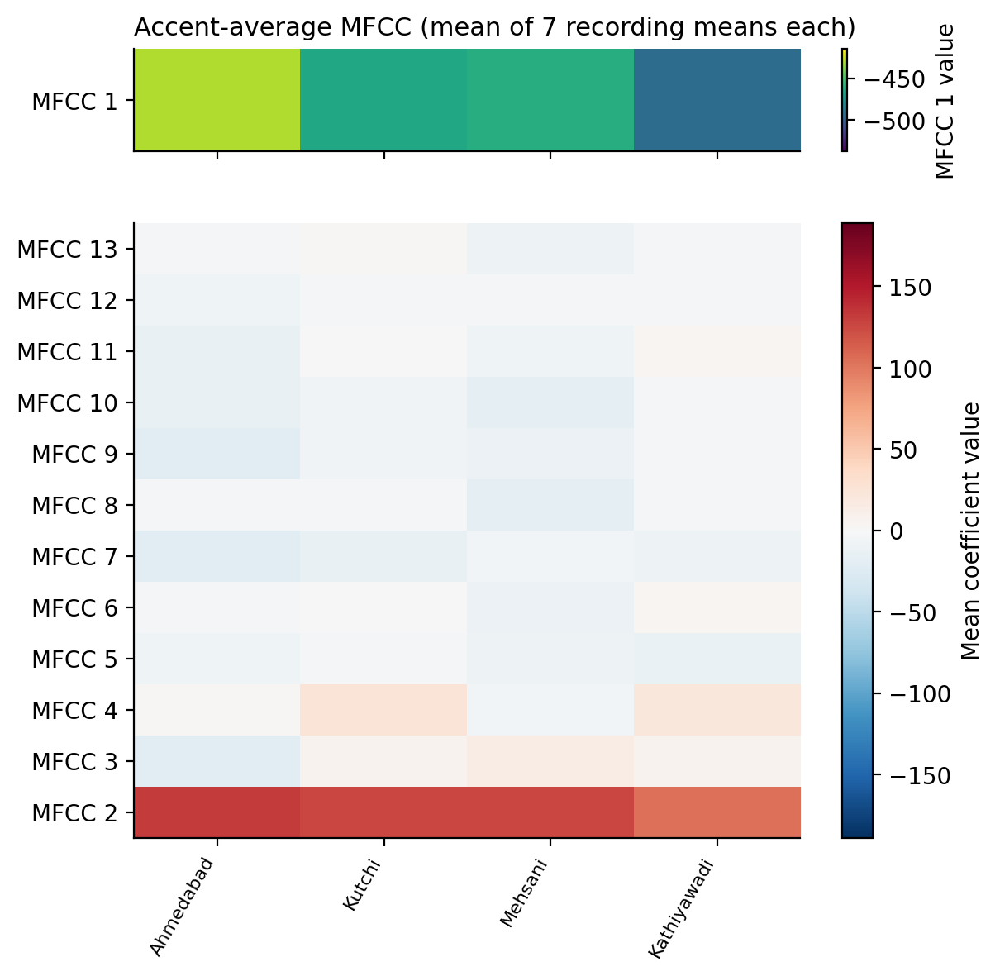

**What it shows.** The 13 average coefficients of each accent side by side. The top strip is MFCC 1; the lower panel is MFCC 2–13.

**What we observe.**
- MFCC 1 is highest (least negative) for Ahmedabad (−429.3) and lowest for Kathiyawadi (−494.1).
- MFCC 2 is lower for Kathiyawadi (103.3) than for the other three (126.1 to 132.5).
- MFCC 3 is negative only for Ahmedabad (−19.8); the others are positive (6.9 to 13.7).
- MFCC 8 is clearly more negative for Mehsani (−19.2) than the others (−2.5 to −3.8).

**Why it matters.** There are visible differences between these four speakers. We still cannot say whether they come from accent, speaker, device or format (see [Section 9](#9-limitations-and-possible-sources-of-bias)).

### 7.4 Distribution of each coefficient

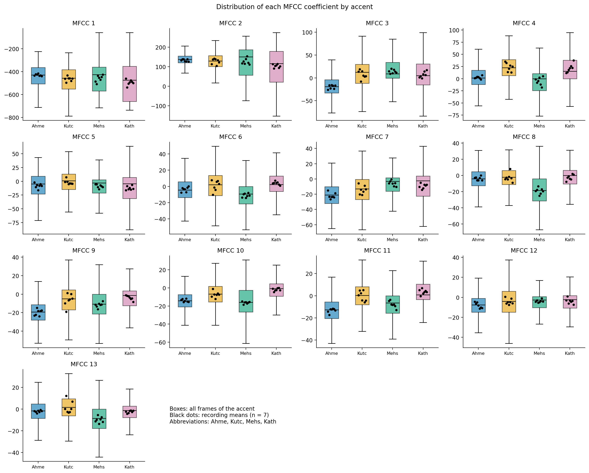

**What it shows.** One small panel per coefficient. Each coloured box covers the middle half of **all frames** of that accent (the line inside is the median). Black dots are the **recording-level means** (seven per accent). Silent and pause frames are included.

**How to read it.** Tall boxes = the coefficient varies a lot from frame to frame. Tightly grouped dots = the recordings of that accent have very similar averages.

**What we observe.**
- The frame-level boxes **overlap heavily** for every coefficient. A single 10 ms frame cannot tell the accents apart.
- The black dots are much more tightly grouped than the boxes, and for some coefficients the dots of different accents sit in different places (for example MFCC 3 for Ahmedabad, MFCC 4 for Kutchi and Kathiyawadi, MFCC 8 for Mehsani).
- Kutchi's dots are more spread out than the others for several coefficients (for example MFCC 2, 9 and 13).

**Why it matters.** Differences show up when we look at the average over a whole recording, not in individual frames. This is why Phase 4 will start from recording-level summaries, but with only 7 recordings from one speaker per accent, we must stay cautious.

### 7.5 Delta and delta-delta MFCC

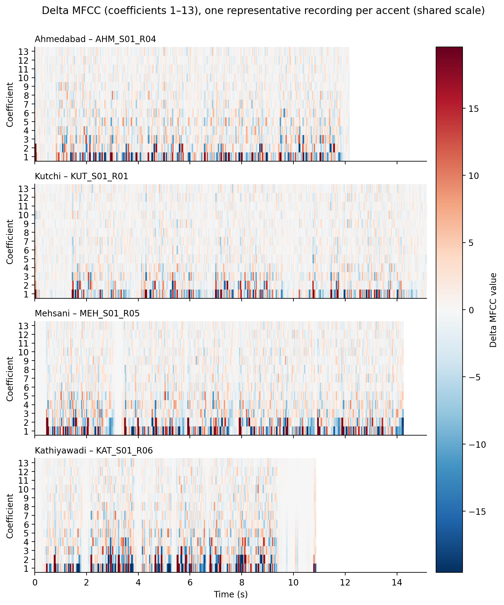

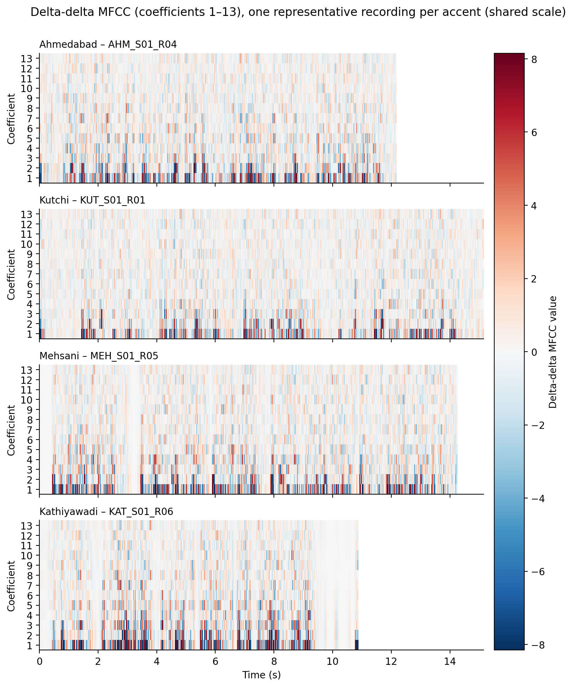

**What they show.** How fast (delta) and how fast-changing (delta-delta) each of the 13 coefficients is, over time, for the representative recordings. Same colour scale for all four accents within each figure. These figures show all 13 coefficients, including MFCC 1.

**How to read them.** Strong red or blue = rapid change at that moment. Pale = steady. The strongest changes are in the bottom rows (MFCC 1–3). In pauses the picture is flat.

**What we observe.**
- Most movement happens in the lowest coefficients (rows 1 to 3) at the start and end of speech bursts.
- In the Mehsani and Kathiyawadi examples the pauses are completely flat (nothing is changing), while in Ahmedabad and Kutchi there is still some small flicker in the pauses.

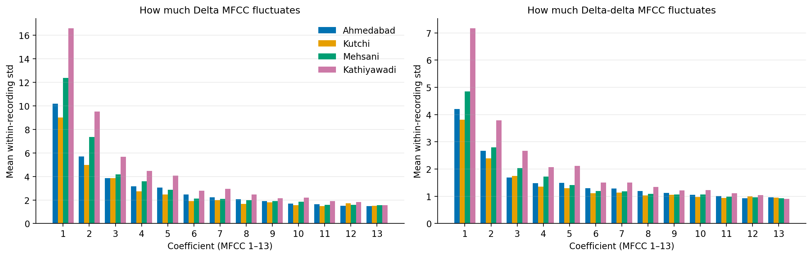

**What it shows.** For each coefficient, how much the delta (left) and delta-delta (right) values wobble inside a recording, averaged over each accent's recordings. Higher bar = more change from moment to moment.

**What we observe.**
- Kathiyawadi has the highest bars for coefficients 1 to 5 (for example delta of MFCC 1: 16.6, against 9.0 to 12.4 for the others).
- Mehsani is second highest for coefficients 1 to 2. Kutchi is lowest for the first coefficients (9.0 for delta of MFCC 1).
- For coefficients 9 to 13 the four accents are almost the same.

**Possible explanation (not tested):** the two OGG accents have sharp jumps between speech and digital silence, which could increase these values. A faster speaking style could also do it. We cannot separate these.

**Why it matters.** Delta features add information about how quickly sounds change, but they are also sensitive to how the recording handles silence.

### 7.6 Recording-level means across accents

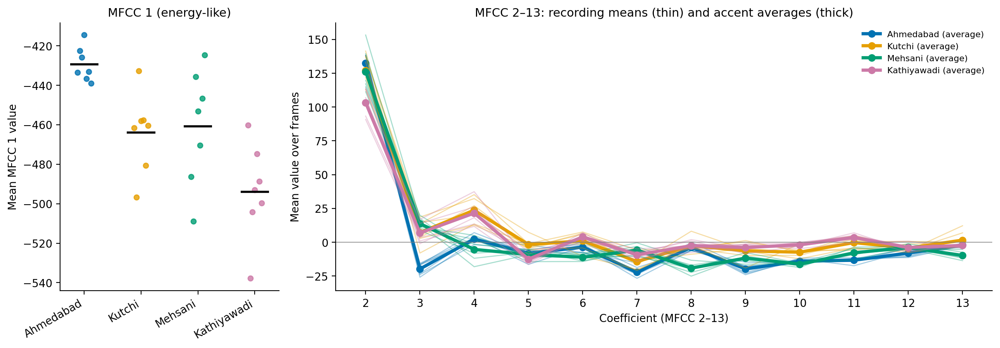

**What it shows.** Left: MFCC 1 (one dot per recording, black line = accent average). Right: MFCC 2–13 as lines. Each thin line is one recording; each thick line is an accent average.

**How to read it.** Thin lines of the same colour close together = that speaker's recordings are similar. A thick line far from the others at a given coefficient = that accent's average is different there.

**What we observe.**
- All accents follow the same overall shape: a huge value at MFCC 2, then values near zero.
- Ahmedabad's thin lines are tightly bunched; Kutchi's are more scattered.
- The accent averages separate most clearly at MFCC 3 (Ahmedabad lowest), MFCC 4 (Kutchi and Kathiyawadi highest) and MFCC 8 (Mehsani lowest).
- For MFCC 1, Ahmedabad's dots sit highest and Kathiyawadi's lowest, with a wide spread for Kutchi, Mehsani and Kathiyawadi.

**Why it matters.** It shows the coefficients where the four speakers differ most in this data. This is a list of things to look at in Phase 4, not a list of "accent features".

### 7.7 Extra views for interpretation

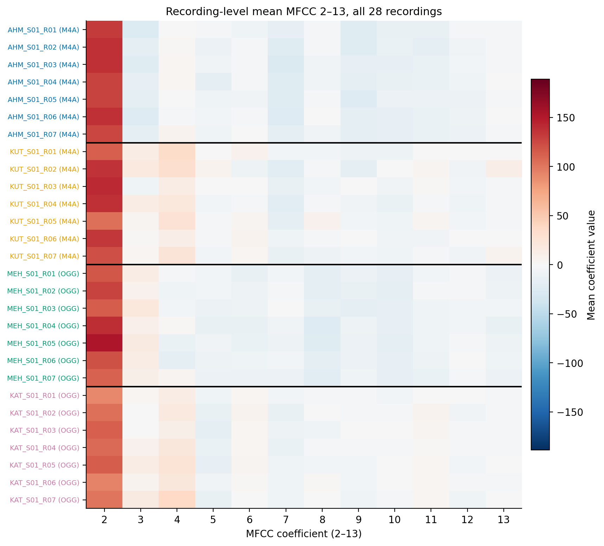

**What it shows.** All 28 recordings at once: one row per recording, grouped by accent (black lines separate them), one column per coefficient (2–13). Label colours match the accent colours, and the original file format is in brackets.

**What we observe.**
- Rows of the same accent look alike. The four groups look different in a few columns (for example column 3 for Ahmedabad, column 4 for Kutchi and Kathiyawadi, column 8 for Mehsani).
- The MFCC 2 column is paler in some recordings, such as `KAT_S01_R01` and `KAT_S01_R06`.

**Why it matters.** This is the "whole dataset on one page" view that Phase 4 will build on.

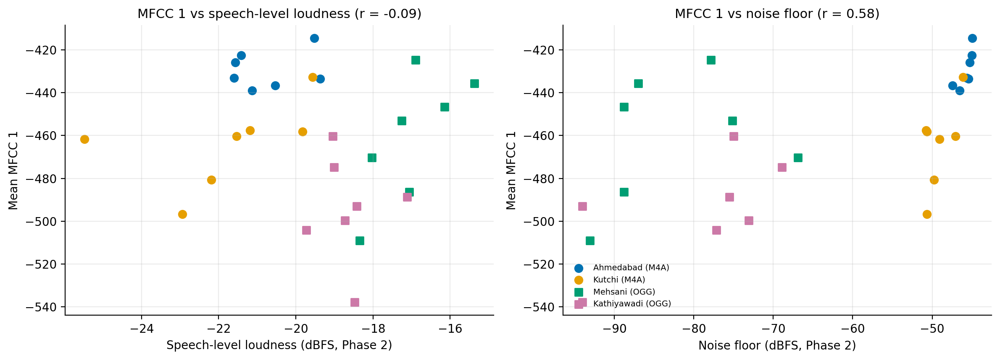

**What it shows.** Each dot is one recording. Left: its mean MFCC 1 against its speech loudness from Phase 2. Right: its mean MFCC 1 against its background noise floor from Phase 2. Circles = M4A files, squares = OGG files.

**What we observe.**
- Mean MFCC 1 has almost no relationship with speech loudness (r = −0.09) but a moderate one with the noise floor (r = 0.58). The noise-floor panel shows a clear split: the M4A recordings sit on the right (noise floor −45 to −51 dBFS) and the OGG recordings spread out on the left.
- Checked separately from the Phase 2 and Phase 3 CSV files: the mean of MFCC 1 and of MFCC 2 per recording both correlate with the **share of speech frames** found in Phase 2 (r = 0.69 and r = 0.70, n = 28).

*(r is a correlation number from −1 to +1; 0 means no straight-line relationship. These numbers are descriptive only, for 28 recordings.)*

**Why it matters.** The averages of the first coefficients depend a lot on **how much silence and background noise** a recording contains. That is a recording property, not an accent property, and it must be kept in mind when comparing accents.

---

## 8. Summary of Observations

### What we observed (facts from the data)

| # | Observation |
|---|---|
| 1 | All 28 recordings gave valid features (13 × frames matrices, no NaN or infinite values). |
| 2 | The accent averages of some coefficients differ clearly, and for **MFCC 3 and MFCC 8** the seven recording means of one accent do not overlap with those of any other accent (MFCC 3: Ahmedabad −25.9 to −15.6 against −8.0 or higher for the others; MFCC 8: Mehsani −25.1 to −13.3 against −8.9 or higher for the others). |
| 3 | **MFCC 4** is higher for Kutchi (23.7) and Kathiyawadi (21.5) than for Ahmedabad (2.4) and Mehsani (−5.3). This split does not follow the M4A/OGG split, since each pair contains one M4A and one OGG accent. |
| 4 | Kathiyawadi has the lowest average MFCC 1 (−494.1) and MFCC 2 (103.3), and the highest delta and delta-delta fluctuation in the lowest coefficients. |
| 5 | Frame-level distributions overlap heavily between accents; recording-level means are much more tightly grouped. |
| 6 | Mean MFCC 1 and MFCC 2 per recording go together with the share of speech frames (r ≈ 0.7) and mean MFCC 1 with the noise floor (r = 0.58). |
| 7 | Recordings of the same speaker are fairly similar; Kutchi shows the most recording-to-recording spread. |

### Possible explanations (not proven)

| Observation | Possible explanation |
|---|---|
| Accent means differ in MFCC 3, 4 and 8 | Speaker voice, vocabulary, accent, microphone or room. We cannot separate them. |
| Kathiyawadi has the lowest MFCC 1 and 2 | Kathiyawadi has the largest share of low-energy frames (about 39%) and digital-silence gaps (Phase 2). |
| Higher delta fluctuation in OGG accents | Sharp jumps between speech and digital silence, or faster speaking style. |
| Kutchi's larger spread | A lower-loudness recording (`KUT_S01_R01`), steady background tones, or less consistent sentences. |

---

## 9. Limitations and Possible Sources of Bias

1. **One speaker per accent.** Speaker voice, region, vocabulary, device and room are all mixed together. Seven recordings from one person are not seven independent samples of an accent.
2. **Recording format tied to accent.** Ahmedabad and Kutchi are M4A; Mehsani and Kathiyawadi are OGG. M4A recordings have a much higher noise floor (median −46.8 dBFS) than OGG ones (median −77.5 dBFS). Format-level averages differ too, for example MFCC 1 −446.7 (M4A) versus −477.5 (OGG), and MFCC 3 −6.3 versus +10.3.
3. **Silence and noise are included.** We did not remove pauses, so the features partly describe how much silence a recording contains.
4. **No normalisation.** Features are raw values, so recording level and channel effects remain.
5. **Quality flags.** Ten recordings have minor clipping and one Kutchi recording is quieter. They were kept on purpose.
6. **Different words.** Speakers adapted the sentences, so features may reflect word choice.
7. **Small sample.** 28 recordings; no statistical tests were run, and none would be reliable here.
8. **MFCC 1 is energy-like**, so it responds to loudness and silence more than to the way words sound.

We therefore **do not claim** that these differences represent the whole regional population, or that MFCC differences prove accent discrimination.

---

## 10. What We Learned

- The extraction pipeline works: all 28 recordings were processed with identical settings, fully validated, and every frame-level matrix is saved and traceable to its recording ID.
- MFCC features of these recordings differ in some coefficients between the four speakers, and are more consistent inside a speaker than between speakers.
- Part of what the features capture is **recording-related** (silence share, noise floor, format), especially in the first coefficients. So later results must be read with care.
- The recording-level table plus the frame-level arrays give us flexibility for the next phases (for example, we can later recompute the table with silence removed without re-extracting from the audio).

---

## 11. How These Features Will Be Used in Phase 4

Phase 4 (accent-wise feature comparison) will use:
- `mfcc_recording_features.csv` for recording-level comparisons: only the **78 acoustic columns** listed in `mfcc_feature_columns.json`, never the metadata.
- `frame_features/*.npz` for frame-level analyses.
- `mfcc_accent_summary.csv` as a starting point for which coefficients differ.

Things to check in Phase 4 because of what we found here:
- Do the differences survive when silence frames are excluded (applied the same way to every recording)?
- Do the differences stay when comparing within the same format only?
- Is MFCC 1 (energy-like) better left out of some comparisons?
- Are results the same with and without the 11 flagged recordings?

Surti will be added later, before final five-class training. When real Surti recordings arrive, re-run Phase 1 (and Phase 2 for the quality flags), then re-run this notebook; the Surti features are extracted with the same settings.

---

## 12. Conclusion

Phase 3 turned all 28 recordings into MFCC, delta and delta-delta features, kept the complete frame-by-frame data, built a clean recording-level table and passed every validation check. The graphs show that the four speakers differ in some coefficients (most clearly MFCC 3, 4 and 8), but also that the features are strongly affected by silence, background noise and recording format. Because there is **one speaker per accent**, these differences cannot be called accent characteristics. We are ready to compare the features carefully in Phase 4, keeping the quality flags and the confounds in mind.

---

## 13. Output Files

All files below are in `results/mfcc/`.

| File or folder | Contents |
|---|---|
| `frame_features/<recording_id>.npz` | Full frame-level `mfcc`, `delta`, `delta2` (13 × frames), frame times, recording/speaker/accent/region, and all extraction parameters. 28 files (about 5.5 MB total). |
| `mfcc_recording_features.csv` | One row per recording: metadata and quality flags, then the 78 acoustic columns (`mfcc_01_mean` … `delta2_13_std`). |
| `mfcc_feature_columns.json` | Lists which columns are metadata (not for model input) and which are acoustic features, plus the parameters. |
| `mfcc_accent_summary.csv` | Per accent, feature group and coefficient: mean and spread of recording means, min/max, pooled frame statistics. |
| `extraction_validation_summary.txt` | Parameters, counts per accent and all validation checks. |
| `figures/` | All figures used above (14 summary figures) and `figures/per_recording/` with 28 per-recording MFCC heatmaps. |

To rebuild everything: run `notebooks/03_mfcc_extraction.ipynb` from top to bottom. The code is in `src/mfcc_features.py`.
