# Phase 6 Report: Custom Dual-Branch CNN–MLP Feature-Fusion Network with Hierarchical Multi-Task Classification

*Gujarati Accent Classifier – research report for model development*

This report documents exactly what was designed, trained and evaluated in Phase 6, what the results do and do not show, which model was selected for the final pipeline and why. All numbers are read from the files in `results/model_development/`; the code is in `src/model_data.py`, `src/model_dev.py`, `src/model_checks.py`, `src/model_plots.py` and `scripts/run_phase6.py`.

> ## ⚠ Critical limitation – read this first
> The dataset has **35 recordings from only 5 speakers, one speaker per accent**. Speaker identity, accent label, recording device/session and wording are therefore completely confounded. Every accuracy in this report is a **within-speaker, recording-level** score: the held-out recordings come from the *same five people* (recorded in the same sessions) as the training recordings. These scores **do not measure unseen-speaker generalisation**, and no model here may be described as a speaker-independent Gujarati accent classifier. Phase 4 and Phase 5 already showed that the features separate the five speakers almost perfectly, so near-perfect within-speaker accuracy is expected and carries little information about accents. The work is an **initial five-accent exploratory study and prototype**.
>
> Also, with exactly one accent per region, the region head and the accent head are currently **equivalent five-class problems**. Genuine hierarchical discrimination between several accents *inside one region* has **not** been demonstrated; the code supports it (Section 11) but it cannot be tested with this data.

## Status at a glance

| Item | Result |
|---|---|
| Architecture implemented and trained from scratch | Dual-branch CNN–MLP fusion network, hierarchical region/accent heads (127,626 trainable parameters) |
| Four required experiments (A–D) | All four **complete** on identical 7-fold splits |
| **Selected final model** | **C: MLP only (78 features)** + hierarchical heads (10,026 trainable parameters) – see Section 27 |
| Fusion network (Experiment D) | Documented and fully evaluated; **not selected** (no evidence that the CNN branch adds anything on this data) |
| Inference pipeline | `scripts/predict_accent.py` and `model_dev.AccentPredictor`; final model in `results/model_development/final_model/bundle/` |
| Architecture diagram | [`figures/phase6_hierarchical_model_architecture.png`](figures/phase6_hierarchical_model_architecture.png) |

**Run status (nothing is reported as complete unless all folds finished):**

| Run | Experiment | Status | Folds finished |
|---|---|---|---|
| A: SVM (78 MFCC features) | A | complete | 7 of 7 |
| B: CNN only (Log-Mel) | B | complete | 7 of 7 |
| C: MLP only (78 features) | C | complete | 7 of 7 |
| D: Dual-branch fusion (proposed) | D | complete | 7 of 7 |
| C (suppl.): MLP, 78 + 13 additional features | C-supp | INCOMPLETE / not run | 0 of 7 |
| C (suppl.): MLP, no augmentation | C-supp | INCOMPLETE / not run | 0 of 7 |
| D (suppl., post-hoc): fusion, patience 25, no augmentation | D-supp | complete | 7 of 7 |
| D (suppl., post-hoc): fusion, patience 25 | D-supp | complete | 7 of 7 |
| B (suppl., post-hoc): CNN, patience 25 | B-supp | complete | 7 of 7 |

The `mlp_only_extra` and `mlp_only_noaug` runs were queued but **deliberately not run** (project time constraints); the partial folder `results/model_development/mlp_only/supplementary_additional_features/` is a leftover of a cancelled start and contains no results.

---

## Contents

1. [Introduction](#1-introduction)
2. [Research objectives](#2-research-objectives)
3. [Dataset description](#3-dataset-description)
4. [Acoustic feature inventory](#4-acoustic-feature-inventory)
5. [Motivation for dual-branch learning](#5-motivation-for-dual-branch-learning)
6. [Log-Mel spectrogram methodology](#6-log-mel-spectrogram-methodology)
7. [Numerical feature preprocessing](#7-numerical-feature-preprocessing)
8. [Full CNN architecture](#8-full-cnn-architecture)
9. [Full MLP architecture](#9-full-mlp-architecture)
10. [Feature-fusion methodology](#10-feature-fusion-methodology)
11. [Hierarchical classification heads](#11-hierarchical-classification-heads)
12. [Model architecture diagram](#12-model-architecture-diagram)
13. [Layer-by-layer explanation](#13-layer-by-layer-explanation)
14. [Tensor shapes at every stage](#14-tensor-shapes-at-every-stage)
15. [Trainable parameter count](#15-trainable-parameter-count)
16. [Mathematical explanation of convolution and feature fusion](#16-mathematical-explanation-of-convolution-and-feature-fusion)
17. [Loss functions](#17-loss-functions)
18. [Optimiser and callbacks](#18-optimiser-and-callbacks)
19. [Data augmentation](#19-data-augmentation)
20. [Training and evaluation methodology](#20-training-and-evaluation-methodology)
21. [Experiment results (A–D)](#21-experiment-results-ad)
22. [Training curves](#22-training-curves)
23. [Confusion matrices](#23-confusion-matrices)
24. [Hierarchical prediction examples](#24-hierarchical-prediction-examples)
25. [Overfitting analysis](#25-overfitting-analysis)
26. [Limitations](#26-limitations)
27. [Key findings and model decision](#27-key-findings-and-model-decision)
28. [Conclusion](#28-conclusion)
29. [Future scope](#29-future-scope)
30. [Connection to Phase 7](#30-connection-to-phase-7)

Labels used: **Observed** = a number from the data; **Interpretation** = a reasonable reading the data cannot prove; **Hypothesis** = needs further investigation.

---

## 1. Introduction

Phases 1–5 standardised the audio, checked its quality, extracted 78 MFCC-based features per recording, analysed those features and explored them with PCA. Phase 5 concluded that the leading principal components are almost entirely speaker/accent-group axes, which is what one expects when each accent is one speaker. Phase 6 asks a different, practical question: **can a model be trained from scratch on this dataset to predict a recording's region and accent, and does combining a spectrogram CNN with the numerical features help?**

The proposed design is a *Custom Dual-Branch CNN–MLP Feature-Fusion Network with Hierarchical Multi-Task Classification*: a 2-D CNN reads a Log-Mel spectrogram, an MLP reads the numerical acoustic features, the two learned vectors are concatenated, and two softmax heads predict region and accent. Everything is trained from random initialisation: **no pretrained model, weights, embeddings or external speech encoders are used** (verified by an automatic code scan and a weight-initialisation test, Section 20).

## 2. Research objectives

1. Learn representations from Log-Mel spectrograms (Branch A).
2. Learn from the existing numerical acoustic features (Branch B).
3. Fuse both representations (concatenation) and predict region and accent jointly (hierarchical multi-task heads).
4. Compare, under one evaluation protocol, (A) an SVM on the 78 features, (B) a CNN on spectrograms only, (C) an MLP on numerical features only, and (D) the proposed fusion network, to see **whether combining the two representations actually helps**.
5. Provide a reusable inference pipeline for a new recording.
6. Be honest about what within-speaker evaluation can and cannot show.

## 3. Dataset description

| Region | Accent | Recordings | Speakers | Original format |
|---|---|---|---|---|
| Central Gujarat | Ahmedabad | 7 | 1 | M4A |
| Kutch | Kutchi | 7 | 1 | M4A |
| North Gujarat | Mehsani | 7 | 1 | OGG |
| Saurashtra | Kathiyawadi | 7 | 1 | OGG |
| South Gujarat | Surti | 7 | 1 | M4A |

Total: **35 recordings, 5 accents, 5 regions, 5 speakers.** The original files are M4A/OGG at 16–48 kHz; all models use the Phase 1 standardised WAVs (16 kHz, mono, PCM-16). Recording durations are 8.3–18.3 s. Region → accent mapping used by the code (read from the metadata, never hard-coded): Central Gujarat → Ahmedabad, Kutch → Kutchi, North Gujarat → Mehsani, Saurashtra → Kathiyawadi, South Gujarat → Surti.

**Confounds inherited from Phases 2–5:** one speaker per accent; Ahmedabad, Kutchi and Surti are M4A and Mehsani and Kathiyawadi are OGG; sample rates and noise floors differ by accent (Surti is noisiest, Kathiyawadi/Mehsani the quietest); the Surti session differs from the others.

## 4. Acoustic feature inventory

**Existing Phase 3 features (78, schema unchanged):** mean and standard deviation of 13 MFCCs, 13 delta-MFCCs and 13 delta-delta-MFCCs per recording (3 families × 13 coefficients × 2 statistics), listed in `results/mfcc/mfcc_feature_columns.json`. The model input uses exactly those columns, in that order; no metadata column (accent, speaker, format, quality flags) is ever an input.

**Additional features (extracted and validated, stored separately):** `results/model_development/additional_features/additional_acoustic_features.csv`, 13 columns: spectral centroid, bandwidth and roll-off (mean, std), zero-crossing rate (mean, std), and F0 statistics from pYIN (mean, std, median, 5–95 percentile range, voiced fraction). RMS energy was **not** added (it is a recording-level quantity already carried by MFCC 1 and confounded with the recording setup in Phases 2–4); **formants were not extracted** because no reliable formant tracker is available without external software.

**Decision:** the additional features are **not** part of the model input. Mean F0, for example, differs strongly between the five speakers (AHM 241 Hz, KAT 136 Hz, KUT 223 Hz, MEH 184 Hz, SUR 149 Hz), i.e. it is a direct speaker-voice fingerprint, and adding speaker-identifying features would only strengthen the confound. The planned test of 78 + additional features (an MLP run) was **not run** for time reasons, so the additional features have not been evaluated in a model.

## 5. Motivation for dual-branch learning

* **Spectrogram CNN:** sees the time–frequency pattern itself (formant transitions, spectral tilt, rhythm), which recording-level statistics average away.
* **Numerical-feature MLP:** sees compact, already-validated statistics (Phase 3/4) and needs far less data to train.
* **Fusion:** a CNN with ≈10⁵ parameters trained on about 25 training recordings per fold risks overfitting; the numerical branch could stabilise it, and the CNN might add information the statistics miss. Whether this *actually* happens is an empirical question, which the experiments answer (Section 21).

## 6. Log-Mel spectrogram methodology

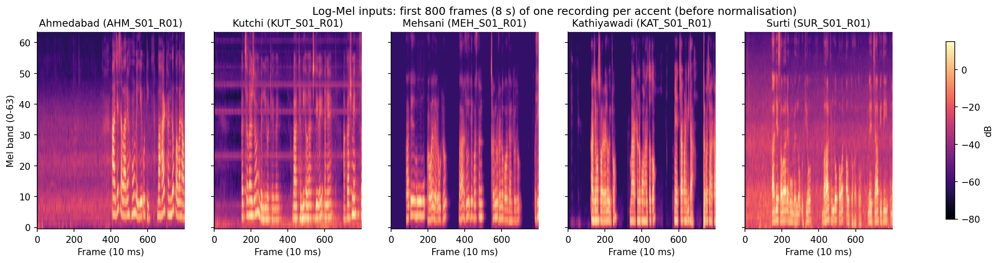

*One recording per accent, first 8 s, before normalisation.*

| Setting | Value |
|---|---|
| Loading | `librosa.load`-equivalent via the project's `load_audio`, 16,000 Hz, mono, original WAV untouched |
| STFT | window 25 ms (400 samples), Hann (`window="hann"`), hop 10 ms (160 samples), `n_fft` 512, `center=True` |
| Mel filter bank | 64 bands, 0–8,000 Hz |
| Spectrogram | `librosa.feature.melspectrogram(power=2.0)` (power spectrogram) |
| Logarithm | `librosa.power_to_db(ref=1.0, top_db=80)` – absolute dB levels kept |
| Input length **T** | **800 frames = 8.0 s**; the shortest recording is 8.29 s, so **no recording needs padding** |
| Cropping | centre crop for validation/test/inference; random crop (a small time shift) for training |
| Padding (future recordings shorter than 8 s) | end-padding with the training mean (= 0 after normalisation) |
| Normalisation | per-Mel-band mean/std **fitted on the training recordings of each fold only** |
| Input tensor | `(batch, 64, 800, 1)` |

Spectrogram frame counts equal the Phase 3 MFCC frame counts for every recording (same framing; checked automatically). Config: `results/model_development/spectrograms/spectrogram_config.json`.

**Note on T:** cropping to 8 s discards up to 10 s of the longer recordings at test time; Surti recordings (8.3–10.8 s) are almost fully used. Duration therefore cannot act as a cue (no padding), but the absolute dB scale (kept deliberately) does carry the noise floor, which differs by recording setup.

## 7. Numerical feature preprocessing

* Input: the 78 Phase 3 columns (checked against the schema file; no NaN/inf).
* **Z-score normalisation fitted on the training recordings of each fold only** and saved with the model (`preprocessing.npz`); validation/test recordings and new recordings are transformed with the training statistics.
* PCA values are **not** used as input; the original features stay available.
* Numerical-feature augmentation (training only) is small Gaussian jitter (σ = 0.1 in z-units) – feature-space noise, not features re-extracted from augmented audio.

## 8. Full CNN architecture

**Branch A** (Log-Mel spectrogram CNN):

| # | Layer | Configuration | Output shape (excl. batch) | Trainable params |
|---|---|---|---|---|
| 0 | Input | Log-Mel | (64, 800, 1) | 0 |
| 1 | Conv2D `conv1_32` | 32 filters, 3×3, `padding="same"`, `use_bias=False` | (64, 800, 32) | 288 |
| 2 | BatchNormalization `conv1_bn` | – | (64, 800, 32) | 64 |
| 3 | ReLU | – | (64, 800, 32) | 0 |
| 4 | MaxPooling2D | 2×2 | (32, 400, 32) | 0 |
| 5 | Conv2D `conv2_64` | 64 filters, 3×3, same, no bias | (32, 400, 64) | 18,432 |
| 6 | BatchNormalization | – | (32, 400, 64) | 128 |
| 7 | ReLU | – | (32, 400, 64) | 0 |
| 8 | MaxPooling2D | 2×2 | (16, 200, 64) | 0 |
| 9 | Conv2D `conv3_128` | 128 filters, 3×3, same, no bias | (16, 200, 128) | 73,728 |
| 10 | BatchNormalization | – | (16, 200, 128) | 256 |
| 11 | ReLU | – (no pooling in block 3) | (16, 200, 128) | 0 |
| 12 | GlobalAveragePooling2D | mean over the 16×200 positions | (128) | 0 |
| 13 | Dense `cnn_dense_128` | 128, ReLU | (128) | 16,512 |
| 14 | Dropout | rate 0.40 | (128) | 0 |

Branch A output: **128-dimensional** vector. Branch A trainable parameters: **109,408**.

## 9. Full MLP architecture

**Branch B** (numerical-feature MLP):

| # | Layer | Configuration | Output shape | Trainable params |
|---|---|---|---|---|
| 0 | Input | 78 z-scored features | (78) | 0 |
| 1 | Dense `mlp_dense_64` | 64, ReLU | (64) | 5,056 |
| 2 | BatchNormalization | – | (64) | 128 |
| 3 | Dropout | rate 0.30 | (64) | 0 |
| 4 | Dense `mlp_dense_32` | 32, ReLU | (32) | 2,080 |
| 5 | Dropout | rate 0.20 | (32) | 0 |

Branch B output: **32-dimensional** vector. Branch B trainable parameters: **7,264**.

## 10. Feature-fusion methodology

`Concatenate(axis=-1)` joins the 128-d CNN vector **a** and the 32-d MLP vector **b** into the 160-d vector **z = [a ; b]**. A shared block follows: `Dense(64, ReLU)` → `Dropout(0.40)` → the **shared 64-d representation h**. No attention or other complex fusion is used (35 recordings do not justify it). Shared block trainable parameters: **10,304**.

## 11. Hierarchical classification heads

Two softmax heads branch from **h**:

* **Region head** `region_output = Dense(5, softmax)` → probabilities over Central Gujarat, Kutch, North Gujarat, Saurashtra, South Gujarat.
* **Accent head** `accent_output = Dense(5, softmax)` → probabilities over Ahmedabad, Kutchi, Mehsani, Kathiyawadi, Surti.

Head parameters: 650 (325 each). Both heads are trained jointly (Section 17).

**Hierarchical inference** (`model_dev.hierarchical_decode`, used by `AccentPredictor`):
1. region = argmax of the region probabilities;
2. the accents allowed are those mapped to that region (the mapping comes from the metadata and is stored in the model bundle);
3. the accent is the argmax of the accent-head probabilities **restricted to those accents and renormalised**;
4. the output contains the region, the accent, the region confidence, the accent confidence within the region, the raw accent-head probability and their product (joint confidence).

The decoder is mapping-agnostic: a region may contain several accents (tested automatically with a synthetic mapping), so the one-accent-per-region situation is **not** hard-coded. **Limitation:** with one accent per region, step 3 is trivial (one allowed accent, confidence 1.0) and the hierarchical result equals the region prediction; the two heads agree on 94.3% of fusion-model test predictions. This **does not show** an ability to distinguish accents inside a region.

## 12. Model architecture diagram

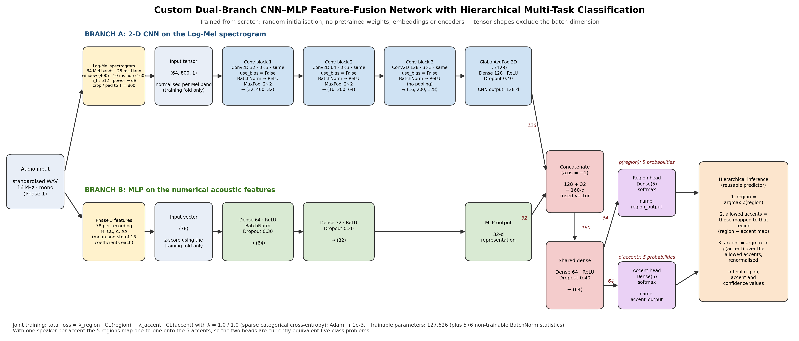

The diagram is saved at `reports/figures/phase6_hierarchical_model_architecture.png` (generated by `model_plots.architecture_diagram` from the actual model dimensions and parameter counts).

## 13. Layer-by-layer explanation

* **Conv2D (3×3, same, no bias):** slides 3×3 filters over the (Mel band × time) image; each filter learns a local spectro-temporal pattern. Bias is omitted because the following BatchNorm has its own shift (β).
* **BatchNormalization:** normalises each channel with batch statistics during training (and running averages at inference) and learns a scale γ and shift β; stabilises optimisation. *Section 25 shows it is also the source of an important training artefact.*
* **ReLU:** max(0, x) non-linearity.
* **MaxPooling2D (2×2):** keeps the maximum of each 2×2 block, halving frequency and time resolution and adding small shift-invariance.
* **GlobalAveragePooling2D:** averages each of the 128 feature maps over all positions, giving a fixed-size 128-d vector for any T.
* **Dense layers:** fully connected layers (ReLU) that mix features. **Dropout:** randomly zeroes units during training (0.40, 0.30, 0.20, 0.40) to reduce overfitting.
* **Concatenate:** stacks the two learned vectors. **Shared Dense(64):** learns a joint representation used by both tasks (multi-task sharing).
* **Softmax heads:** convert 64-d h into class probabilities that sum to 1.

Full layer table of the fusion network (from `results/model_development/fusion_model/architecture_layer_table.csv`):

| layer | type | output shape (batch first) | trainable | non-trainable (BN statistics) |
|---|---|---|---|---|
| spectrogram | InputLayer | (None, 64, 800, 1) | 0 | 0 |
| conv1_32 | Conv2D | (None, 64, 800, 32) | 288 | 0 |
| conv1_bn | BatchNormalization | (None, 64, 800, 32) | 64 | 64 |
| conv1_relu | ReLU | (None, 64, 800, 32) | 0 | 0 |
| conv1_pool | MaxPooling2D | (None, 32, 400, 32) | 0 | 0 |
| conv2_64 | Conv2D | (None, 32, 400, 64) | 18432 | 0 |
| conv2_bn | BatchNormalization | (None, 32, 400, 64) | 128 | 128 |
| conv2_relu | ReLU | (None, 32, 400, 64) | 0 | 0 |
| conv2_pool | MaxPooling2D | (None, 16, 200, 64) | 0 | 0 |
| conv3_128 | Conv2D | (None, 16, 200, 128) | 73728 | 0 |
| features | InputLayer | (None, 78) | 0 | 0 |
| conv3_bn | BatchNormalization | (None, 16, 200, 128) | 256 | 256 |
| mlp_dense_64 | Dense | (None, 64) | 5056 | 0 |
| conv3_relu | ReLU | (None, 16, 200, 128) | 0 | 0 |
| mlp_bn | BatchNormalization | (None, 64) | 128 | 128 |
| cnn_gap | GlobalAveragePooling2D | (None, 128) | 0 | 0 |
| mlp_dropout_1 | Dropout | (None, 64) | 0 | 0 |
| cnn_dense_128 | Dense | (None, 128) | 16512 | 0 |
| mlp_dense_32 | Dense | (None, 32) | 2080 | 0 |
| cnn_dropout | Dropout | (None, 128) | 0 | 0 |
| mlp_dropout_2 | Dropout | (None, 32) | 0 | 0 |
| fusion_concat | Concatenate | (None, 160) | 0 | 0 |
| shared_dense_64 | Dense | (None, 64) | 10304 | 0 |
| shared_dropout | Dropout | (None, 64) | 0 | 0 |
| accent_output | Dense | (None, 5) | 325 | 0 |
| region_output | Dense | (None, 5) | 325 | 0 |

## 14. Tensor shapes at every stage

`audio (16 kHz mono) → Log-Mel (64, T_full) → crop to (64, 800, 1)` → conv1 `(64, 800, 32)` → pool `(32, 400, 32)` → conv2 `(32, 400, 64)` → pool `(16, 200, 64)` → conv3 `(16, 200, 128)` → GAP `(128)` → Dense `(128)` → **a (128)**.
`78 features → (78) → Dense (64) → Dense (32)` → **b (32)**.
`concat → (160)` → Dense `(64)` → **h (64)** → region `(5)` and accent `(5)`. (Batch dimension omitted; all shapes are checked automatically against the built model.)

## 15. Trainable parameter count

| Model | Trainable parameters | Non-trainable (BatchNorm statistics) |
|---|---|---|
| **D: fusion network** | **127,626** | 576 |
| B: CNN only (+ shared Dense(64) + heads) | 118,314 | 448 |
| C: MLP only (+ shared Dense(64) + heads) | 10,026 | 128 |

Fusion = Branch A 109,408 + Branch B 7,264 + shared block 10,304 + two heads 650 = **127,626** (matches an independent hand calculation, checked automatically). The CNN branch accounts for 86% of the fusion network's parameters.

## 16. Mathematical explanation of convolution and feature fusion

**Convolution.** For an input X with C_in channels and a filter K of size 3×3, the output channel at position (i, j) is
y(i, j) = Σ_c Σ_(u,v∈{−1,0,1}) K_c(u, v) · X_c(i + u, j + v)  (zero padding keeps the output size: `same`). Conv block 1 has C_in = 1 and 32 filters (3·3·1·32 = 288 weights); block 2 has 3·3·32·64 = 18,432; block 3 has 3·3·64·128 = 73,728.

**Batch normalisation (per channel).** x̂ = (x − μ_B) / √(σ²_B + ε), y = γ x̂ + β, with batch statistics μ_B, σ²_B during training and exponential moving averages (momentum 0.99) at inference.

**Global average pooling.** a_c = (1/HW) Σ_(i,j) F_c(i, j) for each of the 128 channels; the Dense layer then computes a = ReLU(W₁ g + b₁).

**Feature fusion.** With a ∈ ℝ¹²⁸ (CNN) and b ∈ ℝ³² (MLP): **z = [a ; b] ∈ ℝ¹⁶⁰**, then h = Dropout(ReLU(W₂ z + b₂)), h ∈ ℝ⁶⁴, W₂ ∈ ℝ^(64×160). Because W₂ = [W₂ᴬ | W₂ᴮ], W₂ z = W₂ᴬ a + W₂ᴮ b: the fused layer is a learned weighted sum of what each branch contributes, so the network can down-weight an uninformative branch.

**Heads.** p_region = softmax(W_r h + b_r), p_accent = softmax(W_a h + b_a), softmax(s)ᵢ = exp(sᵢ) / Σⱼ exp(sⱼ).

## 17. Loss functions

Sparse categorical cross-entropy for each head, CE(p, y) = −log p_y, combined as
**L = λ_region · CE_region + λ_accent · CE_accent with λ_region = λ_accent = 1.0** (equal weights, the specified starting point; no weight search was done). Accuracy is tracked per head.

## 18. Optimiser and callbacks

Adam, initial learning rate 0.001; batch size 8 (small data; 25 training recordings × 4 random views = 100 samples per epoch, 13 steps); max 100 epochs; seeds fixed (`42 + fold`). Callbacks as specified: `EarlyStopping(monitor="val_loss", patience=10, restore_best_weights=True)`, `ModelCheckpoint(save_best_only=True, monitor="val_loss")`, `ReduceLROnPlateau(monitor="val_loss", factor=0.5, patience=4)`. **Post-hoc supplementary variants** (added *after* seeing the patience-10 results, therefore labelled as such) use patience 25 and up to 150 epochs.

## 19. Data augmentation

Training recordings only, applied on the fly inside each training fold (after the split): random 8-s crop (time shift), gain ±3 dB, Gaussian jitter (σ = 0.05 in normalised units), at most one time mask (≤ 40 frames = 0.4 s) and one frequency mask (≤ 6 Mel bands), each with probability 0.5. **No pitch or speed change.** All views of a recording stay in that recording's fold; they are never counted as independent samples (an epoch simply draws 4 random views of every training recording). A check reads one full training epoch and confirms that only training recordings are touched.

## 20. Training and evaluation methodology

**Protocol.** Stratified 7-fold cross-validation **over recordings**: each fold holds out one recording per accent (5 test recordings), and every recording is tested exactly once (35 out-of-fold predictions). From the remaining recordings one per accent is kept for validation (early stopping and checkpoint selection) and the rest trains the model (25 training / 5 validation / 5 test per fold). All four experiments and all supplementary runs use identical splits (`results/model_development/evaluation/cross_validation_folds.csv`).

**This is within-speaker evaluation, not unseen-speaker testing.** Every test recording has training recordings from the *same speaker, session and device*. It is exploratory only.

**Split / preprocessing / leakage audit (all checked automatically, `evaluation/validation_summary.txt`):**

| Check | Result |
|---|---|
| Every recording is tested exactly once; train/val/test disjoint in every fold | passed |
| Each test set holds exactly one recording per accent (stratified) | passed |
| Normalisation (spectrogram and numerical) re-fitted on training recordings only reproduces the saved statistics, and differs from an all-data fit | passed |
| Augmentation reads only training recordings (one epoch inspected) | passed |
| Each trained fold used exactly its planned train/val/test recordings | passed |
| Test recordings never influence checkpoint selection (validation set is separate) | by design; confirmed by the fold files |
| Label-shuffle control (SVM, training labels shuffled, 50 repeats): accuracy 0.218 ± 0.078 (chance 0.200) | pipeline does not leak labels |
| No pretrained references; random initialisation (same seed → identical initial weights, different seed → different) | passed |
| All trainable weight tensors changed during training (every fold of every run) | passed |
| Checkpoints (`.keras`) reload and reproduce the stored probabilities | passed |

**Residual leakage of a different kind (not removable with this data):** recordings of one speaker in the same session share voice, microphone, room and probably wording, so train and test are *not independent in the way that matters for accent recognition*. The label-shuffle control shows the code is not leaking labels; it cannot show that the model is learning accent rather than speaker/setup.

**One protocol deviation to disclose:** the SVM is trained on the 25 training recordings only (not train+validation) so that all models see identical training data; the validation recordings are used by the neural networks only for early stopping/checkpointing.

**Metrics.** Pooled over the 35 out-of-fold predictions: accuracy, macro precision/recall/F1 (accent head), region accuracy, hierarchical end-to-end accuracy (region and decoded accent both correct), per-class results and confusion matrices; fold-wise mean ± SD (each fold has only 5 test recordings, so one error moves a fold by 0.2 and the fold-wise SD is coarse).

## 21. Experiment results (A–D)

All four required experiments are **complete** on identical folds.

| Experiment | Status | Accent accuracy (pooled, 35) | Fold-wise mean ± SD | Macro P / R / F1 | Region accuracy | Hierarchical end-to-end |
|---|---|---|---|---|---|---|
| A: SVM, 78 MFCC features (RBF, C=1) | complete (7/7 folds) | 1.000 | 1.000 ± 0.000 | 1.000 / 1.000 / 1.000 | 1.000 | 1.000 |
| B: CNN only (Log-Mel), patience 10 | complete (7/7 folds) | 0.429 | 0.429 ± 0.138 | 0.261 / 0.429 / 0.321 | 0.429 | 0.429 |
| C: MLP only (78 features), patience 10 | complete (7/7 folds) | 1.000 | 1.000 ± 0.000 | 1.000 / 1.000 / 1.000 | 1.000 | 1.000 |
| D: dual-branch fusion (proposed), patience 10 | complete (7/7 folds) | 0.857 | 0.857 ± 0.190 | 0.896 / 0.857 / 0.852 | 0.829 | 0.829 |

**Supplementary runs (same folds; the two *patience-25* rows are post-hoc, added after the patience-10 results):**

| Run | Status | Accent accuracy (pooled) | Fold-wise mean ± SD | Macro P / R / F1 | Region accuracy | Hierarchical end-to-end |
|---|---|---|---|---|---|---|
| B′: CNN only, patience 25, ≤150 epochs | complete (7/7 folds) | 0.486 | 0.486 ± 0.254 | 0.671 / 0.486 / 0.429 | 0.514 | 0.514 |
| D′: fusion, patience 25, ≤150 epochs | complete (7/7 folds) | 1.000 | 1.000 ± 0.000 | 1.000 / 1.000 / 1.000 | 1.000 | 1.000 |
| D″: fusion, patience 25, **no augmentation** | complete (7/7 folds) | 0.771 | 0.771 ± 0.243 | 0.836 / 0.771 / 0.758 | 0.743 | 0.743 |

Fold-wise accuracy (rows = runs, columns = folds; each fold = 5 held-out recordings):

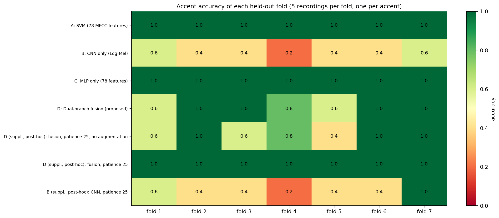

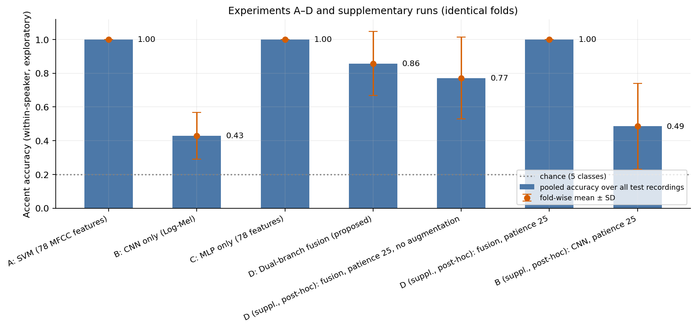

| run | 1 | 2 | 3 | 4 | 5 | 6 | 7 |
|---|---|---|---|---|---|---|---|
| A: SVM (78 MFCC features) | 1.0 | 1.0 | 1.0 | 1.0 | 1.0 | 1.0 | 1.0 |
| B: CNN only (Log-Mel) | 0.6 | 0.4 | 0.4 | 0.2 | 0.4 | 0.4 | 0.6 |
| C: MLP only (78 features) | 1.0 | 1.0 | 1.0 | 1.0 | 1.0 | 1.0 | 1.0 |
| D: Dual-branch fusion (proposed) | 0.6 | 1.0 | 1.0 | 0.8 | 0.6 | 1.0 | 1.0 |
| D (suppl., post-hoc): fusion, patience 25, no augmentation | 0.6 | 1.0 | 0.6 | 0.8 | 0.4 | 1.0 | 1.0 |
| D (suppl., post-hoc): fusion, patience 25 | 1.0 | 1.0 | 1.0 | 1.0 | 1.0 | 1.0 | 1.0 |
| B (suppl., post-hoc): CNN, patience 25 | 0.6 | 0.4 | 0.4 | 0.2 | 0.4 | 0.4 | 1.0 |

**Observed.**
* **A (SVM) and C (MLP) classify all 35 held-out recordings correctly** (1.000 and 1.000), in every fold. As the label-shuffle control shows, this is not label leakage; it is what Phase 4/5 predicted: the 78 features separate the five speaker/session groups cleanly.
* **D (fusion, patience 10, as specified) reaches 0.857** (fold-wise 0.857 ± 0.190); its errors are concentrated in the three folds where early stopping fired at epochs 16–19 (Section 25).
* **B (CNN only, patience 10) reaches 0.429** (0.429 ± 0.138); it never predicts Ahmedabad or Kutchi correctly (per-class table below).

* **D′ (fusion, patience 25) reaches 1.000** (1.000 ± 0.000), training 78–150 epochs per fold (median best epoch 106).
* **D″ (fusion, no augmentation) reaches 0.771** (0.771 ± 0.243); early stopping fired at epoch ≤ 30 in 4 of 7 folds, versus 0 of 7 for the augmented run with the same patience.
* **B′ (CNN, patience 25) reaches 0.486** (0.486 ± 0.254): six folds still stopped near epoch 30 with a poor result, but one fold trained all 150 epochs and classified all five held-out recordings correctly.

**Per-class results (accent head, pooled):**

Experiment D (fusion, patience 10):

| accent | precision | recall | f1 | support |
|---|---|---|---|---|
| Ahmedabad | 1.000 | 0.571 | 0.727 | 7 |
| Kutchi | 1.000 | 0.714 | 0.833 | 7 |
| Mehsani | 0.700 | 1.000 | 0.824 | 7 |
| Kathiyawadi | 1.000 | 1.000 | 1.000 | 7 |
| Surti | 0.778 | 1.000 | 0.875 | 7 |

Experiment B (CNN only, patience 10):

| accent | precision | recall | f1 | support |
|---|---|---|---|---|
| Ahmedabad | 0.000 | 0.000 | 0.000 | 7 |
| Kutchi | 0.000 | 0.000 | 0.000 | 7 |
| Mehsani | 0.250 | 0.429 | 0.316 | 7 |
| Kathiyawadi | 0.556 | 0.714 | 0.625 | 7 |
| Surti | 0.500 | 1.000 | 0.667 | 7 |

(A and C have precision = recall = F1 = 1.000 for every class.)

**Interpretation.** Because A and C are already perfect, **accuracy cannot separate the models that work**; differences between them are not evidence of one representation being "better for accents". What the table *does* show is that the CNN-based models are harder to train reliably and that nothing here supports the claim that adding the CNN branch helps (Section 27).

## 22. Training curves

Fusion network (Experiment D, patience 10): thin lines are folds, thick lines the mean over folds.

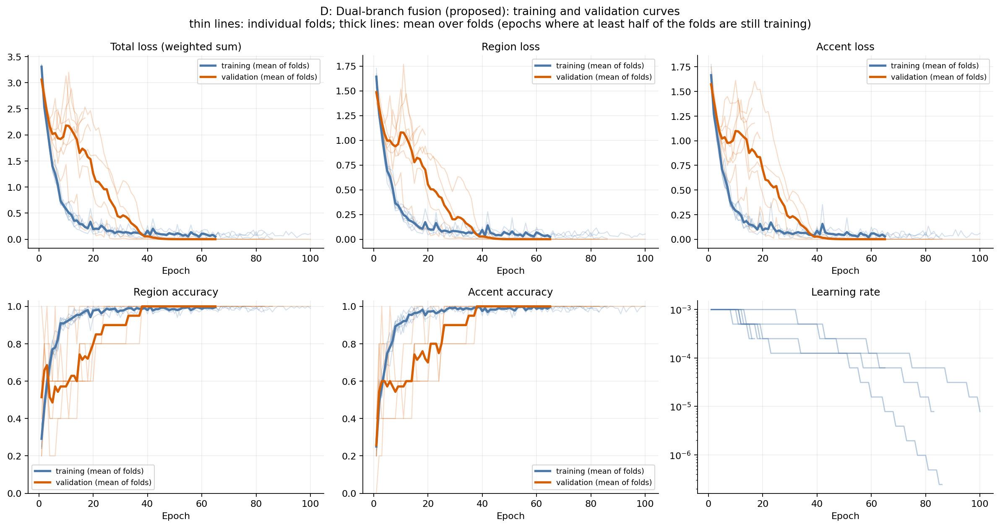

CNN only (B):

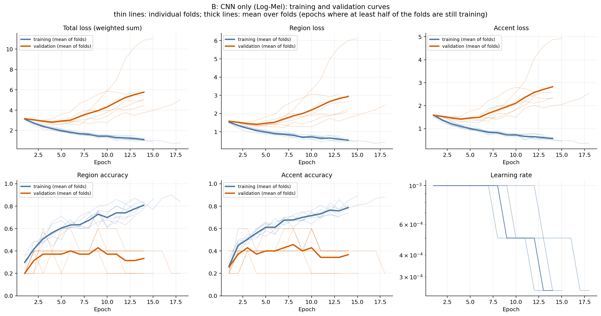

MLP only (C):

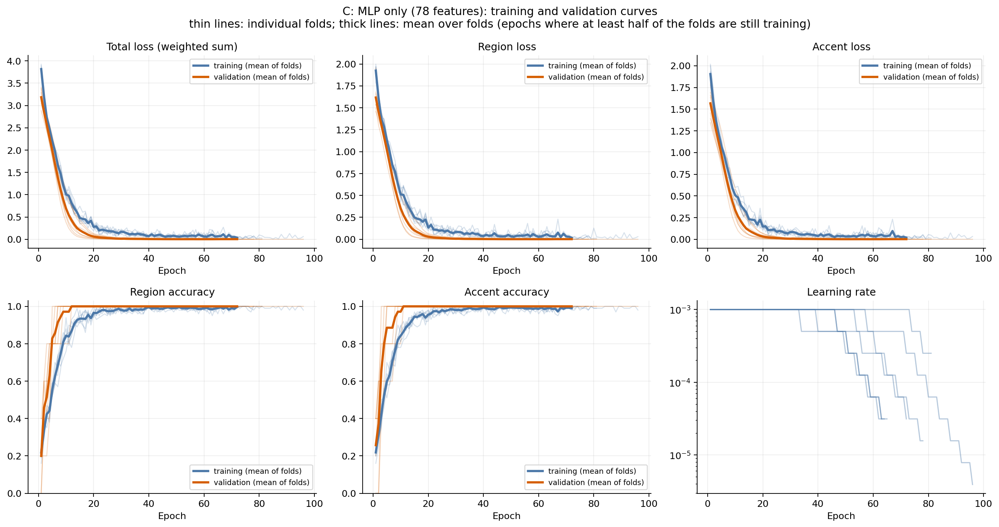

Post-hoc supplementary runs:

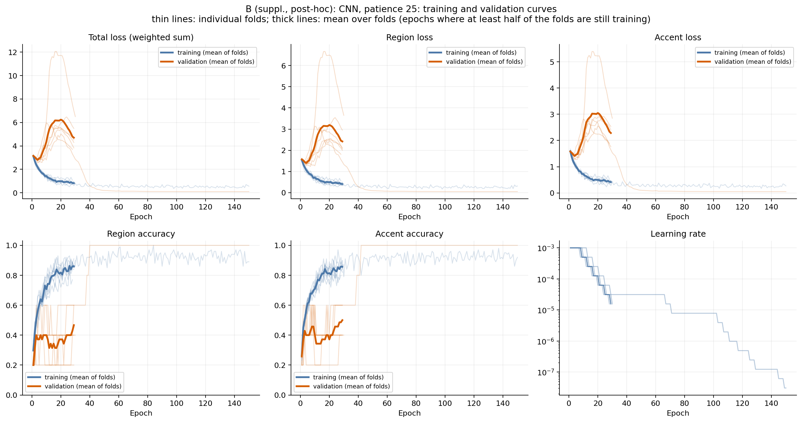

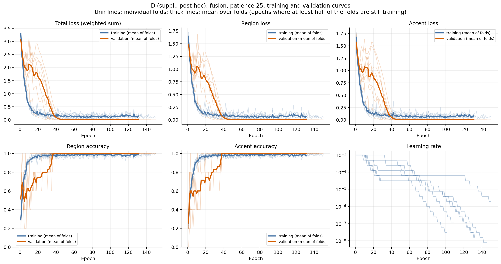

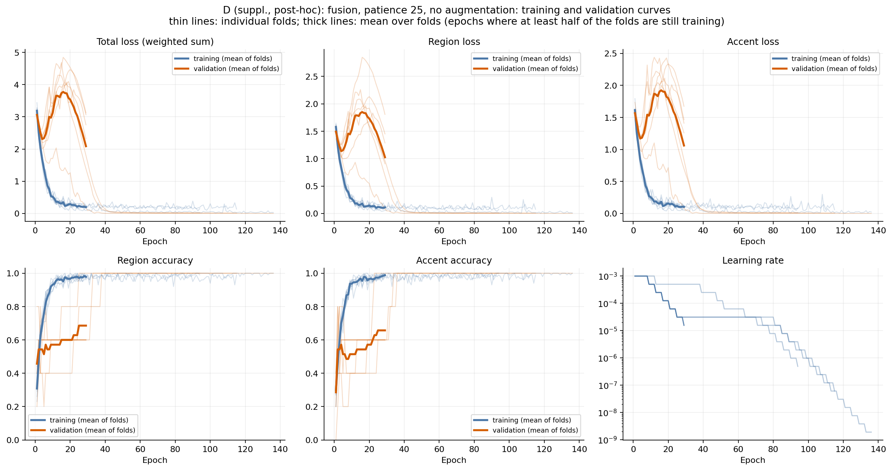

**Observed.** In the fusion and CNN runs the validation loss typically **rises or plateaus during the first ~10 epochs and only falls sharply between epochs ~15 and ~40**, after which the held-out validation recordings are classified correctly. The MLP learns smoothly and reaches 100% validation accuracy in all folds. Learning-rate reductions (bottom-right panels) are driven by validation-loss plateaus.

## 23. Confusion matrices

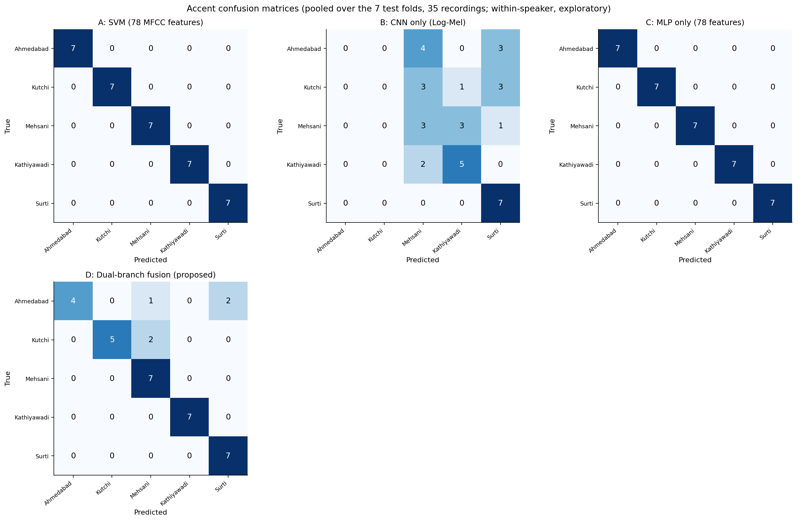

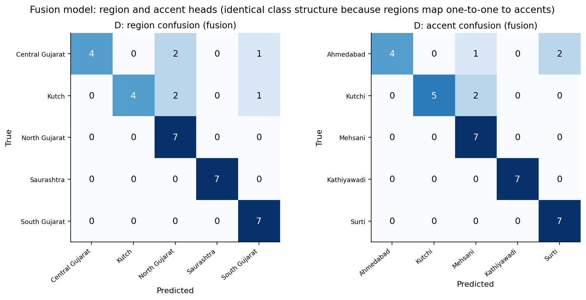

Pooled over the 7 test folds (35 recordings; rows = true class). A and C are diagonal. The fusion model (D) confuses Ahmedabad and Kutchi with Mehsani and (Ahmedabad) Surti; the CNN-only model (B) predicts almost everything as Surti, Mehsani or Kathiyawadi. **Because the regions map one-to-one to accents, the region confusion matrix has the same structure as the accent matrix** (a head-by-head disagreement occurs only when the two heads pick different classes; here they agree on 94.3% of fusion test predictions).

## 24. Hierarchical prediction examples

Predictions from the **selected model** (C, MLP + hierarchical heads) for recordings that the predicting fold model **did not see** (held out), made with the reusable pipeline (audio file → features → saved normalisation → network → hierarchical decision) – `results/model_development/hierarchical_inference/prediction_examples.csv` holds all 35:

| recording_id | fold_model | true_region | predicted_region | true_accent | predicted_accent | region_confidence | joint_confidence |
|---|---|---|---|---|---|---|---|
| AHM_S01_R01 | 7 | Central Gujarat | Central Gujarat | Ahmedabad | Ahmedabad | 1.000 | 1.000 |
| AHM_S01_R02 | 5 | Central Gujarat | Central Gujarat | Ahmedabad | Ahmedabad | 1.000 | 1.000 |
| KUT_S01_R01 | 1 | Kutch | Kutch | Kutchi | Kutchi | 1.000 | 1.000 |
| KUT_S01_R02 | 4 | Kutch | Kutch | Kutchi | Kutchi | 1.000 | 1.000 |
| MEH_S01_R01 | 7 | North Gujarat | North Gujarat | Mehsani | Mehsani | 1.000 | 1.000 |
| MEH_S01_R02 | 2 | North Gujarat | North Gujarat | Mehsani | Mehsani | 1.000 | 1.000 |
| KAT_S01_R01 | 1 | Saurashtra | Saurashtra | Kathiyawadi | Kathiyawadi | 0.995 | 0.995 |
| KAT_S01_R02 | 7 | Saurashtra | Saurashtra | Kathiyawadi | Kathiyawadi | 1.000 | 1.000 |
| SUR_S01_R01 | 2 | South Gujarat | South Gujarat | Surti | Surti | 1.000 | 1.000 |
| SUR_S01_R02 | 1 | South Gujarat | South Gujarat | Surti | Surti | 1.000 | 1.000 |

The pipeline also accepts the **original M4A/OGG files** (standardised with FFmpeg first, like Phase 1):

| recording_id | true_accent | predicted_region | predicted_accent | region_confidence |
|---|---|---|---|---|
| AHM_S01_R01 | Ahmedabad | Central Gujarat | Ahmedabad | 1.000 |
| KUT_S01_R01 | Kutchi | Kutch | Kutchi | 1.000 |
| MEH_S01_R01 | Mehsani | North Gujarat | Mehsani | 1.000 |

The reusable predictor reproduces the batch evaluation probabilities (max difference 2.9e-08). Examples of **errors** (fusion network, patience 10, held-out recordings; hierarchical decoding):

| recording_id | fold | true_region | pred_region | true_accent | pred_accent_hier | region_confidence | accent_confidence_within_region |
|---|---|---|---|---|---|---|---|
| AHM_S01_R04 | 1 | Central Gujarat | North Gujarat | Ahmedabad | Mehsani | 0.350 | 1.000 |
| KUT_S01_R01 | 1 | Kutch | North Gujarat | Kutchi | Mehsani | 0.405 | 1.000 |
| AHM_S01_R05 | 4 | Central Gujarat | North Gujarat | Ahmedabad | Mehsani | 0.511 | 1.000 |
| KUT_S01_R02 | 4 | Kutch | South Gujarat | Kutchi | Surti | 0.272 | 1.000 |
| AHM_S01_R02 | 5 | Central Gujarat | South Gujarat | Ahmedabad | Surti | 0.614 | 1.000 |
| KUT_S01_R05 | 5 | Kutch | North Gujarat | Kutchi | Mehsani | 0.424 | 1.000 |

For a deployable model, the **final model** (`results/model_development/final_model/bundle/`, fitted on all recordings except 5 validation recordings) is used by `python scripts/predict_accent.py <audio>`. Its predictions on the recordings it was fitted on are in `final_model_demo_predictions.csv` and are **illustrative only, not an evaluation**.

## 25. Overfitting analysis

Mean accent accuracy over folds on the (clean) training recordings, validation recordings and held-out test recordings, and the epoch counts:

| name | train_accent_accuracy | val_accent_accuracy | test_accent_accuracy | mean_epochs_run | mean_best_epoch |
|---|---|---|---|---|---|
| A: SVM (78 MFCC features) | 1.000 | 1.000 | 1.000 | – | – |
| B: CNN only (Log-Mel) | 0.429 | 0.429 | 0.429 | 14.6 | 4.6 |
| C: MLP only (78 features) | 1.000 | 1.000 | 1.000 | 74.1 | 64.1 |
| D: Dual-branch fusion (proposed) | 0.874 | 0.829 | 0.857 | 55.1 | 46.6 |
| D (suppl., post-hoc): fusion, patience 25, no augmentation | 0.777 | 0.771 | 0.771 | 65.9 | 40.9 |
| D (suppl., post-hoc): fusion, patience 25 | 1.000 | 1.000 | 1.000 | 120.9 | 99.1 |
| B (suppl., post-hoc): CNN, patience 25 | 0.486 | 0.514 | 0.486 | 46.3 | 23.4 |

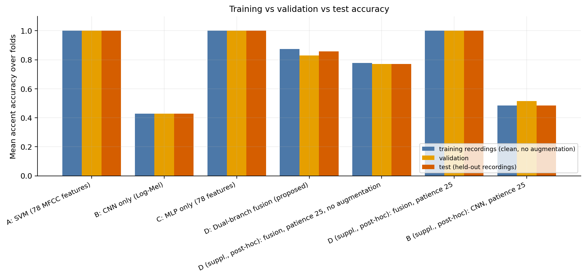

**Observed.**
* **SVM/MLP:** 1.00 on train, validation and test – no train–test gap, but also no evidence about generalisation beyond these speakers.
* **Fusion (patience 10) and CNN (patience 10):** the poor folds are **not** classical overfitting (high train accuracy, low test accuracy). In the failing folds the *training* accuracy at the restored checkpoint is also low (CNN-only: 0.28–0.60 in every fold; fusion folds 1, 4 and 5: 0.64–0.80), and the restored checkpoints come from epochs 3–9: the models were stopped before they had fitted even the training recordings.
* For the CNN-only run the accuracy on the *training crops during training* climbs to 0.7–0.9 within 14–18 epochs while the validation loss rises (1.4 → 2.3–4.9). So the best-validation checkpoint is an early one even though the network is still fitting the training data.

**Diagnosis of the CNN's poor result (checked, not assumed).** For every saved checkpoint of the CNN-only and fusion runs we compared each BatchNorm layer's stored running variance with the true variance of the layer's input on the fold's training recordings (CNN-only with patience 10 and 25, and fusion with patience 10) (`scripts/diagnose_cnn_batchnorm.py`, inference only, no training):

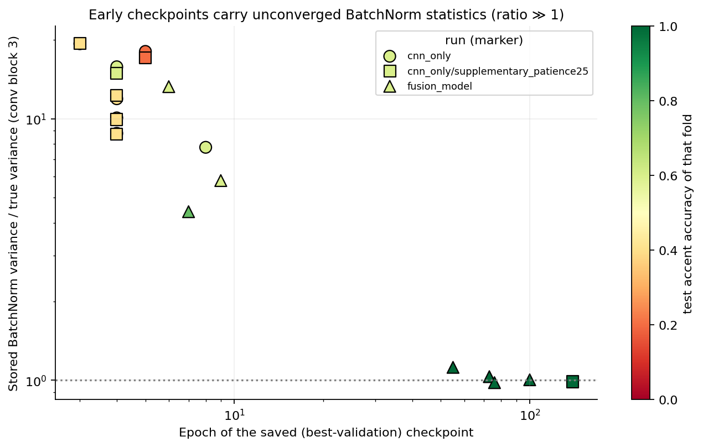

* In checkpoints saved at epoch ≤ 12 the stored variance is **4.4–19.4× the true variance** (conv block 3; 16 checkpoints). In checkpoints saved after epoch 40 it is **0.98–1.12×** (5 checkpoints), and **every one of those folds classified all of its held-out recordings correctly**.
* **A plausible mechanism (consistent with this diagnostic, not proven by it):** a BatchNorm layer with momentum 0.99 needs a few hundred update steps before its running statistics reflect the data; a checkpoint from epochs 3–9 (≈40–120 steps) therefore normalises with wrong statistics at inference time, which would inflate the validation loss and could trigger early stopping – a self-reinforcing artefact.
* One CNN-only fold trained to epoch 150 and reached validation loss 0.05 and 100% test accuracy, so **the CNN architecture can learn this task; it is not inherently unsuitable**.

**Interpretation / hypothesis (not tested):** the poor CNN-only and early-stopped fusion results are largely a training-procedure artefact (BatchNorm statistics × short checkpoint × tiny 5-recording validation set), not evidence that spectrogram CNNs are unsuitable. A direct test (e.g. faster BatchNorm momentum or a minimum number of epochs before early stopping) was **not run** because no further training was allowed in this phase. A second, ad-hoc check using batch statistics at inference (`evaluation/cnn_bn_mode_diagnostic.csv`) is confounded by active dropout and is not relied upon.

## 26. Limitations

1. **One speaker per accent (critical):** accent, speaker, device, session and wording are inseparable; all results are within-speaker, recording-level and exploratory. **No unseen-speaker generalisation can be claimed.**
2. **Saturated metric:** several models score 100%, so the evaluation cannot rank them; it also cannot show that the models learned *accent*.
3. **Tiny test folds:** 5 recordings per fold; a single error changes a fold's accuracy by 0.2, and fold-wise SDs are coarse.
4. **Region = accent:** the hierarchical structure is trivial in this dataset; multi-accent regions remain untested.
5. **Single seed per fold**; run-to-run variability of the CNN-based models was not measured.
6. **Post-hoc supplementary runs:** the patience-25 variants were chosen after seeing patience-10 results.
7. **Not run:** the additional-feature MLP, the MLP no-augmentation run, a CNN no-augmentation run and any test of a BatchNorm fix; some planned comparisons are therefore missing.
8. **Augmentation is mild and partly feature-space;** its effect cannot be isolated cleanly from the early-stopping artefact (Section 27).
9. **T = 8 s crops** discard part of the longer recordings at test time.
10. **Absolute dB spectrograms keep the noise floor,** which differs by recording setup (a trivial cue that the CNN may exploit).
11. The final model is fitted on all recordings (minus 5 validation); it has **no held-out evaluation**.

## 27. Key findings and model decision

**Findings (Observed).**
1. Within-speaker recording-level accuracy: SVM 1.000, MLP 1.000, fusion (as specified) 0.857, CNN only 0.429.
2. With longer patience (post-hoc) the fusion network reaches 1.000 and, without augmentation, 0.771; the CNN alone 0.486.
3. The CNN's weakness is mostly a **training-procedure artefact** (unconverged BatchNorm statistics at early-stopping checkpoints), not proof that the architecture is unsuitable (Section 25).
4. Label-shuffle control: 0.218 (chance 0.200) – no label leakage in the pipeline.
5. The extra spectral/F0 features are speaker fingerprints (mean F0 122–262 Hz across recordings) and were not used.

**Model decision.** *Selected for the final pipeline:* **C: MLP only (78 features) with the shared Dense(64) block and the two hierarchical heads** (Branch B + shared block + heads; 10,026 trainable parameters), fitted once on all recordings for inference.

*Reasons (evidence already available, not a new experiment):*
* **Accuracy cannot discriminate** between the working models (SVM and MLP are perfect; the fusion network matches them only after prolonged training), so the choice rests on stability, cost and parsimony rather than on an accuracy difference.
* **No evidence that the CNN branch helps:** the fusion network never exceeded the MLP-only network in any experiment, its result depends strongly on the early-stopping and augmentation settings (0.857 at the specified patience, 1.000 at patience 25 with augmentation, 0.771 at patience 25 without augmentation) whereas SVM and MLP results do not, it needs 13× the parameters and far more training time (2092 s for the 7 folds of the specified fusion run versus 83 s for the MLP, from `evaluation/training_logs/`), and its training is sensitive to a BatchNorm/early-stopping interaction. The patience-25 setting was also chosen *after* seeing the test-fold results, so even its 1.000 is not a clean estimate.
* **The MLP keeps everything the project needs:** two softmax heads (region and accent) with probabilities, the hierarchical decoder, and a lightweight, reproducible inference path based on the validated Phase 3 features.
* **SVM** is equally accurate, but gives no per-head probabilities and does not implement the multi-task hierarchical structure.

*What this decision does not mean:* it does **not** mean the MLP is the best accent recogniser (no experiment can show that with one speaker per accent), nor that spectrogram CNNs are unsuitable. The **dual-branch fusion architecture remains fully implemented, documented and evaluated**, and is the natural candidate to re-test when more speakers per accent exist, because a CNN branch needs more data than 25 training recordings.

## 28. Conclusion

A custom dual-branch CNN–MLP fusion network with hierarchical region/accent heads was implemented from scratch, trained under a documented cross-validation protocol and compared with an SVM, an MLP and a CNN. On this dataset all workable models classify held-out recordings of the *same five speakers* almost perfectly, which is what the Phase 4–5 analyses predicted and which says little about accent. The extra CNN branch added no measurable benefit and made training fragile; the simpler MLP with hierarchical heads was therefore selected for the final inference pipeline, with the fusion design retained for future data. The work is an **initial five-accent exploratory study and prototype**, not a speaker-independent accent classifier.

## 29. Future scope

* More speakers per accent and more recordings per speaker; same-device, quiet recordings across accents; more regions and accent varieties inside Gujarat; a larger, balanced dataset.
* **Speaker-independent evaluation** (train and test on different speakers; leave-one-speaker-out) – the essential next step before any generalisation claim.
* Regions containing several accents, so the hierarchical head and decoder can be genuinely tested.
* Re-testing the fusion network on larger data, with a BatchNorm fix (faster momentum or minimum epochs) and multiple seeds.
* Evaluating the additional (spectral/F0) features only after speaker confounds are controlled.

## 30. Connection to Phase 7

Phase 7 (model evaluation) should (1) re-state all results as within-speaker; (2) add repeated runs/seeds and report variance; (3) evaluate the selected model and the fusion network on any newly collected *unseen* speakers; (4) include robustness tests (noise, level, format changes) to quantify reliance on recording conditions; (5) test hierarchical decoding on a region with several accents when such data exist; (6) use the saved fold models, the final bundle and `scripts/predict_accent.py` as the starting point.

---

## Appendix: outputs, reproduction and inference

| Location | Content |
|---|---|
| `results/model_development/spectrograms/` | Log-Mel store, config JSON, manifest, example figure |
| `results/model_development/additional_features/` | Additional acoustic features and schema (separate from Phase 3) |
| `results/model_development/svm_baseline/`, `cnn_only/`, `mlp_only/`, `fusion_model/` | Per-run predictions, fold metrics, per-class metrics, confusion matrices, histories, training curves, fold checkpoints (`fold_k/model.keras` + `preprocessing.npz` + `labels.json`), architecture tables |
| `results/model_development/hierarchical_inference/` | Region→accent mapping, prediction examples, consistency check |
| `results/model_development/final_model/` | Final model bundle and training record (no test set) |
| `results/model_development/evaluation/` | Folds, comparison tables, run status, fold matrix, overfitting summary, BatchNorm diagnostics, validation summary, figures |
| `reports/figures/phase6_hierarchical_model_architecture.png` | Architecture diagram |

Reproduce: `python scripts/run_phase6.py` (prepare → train → finalize → evaluate; resumable). Predict: `python scripts/predict_accent.py recording.m4a`. Diagnostic: `python scripts/diagnose_cnn_batchnorm.py`. Validation: `python scripts/validate_project.py`.

Related reports: [Phase 5 PCA report](pca_report.md), [Phase 4 feature analysis](feature_analysis_report.md), [Phase 3 MFCC report](mfcc_extraction_report.md), [Phase 2 audio analysis](audio_analysis_report.md).
