# Phase 5 Report: Dimensionality Reduction and PCA of the Gujarati Accent Features

*Gujarati Accent Classifier – a beginner-friendly research report*

This report explains what we did in Phase 5, what every graph and table shows, what we found, and what it does and does **not** mean. You do not need to open any code to follow it. All numbers come from the files in `results/pca/`, produced by `python scripts/run_phase5.py` (code: `src/pca_analysis.py`, `src/pca_plots.py`).

> ## ⚠ Critical research limitation – read this first
> The dataset has **35 recordings from only 5 speakers, exactly one speaker per accent** (7 recordings each). Therefore **speaker identity and accent label are completely confounded**, and so are the recording device/session, the file format and the spoken wording.
>
> * Any cluster in a PCA plot may reflect an **individual's voice** or the **recording conditions**, not a generalisable regional accent.
> * We **cannot** establish speaker-independent accent separation with this dataset.
> * Good visual separation in this report is **not** evidence that an accent classifier will generalise to new speakers.
> * PCA is an exploratory, **unsupervised** tool. It never sees the accent labels, and it is **not** an accent classifier.
>
> The current work should be described as an **initial five-accent exploratory study and prototype**.

**Where this phase sits.** Phase 1 standardised the audio, Phase 2 checked its quality, Phase 3 extracted 78 MFCC-based features per recording, Phase 4 compared those features across accents. Phase 5 (this report) asks: *what is the overall structure of those 78 features, and what drives it?* The earlier phases were only read, never changed.

**Result in one paragraph (details and caveats follow).** The first four principal components hold 64.4% of the variance and are far above what chance would give (Section 7); components from PC5 onwards are at chance level. Each of PC1–PC4 is dominated by one speaker/accent group (each has η² ≥ 0.85 with the accent label), so the five groups appear as five largely separate clouds in the PC1–PC2 plot, with Ahmedabad, Mehsani and Surti closest to each other. This is exactly what one would expect if the dominant differences are *speaker + recording-session fingerprints*, and the data cannot tell these apart from accent. The structure is not caused by MFCC 1 and MFCC 2 (removing them changes almost nothing), and Surti forms its own cloud but does not drive PC1 (though PC3 depends on its presence).

---

## Contents
1. [Introduction to dimensionality reduction](#1-introduction-to-dimensionality-reduction)
2. [PCA in simple terms](#2-pca-in-simple-terms)
3. [Why PCA matters for this project](#3-why-pca-matters-for-this-project)
4. [Dataset and feature description](#4-dataset-and-feature-description)
5. [Preprocessing and standardisation](#5-preprocessing-and-standardisation)
6. [PCA methodology and the mathematics](#6-pca-methodology-and-the-mathematics)
7. [Explained variance results](#7-explained-variance-results)
8. [Scree plot interpretation](#8-scree-plot-interpretation)
9. [Cumulative variance interpretation](#9-cumulative-variance-interpretation)
10. [PCA scatter plot interpretation](#10-pca-scatter-plot-interpretation)
11. [Principal component loading interpretation](#11-principal-component-loading-interpretation)
12. [Accent-wise observations](#12-accent-wise-observations)
13. [Recording-condition and noise-related observations](#13-recording-condition-and-noise-related-observations)
14. [Surti-specific findings](#14-surti-specific-findings)
15. [Sensitivity analysis](#15-sensitivity-analysis)
16. [Limitations and possible sources of bias](#16-limitations-and-possible-sources-of-bias)
17. [Key findings](#17-key-findings)
18. [Conclusion](#18-conclusion)
19. [How Phase 5 informs Phase 6](#19-how-phase-5-informs-phase-6)

Throughout, statements are labelled **Observed** (a number from the data), **Interpretation** (a reasonable reading that the data cannot prove) or **Hypothesis** (needs further investigation).

---

## 1. Introduction to dimensionality reduction

Each recording is described by **78 numbers** (its features). We cannot picture a point in 78 dimensions, and many of those numbers move together (for example MFCC 3 and its delta). *Dimensionality reduction* replaces the 78 numbers by a handful of new numbers that keep as much of the original information as possible. This helps to:

* **see** the data (a 2-D or 3-D plot);
* find which features carry the main differences between recordings;
* remove redundancy before building a model;
* check what the data's biggest sources of variation really are, before trusting a model that uses them.

---

## 2. PCA in simple terms

**Principal Component Analysis (PCA)** finds new "axes" through the cloud of recordings:

* **PC1** is the direction along which the recordings differ **most**.
* **PC2** is the direction of the next-largest difference that is at right angles (uncorrelated) to PC1.
* PC3, PC4 … continue in the same way.

Each recording gets a **score** on every PC (where it lies along that axis). Each PC is a recipe that mixes the original features; the recipe weights are called **loadings**. A large loading (positive or negative) means that feature matters a lot for that PC.

Two things to remember: PCA never uses accent labels (it only looks at how the numbers vary), and "the biggest difference" is not necessarily "the accent difference" – it can be loudness, a noisy room, a different microphone or simply a different person.

---

## 3. Why PCA matters for this project

* **Structure check.** Before Phase 6 (model development) we need to know what the dominant variation in our features is. If it is mostly recording conditions, a model could "succeed" for the wrong reasons.
* **Feature understanding.** Phase 4 screened features one at a time; PCA looks at all of them together and shows which *groups* of features move together.
* **Model design.** The number of useful components tells us how compact the representation is (important with only 35 recordings and 78 features).
* **Honest framing.** Phase 4 showed that many features differ between accents but are confounded with speaker and recording setup. PCA lets us see whether the same confounds shape the whole feature space.

---

## 4. Dataset and feature description

| Accent | Region | Recordings | Speakers | Original format | Original sample rate |
|---|---|---|---|---|---|
| Ahmedabad | Central Gujarat | 7 | 1 | M4A | 48 kHz |
| Kutchi | Kutch | 7 | 1 | M4A | 48 kHz |
| Mehsani | North Gujarat | 7 | 1 | OGG | 48 kHz |
| Kathiyawadi | Saurashtra | 7 | 1 | OGG | 16 kHz |
| Surti | South Gujarat | 7 | 1 | M4A | 44.1 kHz |
| **Total** | | **35** | **5** | | |

(The original sample rates were read from the original files; the processed WAV files used by all phases are 16 kHz mono. Each speaker's identity per accent was confirmed by the dataset collector.)

**Features (78).** From the 13 MFCCs (a compact description of the spectral shape of speech in each 25 ms frame) Phase 3 computed, per recording, the **mean** and **standard deviation** across frames of: the 13 MFCCs, their 13 **deltas** (how fast they change) and 13 **delta-deltas** (how that change itself changes): 3 families × 13 × 2 statistics = 78. Means describe the *average* spectral shape; standard deviations describe *how much it varies* during the recording. The feature list comes from `results/mfcc/mfcc_feature_columns.json`. MFCC 1 is the energy-like coefficient (librosa's c0).

**Not used as PCA input:** accent, region, speaker ID, recording ID, file names, original format, sample rate, quality flags and all Phase 2 quality metrics. They are kept separately and only used afterwards to *interpret* the result.

---

## 5. Preprocessing and standardisation

1. **Input table.** `results/mfcc/mfcc_recording_features.csv` (Phase 3), restricted to the 78 columns in the schema file. The code checks that the column names and order match the schema and that no metadata column is among them.
2. **Missing / non-finite values.** The pipeline refuses to continue if any value is NaN or infinite (found: **0**) and would drop (and report) any zero-variance column, which cannot be standardised (found: **0**).
3. **Standardisation (StandardScaler).** Every feature is shifted to mean 0 and scaled to standard deviation 1 (population standard deviation, as scikit-learn's `StandardScaler`). This is essential: MFCC means are in the hundreds while delta features are around 1; without scaling the large-valued features would dominate PCA only because of their units.
4. **Artifacts.** The fitted scaler (means, scales) and the PCA (loading vectors, variances) are saved together in `results/pca/pca_model.npz` with `pca_model_meta.json` (feature order). A new recording's features can be projected with `pca_analysis.load_model()` and `pca_analysis.transform()`. The pipeline checks that this saved model reproduces the saved scores to 1e-9.
5. **No extra dependency.** PCA is computed with NumPy's singular value decomposition. As an independent check (done once, outside the project; scikit-learn is not a dependency) we compared against scikit-learn's `StandardScaler` + `PCA`: the explained-variance ratios agree to 4e-16 and the scores to 1e-13 (ignoring the arbitrary sign of a component).
6. **Reproducibility.** The method is deterministic; refitting gives identical scores, and the sign of each component is fixed by making its largest-magnitude loading positive.

---

## 6. PCA methodology and the mathematics

Let **X** be the 35 × 78 feature matrix and **Z** the standardised matrix (each column mean 0, standard deviation 1).

* PCA computes the singular value decomposition **Z = U S Vᵀ**. The rows of **Vᵀ** are the principal axes (the *loadings*, unit length and mutually orthogonal).
* The **scores** are **T = Z V** (each recording's coordinates on the new axes).
* The variance of component *k* (its **eigenvalue**) is λₖ = sₖ² / (n − 1). The **explained variance ratio** is λₖ / Σλ. Because Z is standardised, Σλ ≈ 78 (the number of features), so a component with λ > 1 explains more than one average feature's worth of variance.
* **Number of components.** With n = 35 recordings, centred data has rank at most n − 1 = **34**, so at most 34 components have any variance (78 features cannot give 78 components). We keep all 34.
* **Between- and within-group measure used here.** For a PC's scores, η² = (variance explained by a grouping such as accent) / (total variance of that PC). η² = 1 means the groups fully determine the score; 0 means they explain nothing. It is descriptive: no significance test is performed, because with one speaker per accent such a test would not mean what it appears to mean.
* **Silhouette score** (−1 to 1): how much closer a recording is, on average, to recordings with the same label than to the nearest other label, using the PC scores. We use it descriptively.
* **Chance baseline.** To judge whether the leading components are "big", we shuffled each feature column independently 500 times (fixed seed) – this keeps each feature's distribution but destroys the relations between features – and re-ran PCA (`results/pca/permutation_baseline.csv`).

---

## 7. Explained variance results

| Component | Variance explained | Cumulative | Chance level (mean / 95th percentile of shuffled data) |
|---|---|---|---|
| PC1 | **33.5%** | 33.5% | 7.4% / 8.0% |
| PC2 | **12.0%** | 45.5% | 6.7% / 7.2% |
| PC3 | **10.2%** | 55.7% | 6.2% / 6.6% |
| PC4 | **8.7%** | 64.4% | 5.8% / 6.1% |
| PC5 | 4.2% | 68.6% | 5.5% / 5.8% |
| PC6 | 3.7% | 72.3% | – |
| PC7 | 3.3% | 75.6% | – |
| PC8 | 3.0% | 78.6% | – |

Full table: `results/pca/explained_variance.csv`.

**Components needed:** **9** components for 80%, **15** for 90% and **19** for 95% of the variance (out of 34 possible).

**Observed.** PC1 alone holds one third of all variance, and PC1–PC4 each exceed what shuffled data produces (chance PC1 ≈ 7%). From PC5 onwards the components are **at or below the chance level** (4.2% vs 5.5%). So the data contains **four** clearly structured directions and then largely unstructured variation. There are 14 components with eigenvalue > 1 (the "Kaiser rule"), but with n = 35 this rule overstates the structure, and the chance comparison is more informative.

---

## 8. Scree plot interpretation

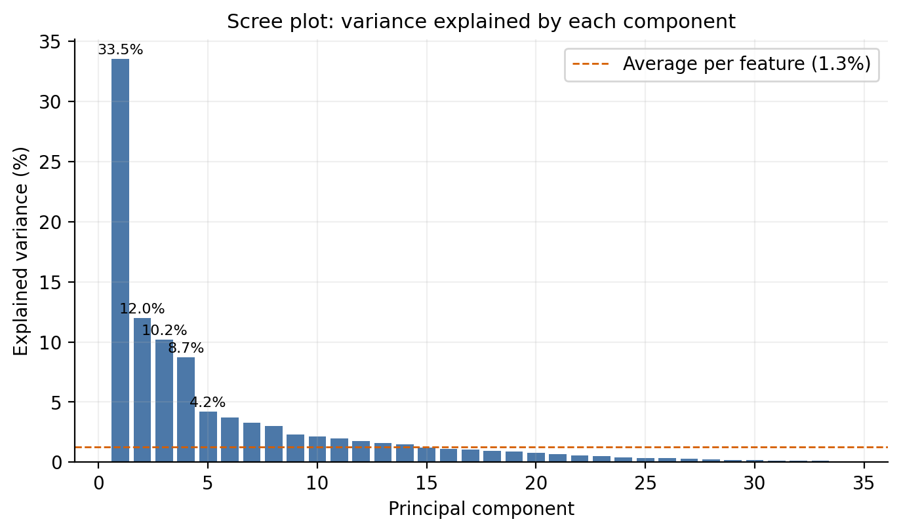

*What it shows:* one bar per component (height = % of variance). The dashed line is the average share per feature (1.3%). *How to read it:* look for the "elbow" where bars stop dropping steeply.

**Observed.** There is a steep drop from PC1 (33.5%) to PC2 (12.0%), a plateau PC2–PC4 (12.0, 10.2, 8.7%), another drop to PC5 (4.2%), and a slow decay afterwards. **Interpretation.** The elbow after PC4 agrees with the chance baseline: PC1–PC4 are the structured components. As Section 12 shows, there is a simple reason for exactly four: five groups (speakers) can differ from each other in at most 4 independent directions (number of groups − 1).

---

## 9. Cumulative variance interpretation

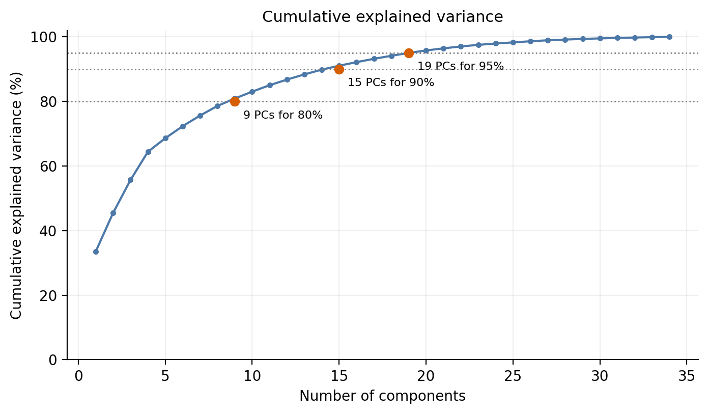

*What it shows:* the running total of variance explained as components are added; the dots mark where 80%, 90% and 95% are reached (9, 15 and 19 components).

**Observed.** Two components give 45.5%, four give 64.4%, five give 68.6%. The curve then rises slowly, so a faithful description needs many components (15 for 90%). **Interpretation.** A 2-D plot therefore shows less than half of the variance: apparent overlap or separation in PC1–PC2 can hide or exaggerate differences. The remaining 35.6% beyond PC4 is mostly small, not clearly structured variation (e.g. differences between a speaker's own recordings).

---

## 10. PCA scatter plot interpretation

Each point is a recording; colour = accent, marker = original format (circle = M4A, square = OGG); labels such as `KUT-R02` give the recording ID (`KUT_S01_R02`). The accent colours are the same as in Phases 2–4. *Colours and markers are added after PCA; PCA itself never used them.*

### PC1 vs PC2 (45.5% of the variance)

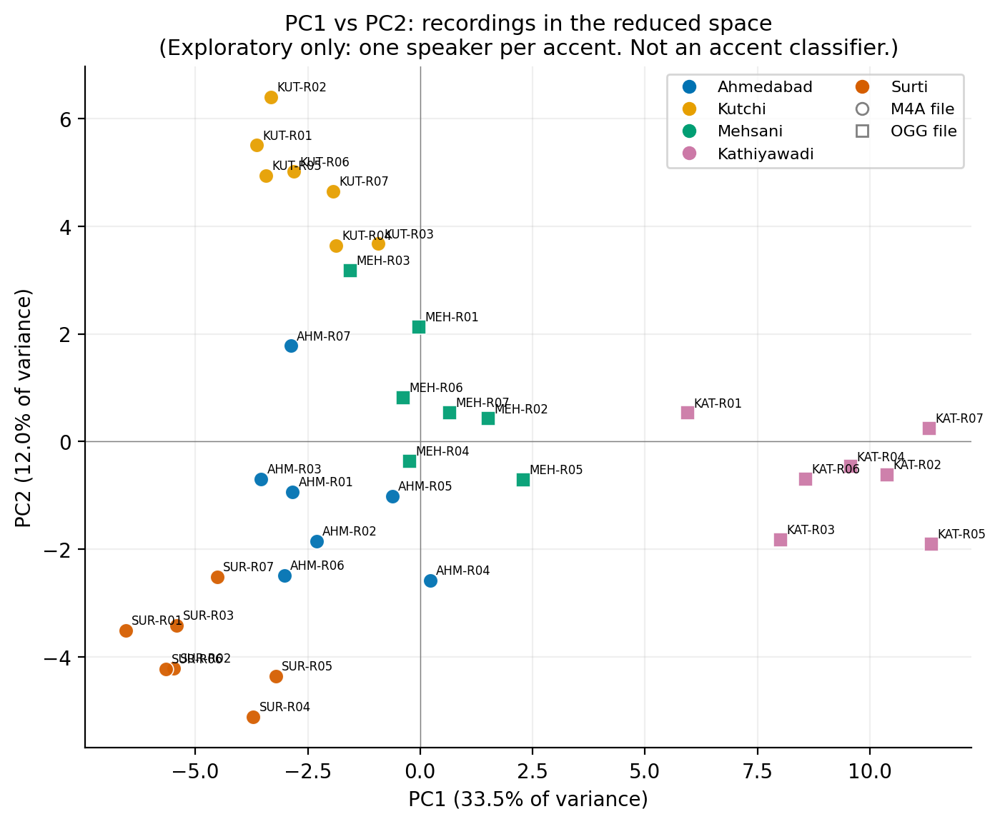

**Observed.**
* Kathiyawadi (pink squares) lies far to the right (PC1 mean +9.3, others between −4.9 and +0.3) – PC1 is mostly a "Kathiyawadi vs everything else" axis (η² of PC1 for Kathiyawadi-vs-rest = 0.83).
* Kutchi (yellow) occupies the top (PC2 mean +4.8), Surti (orange) the bottom-left (PC2 mean −3.9, PC1 mean −4.9).
* Ahmedabad (blue) and Mehsani (green) sit in the middle; they are the closest pair (centroid distance / spread = 1.7, and their ranges overlap on both PC1 and PC2). Two Mehsani/Ahmedabad recordings (MEH-R03, AHM-R07) lie towards Kutchi.
* The silhouette of the accent labels is 0.46 in PC1–PC2 (0.58 in PC1–PC5).

### PC1 vs PC3 and PC2 vs PC3

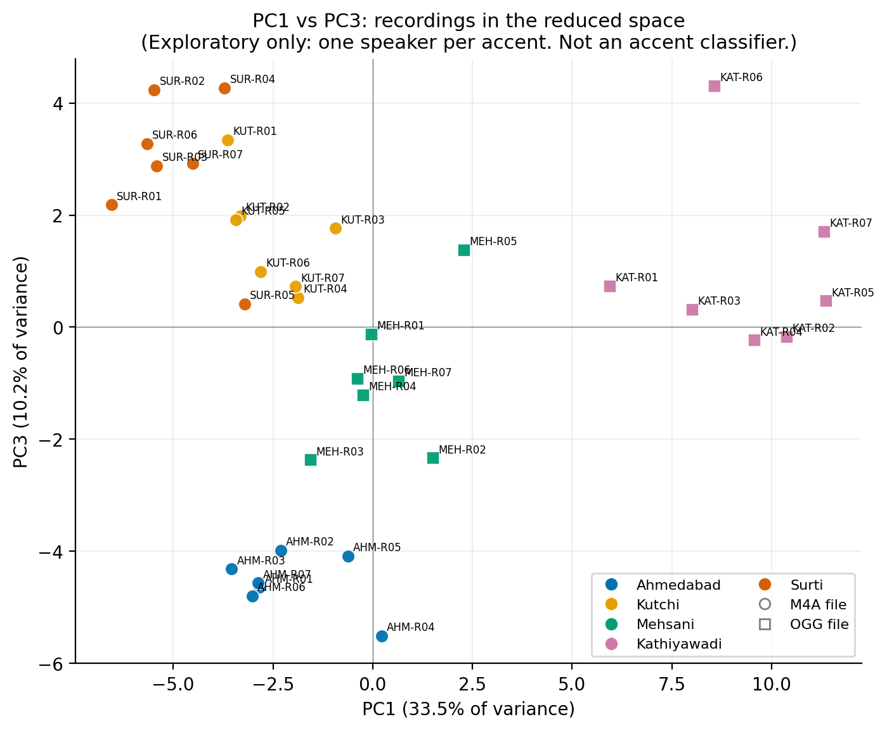

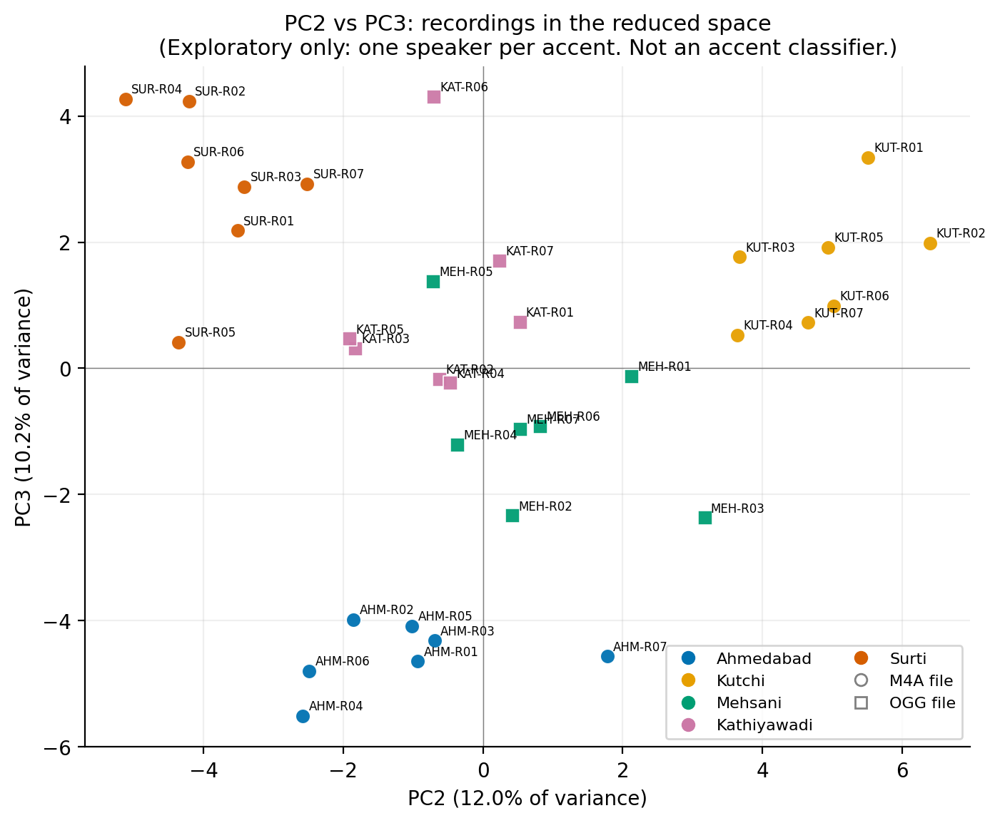

**Observed.** PC3 mostly isolates Ahmedabad (PC3 mean −4.6 with a very small spread, SD 0.5; Ahmedabad-vs-rest η² = 0.66) and separates Ahmedabad from Surti, which overlapped in PC2. So the closest pairs in PC1–PC2 are better separated once PC3 is added.

**Interpretation.** Recordings from the same accent group lie close together and the five groups mostly form separate clouds. This is **expected** when each group is one person recorded in one session: the recordings share that person's voice and that session's microphone and room. **It is not evidence of accent recognition.** (An accent-free alternative explanation – "five different speakers/devices" – predicts the same picture.)

---

## 11. Principal component loading interpretation

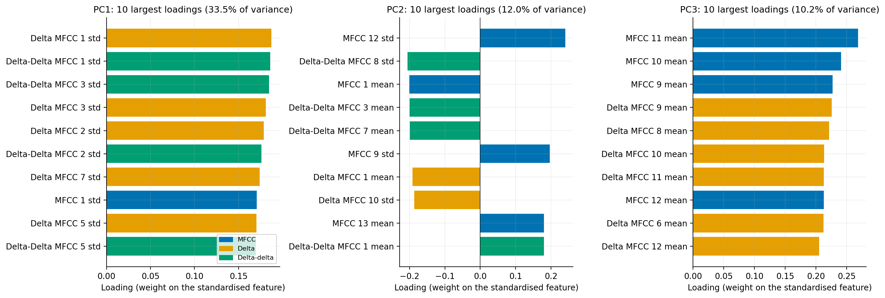

*What it shows:* the ten features with the largest absolute loading for PC1, PC2 and PC3, coloured by feature family (MFCC, delta, delta-delta). A positive bar means a high feature value pushes a recording to the right on that PC. Complete tables: `results/pca/pca_loadings.csv`, `results/pca/top_loadings.csv`.

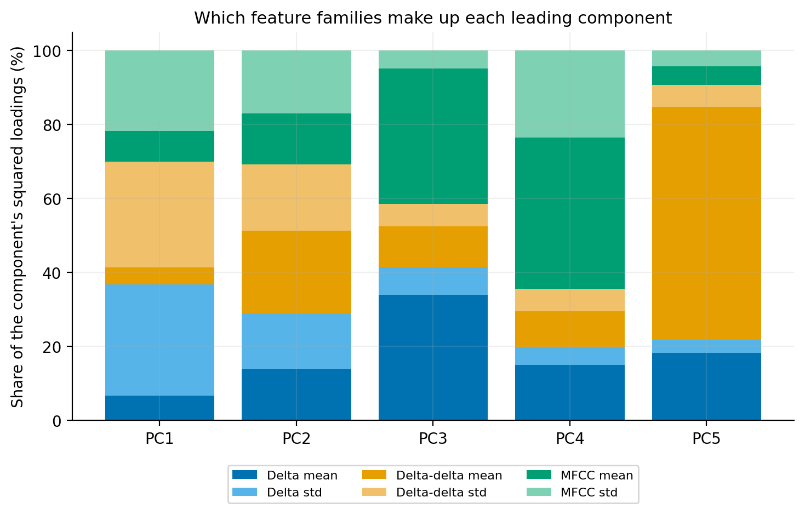

*What it shows:* for each component, the share of its squared loadings (they sum to 100%) carried by each family × statistic.

| Component | Dominant features (share of squared loadings) | Reading |
|---|---|---|
| **PC1** (33.5%) | **Standard deviations: 80%** (delta 30%, delta-delta 29%, MFCC 22%). Top loadings: Delta MFCC 1 std, Delta-delta MFCC 1 std, Delta-delta MFCC 3 std, Delta MFCC 3 std (all ≈ +0.18) | *How much the spectral shape fluctuates* from frame to frame. Large PC1 = more variable. |
| **PC2** (12.0%) | Spread across all families (no family above 22%); MFCC 12 std (+0.24), Delta-delta MFCC 8 std (−0.21), MFCC 1 mean (−0.20) | A mixture of average spectral shape and variability; includes MFCC 1 mean (energy-like). |
| **PC3** (10.2%) | **Means: 82%** (MFCC 37%, delta 34%, delta-delta 11%). Top: MFCC 11, 10, 9 mean (+0.27 to +0.23) | *Average* spectral shape in the higher MFCCs. |
| **PC4** (8.7%) | MFCC means (41%) and MFCC std (24%); MFCC 8 mean (+0.30), MFCC 10 std (−0.26) | Average spectral shape (middle/high MFCCs). |
| **PC5** (4.2%) | Delta-delta means: 63% (MFCC 11 and 10 delta-delta means, +0.41, +0.35) | Below chance level; not interpreted. |

**Observed.** All three families contribute to PC1; the standard-deviation (variability) features dominate PC1 and mean features dominate PC3 and PC4. Delta and delta-delta features are *not* minor: because each MFCC, its delta and its delta-delta are strongly correlated, they enter the same components together (see the paired entries in the PC1 list). MFCC 1 and MFCC 2 appear but do not dominate (Section 15 tests this directly).

**Interpretation.** PC1 measures variability of the spectral shape; PC3/PC4 measure the average spectral shape. These are the properties that a *speaker's voice, speaking style, microphone and room* strongly affect; they may also depend on accent, which the data cannot separate.

---

## 12. Accent-wise observations

**How much of each PC is the accent (= speaker) grouping?**

| PC | η² accent | η² original format | η² original sample rate | Largest one-vs-rest accent (η²) |
|---|---|---|---|---|
| PC1 | 0.94 | 0.59 | 0.90 | Kathiyawadi (0.83) |
| PC2 | 0.88 | 0.00 | 0.49 | Kutchi (0.63); Surti (0.41) |
| PC3 | 0.85 | 0.00 | 0.36 | Ahmedabad (0.66) |
| PC4 | 0.89 | 0.35 | 0.03 | Mehsani (0.81) |
| PC5 | 0.06 | 0.01 | 0.04 | – |
| PC6–PC8 | ≤ 0.04 | ≤ 0.00 | ≤ 0.03 | – |

(`results/pca/pc_grouping_eta2.csv`, `pc_accent_one_vs_rest_eta2.csv`)

**Observed.**
1. **PC1–PC4 are almost entirely group-membership axes** (η² 0.85–0.94), and PC5 onwards is not (η² ≤ 0.06). Weighted by variance, about **59%** of all variance in the data is between-group (speaker/accent) variation. Each leading PC is mostly "one group vs the rest": Kathiyawadi → PC1, Kutchi (and Surti on the opposite side) → PC2, Ahmedabad → PC3, Mehsani → PC4.
2. This is a mathematical consequence of the design: five groups can create at most four between-group directions, and each of the four strongest directions here lines up with one group.
3. **Same-accent recordings are close.** Each accent's recordings form a tight cloud: the centroid distance between any two accents is 1.7–8.6 within-group spreads in PC1–PC2 (2.8–5.2 in PC1–PC5).

**Which accents overlap most (PC1–PC2, `results/pca/accent_pair_separation.csv`)?** Ahmedabad–Mehsani (distance/spread 1.7; ranges overlap on both axes), Ahmedabad–Surti (2.4; overlap on both), then Kutchi–Mehsani (3.2). In PC1–PC5 the smallest distances are Surti–Mehsani (3.0), Surti–Ahmedabad (2.8) and Ahmedabad–Mehsani (3.1). Kathiyawadi is the most separate from all other accents (4.9 to 8.6 in PC1–PC2; 3.9 to 5.2 in PC1–PC5).

**Unusual recordings (`results/pca/outlier_summary.csv`).** The largest standardised distance from the overall centre in PC1–PC5 is SUR-R04 (3.45), followed by MEH-R03 (2.95), AHM-R06 (2.94) and KUT-R02 (2.61). None is extreme: with five components the typical value is about 2.2. SUR-R04 is also the most distant recording from its own accent's centre (5.5), i.e. the least typical Surti file.

**Interpretation / hypothesis.** The picture is consistent with a *speaker-and-session fingerprint*; PCA cannot tell it from accent. Whether any accent-specific structure remains once speaker and device are varied can only be tested with more speakers per accent (Section 19). **Do not read the 0.46/0.58 silhouette as accent separability**: the same labels are also the speaker labels.

---

## 13. Recording-condition and noise-related observations

These variables were **not** PCA inputs. They come from the metadata and Phase 2/4 (`results/pca/pc_condition_associations.csv`).

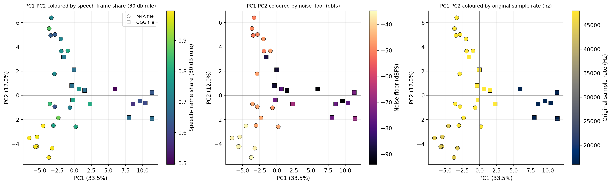

*What it shows:* the same PC1–PC2 plot coloured by (left) speech-frame share, (middle) noise floor, (right) original sample rate; marker = format.

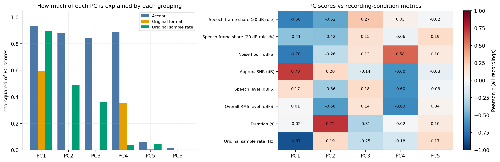

*What it shows:* (left) η² of each leading PC with accent, original format and original sample rate; (right) Pearson correlation of each leading PC with recording-condition metrics across all 35 recordings.

| Condition | PC1 | PC2 | PC3 | PC4 |
|---|---|---|---|---|
| Original sample rate | **−0.87** | 0.19 | −0.25 | −0.18 |
| Speech-frame share (30 dB rule) | **−0.68** | −0.52 | 0.27 | 0.05 |
| Noise floor (dBFS) | **−0.70** | −0.26 | 0.13 | **0.58** |
| Approx. SNR (dB) | **0.70** | 0.20 | −0.14 | **−0.60** |
| Speech level (dBFS) | 0.17 | −0.36 | 0.18 | **−0.60** |
| Overall RMS (dBFS) | 0.01 | **−0.56** | 0.14 | **−0.63** |
| Duration (s) | −0.02 | **0.72** | −0.31 | −0.02 |

**Observed – format and sample rate.** PC1 is related to the original file type (η² 0.59) and especially to the original sample rate (η² 0.90; r = −0.87). But the sample rate has only three values and the 16 kHz value belongs to a single accent, Kathiyawadi; so this number mostly restates that Kathiyawadi is the outlier on PC1. The two OGG accents do **not** behave alike: Kathiyawadi is far right on PC1 while Mehsani (also OGG) sits in the middle among the M4A accents. Format alone therefore does not explain PC1. PC2 and PC3 are unrelated to format (η² ≈ 0.00).

**Observed – noise and level.** PC1 correlates with noise floor (−0.70) and SNR (+0.70); PC4 with noise floor (+0.58), SNR (−0.60), speech level and RMS (both about −0.6). But the noise floor differs hugely between speakers (mean −35.7 dBFS Surti, about −46 to −49 Ahmedabad/Kutchi, about −80 dBFS Kathiyawadi/Mehsani), and the two quietest-background accents land at opposite ends of PC1 (Kathiyawadi far right, Mehsani centre). So these overall correlations come from **differences between the groups**, not from a proven effect of noise.

**Observed – within accents.** Correlations computed within each accent (pooled) are weaker and often have the **opposite sign**: for PC1 and speech-frame share, r = −0.68 overall but **+0.26 within accent**. The overall relationship is therefore a between-group (speaker/session) effect, not a dependable "more speech frames ⇒ lower PC1" law. The within-accent figures rest on only 7 recordings per accent and should be considered indicative at best.

**Observed – duration.** PC2 correlates with recording duration (0.72), because Kutchi recordings are the longest (mean 15.1 s) and Surti recordings the shortest (9.3 s). Mean and standard deviation of MFCCs have no built-in dependence on duration, so this is again probably a group effect; **hypothesis:** different speaking rate or prompt length per speaker.

**Interpretation.** The leading components are entangled with the recording setup (sample rate, noise, level) and with the speaker. We cannot separate those from accent. **MFCC 1** (an energy-like coefficient) appears in PC2 and is related to speech-frame share, as Phase 4 found; its effect on the overall structure is small (Section 15).

---

## 14. Surti-specific findings

Surti was recorded in a different session on a probably different device (44.1 kHz source files, created on a different day) and has by far the highest noise floor (−35.7 dBFS vs −45.8 or lower for the others; mean SNR 12.7 dB vs 23–63 dB). On the Phase 2 speech detector, 99% of frames count as speech and no pauses are found, because the 30 dB rule cannot separate Surti's speech from its noise (Phase 2 report). Questions: does Surti dominate the PCA, and is it a distinct cluster?

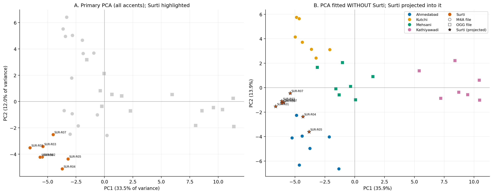

*What it shows:* (A) the primary PCA with Surti highlighted; (B) a PCA fitted **without** Surti, into which Surti's seven recordings are projected as stars. Projected points did not take part in the fit.

| Left-out accent | PC1 variance without it | PC1 / PC2 / PC3 loading similarity with primary (\|cosine\|) | Held-out centroid distance (fit spread = 1) |
|---|---|---|---|
| **Surti** | 35.9% (primary 33.5%) | **0.97 / 0.70 / 0.12** | 0.83 |
| Ahmedabad | 35.1% | 1.00 / 0.97 / 0.46 | 0.34 |
| Kutchi | 39.3% | 0.98 / 0.43 / 0.27 | 0.28 |
| Mehsani | 37.7% | 1.00 / 0.98 / 0.97 | 0.05 |
| Kathiyawadi | 22.1% | 0.68 / 0.90 / 0.66 | **1.81** (outside the fitted PC1 range) |

(`results/pca/leave_one_accent_out.csv`)

**Observed.**
* In the primary PCA Surti forms a compact cloud at the lower left (PC1 mean −4.9, PC2 mean −3.9). On PC2 it is opposite to Kutchi (one-vs-rest η² 0.41 on PC2, 0.26 on PC3, 0.23 on PC1). It is not the dominant group on any component; the dominant ones are Kathiyawadi (PC1), Kutchi (PC2), Ahmedabad (PC3), Mehsani (PC4).
* **Removing Surti hardly changes PC1** (loadings 0.97 similar; variance 33.5% → 35.9%), so PC1 is not driven by Surti. PC2 changes moderately (0.70) and PC3 changes a lot (0.12). PC3 of the primary PCA therefore depends strongly on Surti being present (and also on Kutchi, 0.27, and Ahmedabad, 0.46) – with only five groups, the component directions change when a group is removed.
* **When Surti is projected into a PCA that never saw it,** it does *not* land far away: its centroid is only 0.83 fit-spreads from the others and its PC1 range overlaps the fitted one, and the points lie beside the Ahmedabad cloud rather than in a separate region. In contrast Kathiyawadi projected into a Kathiyawadi-free PCA falls outside the fitted PC1 range (1.81). So Surti is distinguishable in the primary PCA, but it is *less* of an outlier than Kathiyawadi.

**Interpretation.** Surti is a separate group in PC space, but this must **not** be called a Surti accent pattern. Its session, device and noise floor all differ from the other accents, the Phase 2 speech detector works less well on it, and the single Surti speaker is the only source of Surti data. **Hypothesis requiring further investigation:** Surti's noisier recordings may shift the delta/variability features (PC2, PC3 contributions); testing it needs Surti-like speech recorded in a quiet setting, or another speaker in noise.

---

## 15. Sensitivity analysis

These are **separate** exploratory PCAs. They do not replace the primary PCA, and no feature is removed or kept permanently on the basis of any of them (`results/pca/sensitivity_summary.csv`, `sensitivity_scores.csv`).

| Variant | Purpose | Features | PC1 | PC2 | Components for 80 / 90 / 95% |
|---|---|---|---|---|---|
| **Primary** (all frames) | Reference | 78 | 33.5% | 12.0% | 9 / 15 / 19 |
| Speech-only, 30 dB rule | Does removing non-speech frames change the structure? (Phase 4 table, same schema) | 78 | 46.3% | 13.0% | 6 / 12 / 16 |
| Speech-only, 20 dB rule | Same, with the stricter rule that suits the noisy Surti files | 78 | 39.9% | 12.3% | 8 / 13 / 19 |
| Without MFCC 1 and MFCC 2 | Phase 4 linked these to speech-frame share; are they driving PCA? | 74 | 32.3% | 11.8% | 9 / 15 / 19 |

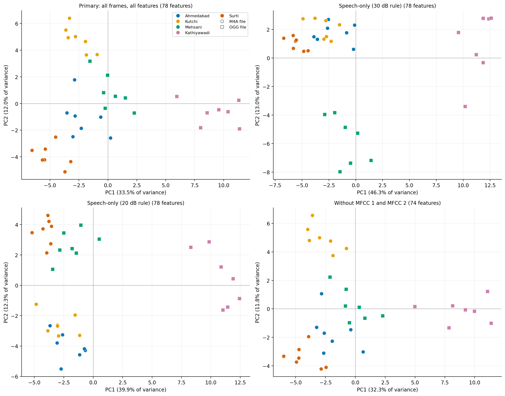

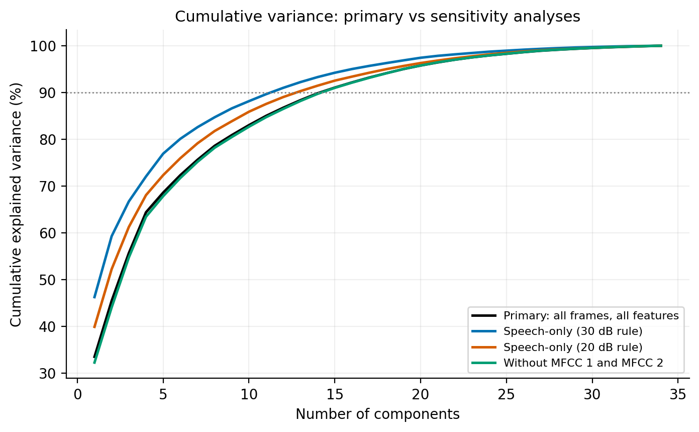

**How similar are the variant scores to the primary ones?** (|r| between primary PC and the best-matching variant PC; `sensitivity_summary.csv`)

| Variant | PC1 | PC2 | PC3 |
|---|---|---|---|
| Speech-only, 30 dB | 0.98 | 0.61 (matches variant **PC4**; same-index 0.01) | 0.73 |
| Speech-only, 20 dB | 0.96 | 0.76 (variant PC4; same-index 0.46) | 0.57 (variant PC2) |
| Without MFCC 1 and 2 | **1.00** | **0.98** | **0.99** |

**Observed.**
* **MFCC 1 and 2 do not drive the structure.** Without them PC1–PC3 correlate 0.98–1.00 with the primary scores and the PC1–PC2 plot is practically unchanged. The feature-level link between MFCC 1/2 and speech-frame share seen in Phase 4 does not shape the overall PCA.
* **PC1 (variability / Kathiyawadi axis) is stable** across all variants (|r| ≥ 0.96).
* **PC2 and PC3 are less stable once non-speech frames are removed**: the primary PC2 only correlates 0.61 (30 dB) or 0.76 (20 dB) with its best match, which then appears as PC4 – the order of components changes, so their individual meaning is not robust. Speech-only data concentrate more variance in PC1 (46% at 30 dB), as expected if pauses and noise add varied low-energy frames.
* The speech-only 30 dB variant is almost identical to the primary for Surti (99% of Surti frames are "speech" by this rule); the 20 dB variant treats Surti most differently from the primary.
* In all variants the accent labels still dominate PC1–PC3 (η² 0.76–0.96).

**Interpretation.** The broad picture (Kathiyawadi on PC1, groups forming separate clouds, 4 structured components) is robust to these choices; the finer detail in PC2/PC3 depends on whether non-speech frames are included and on the speech-detection rule. We are **not** changing the Phase 3/4 feature definitions because of this.

---

## 16. Limitations and possible sources of bias

1. **One speaker per accent (critical).** Accent = speaker = device/session = wording. Every cluster has a speaker-based alternative explanation. Speaker-independent accent separation cannot be established.
2. **Small n.** 35 recordings, 78 features (34 usable components), 7 recordings per group; PCA directions beyond PC4 are not distinguishable from chance and the leading directions depend on which groups are present (Section 14).
3. **Recording conditions are confounded with group.** Format (M4A/OGG), original sample rate (16/44.1/48 kHz), noise floor (−36 to −82 dBFS) and level all differ between speakers. The overall correlations in Section 13 are largely between-group effects.
4. **Recordings are similar in content within a speaker.** Within a group, recordings are of one person in one session, which shrinks within-group spread and inflates cluster tightness and silhouette values.
5. **Speech detection weakness for Surti** (Phase 2): speech-only results for Surti are approximate.
6. **PCA is linear and unsupervised.** It finds high-variance directions, which are not necessarily the accent-relevant ones; accent information may lie in small-variance components that PCA discards (PC5 onwards still hold 36% of the variance).
7. **No significance testing**, by design: the usual assumptions (independent speakers) are not met.
8. **2-D plots show under half of the variance** (45.5%).
9. **MFCC features only.** No pitch, prosody, formants or phonetic content were analysed.
10. **Confidence.** The numbers are exact for this dataset; their interpretation as "voice/setup effects" is a hypothesis, not a measured fact.

---

## 17. Key findings

**Observed:**
1. PCA of the standardised 78 features: PC1 33.5%, PC2 12.0%, PC3 10.2%, PC4 8.7%; 9 / 15 / 19 components for 80 / 90 / 95% of the variance.
2. PC1–PC4 are above chance level; PC5 onwards is at or below it (permutation baseline).
3. PC1 is dominated by standard-deviation (variability) features of MFCC, delta and delta-delta; PC3 and PC4 by mean features; MFCC 1/2 do not shape the structure (similarity 0.98–1.00 without them).
4. PC1–PC4 each correspond to one group (η² with accent 0.85–0.94): Kathiyawadi, Kutchi/Surti, Ahmedabad, Mehsani. PC5+ is not group-related (η² ≤ 0.06).
5. Same-accent recordings cluster; Ahmedabad, Mehsani and Surti are closest; Kathiyawadi is the most separate. Silhouette (accent labels) 0.46 (PC1–2), 0.58 (PC1–5).
6. Leading PCs are associated with sample rate, noise and level, but these overall associations are mostly between-group and often reverse within accent.
7. Surti forms its own cloud but does not drive PC1; projected into a PCA without it, Surti lands within the existing range, near Ahmedabad.
8. Variant analyses keep PC1 and the group structure; PC2/PC3 order and content change when non-speech frames are removed.

**Interpretation:** The dominant variation is between *speaker/session groups*; this is compatible with, but does not demonstrate, accent differences.

**Hypotheses for future work:** (a) PC1's variability axis reflects speaking style or recording chain rather than accent; (b) PC2's relation to duration reflects different speaker prompts/rates; (c) Surti's noise raises variability features.

---

## 18. Conclusion

PCA gives a compact, reproducible picture of the Phase 3 features: a few (four) structured directions followed by low-level variation, and a clear grouping of the recordings by speaker/accent group. That is useful because it tells us where the information in our features is and what a model would be able to latch on to. It is **not** evidence that the five Gujarati accents are separable in a way that will generalise: with one speaker per accent, the same picture is expected from five different voices recorded in five different setups. The current work should be reported as an **initial five-accent exploratory study and prototype**.

---

## 19. How Phase 5 informs Phase 6

**What Phase 5 suggests for model development (Phase 6 not started).**
1. **Split by speaker is impossible today; random splits would be misleading.** Since recordings of one speaker cluster tightly, a random train/test split of recordings will put near-duplicates (same speaker, same session) in both sets and give inflated accuracy. Any Phase 6 result on this dataset must be labelled as non-speaker-independent; leave-one-recording-out or random-split scores should not be presented as accent-recognition accuracy.
2. **Use the PCA components cautiously.** If dimensionality reduction is used inside a model, the number of components should be chosen within cross-validation (the 80/90/95% counts are 9/15/19; the structured part is only four) and the scaler and PCA must be fitted on training data only. `pca_model.npz` describes the whole dataset and is for exploration, not for evaluation.
3. **Simple baselines first.** With 35 samples and one group per class, regularised/simple models and the 4-dimensional structure of the data suggest that more complex models could simply memorise speakers.
4. **Features to treat with care:** variability (standard-deviation) features carry PC1 and were linked to format/noise in Phase 4; PC2's relation to duration and level, and PC4's relation to noise/level, suggest checking level normalisation and noise robustness. These are hypotheses, not reasons to remove features now.
5. **Robustness checks to include:** compare models on all-frame versus speech-only features (PC2/PC3 changed), and check results with Surti removed and with Kathiyawadi removed (leave-one-accent-out showed the structure depends on which groups are present).
6. **Data needs (future scope).** More speakers per accent; more recordings per speaker; the same device and quiet recording conditions across accents; more regions within Gujarat and additional accent varieties; a larger, balanced and diverse dataset; and **speaker-independent evaluation** (train and test on different speakers) leading to a more generalisable classifier.

---

## Appendix: Phase 5 outputs and how to reproduce

Run `python scripts/run_phase5.py` (needs Phases 1–4). Outputs are in `results/pca/`:

| File | Content |
|---|---|
| `pca_scores.csv` | PC scores of all 35 recordings with metadata |
| `explained_variance.csv` | Eigenvalue, variance ratio and cumulative variance per component |
| `pca_loadings.csv`, `top_loadings.csv`, `loading_group_contributions.csv` | Loadings, top-10 features per component, family shares |
| `pca_model.npz`, `pca_model_meta.json`, `pca_manifest.json` | Fitted scaler + PCA, feature order, input hash and settings |
| `pc_grouping_eta2.csv`, `pc_accent_one_vs_rest_eta2.csv` | η² of PC scores with accent, format, sample rate; one-vs-rest per accent |
| `pc_condition_associations.csv` | PC correlation with recording-condition metrics (overall and within accent) |
| `accent_pair_separation.csv`, `separation_metrics.csv`, `outlier_summary.csv` | Pairwise accent distances, silhouettes, outlier distances |
| `leave_one_accent_out.csv` | Surti (and every other accent) left out of the fit |
| `sensitivity_summary.csv`, `sensitivity_scores.csv` | Speech-only and no-MFCC-1/2 variants |
| `permutation_baseline.csv` | Chance-level explained variance (500 shuffles, seed 0) |
| `validation_summary.txt` | All Phase 5 checks (40 checks) |
| `figures/` | The 12 figures used in this report |

The Phase 1–4 outputs are read only; their files were not changed. See also: [Phase 4 feature analysis report](feature_analysis_report.md), [Phase 3 MFCC report](mfcc_extraction_report.md), [Phase 2 audio analysis report](audio_analysis_report.md).
