# Recognising Regional Gujarati Accents from Speech: An Exploratory Study Using Acoustic Features, Principal Component Analysis and a Hierarchical Neural Classifier

*Authors: [to be added]*

---

## ABSTRACT

Gujarati is spoken across regions of Gujarat that differ in how the language sounds, yet very little work has asked whether those differences can be measured and learned from audio alone. This paper reports an initial, exploratory attempt to do so. We assembled a small dataset of 35 Gujarati recordings covering five accent categories (Ahmedabad, Kutchi, Mehsani, Kathiyawadi and Surti), with seven recordings from each of five speakers, one speaker per accent. The recordings were converted to a common format (16 kHz, mono WAV), examined for recording quality, and summarised by 78 acoustic features built from Mel-frequency cepstral coefficients (MFCCs) and their first and second time derivatives. Feature analysis showed that many features differ strongly between the five groups, but also that these differences are entangled with recording format, background noise and the individual speaker. Principal component analysis (PCA) showed the same picture: the first four components hold 64.4% of the variance, and each of them lines up with one speaker/accent group. We then compared a support-vector machine (SVM), a multilayer perceptron (MLP), a convolutional neural network (CNN) on Log-Mel spectrograms, and a CNN–MLP fusion network, all trained from scratch with two output heads (region and accent) and evaluated with seven-fold cross-validation over recordings. The SVM and the MLP classified every held-out recording correctly (pooled accuracy 1.000 and 1.000); the CNN reached 0.429 and the fusion network 0.857, largely, it appears, because of a training problem involving early stopping and BatchNorm statistics that we describe but did not test. We selected the MLP, which matched the SVM, produces probabilities for both heads and is far cheaper than the fusion model, and built a Streamlit application around it. Because each accent is represented by a single speaker, these results are within-speaker and cannot show that the model recognises accents in unseen speakers; they also cannot rule out effects of speaker gender, voice characteristics or recording conditions. The paper should therefore be read as a documented prototype and a set of lessons for building a larger, speaker-diverse dataset.

**Keywords:** Gujarati; accent classification; MFCC; principal component analysis; multilayer perceptron; speaker confounding.

---

## 1. INTRODUCTION

### 1.1 Gujarati and its regional variation

Gujarati is an Indo-Aryan language with a long literary tradition and a large community of speakers, described in standard references on the Indo-Aryan languages [1]. Like most widely spoken languages, it is not uniform. A speaker from Ahmedabad, a speaker from Kutch and a speaker from the Surat area will usually be understood by one another, but listeners can often tell where someone comes from within a few sentences. The differences can lie in how particular sounds are produced, in the melody and rhythm of speech, in the choice of everyday words, or in a combination of all of these. Sociolinguistic studies have documented such variation in detail: one study of Gujarati as spoken in Cape Town, for example, examines how a particular consonant pattern relates to Gujarati dialects of the homeland [2].

In this paper we use the word *accent* in a deliberately modest sense: the way a person's speech sounds, as measured from a recording, for a given regional label. We do not try to define dialect boundaries or to describe the linguistics of any region. The five labels we work with (Ahmedabad, Kutchi, Mehsani, Kathiyawadi and Surti) are the names under which our recordings were collected, and they map to five regions of Gujarat: Central Gujarat, Kutch, North Gujarat, Saurashtra and South Gujarat.

### 1.2 Why regional accent recognition is an interesting speech-processing problem

A speech recording contains much more than words. It carries information about the speaker's identity, age, mood, microphone and room, and, among many other things, the region the speaker comes from. Teaching a computer to pick out the regional part is hard for two reasons. First, the regional signal is subtle and is mixed with everything else in the recording. Second, collecting enough recordings from enough speakers in each region is slow and expensive, particularly for a language such as Gujarati, for which, as far as we could find, ready-made regional speech datasets with reliable labels are scarce.

The problem is nevertheless worth studying. A system that can tell which regional variety it is hearing could, in principle, help speech recognisers cope with regional pronunciation, help voice-based services adapt to their callers, support language-learning material that explains regional differences without ranking them, and contribute to the documentation of regional speech. We treat these as possible long-term uses, not as something this project delivers.

### 1.3 Motivation and research objectives

The project began with a simple belief and a worry. The belief was that features measured directly from the audio, without any pretrained speech model, should carry some trace of regional speech. The worry was that a model trained on a handful of recordings would not learn regional speech at all, but would learn to recognise the individual voices and recording setups it was shown. That worry turned out to shape the whole project.

Our objectives were therefore to:

1. collect and organise Gujarati recordings with regional labels, and bring them into one consistent audio format;
2. examine the recordings and the extracted features carefully enough to know what they do and do not contain;
3. extract a compact set of acoustic features (MFCCs and their derivatives) and study how they differ across the five groups;
4. explore the structure of those features with dimensionality reduction;
5. train and compare several classifiers, all from scratch, including a model with two output levels (region first, accent second);
6. choose a final model on the basis of the evidence, and make it usable through a simple application; and
7. state clearly what the results can and cannot support.

### 1.4 Scope of the project

Our starting plan, written at the proposal stage, was ambitious in one respect that we could not meet. It called for testing the models on speakers whose recordings had not been used in training, for comparing a direct (flat) classifier with a two-stage (hierarchical) one, and for trying traditional classifiers such as support-vector machines, random forests and logistic regression together with pitch and speaking-rate features. As the dataset took shape, it became clear that it contained exactly one speaker for each accent. Testing on unseen speakers was therefore impossible, and so was any meaningful comparison of flat and hierarchical classification: with one accent in each region, the hierarchy has nothing to decide inside a region. We also did not run random forests or logistic regression. What we did instead was to follow the evidence the dataset allowed us to collect, which is why this paper is an *initial five-accent exploratory study and prototype* rather than a finished accent classifier.

### 1.5 Overview of the approach and of this paper

In outline, each recording is converted to a standard format, checked for quality, and turned into 78 numbers that summarise its sound. We study those numbers statistically, project them onto a few principal components to see their overall structure, and then train and compare four kinds of classifier. The best-justified one, a small neural network, is wrapped in a web application. Section 2 reviews related work and states the gap this study addresses. Section 3 describes the methods in detail, introducing speech-processing concepts from first principles. Section 4 reports and discusses the results, following the order in which the work was done so that each finding explains the next step. Section 5 summarises what was achieved, sets out the limitations and suggests future work.

---

## 2. LITERATURE REVIEW

### 2.1 Gujarati speech and regional variation

Descriptions of Gujarati grammar and sound structure exist in standard references on the Indo-Aryan languages [1], and sociolinguistic work has documented regional and diaspora variation in specific sounds [2]. Computational work on Gujarati speech is much thinner. A recent survey of voice recognition for Gujarati dialects reviews the area and points to the problems facing such systems [3]. Earlier acoustic work on Gujarati addressed phoneme classification: Chittora and Patil used a modulation-spectrogram feature with an SVM on a Gujarati database, and reported that combining their feature with MFCCs improved phoneme classification over MFCCs alone [4]. Neither line of work answers the question we ask, namely whether the regional variety of a speaker can be told from a short recording. We did not find a published study that classifies Gujarati regional accents from MFCC-type features, although our search was limited to what could be checked online and is not a systematic review.

### 2.2 Acoustic features for dialect and accent identification

Almost all of the acoustic work in this area rests on the Mel-frequency cepstral coefficient. Davis and Mermelstein compared several ways of representing the short-term speech spectrum for word recognition and found that Mel-frequency cepstral coefficients performed best, which helped establish MFCCs as the standard compact description of speech sounds [5]. A second, equally standard idea is to add the *dynamics* of the spectrum. Furui showed that regression coefficients computed over a short window of frames, now usually called delta features, improved speaker-independent word recognition [6]. The 78 features used in this paper combine both ideas: MFCCs, their deltas and their delta-deltas, each summarised by a mean and a standard deviation.

Work on dialect and accent identification has often used these features or close relatives. Shon, Ali and Glass built an end-to-end convolutional system for five Arabic dialects and compared MFCCs, log Mel filter-bank energies and spectrogram inputs; the filter-bank features did slightly better than MFCCs, and speed perturbation of the training data added noticeable robustness [7]. For Indian English, the MARS system evaluated several classifiers, from SVMs and random forests to deep residual convolutional networks, on non-native English accents from six Indian states using MFCC and Mel-spectrogram features, and reported that a residual network performed best [8]. These studies suggest two directions that we follow: cepstral and spectrogram features are both reasonable inputs, and neural networks are worth comparing with classical classifiers.

### 2.3 Classifiers: from support-vector machines to deep networks

The support-vector machine introduced by Cortes and Vapnik remains a strong baseline for small datasets of moderate dimensionality, because it fits a maximum-margin boundary and has few settings to tune [9]. Convolutional networks, on the other hand, have been applied to spectrogram images with considerable success; Hershey and colleagues showed that image-classification architectures transfer well to large-scale audio classification [10]. Such networks, however, are usually trained on very large datasets. When data are scarce, regularisation and augmentation become important. SpecAugment, which masks blocks of frequency channels and time steps in the spectrogram, is one widely used augmentation for speech [11], and we use mild masking in the same spirit. The practical lesson from this literature is that deep models are attractive but data-hungry, and that a simple baseline should always be kept in the comparison.

### 2.4 Evaluation pitfalls: speakers, gender and recording conditions

Two issues in the literature matter especially for a small dataset like ours. The first is that a speech classifier can easily learn the speaker rather than the property of interest. If recordings from the same speaker appear in both the training and the test data, high accuracy may only mean that the model recognises familiar voices. This is why dialect and accent studies are normally evaluated on speakers that were not used in training, which was also our proposal's intention.

The second issue is that speech varies systematically with voice characteristics such as pitch range and voice quality, which differ on average between male and female voices for physiological reasons [12], and that speech technology has been shown to perform unevenly across groups. Tatman, for example, measured the accuracy of automatic captions across gender and dialect groups and found that accuracy differed between them, arguing that systems should be validated across sociolinguistic groups [13]. These findings do not tell us how gender would affect our particular features, and we do not claim that it does. They do tell us that gender-related differences are a risk that a study should either control or acknowledge.

### 2.5 Research gap and positioning of this work

Taken together, the literature offers well-tested features (MFCCs and their dynamics), a range of classifiers from SVMs to deep networks, and a clear warning about speaker and group effects. What it does not offer, as far as we could verify, is a study of regional Gujarati accents using these tools. Our work is a first step in that direction: we assemble a small Gujarati dataset, study its acoustic features with care, compare classical and neural classifiers under one protocol, and, importantly, document how far a dataset with one speaker per accent can go. The contribution is therefore less a performance figure than an honest account of the method, the pitfalls and the evidence, which a larger study can build on.

---

## 3. METHODOLOGY

### 3.1 Research workflow and system overview

The work was carried out in a fixed order in which each step answered a question left open by the previous one. We needed consistent audio before we could measure quality; we needed to know the quality before we trusted the features; we needed to understand the features before we reduced or modelled them; and we needed evidence from several models before we chose one for an application. Figure 1 summarises the whole pipeline.

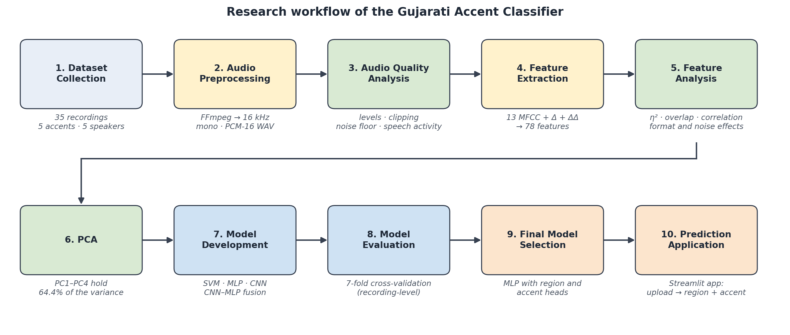

*Figure 1.* Overall research workflow, from data collection to the prediction application. The short notes under each stage give its key output in this study.

The remainder of this section follows that order. Each subsection first explains the idea in plain terms and then gives the exact settings used, so that the work can be reproduced from the project repository.

### 3.2 Dataset collection

The dataset contains 35 recordings of spoken Gujarati from five speakers, each representing one accent category and one region of Gujarat (Table 1). Every accent has seven recordings. The speakers were given common Gujarati sentence prompts but were free to adapt them to their own regional vocabulary and way of speaking, so the recordings are similar in topic but do not contain identical words; nothing was translated, standardised or transcribed. The recordings last between 8.3 and 18.3 seconds, about 7.4 minutes in total. The Surti recordings were added after the first four accents had been analysed; the dataset collector confirmed that all seven belong to a single speaker. Speaker gender, age and other demographic details were not recorded in the metadata, which matters for the limitations discussed later.

*Table 1.* The dataset: five accents, five speakers, 35 recordings. Original sample rates were read from the original files; all analysis uses the standardised 16 kHz versions.

| Region | Accent | Speaker ID | Recordings | Original format | Original sample rate | Duration, s (range) |
|---|---|---|---|---|---|---|
| Central Gujarat | Ahmedabad | AHM_S01 | 7 | M4A | 48 kHz | 12.0–17.3 (mean 13.7) |
| Kutch | Kutchi | KUT_S01 | 7 | M4A | 48 kHz | 13.8–17.0 (mean 15.1) |
| North Gujarat | Mehsani | MEH_S01 | 7 | OGG | 48 kHz | 10.8–18.3 (mean 14.2) |
| Saurashtra | Kathiyawadi | KAT_S01 | 7 | OGG | 16 kHz | 9.6–15.2 (mean 11.4) |
| South Gujarat | Surti | SUR_S01 | 7 | M4A | 44.1 kHz | 8.3–10.8 (mean 9.3) |

Three features of the data deserve attention at the outset. First, each accent is represented by exactly one speaker, so *speaker, accent, recording device, session and wording are all perfectly confounded*: any difference we find between accents could equally be a difference between people or setups. Second, the recordings were made in different formats (M4A for three accents, OGG for two) at different sample rates (16, 44.1 and 48 kHz), and the Surti recordings come from a different recording session from the other two M4A accents. Third, the dataset is small. We return to all three points repeatedly, because they limit every conclusion in this paper.

### 3.3 Audio preprocessing

Machine-learning code needs its inputs in one consistent form, and recordings that arrive in different containers, at different sample rates and with different channel layouts would otherwise introduce differences that have nothing to do with the speech. We therefore converted every original recording to the same format: a WAV file, sampled at 16,000 Hz, with a single (mono) channel and 16-bit PCM samples. The conversion used FFmpeg and changed nothing else: no filtering, trimming, denoising or loudness normalisation was applied (Figure 2). The original files were never modified, and each converted file was checked with the SoundFile library for sample rate, channel count and sample type. A metadata table records, for every recording, its identifier, accent, region, original format and duration.

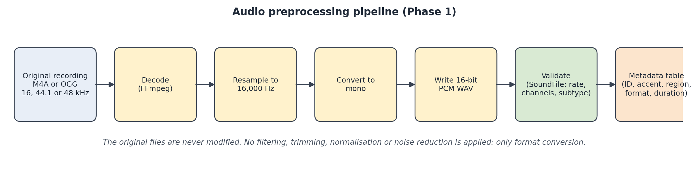

*Figure 2.* Audio preprocessing pipeline. Only the file format is standardised; the content of the signal is left as recorded.

Sixteen kilohertz is sufficient for speech content up to 8 kHz and matches the lowest sample rate in the dataset (one accent was recorded at 16 kHz), so no recording had to be upsampled.

### 3.4 Audio quality analysis

Before extracting features we asked a practical question: are these recordings comparable, or do some of them differ so much in loudness, noise and silence that the features will mostly measure the recording conditions? We computed, for every recording, its duration, peak level, speech loudness, a background noise-floor estimate (the level of the quietest frames), an approximate signal-to-noise ratio, the number and length of pauses, and flags for clipping, very low amplitude, near silence, unusual duration and inconsistent speech level. Speech was separated from pauses with a simple energy rule: a 25 ms frame counts as speech if its energy lies within 30 dB of the recording's loud level, and as silence if it falls more than 45 dB below it. The rule is easy to explain and to reproduce, but, as the results show, it has limits.

Figure 3 shows the three most informative measures, and Figure 4 shows the speech-detection result for one recording per accent. Table 2 summarises the findings by accent; their interpretation is given in Section 4.2.

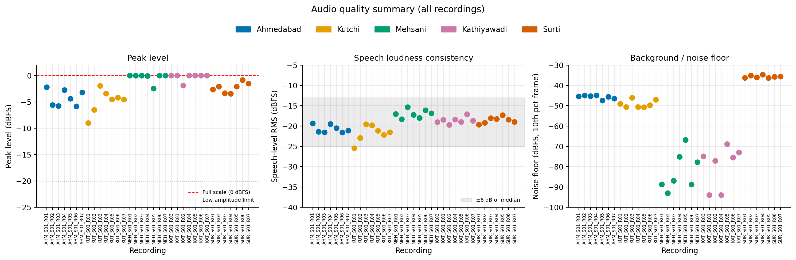

*Figure 3.* Audio quality summary for all recordings (colour = accent). Left: peak level. Middle: speech loudness, with the grey band marking the range within 6 dB of the median. Right: background noise floor of each recording.

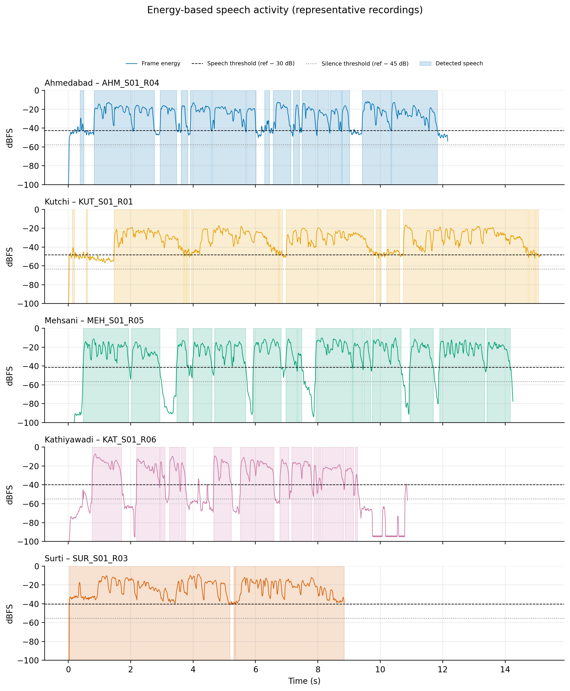

*Figure 4.* Energy-based speech activity for one representative recording per accent. The solid line is frame energy, the dashed line the speech threshold and the shaded blocks the detected speech.

*Table 2.* Recording quality by accent (means over the seven recordings of each accent). Levels are in decibels relative to full scale (dBFS).

| Accent | Peak, dBFS | Noise floor, dBFS | Approx. SNR, dB | Speech share | Internal pauses | Clipping flags |
|---|---|---|---|---|---|---|
| Ahmedabad | -4.3 | -45.8 | 23.2 | 0.77 | 4.4 | 0 |
| Kutchi | -4.9 | -49.2 | 24.2 | 0.73 | 2.9 | 0 |
| Mehsani | -0.4 | -82.5 | 63.3 | 0.73 | 5.7 | 4 |
| Kathiyawadi | -0.3 | -79.7 | 59.1 | 0.61 | 3.1 | 6 |
| Surti | -2.3 | -35.7 | 12.7 | 0.99 | 0.0 | 0 |

### 3.5 Acoustic feature extraction

#### Why features are needed

A speech recording is a sound wave: a long list of air-pressure measurements, sixteen thousand of them for every second of audio. A machine-learning model cannot make much use of such a list directly, much as a person cannot recognise a song by reading the raw numbers on a disc. Feature extraction converts the properties of the sound that matter for the task into a smaller set of numbers that a model can compare. For speech, the most widely used such numbers are Mel-frequency cepstral coefficients [5].

#### What an MFCC is, in intuitive terms

The idea behind an MFCC is to describe the *shape of the sound spectrum* at a given moment, in a way that resembles how people hear. The steps, shown in Figure 5, are these.

1. **Cut the signal into short frames.** Speech changes quickly, but over about a hundredth of a second its character is roughly stable. We therefore cut the recording into overlapping frames of 25 ms, advancing by 10 ms each time.
2. **Apply a window.** Cutting a signal abruptly creates artificial edges, so each frame is multiplied by a smooth bell-shaped curve (a Hann window) that fades its ends towards zero.
3. **Look at the frequencies.** A Fourier transform shows how much energy the frame contains at each frequency, giving the frame's power spectrum.
4. **Group frequencies the way hearing does.** The ear separates low frequencies finely and high frequencies coarsely. A bank of triangular filters spaced on the Mel scale (128 of them here) adds up the energy in each band, which compresses the spectrum into a perceptually sensible form.
5. **Take the logarithm.** Hearing responds to loudness roughly logarithmically, and the logarithm also turns a multiplication of effects into an addition.
6. **Compress with a discrete cosine transform (DCT).** The log filter-bank values for neighbouring bands are strongly related. The DCT re-expresses them as a short list of independent numbers and we keep the first 13. These are the 13 MFCCs.

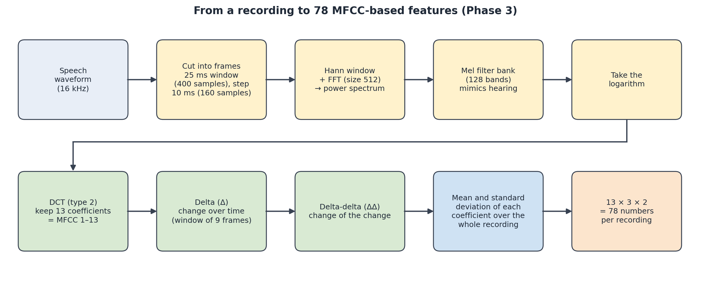

*Figure 5.* From a recording to 78 MFCC-based features. The first row produces frame-level spectra, the second row produces the MFCCs, their derivatives and the recording-level summary.

Loosely speaking, the first coefficient (MFCC 1, which in the implementation we used corresponds to the zeroth cepstral coefficient) reflects overall energy, the next few describe the broad slope and gross shape of the spectrum, and higher coefficients describe progressively finer detail. This interpretation is intuitive rather than exact, but it explains an observation that matters later: the first coefficients are sensitive to loudness and background noise.

#### Delta and delta-delta coefficients

MFCCs describe each frame on its own. Speech, however, is about movement: a vowel glides into the next one, a consonant releases, the voice rises and falls. To capture this, we add the **delta coefficients**, which measure how each MFCC changes from frame to frame (the slope over a window of nine frames, about 90 ms), following the dynamic-feature idea of Furui [6]. The **delta-delta coefficients** apply the same operation again and measure how the change itself is changing (the acceleration). In short, MFCCs describe the spectral shape, deltas describe how that shape moves and delta-deltas describe how the movement speeds up or slows down.

#### From frames to one set of numbers per recording

A 13-second recording produces over a thousand frames, and recordings differ in length, so a model would struggle to compare frame lists directly. We therefore summarise each coefficient over the whole recording with two numbers: its **mean** (the average value, the typical spectral shape) and its **standard deviation** (how much it varies, a measure of how much that aspect of the sound moves around during the recording). This gives

13 coefficients × 3 feature groups (MFCC, delta, delta-delta) × 2 statistics (mean, standard deviation) = **78 numerical features** per recording (Table 3).

*Table 3.* Composition of the 78 recording-level features.

| Feature group | Statistics per coefficient | Features |
|---|---|---|
| MFCC 1–13 | mean, standard deviation | 26 |
| Delta MFCC 1–13 | mean, standard deviation | 26 |
| Delta-delta MFCC 1–13 | mean, standard deviation | 26 |
| **Total** |  | 78 |

The extraction was implemented with the librosa library [14], and the exact settings are listed in Table 4. Across the dataset, the extraction produced 44,664 frames of 10 ms (between 829 and 1826 per recording), with no missing or infinite values. The full frame-level matrices were kept alongside the 78-number summaries.

*Table 4.* Feature-extraction configuration.

| Setting | Value |
|---|---|
| Sampling rate | 16,000 Hz |
| MFCC coefficients | 13 |
| FFT size (n_fft) | 512 |
| Window length | 400 samples (25 ms), hann window |
| Hop length | 160 samples (10 ms) |
| Mel filter bands | 128 |
| DCT | type 2, norm = ortho |
| Frame centring | True |
| Delta width | 9 frames (about 90 ms) |

#### MFCCs and Mel spectrograms are different things

Because both use a Mel scale, MFCC extraction and Mel-spectrogram computation are easily confused. A **Mel spectrogram** is an image: a grid of the energy in each Mel band (rows) over time (columns). An **MFCC** matrix is what is left after the logarithm and the DCT are applied to that grid, a much more compact and decorrelated description. In this study the two are used separately: the 78 MFCC-based numbers feed the SVM and the MLP, while a Log-Mel spectrogram of 64 Mel bands (the same 25 ms window and 10 ms step, cropped to 8 s) feeds the convolutional network in Section 3.8.

### 3.6 Feature analysis

With 78 features and five groups, we needed to know which features differ between the groups, how much the groups overlap, whether the features are redundant, and, above all, whether the differences are about speech or about the recording. We used four kinds of analysis, all descriptive; we deliberately did not run significance tests, because with one speaker per accent such tests would not mean what they appear to mean.

**Accent separation (η² and range overlap).** For each feature we computed η² (eta-squared), the share of the variation between recordings that is explained by the accent grouping. A value near 1 means the group explains almost everything, and a value near 0 that it explains almost nothing. We also counted, for each feature, how many of the ten pairs of accents have completely non-overlapping value ranges. Figure 6 displays both measures for all 78 features.

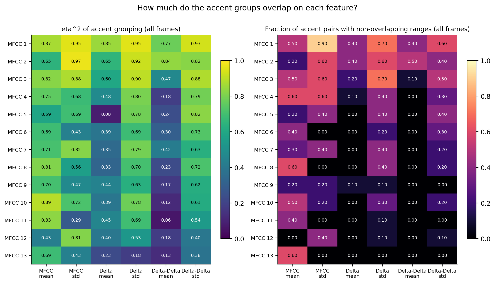

*Figure 6.* Accent separation for all 78 features (whole recordings). Left: η² of the accent grouping for each coefficient (rows) and feature type (columns). Right: the fraction of the ten accent pairs whose value ranges do not overlap.

**Redundancy.** Figure 7 shows the Pearson correlation between every pair of features across the recordings. Strongly correlated features carry almost the same information, which matters both for counting evidence and for later dimensionality reduction.

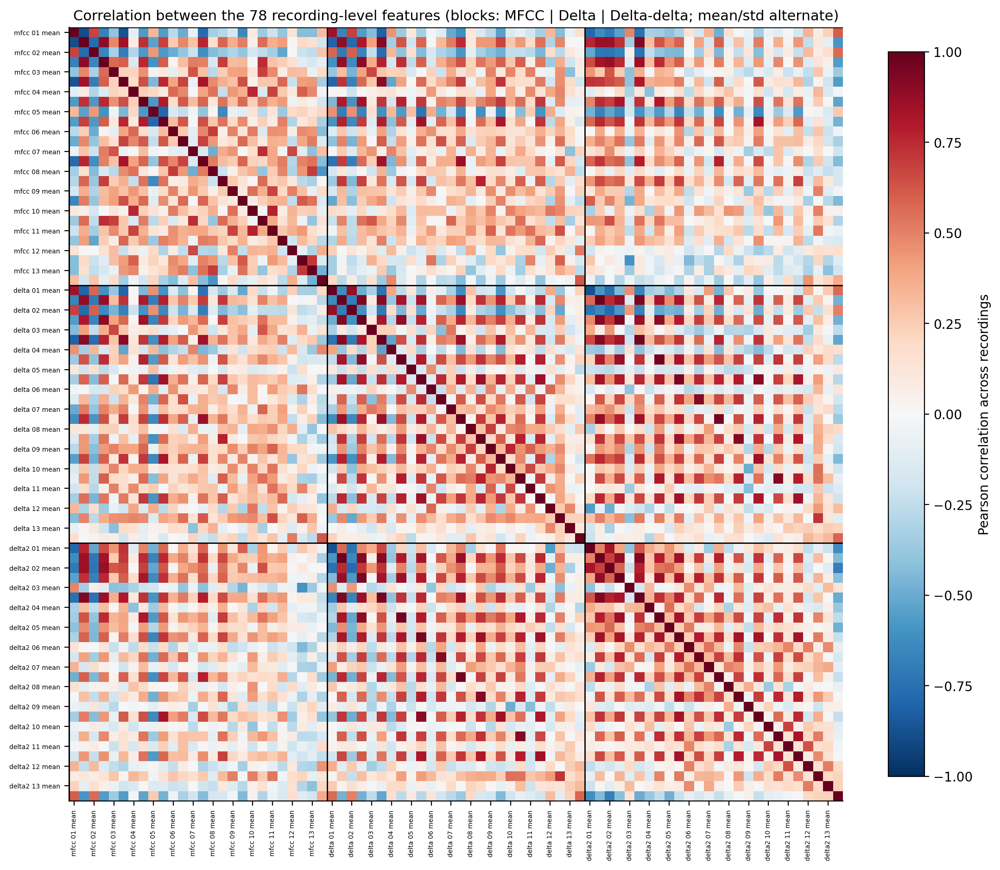

*Figure 7.* Correlation between the 78 features across the 35 recordings (red = move together, blue = move in opposite directions).

**Speech versus non-speech.** Whole-recording averages include pauses and background noise. Using the speech detector from Section 3.4, we rebuilt the features from speech frames only, after checking that the frame-by-frame alignment between the detector and the MFCC frames was correct, and compared the two versions. We also repeated the comparison with a stricter 20 dB rule, because the 30 dB rule behaved badly on the noisiest recordings (Section 4.2). Figure 8 illustrates the issue for the first two coefficients.

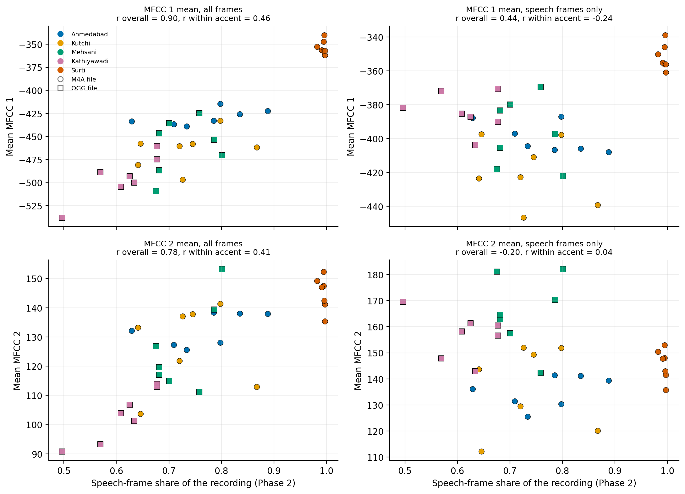

*Figure 8.* Mean MFCC 1 (top) and MFCC 2 (bottom) against the share of each recording that is speech, using all frames (left) and speech frames only (right). Circles are M4A files, squares OGG files.

**Format and quality.** Finally, we asked how much of each feature's variation is explained by the original file format, how much accent still explains once format is accounted for, and how each feature relates to recording-quality measures (Figure 9).

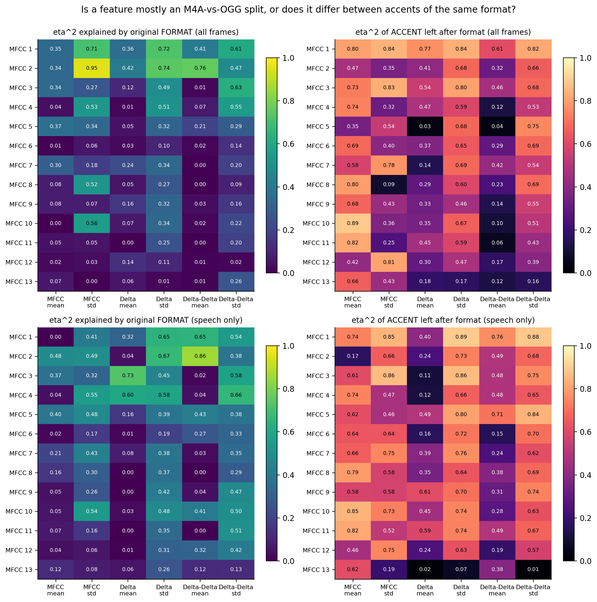

*Figure 9.* Is a feature mostly an M4A-versus-OGG split? Left: η² explained by original format. Right: η² of accent that remains after format is taken into account. Top row: whole recordings; bottom row: speech frames only.

We then applied a rule-based screen that flagged features as showing separation, being format-dominated, being quality-sensitive or overlapping heavily. The screen produces a shortlist for follow-up; it is not a feature-selection procedure, and no feature was removed from later analysis because of it.

### 3.7 Principal component analysis

#### The idea

The feature analysis left us with 78 numbers per recording, many of them strongly correlated (Figure 7). Principal component analysis (PCA) is a standard way to look at such data [15]. Imagine the 35 recordings as a cloud of points in a 78-dimensional space, impossible to picture. PCA finds the direction in which the cloud is stretched most (the first principal component), then the direction at right angles to it with the next-largest stretch, and so on. Each recording gets a *score* on every component (where it lies along that direction), and each component is a recipe of *loadings* that says which of the original features it is made of. The *explained variance* of a component is the share of the total spread in the data that lies along it, and the *cumulative explained variance* adds these up across components. PCA is unsupervised: it never sees the accent labels, so any grouping that appears by accent was present in the features, but it need not be there *because* of accent.

#### What we did

We standardised each of the 78 features (mean 0, standard deviation 1), so that features measured on larger scales did not dominate, and computed the components through a singular value decomposition (Figure 10). With 35 recordings the standardised data have at most 34 directions of variation, so we kept all 34 components. As a one-off check, we compared our implementation with scikit-learn's: the explained-variance ratios agreed to about 4 × 10⁻¹⁶. To judge whether a component is "large", we also shuffled each feature column independently 500 times, which destroys the relations between features, and recorded how much variance the first components capture by chance alone. We then examined the scree plot (Figure 11), the loadings, scatter plots coloured by accent and marked by file format, and the relation of the components to format, sample rate, noise and speech share, which were never used as inputs. Three sensitivity analyses were run separately and never replaced the primary analysis: speech-only features (30 dB and 20 dB rules), a version without MFCC 1 and MFCC 2, and a version in which each accent in turn was left out of the fit and then projected into the resulting space.

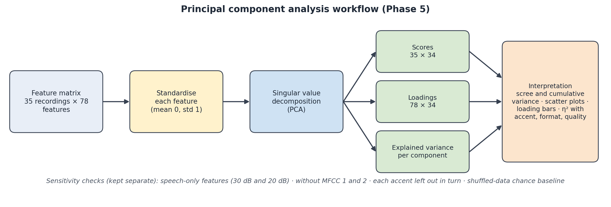

*Figure 10.* Principal component analysis workflow used in this study.

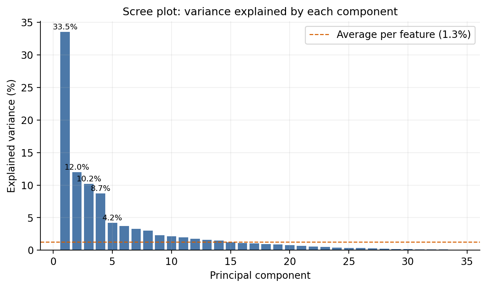

*Figure 11.* Scree plot: the percentage of variance explained by each of the 34 principal components. The dashed line marks the share an average single feature would carry.

A scree plot such as Figure 11 is read by looking for the "elbow", where the bars stop falling steeply. Section 4.5 gives the results.

### 3.8 Model development

We compared four kinds of classifier, all trained from scratch on our own data. No pretrained model, weights or embeddings were used. Each neural model ends in two softmax output layers, a *region head* and an *accent head*, so that the same network predicts both levels of the hierarchy (Table 5).

*Table 5.* The four model types compared (trainable parameter counts for the neural models; the CNN-only variant, which has the CNN branch plus the shared block and heads but no MLP branch, has 118,314 trainable parameters).

| Exp. | Model | Input | Structure | Trainable parameters |
|---|---|---|---|---|
| A | SVM (RBF kernel, C = 1) | 78 numerical features | Support-vector classifier on standardised features | not applicable |
| B | CNN only | Log-Mel spectrogram (64 × 800) | 3 convolution blocks → 128-d → shared Dense(64) → two heads | 118,314 |
| C | MLP only (selected) | 78 numerical features | Dense 64 → Dense 32 → shared Dense 64 → two heads | 10,026 |
| D | CNN–MLP fusion | Log-Mel spectrogram and 78 features | CNN 128-d and MLP 32-d → concatenate (160-d) → shared Dense(64) → two heads | 127,626 |

**Support-vector machine (SVM) [9].** The SVM looks for the boundary that separates the classes with the widest possible margin, optionally in a transformed space. We used a radial-basis-function kernel with default settings after standardising the 78 features. It is cheap, needs little data and serves as the simple baseline.

**Multilayer perceptron (MLP).** An MLP is a stack of fully connected layers: each layer multiplies its inputs by learned weights, adds a bias and applies a simple non-linearity (here ReLU, which keeps positive values and zeroes negative ones). Stacking layers lets the network learn combinations of features that a single boundary cannot. Our MLP takes the 78 standardised features, passes them through a layer of 64 units (followed by batch normalisation, which rescales activations during training [16], and dropout of 0.30, which randomly switches off units during training to reduce overfitting [17]), a layer of 32 units (dropout 0.20), and a shared layer of 64 units (dropout 0.40). Two small output layers then give the region probabilities and the accent probabilities (Figure 12). In total there are 10,026 trainable parameters.

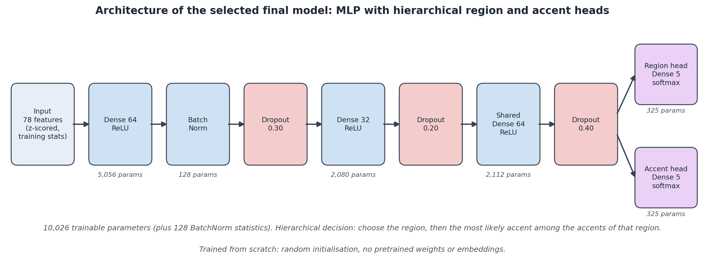

*Figure 12.* Architecture of the selected final model: an MLP with a shared 64-unit layer and two softmax output heads. Parameter counts are shown under each layer.

**Convolutional neural network (CNN).** A CNN is designed for image-like inputs. Instead of connecting every input to every unit, it slides small filters (here 3 × 3) across the image and learns which local patterns are worth detecting; pooling layers then shrink the image while keeping the strongest responses. We fed it a Log-Mel spectrogram of 64 Mel bands by 800 frames (8 s at a 10 ms step), standardised per Mel band using the training recordings only. The network has three convolution blocks (32, 64 and 128 filters, each followed by batch normalisation and ReLU, with 2 × 2 max pooling after the first two), a global average pooling layer that reduces each of the 128 feature maps to one number, a dense layer of 128 units with dropout 0.40, and the same shared layer and two heads as the MLP.

**CNN–MLP fusion network.** The fusion network combines both representations: the 128-number vector from the CNN and the 32-number vector from the MLP are concatenated into a 160-number vector, passed through a shared 64-unit layer with dropout 0.40, and fed to the two heads. It has 127,626 trainable parameters, of which the CNN branch accounts for most (Figure 13). We implemented it as the model we hoped would work best, but, as the results show, it is an experimental candidate and not the final model.

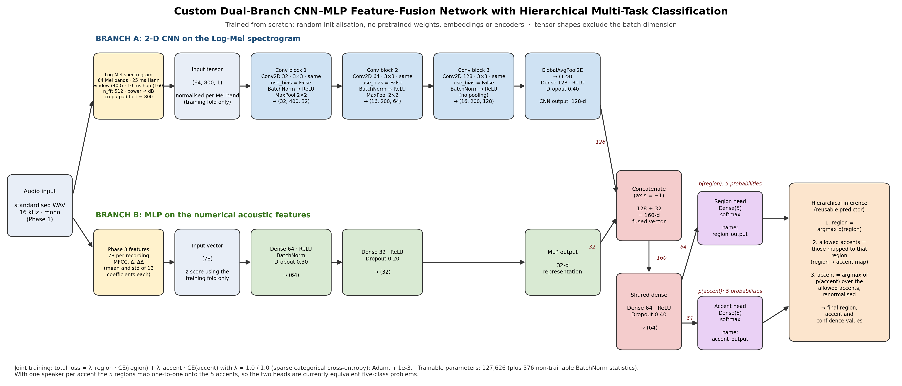

*Figure 13.* The CNN–MLP fusion network evaluated as an experimental candidate. Branch A (top) reads the Log-Mel spectrogram; Branch B (bottom) reads the 78 numerical features.

**Region and accent heads, and hierarchical decoding.** The region head outputs one probability for each of the five regions, and the accent head one for each of the five accents. At prediction time the region with the highest probability is chosen first; the accent is then chosen only among the accents that belong to that region, with their probabilities renormalised. The code reads the region-to-accent mapping from the metadata and supports regions that contain several accents. In the present dataset, however, each of the five regions contains exactly one accent, so the two heads are equivalent five-class problems and the second step of the hierarchy never has a real choice to make. The hierarchical machinery is therefore in place, but its ability to separate several accents *within* a region is untested.

### 3.9 Model training and evaluation

**Data splitting.** Because the dataset is tiny, we used seven-fold cross-validation over recordings (Table 6). Each fold holds out one recording of every accent for testing, so each of the 35 recordings is tested exactly once. From the remaining recordings one per accent is kept as a validation set, used only to decide when to stop training and which checkpoint to keep. The SVM and all neural models were trained and tested on identical splits.

*Table 6.* Evaluation protocol.

| Aspect | Setting |
|---|---|
| Folds | 7, stratified by accent: each fold holds out one recording per accent (5 test recordings) |
| Per fold | 25 training, 5 validation (one per accent), 5 test recordings |
| Coverage | every one of the 35 recordings is tested exactly once |
| Validation use | early stopping and checkpoint selection only |
| Normalisation | fitted on the training recordings of each fold only |
| Augmentation | training recordings only, applied on the fly inside the training fold |
| Unit of evaluation | recording (not speaker): test recordings share speaker, session and device with the training recordings |

**Training.** The neural networks were trained with the Adam optimiser [18] (initial learning rate 0.001, batch size 8), with the two outputs combined into one loss by equal weights on the region and accent cross-entropies. Early stopping watched the validation loss with a patience of 10 epochs, the best weights were saved as a checkpoint, and the learning rate was halved after 4 epochs without improvement. One training epoch consisted of four random views of each training recording. All weights started from random initialisation, and random seeds were fixed.

**Augmentation.** Augmentation was applied to training recordings only, inside each training fold and after the split, so that no variant of a test recording could reach training. For spectrograms we used a random crop, a gain change of up to 3 dB, small random jitter, and at most one mild time mask and one mild frequency mask in the spirit of SpecAugment [11]; for numerical features we added small random noise. We avoided pitch and speed changes because these could alter accent-related information. Augmented views are not counted as additional independent samples.

**Metrics.** We report pooled accuracy over the 35 held-out recordings, macro-averaged precision, recall and F1, region accuracy, end-to-end hierarchical accuracy, per-class results, confusion matrices, and the mean and standard deviation of the accuracy across folds (each fold has only five test recordings, so a single error moves a fold's accuracy by 0.2).

**Recording-level, not speaker-independent.** It is essential to be clear about what this protocol measures. A held-out recording comes from the *same speaker, session and device* as the training recordings of its accent. The evaluation therefore asks whether the model can recognise a new recording from a voice and setup it has already seen. It does not ask whether the model can recognise the accent in a new speaker, and it cannot, because no accent has a second speaker. We call the evaluation *within-speaker* and treat it as exploratory.

**Leakage checks.** We verified automatically that every recording is tested exactly once, that training, validation and test recordings do not overlap, that normalisation is fitted on the training recordings of each fold only, that augmentation touches only training recordings, that checkpoints reload and reproduce their predictions, that all weights actually change during training, and that no pretrained component is referenced in the code. As a sanity check for label leakage we also trained the SVM 50 times on shuffled training labels; the mean test accuracy was 0.218, close to the 0.200 expected by chance. This shows that the pipeline does not leak labels mechanically. It does not show that the models are learning accent rather than speaker.

### 3.10 Frontend and prediction pipeline

To make the selected model usable, we built a web application with Streamlit. A user uploads a recording (WAV, MP3, M4A or OGG) and the application passes it through the same pipeline that was used during development (Figure 14). The file is first validated: its type, that it is not empty, that it can be decoded, that it lasts between one and 180 seconds and that it is not silent. It is then standardised with FFmpeg to 16 kHz mono, the 78 features are extracted by the project's own feature code, the saved training-set mean and standard deviation are applied, and the final MLP produces region and accent probabilities, which are combined by the hierarchical rule. The application never re-implements feature extraction or normalisation; it calls the existing inference code, which is also available as a command-line script.

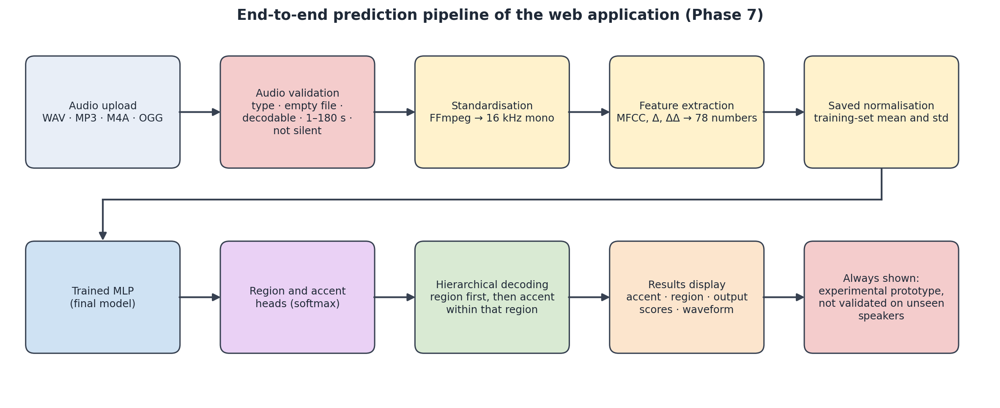

*Figure 14.* End-to-end prediction pipeline of the web application.

The interface has four pages: a home page with the five accents and their regions; the classification page, with an audio player, a waveform, a "Classify accent" button and a results section showing the predicted accent, its region, bar charts of the output scores of both heads and an explanation of the hierarchical decision; a page describing the model and its 78 features; and a page on the dataset and its limitations, including the gender-related limitation discussed in Section 5.2. A warning that the system is an experimental prototype, not validated on unseen speakers, appears on every page. The bars are labelled *output scores*, because they are the raw outputs of the softmax layers and not calibrated probabilities. The project did not include a screenshot of the application, so none is reproduced here.

---

## 4. RESULTS AND DISCUSSION

### 4.1 Dataset summary

The dataset has 35 recordings in five accents, seven per accent, from five speakers (Table 1). Durations range from 8.3 to 18.3 seconds with a mean of 12.8 seconds, and they differ by accent: the Surti recordings are the shortest (mean 9.3 s) and the Kutchi recordings the longest (mean 15.1 s). The converted recordings are all 16 kHz mono PCM-16 WAV files; their originals span three sample rates and two file formats, in a pattern that follows the accent labels (each accent has a single format and a single sample rate). This is the first sign of the confounding that runs through the results: knowing a recording's format, sample rate and duration already says something about its accent label, without any speech analysis at all.

### 4.2 Audio quality findings

Eleven of the 35 recordings carried at least one quality flag (Table 2). Ten were flagged for clipping, 4 Mehsani and 6 Kathiyawadi recordings (both OGG), and one Kutchi recording had a speech level that deviated from the median by more than 6 dB. No recording was flagged for very low amplitude, near silence or unusual duration. Clipping means that some loud samples reached the maximum level and may be distorted; we kept these recordings, because there were so few, and recorded the flags so that later analyses could take them into account.

The more consequential finding concerns background noise (Figure 3). The estimated noise floor differs enormously between the groups: about -35.7 dBFS for Surti, -45.8 for Ahmedabad and -49.2 for Kutchi, against -82.5 for Mehsani and -79.7 for Kathiyawadi. The corresponding approximate signal-to-noise ratios run from 12.7 dB for Surti to 63.3 dB for Mehsani. In other words, the Mehsani and Kathiyawadi recordings are very clean (possibly because OGG encoding drives silent passages close to digital silence, a hypothesis we did not test), while the Surti recordings carry a steady background level only about 13 dB below the speech. These are properties of the recordings, not of the accents, and they differ by group in exactly the way the format and sample rate do.

The speech-activity analysis revealed a limitation of our own method (Figure 4). On the Surti recordings the 30 dB rule labels almost every frame as speech (a speech share of 0.99, with no pauses detected at all), because the noise floor lies within 30 dB of the speech. For the other accents the speech share is between 0.61 and 0.77. The waveforms and spectrograms of the Surti recordings clearly contain pauses; the detector simply cannot see them. We did not change the rule to suit one group, but we recorded the problem and repeated the speech-only analyses with a stricter rule as a sensitivity check. The quality analysis thus told us two things that shaped what followed: the recordings are not comparable in noise, level or format across accents, and features that are sensitive to level and noise would need careful interpretation.

### 4.3 Feature extraction summary

Feature extraction ran without errors on all 35 recordings and produced 44,664 frames in total, with no missing or infinite values. The extraction parameters are those of Table 4. Figure 15 shows the average MFCC profile of each accent: the first coefficient takes very different values across accents, most extreme for Surti (a mean of about −353 compared with −494 for Kathiyawadi), whereas MFCC 2 is large and positive for every accent and coefficients 3 to 13 are much closer to zero and look alike at this scale. That the first coefficient distinguishes Surti so sharply is consistent with the Surti recordings' high noise floor, since this coefficient tracks overall energy.

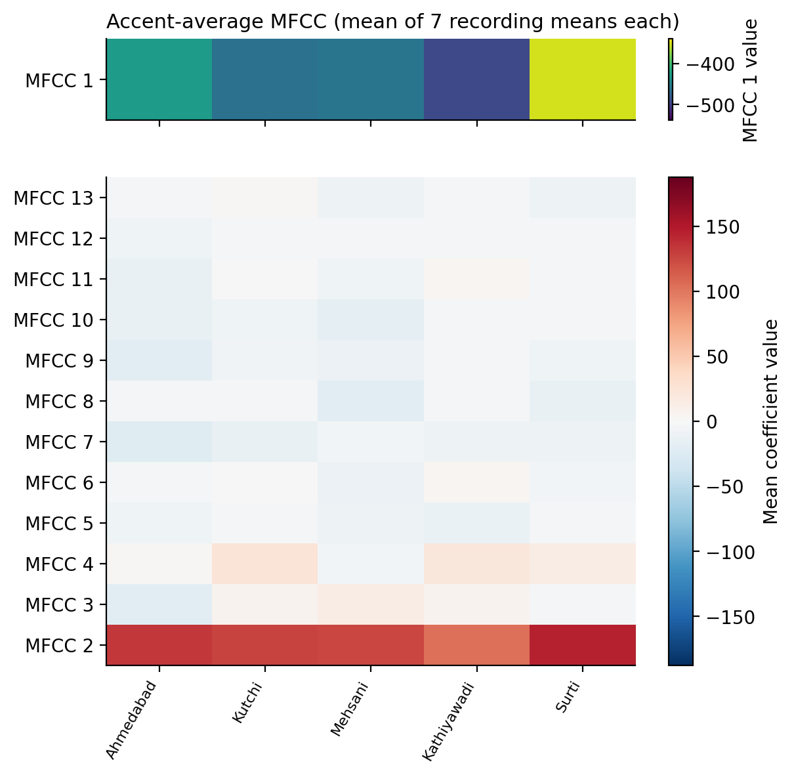

*Figure 15.* Accent-average MFCC values (each cell is the mean of the seven recording means of that accent). MFCC 1 is plotted on its own colour scale because its values are much larger than the others.

A second early observation concerns the *variability* of the derivative features. Figure 16 shows, for each coefficient, how much the delta and delta-delta values fluctuate within a recording. Kathiyawadi recordings fluctuate the most and Mehsani next (average delta standard deviation of 4.47 and 3.47 over the 13 coefficients), and the three M4A accents the least (Ahmedabad 3.16, Kutchi 2.83, Surti 2.82). The two OGG accents are the two with the most spectral fluctuation. Whether this reflects the speakers, the language or the OGG encoding cannot be settled with these data, but it is an early warning that format and accent are tangled.

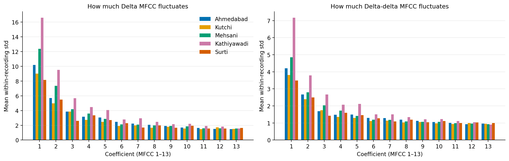

*Figure 16.* Mean within-recording standard deviation of the delta (left) and delta-delta (right) coefficients for each accent.

### 4.4 Feature analysis findings

The accent-separation analysis (Figure 6) showed that the features differ strongly between the five groups. Of the 78 features, 44 have an η² of at least 0.60 for the accent grouping in whole recordings, 22 are moderate and 12 overlap heavily; with speech frames only, the counts become 51, 20 and 7. The largest values belong to variability features: MFCC 2 std (0.97); Delta MFCC 1 std (0.95); MFCC 1 std (0.95). No single feature separates all ten pairs of accents. A strong η² is, however, exactly what one expects when each group is one person recorded in one setup, so we read it as showing that the five groups are *different*, not that the difference is accent.

The correlation analysis (Figure 7) showed that the features are far from independent: 18 of the 3,003 feature pairs have an absolute correlation of at least 0.9, and 232 of at least 0.7. The strongest relationships link the standard deviation of a delta with that of the delta-delta of the same coefficient. In practice, the 78 features contain far fewer than 78 independent pieces of information, which is the natural motivation for PCA.

The speech-versus-silence analysis (Figure 8) revealed a trap. Across the whole recordings, the means of MFCC 1 and MFCC 2 rise with the share of the recording that is speech (within-accent correlations of 0.46 and 0.41): recordings with more pauses and noise have different coefficient values simply because they contain more non-speech. When only speech frames are used, the MFCC 2 relationship vanishes (0.04) and the MFCC 1 relationship reverses (-0.24). Overall 75.5% of all frames (33,706) were classified as speech with the 30 dB rule. The lesson is that the first coefficients in whole-recording features partly measure silence and noise rather than speech. We also found that Surti stands apart (all seven recordings outside the range of the other accents) in 10 of the 78 speech-only features, mostly energy- and variability-related ones, which is what a noisier recording setup would produce.

The format analysis (Figure 9) showed that some features are almost entirely an M4A-versus-OGG split (for example the standard deviation of MFCC 2, η² for format of 0.95 in whole recordings), while others differ between accents of the *same* format, which would not be expected from format alone. Accent and format are therefore partly, but not fully, separable in this dataset. In the rule-based screen, 35 of the 78 features passed every screening rule and were listed as candidates for follow-up with more speakers, seven heavily overlapping features were identified, and two were mostly format-driven. These lists are observations about this dataset, not a feature-selection result.

Taken together, the feature analysis delivered a clear message. The features contain a great deal of between-group structure, and a great deal of it is plausibly explained by the recording rather than the speech. This is what made us want a global view of the structure, independent of any single feature, before building models: if the dominant directions of variation in the data turned out to be recording conditions, a classifier would be tempted to use them.

### 4.5 PCA results

**Explained variance.** The first principal component alone explains 33.5% of the total variance, the second 12.0%, the third 10.2% and the fourth 8.7%, together 64.4% (Table 7, Figure 11). Reaching 80%, 90% and 95% of the variance takes 9, 15 and 19 components out of the 34 that exist (Figure 17). The shuffled-data baseline puts these numbers in context: for data of this size and with no relations between features, the first component would capture only about 7.4% of the variance (95th percentile 8.0%). Components 1 to 4 are therefore far above chance, whereas component 5 (4.2%) is at or below the chance level (5.5%), as are all later ones. The scree plot shows the corresponding elbow after the fourth component.

*Table 7.* The first five principal components: variance explained, the chance level from shuffled data, and η² of each component's scores with accent grouping and original file format.

| Component | Variance explained (%) | Chance level, mean of shuffled data (%) | η² with accent | η² with original format |
|---|---|---|---|---|
| PC1 | 33.5 | 7.4 | 0.94 | 0.59 |
| PC2 | 12.0 | 6.7 | 0.88 | 0.00 |
| PC3 | 10.2 | 6.2 | 0.85 | 0.00 |
| PC4 | 8.7 | 5.8 | 0.89 | 0.35 |
| PC5 | 4.2 | 5.5 | 0.06 | 0.01 |

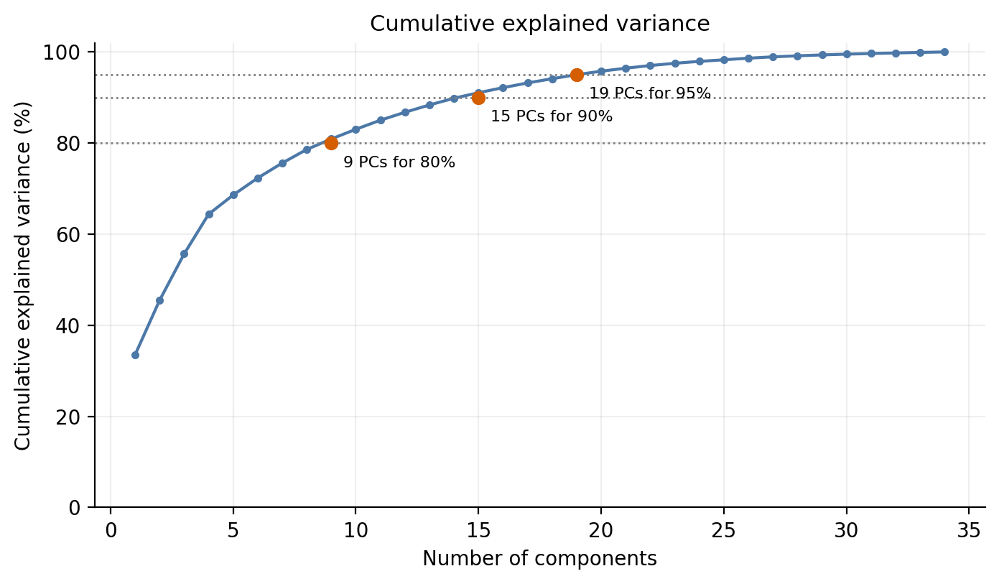

*Figure 17.* Cumulative explained variance. The dots mark the number of components needed to reach 80, 90 and 95% of the variance.

**Structure of the components.** The strong η² of the first four components with the accent label (0.94, 0.88, 0.85 and 0.89) against 0.06 for the fifth shows that each of the four leading components is almost entirely a group-membership axis. The explanation is mathematical as much as acoustic: five groups can differ in at most four independent directions, and in our data each of the four strongest directions lines up with one group (Kathiyawadi on component 1 with a one-versus-rest η² of 0.83, Kutchi on component 2 with 0.63, Ahmedabad on component 3 with 0.65, Mehsani on component 4 with 0.81). Components beyond the fourth, which would hold variation *within* a speaker, carry little structure.

Figure 18 shows the recordings in the plane of the first two components. Recordings of the same accent lie close together, and the five groups form largely separate clouds: Kathiyawadi far to the right, Kutchi at the top, Surti at the bottom left, and Ahmedabad and Mehsani in the middle, where they are closest to each other. The silhouette score of the accent labels in this plane is 0.46 (0.58 using the first five components). We must be careful about what this means. Tight clusters are exactly what one expects of recordings from the same person in the same session, and the figure cannot distinguish "same accent" from "same speaker".

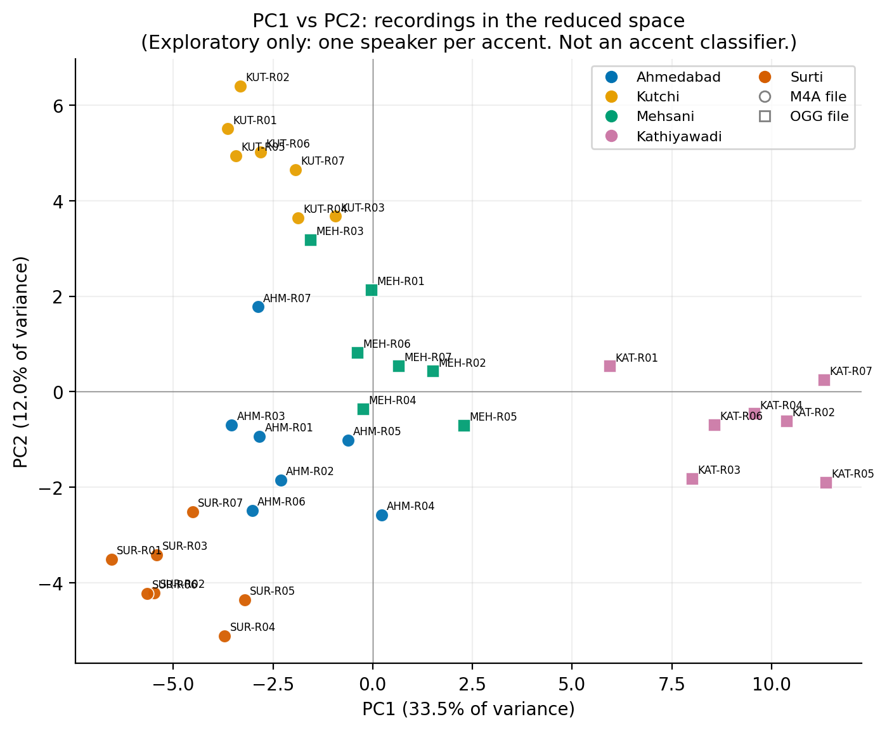

*Figure 18.* Recordings in the plane of the first two principal components (colour = accent, marker = original format, labels = recording IDs). PCA never used these labels.

**What the components are made of.** The loadings (Figure 19) show that component 1 is dominated by *variability* features: 80% of its squared loadings come from standard deviations, in particular those of the delta and delta-delta coefficients, so it measures how much the spectral shape fluctuates within a recording. Component 3, in contrast, is made mostly of *mean* features (82%), mainly the higher MFCCs, which describe average spectral shape. Component 2 mixes both. These are the characteristics of a voice and of a recording chain as much as of an accent.

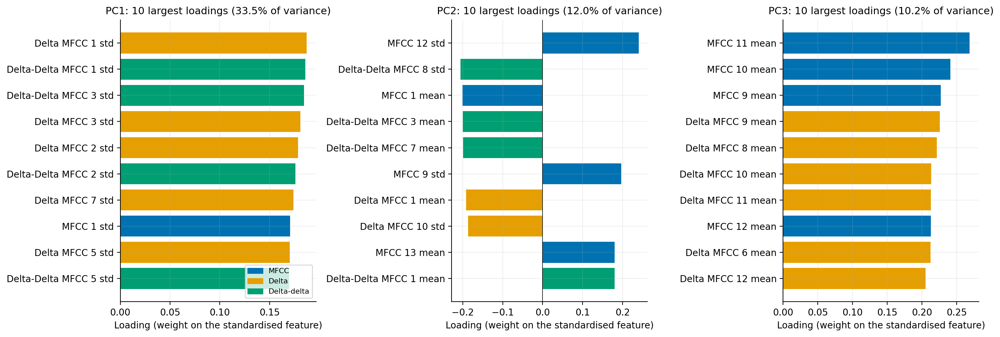

*Figure 19.* The ten features with the largest loadings on components 1 to 3, coloured by feature family (MFCC, delta, delta-delta).

**Relation to recording conditions.** We related the component scores to variables that were not used as inputs (Figure 20). Component 1 correlates strongly with the original sample rate (-0.87), the noise floor (-0.70) and the speech share (-0.68) across all recordings. However, the sample rate has only three values and its lowest value belongs to a single accent, so that correlation mostly restates that Kathiyawadi stands apart on this component; and the correlation with speech share even reverses within accents (0.26). The two OGG accents do not behave alike either: Kathiyawadi is far right while Mehsani sits in the middle. File format alone therefore does not explain the first component, and neither does noise alone. These associations are between-group effects, and the data cannot separate them from the effect of the speaker.

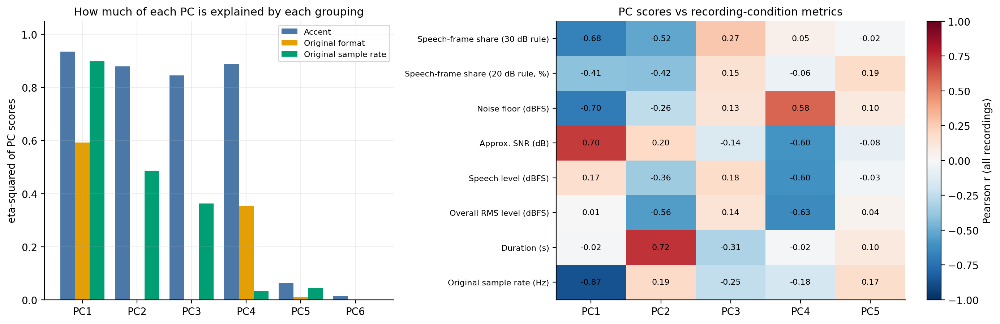

*Figure 20.* Left: how much of each component's variation is explained by accent, original format and original sample rate (η²). Right: correlation of each component with recording-condition measures across the 35 recordings.

**The Surti question.** Because Surti has the highest noise floor and the least reliable speech detection, we asked whether it distorts the analysis or appears as a special cluster (Figure 21). In the full PCA Surti forms a compact cloud, but it is not the dominant group on any component (its one-versus-rest η² is 0.41 on component 2, which is the highest of its values). Removing it barely changes component 1 (the loading vectors have a cosine similarity of 0.97), changes component 2 moderately (0.70) and component 3 a great deal (0.12). When Surti recordings were projected into a PCA fitted without them, they fell beside the Ahmedabad cloud rather than in a region of their own (their centroid lay only 0.83 times the spread of the other recordings away from theirs), unlike Kathiyawadi, which falls well outside the space fitted without it (1.81). Surti is a distinct group, but not an outlier, and we do not interpret its position as a Surti accent pattern.

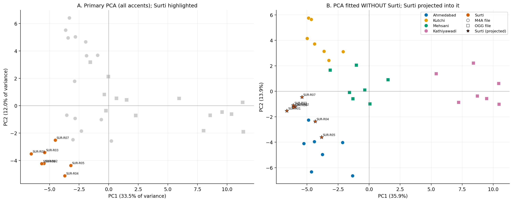

*Figure 21.* Left: the full PCA with Surti highlighted. Right: a PCA fitted without Surti, into which the Surti recordings (stars) are projected.

**Sensitivity.** The structure is robust in its broad outline but not in its detail (Table 8, Figure 22). Component 1 is stable across all variants (correlation with the primary scores of at least 0.96). Removing MFCC 1 and MFCC 2, which the feature analysis had linked to speech share, hardly changes anything (correlations of 1.00, 0.98 and 0.99 for components 1 to 3), so these two coefficients do not drive the global structure. Using speech frames only, however, concentrates more variance in component 1 (46.3% with the 30 dB rule), and the second component is not stable: the primary component 2 correlates only 0.01 with component 2 of the speech-only analysis, although it correlates 0.61 with that analysis's component 4. The order and meaning of the middle components thus depend on whether non-speech frames are included.

*Table 8.* Sensitivity analyses. The primary analysis is the first row; the last column gives the absolute correlation between the primary scores and those of each variant for the same component number.

| Variant | Features | PC1 (%) | PC2 (%) | Components for 80 / 90 / 95% | Absolute correlation with primary PC1 / PC2 / PC3 |
|---|---|---|---|---|---|
| Primary: all frames, all features | 78 | 33.5 | 12.0 | 9 / 15 / 19 | 1.00 / 1.00 / 1.00 |
| Speech-only (30 dB rule) | 78 | 46.3 | 13.0 | 6 / 12 / 16 | 0.98 / 0.01 / 0.73 |
| Speech-only (20 dB rule) | 78 | 39.9 | 12.3 | 8 / 13 / 19 | 0.96 / 0.46 / 0.51 |
| Without MFCC 1 and MFCC 2 | 74 | 32.3 | 11.8 | 9 / 15 / 19 | 1.00 / 0.98 / 0.99 |

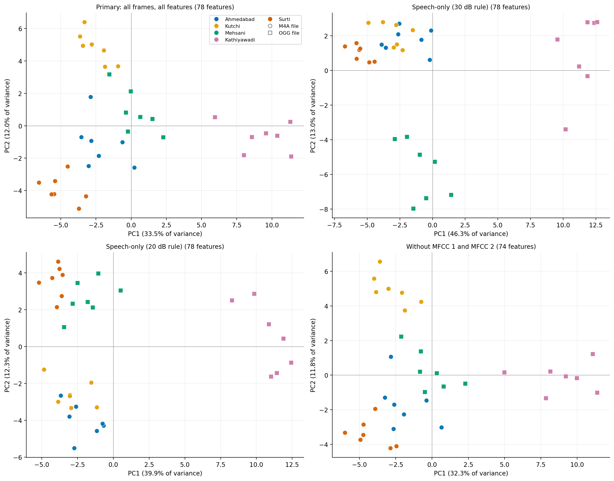

*Figure 22.* Components 1 and 2 for the primary analysis and the three sensitivity analyses.

**Implications for modelling.** PCA did not tell us that the accents are separable; it told us what dominates the features. That is mostly the identity of the five speaker-and-setup groups. Two consequences followed for the next stage. A classifier trained on such data should be expected to score well, but for reasons that may have little to do with accent. And a recording-level evaluation, where test recordings come from the same five people, would not be a test of generalisation. We nevertheless wanted to see how different learning methods behaved on the task, how easy it is, and how much a spectrogram-based network adds to the numerical features, which led to the model comparison below.

### 4.6 Model comparison

Table 9 lists every run, with its type and status. The *original* experiments are the four planned comparisons (A to D). The *post-hoc* runs were added after the original results were seen, in order to understand them, and should be read as such. The *not run* entries were planned or considered but were not carried out.

*Table 9.* Results of all experiments on identical seven-fold splits (accuracy is for the accent head, pooled over the 35 held-out recordings). Post-hoc runs were added after the original results were seen. Runs marked "not run" were not carried out.

| Run | Type | Status | Pooled accent accuracy | Fold-wise mean ± SD | Macro F1 | Region accuracy |
|---|---|---|---|---|---|---|
| A. SVM, 78 features | Original | complete (7 of 7 folds) | 1.000 | 1.000 ± 0.000 | 1.000 | 1.000 |
| C. MLP, 78 features (**selected**) | Original | complete (7 of 7 folds) | 1.000 | 1.000 ± 0.000 | 1.000 | 1.000 |
| B. CNN, Log-Mel, patience 10 | Original | complete (7 of 7 folds) | 0.429 | 0.429 ± 0.138 | 0.321 | 0.429 |
| D. CNN–MLP fusion, patience 10 | Original | complete (7 of 7 folds) | 0.857 | 0.857 ± 0.190 | 0.852 | 0.829 |
| B′. CNN, patience 25 | Post-hoc | complete (7 of 7 folds) | 0.486 | 0.486 ± 0.254 | 0.429 | 0.514 |
| D′. Fusion, patience 25 | Post-hoc | complete (7 of 7 folds) | 1.000 | 1.000 ± 0.000 | 1.000 | 1.000 |
| D″. Fusion, patience 25, no augmentation | Post-hoc | complete (7 of 7 folds) | 0.771 | 0.771 ± 0.243 | 0.758 | 0.743 |
| MLP with the 13 additional spectral/F0 features | Not run | not run | – | – | – | – |
| MLP without augmentation | Not run | not run | – | – | – | – |
| CNN without augmentation | Not run | not run | – | – | – | – |
| BatchNorm-momentum / minimum-epoch test | Not run | not run | – | – | – | – |
| Speaker-independent evaluation | Not run | not run | – | – | – | – |

Figure 23 shows the accuracy of every held-out fold, and Figure 24 summarises the pooled accuracy.

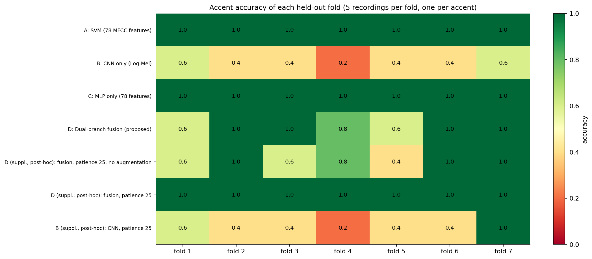

*Figure 23.* Accent accuracy of each held-out fold (five recordings per fold, one per accent) for every completed run.

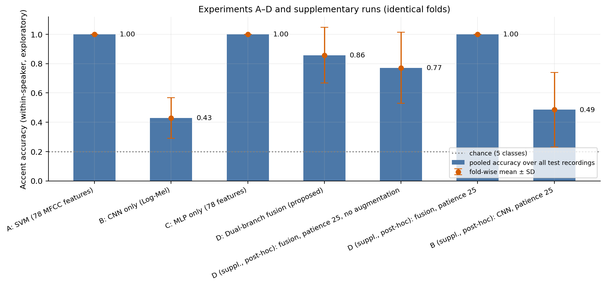

*Figure 24.* Pooled accuracy (bars) and fold-wise mean ± standard deviation (points) for all completed runs, with the chance level for five classes.

The SVM and the MLP classified all 35 held-out recordings correctly (pooled accuracy 1.000 and 1.000), in every fold. The fusion network as originally specified reached 0.857 (fold-wise standard deviation 0.190), and the CNN alone reached 0.429. The post-hoc runs with a longer early-stopping patience gave 1.000 for the fusion network and 0.486 for the CNN, while the fusion network without augmentation reached 0.771. Four things should be kept in mind. First, scores of 1.000 for the simple models are what the earlier analyses predicted: the features separate the five groups cleanly. Second, when several models score perfectly, accuracy cannot rank them, so the other considerations in Section 4.8 decide. Third, the differences among the neural models appear to arise largely from training behaviour, as the next section shows, and not from the representations alone. Fourth, none of these numbers speaks to unseen speakers.

### 4.7 Training and evaluation results

**Confusion matrices.** The confusion matrices (Figure 25) make the pattern concrete. The SVM and the MLP are perfectly diagonal. The fusion network confuses Ahmedabad and Kutchi recordings with Mehsani (and Ahmedabad with Surti), and the CNN alone predicts most recordings as Surti, Mehsani or Kathiyawadi and never identifies Ahmedabad or Kutchi correctly. Because every region has exactly one accent, the region confusion matrix has the same structure as the accent matrix, and the hierarchical accuracy equals the region accuracy.

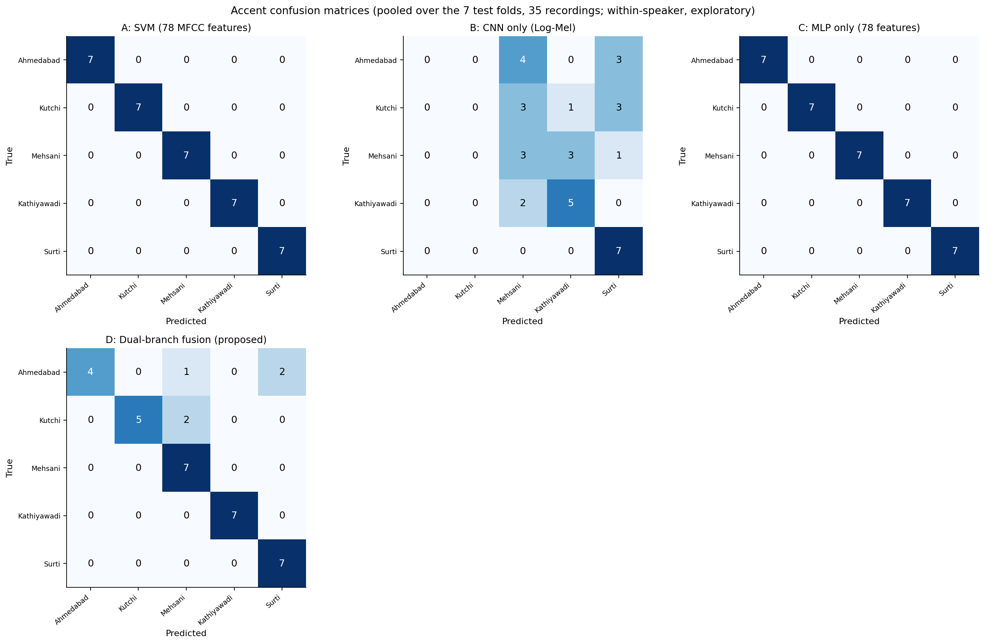

*Figure 25.* Accent confusion matrices pooled over the seven test folds for experiments A to D (rows: true class; columns: predicted class).

**Training behaviour.** The curves of the fusion network (Figure 26) show a recurring shape. The validation loss stays flat or even rises during roughly the first ten epochs and then falls steeply between epochs 15 and 40, after which the held-out validation recordings are classified correctly. With a patience of 10 epochs, early stopping can fire inside that initial plateau. This happened in 3 of the seven folds of the fusion network, which stopped after 16 to 19 epochs and scored 0.6 to 0.8 in those folds, and in all folds of the CNN-only network (between 13 and 18 epochs). The MLP, in contrast, learned smoothly and reached 100% validation accuracy in all folds.

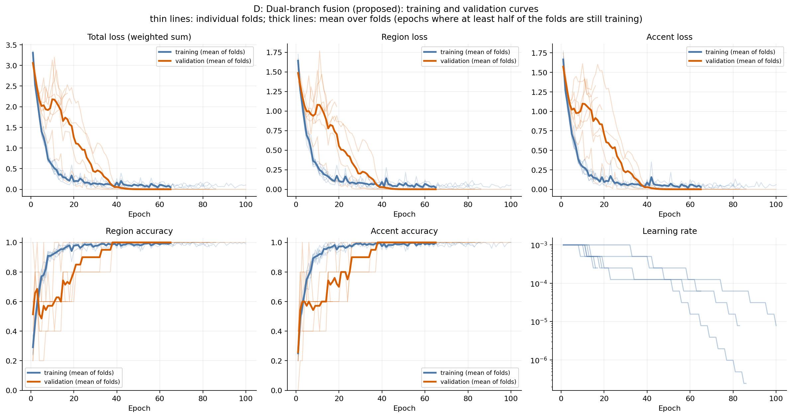

*Figure 26.* Training and validation curves of the fusion network (patience 10). Thin lines are individual folds, thick lines the mean over folds. Bottom right: the learning-rate schedule.

**Overfitting analysis.** The weak folds are not the classic case of overfitting, in which a model scores highly on its training data and poorly on new data. In the failing folds the training accuracy at the restored checkpoint was itself low: between 0.28 and 0.60 in every fold of the CNN-only network, and between 0.64 and 0.80 in the three early-stopped folds of the fusion network. These models were stopped before they had fitted even the training recordings well (Figure 27 shows the averages over folds). For the CNN-only network the accuracy on training crops *during training* rose to between 0.7 and 0.9 while the validation loss rose, which suggests that the early checkpoint is not representative of the model's later state.

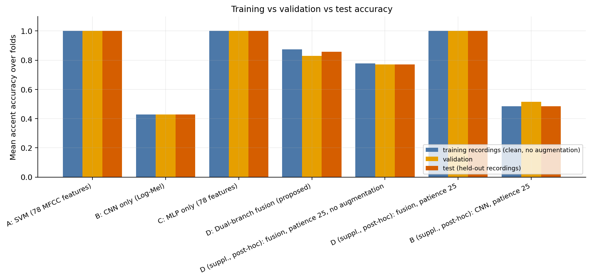

*Figure 27.* Mean accuracy on the training recordings (without augmentation), the validation recordings and the held-out test recordings for each completed run.

**A possible training-stability issue.** We examined the saved checkpoints for a reason that would explain this pattern, using inference only, without any further training. For each BatchNorm layer we compared the running variance stored in the checkpoint with the true variance of that layer's input over the training recordings (Figure 28). In the checkpoints saved at epoch 12 or earlier (16 checkpoints from the CNN-only and fusion runs, final convolution block) the stored variance was between 4.4 and 19.4 times the true variance. In the 5 checkpoints saved after epoch 40 it was between 0.98 and 1.12 times the true variance, and every one of those folds classified all its held-out recordings correctly. One CNN-only fold in the patience-25 run trained for 150 epochs and reached 100% test accuracy, so the CNN architecture *can* learn this task. A plausible explanation is that batch normalisation updates its running statistics slowly (the standard momentum is 0.99), so a checkpoint taken after a few dozen updates normalises its inputs with statistics that are still far from the right ones, which would inflate the validation loss and could trigger early stopping before the network has learned anything. This is an observation consistent with the data and a hypothesis, not an established cause: the controlled experiment that would test it (for example a faster momentum or a minimum number of epochs) was not run.

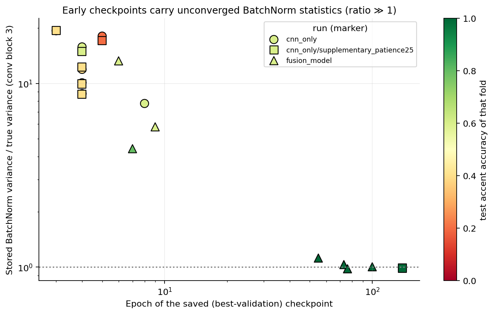

*Figure 28.* Stored BatchNorm running variance relative to the true activation variance, in the last convolution block, against the epoch of the saved checkpoint. Colour shows the test accuracy of that fold.

**Augmentation.** The effect of augmentation can be read from the post-hoc comparison of the fusion network with and without it (same patience of 25 epochs). With augmentation the pooled accuracy was 1.000, and 0 of the seven folds stopped by epoch 30; without it the accuracy was 0.771 and 4 folds stopped by epoch 30. Augmentation was therefore associated with better results and longer training of the fusion network, but we cannot say whether it improved generalisation or merely changed the training dynamics that early stopping reacts to. With one seed per fold and so few recordings, the comparison is suggestive only. The corresponding comparison for the MLP was not run.

### 4.8 Final model selection

We selected the **MLP on the 78 features with the two hierarchical heads** as the final model. The reasons come from the evidence above, and they deliberately do not rest on accuracy alone, because accuracy could not discriminate.

* **Accuracy was equal to the best.** The MLP matched the SVM, with both at 1.000 pooled accuracy, and was at least as good as the fusion network in every fold of every run.
* **It produces probabilities for both heads.** The SVM, as we used it, gives only a class label, whereas the MLP provides output scores for the region and accent heads and fits the hierarchical decoder. We note that these scores are not calibrated: for the MLP the average top score on held-out recordings was 0.999, that is, saturated near 1.
* **It is far cheaper.** The seven folds of the MLP took 83 seconds of training, against 2,092 seconds for the fusion network and 443 seconds for the CNN-only network. The MLP has 10,026 trainable parameters, about 8% of the fusion network's 127,626.
* **Its training was smooth and uniformly successful.** Under the specified settings every fold of the MLP trained for between 63 and 96 epochs and ended with all validation recordings correct, whereas the CNN-based models were sensitive to the early-stopping setting. (We did not vary the MLP's early-stopping setting, so we cannot say how it would react to it.)
* **Inference is simpler.** It needs only the 78 features, which the project already extracts and validates, and no spectrogram pipeline.

The decision does **not** mean that the MLP is the best accent recogniser, nor that spectrogram CNNs are unsuitable: no experiment here could show either. The fusion network remains implemented, documented and evaluated, and it is the natural candidate to retest when there are enough speakers for a CNN branch to have something to learn. The final model was fitted once more on all recordings except 5 validation recordings (30 recordings for fitting) for use in the application; this model has no held-out evaluation, and its expected performance is that of the cross-validated MLP, within the limits already stated.

An additional check relevant to model choice is the additional feature set. We extracted 13 further features (spectral centroid, bandwidth and roll-off, zero-crossing rate, and fundamental-frequency statistics), but did not use them. The mean fundamental frequency, for example, varies by recording between 122 and 262 Hz, and its average for each speaker ranges from 136 to 241 Hz. A feature that differs this much between speakers is a direct speaker signature, and adding it would only strengthen the confound. We also did not test it in a model.

### 4.9 Application implementation results

The selected model is available through the Streamlit application and a command-line script. We tested the application's processing and interface with a script that uses the real model and real recordings (Table 10). The result was 37/37 tests passed. These tests used project recordings, which the final model has seen, so they show that the integration works (decoding, standardisation, feature extraction, saved normalisation, model, hierarchical decision), not that the predictions are accurate on new speakers. The application's result for a file is identical to the command-line script's, and the same pipeline handles other sample rates and channel layouts by standardising them first.

*Table 10.* Frontend tests that were run (all passed).

| Test group | What was checked |
|---|---|
| Valid files | WAV, original M4A, original OGG, MP3, 44.1 kHz stereo WAV, 8 kHz mono WAV: decoded, standardised and classified |
| Consistency | same result as the command-line script `scripts/predict_accent.py` (probability difference 0.0) and as the stored Phase 6 prediction |
| Rejected with a message | unsupported type, empty file, text file named .wav, corrupted M4A, zero-sample WAV, 0.3 s clip, digital silence, 190 s clip |
| Accepted with a warning | near-silent noise, 3 s clip |
| Interface | all four pages render; each sidebar tab switches the page; no radio widget; the gender-related limitation is displayed |

What was **not** tested is equally important: we did not click through the upload widget in a real browser, check the layout visually on different screens, test many simultaneous users, or run the application on recordings from speakers outside the dataset, because none exist. These are untested rather than assumed to work.

---

## 5. CONCLUSION

### 5.1 Summary of the work

We set out to find out whether regional Gujarati accents can be recognised from audio alone, using features measured directly from the recordings and models trained from scratch. We assembled and standardised a dataset of 35 recordings of five accents from five speakers, examined its quality, extracted 78 MFCC-based features, analysed them statistically, explored their structure with PCA, compared an SVM, an MLP, a CNN and a CNN–MLP fusion network under one seven-fold protocol, selected the MLP with region and accent heads, and built a web application around it.

Each stage revealed something that shaped the next. The quality analysis showed that format, sample rate and noise level vary by accent. The feature analysis showed that many features differ strongly between the five groups, and that silence and recording conditions explain part of that. PCA showed that the dominant directions of variation are the five speaker-and-setup groups themselves. The model comparison showed that the simplest models classify held-out recordings of these five voices perfectly, and that the more elaborate neural models were harder to train reliably, partly for a training-stability reason that we could identify but not confirm. The choice of the MLP followed from these findings. What was achieved is a complete, documented and reproducible pipeline, a working prototype, and a clear understanding of what this dataset can and cannot say.

### 5.2 Limitations

1. **One speaker per accent.** Accent, speaker, device, session and wording are completely confounded. Every cluster, every feature difference and every high score has an alternative explanation in terms of the individual speaker or recording setup.
2. **Recording-level evaluation.** Held-out recordings come from the same speakers as the training recordings, so the evaluation cannot establish generalisation to unseen speakers. Several models score 100%, so the evaluation cannot even rank them, and the tiny test folds (five recordings each) make fold-wise figures coarse.
3. **Speaker and accent identity are confounded** in the PCA as well: the leading components are group axes, and the model may be recognising voices.
4. **Potential gender-related bias.** Differences in speaker gender and in gender-associated vocal characteristics, such as pitch range and voice quality, could influence the acoustic features and potentially lead to biased accent predictions. Gender-independent performance has not been established, because the dataset has insufficient speaker diversity. We did not record speaker gender, and we do not claim that any bias was observed or measured. Our data merely show that the speakers differ a great deal in voice pitch (average fundamental frequency between 136 and 241 Hz), which is the kind of difference this limitation is about [12], [13].
5. **Recording conditions.** Device, format, sample rate, background noise and recording session differ across accents; the Surti recordings come from a different session and are the noisiest, and our speech detector fails on them. The models may exploit such differences.
6. **One accent per region.** The two heads are equivalent, so the ability to discriminate several accents within a region has not been demonstrated, even though the decoder supports it.
7. **Experiments not conducted.** We did not run the MLP with the additional features, the MLP and CNN without augmentation, a test of a BatchNorm fix, repeated runs with several random seeds, the classical random forest and logistic regression models from the original proposal, or any speaker-independent evaluation. The post-hoc runs were chosen after seeing the original results.
8. **Scores are not calibrated probabilities,** and the application should not be read as saying how likely it is that a prediction is right.
9. **Small dataset and short, clean-prompt recordings** (about 7.4 minutes in all); the features are summary statistics over whole recordings and say nothing about phonetic content or rhythm.

### 5.3 Future scope

The most important next step is a dataset in which accent is no longer confounded with speaker. This would mean collecting many speakers per accent, with more recordings per speaker, recorded as far as possible on the same device and under similar conditions; improving gender, age and demographic diversity and recording that information; broadening the regional coverage within Gujarat and adding further accent varieties; and ensuring regions that contain several accents, so that the hierarchical head can be tested properly. With such data, a speaker-independent evaluation (training and testing on different speakers, for example by leaving one speaker out at a time) becomes possible, and that is the only kind of result that can support a claim about accent recognition. Methodologically, the BatchNorm hypothesis should be tested directly; the fusion network should be re-evaluated on a larger dataset with repeated runs; the additional spectral and pitch features should be examined once speaker effects can be controlled; and robustness across recording devices and noise conditions should be measured explicitly.

### 5.4 Closing remarks

The project began with the hope of a classifier that recognises Gujarati regional accents. What we have is smaller and, we think, more useful: a careful, transparent pipeline, a working prototype, and strong evidence about the data's limitations. The simplest model was the one we could most readily justify, and the most instructive result is arguably the way every analysis, from the quality checks to the PCA, pointed at the same issue, the missing second speaker. We hope the paper helps the next, larger study avoid starting from the same constraint.

---

## REFERENCES

[1] G. Cardona and B. Suthar, "Gujarati," in *The Indo-Aryan Languages*, G. Cardona and D. Jain, Eds. London, U.K.: Routledge, 2003, pp. 659–697.

[2] R. Mesthrie and V. Chavda, "Cape Town Gujarati and its relation to Gujarati dialectology: A study of retroflex boosting," *Journal of South Asian Languages and Linguistics*, vol. 7, no. 1, pp. 1–14, 2021, doi: 10.1515/jsall-2020-2022.

[3] M. M. Shah and H. R. Kavathiya, "Voice recognition for Gujarati dialects: An in-depth survey," *International Journal of Computer Applications*, vol. 186, no. 5, pp. 1–4, Jan. 2024, doi: 10.5120/ijca2024923112.

[4] A. Chittora and H. A. Patil, "Classification of phonemes using modulation spectrogram based features for Gujarati language," in *Proc. Int. Conf. Asian Language Processing (IALP)*, Kuching, Malaysia, 2014, pp. 46–49, doi: 10.1109/IALP.2014.6973506.

[5] S. B. Davis and P. Mermelstein, "Comparison of parametric representations for monosyllabic word recognition in continuously spoken sentences," *IEEE Trans. Acoust., Speech, Signal Process.*, vol. 28, no. 4, pp. 357–366, Aug. 1980, doi: 10.1109/TASSP.1980.1163420.

[6] S. Furui, "Speaker-independent isolated word recognition using dynamic features of speech spectrum," *IEEE Trans. Acoust., Speech, Signal Process.*, vol. 34, no. 1, pp. 52–59, Feb. 1986, doi: 10.1109/TASSP.1986.1164788.

[7] S. Shon, A. Ali, and J. Glass, "Convolutional neural networks and language embeddings for end-to-end dialect recognition," in *Proc. Odyssey 2018: The Speaker and Language Recognition Workshop*, Les Sables d'Olonne, France, 2018, pp. 98–104, doi: 10.21437/Odyssey.2018-14.

[8] S. Darshana *et al.*, "MARS: A hybrid deep CNN-based multi-accent recognition system for English language," in *Proc. Int. Conf. Advances in Information Technology and Pattern Recognition (ICAITPR)*, 2022, doi: 10.1109/ICAITPR51569.2022.9844177.

[9] C. Cortes and V. Vapnik, "Support-vector networks," *Machine Learning*, vol. 20, no. 3, pp. 273–297, 1995, doi: 10.1007/BF00994018.

[10] S. Hershey *et al.*, "CNN architectures for large-scale audio classification," in *Proc. IEEE Int. Conf. Acoustics, Speech and Signal Processing (ICASSP)*, 2017, arXiv:1609.09430.

[11] D. S. Park *et al.*, "SpecAugment: A simple data augmentation method for automatic speech recognition," in *Proc. Interspeech 2019*, 2019, pp. 2613–2617, arXiv:1904.08779.

[12] I. R. Titze, "Physiologic and acoustic differences between male and female voices," *J. Acoust. Soc. Am.*, vol. 85, no. 4, pp. 1699–1707, Apr. 1989, doi: 10.1121/1.397959.

[13] R. Tatman, "Gender and dialect bias in YouTube's automatic captions," in *Proc. First ACL Workshop on Ethics in Natural Language Processing*, Valencia, Spain, Apr. 2017, pp. 53–59, doi: 10.18653/v1/W17-1606.

[14] B. McFee, C. Raffel, D. Liang, D. P. W. Ellis, M. McVicar, E. Battenberg, and O. Nieto, "librosa: Audio and music signal analysis in Python," in *Proc. 14th Python in Science Conf. (SciPy)*, Austin, TX, USA, 2015, doi: 10.25080/Majora-7b98e3ed-003.

[15] I. T. Jolliffe and J. Cadima, "Principal component analysis: A review and recent developments," *Phil. Trans. R. Soc. A*, vol. 374, no. 2065, art. 20150202, Apr. 2016, doi: 10.1098/rsta.2015.0202.

[16] S. Ioffe and C. Szegedy, "Batch normalization: Accelerating deep network training by reducing internal covariate shift," in *Proc. 32nd Int. Conf. Machine Learning (ICML)*, PMLR vol. 37, 2015, pp. 448–456.

[17] N. Srivastava, G. Hinton, A. Krizhevsky, I. Sutskever, and R. Salakhutdinov, "Dropout: A simple way to prevent neural networks from overfitting," *J. Mach. Learn. Res.*, vol. 15, pp. 1929–1958, 2014.

[18] D. P. Kingma and J. Ba, "Adam: A method for stochastic optimization," in *Proc. 3rd Int. Conf. Learning Representations (ICLR)*, San Diego, CA, USA, 2015, arXiv:1412.6980.
